# Lab 04 Practical Report: Amazon ECS and Deploying the USMS Enrolment Service on Fargate

## 1. Aim / Objective

The aim of this lab is to run the University Student Management System (USMS) **enrolment service** as containers on **Amazon ECS with AWS Fargate**, inside the private subnets built in Lab 02, using only the AWS CLI on the local emulator Floci.

The specific objectives were to:

- Understand the four ECS objects (**cluster, task definition, task, service**) and know which one gets scaled.
- Understand what Fargate takes away from the EC2 model (servers) and what it does not (networking, security groups, IAM).
- Write and register a task definition that uses `awsvpc` networking, a valid Fargate CPU/memory size, two IAM roles and the `awslogs` log driver.
- Know the difference between the **task execution role** and the **task role**.
- Create an ECS service across two private subnets with no public IP, protected by a security group that only accepts traffic from the web tier.
- Read the four service numbers: `desiredCount`, `runningCount`, `pendingCount` and `status`.
- Save all outputs into `configs/lab-04.env` for Labs 05 and 06, and check the whole lab with a verification script.

## 2. Introduction

**Amazon Elastic Container Service (ECS)** is the AWS service for running containers. A container packages an application together with everything it needs (code, libraries, settings), so it runs the same way everywhere. ECS decides where containers run, restarts them when they fail and keeps the right number of copies running.

**AWS Fargate** is a way to run ECS containers *without managing any servers*. With EC2 (Lab 03) we had to choose an AMI, patch the operating system and plan the server size. With Fargate we only say "this container needs 0.25 vCPU and 512 MiB of memory" and AWS finds the capacity.

ECS is built from four objects:

| Object | Simple meaning | Comparison with EC2 (Lab 03) |
|---|---|---|
| **Cluster** | A named group where services and tasks live. On Fargate it has no servers and costs nothing by itself. | Like a folder or namespace |
| **Task definition** | A versioned blueprint: image, CPU, memory, ports, roles, logging. It never changes; a change creates a new revision. | Like an AMI + launch settings |
| **Task** | One running copy of a task definition. Each task gets its own network card (ENI) and private IP. | Like one EC2 instance |
| **Service** | A controller that keeps the number of running tasks equal to `desiredCount` and replaces failed tasks. | Like an Auto Scaling group |

ECS tasks use **two different IAM roles**, which was one of the most important ideas in this lab:

| | Task execution role | Task role |
|---|---|---|
| Who uses it | ECS / Fargate itself, *before* the container starts | The application code *inside* the container |
| What for | Pull the container image, write logs | Call AWS services such as S3 |
| Field in task definition | `executionRoleArn` | `taskRoleArn` |
| What happens if it is wrong | The task never starts | The task starts, then gets `AccessDenied` |

ECS matters in cloud computing because containers start in seconds, use resources efficiently and can be scaled by changing a single number. It is widely used for microservices, APIs and background workers.

This lab was done on **Floci**, a local AWS emulator. Floci stores ECS configuration (clusters, task definitions, services, counts) correctly, but it does not run real Fargate containers, serve task credentials or enforce security groups. Where Floci could not show something, the expected AWS behaviour is explained.

## 3. Use Case

**USMS use case:** During enrolment week, thousands of students click "Register for this module" at the same time. The two fixed-size EC2 servers from Lab 03 cannot handle this sudden spike. So the enrolment API is moved into containers:

- It runs as an ECS **service** (`usms-enrolment-svc`) with **two tasks**, one in each Availability Zone, so one AZ failing does not stop enrolment.
- The tasks are in **private subnets** with no public IP. Only the web server (`usms-app-sg`) can call them on port 80.
- The tasks use the **same S3 permission** (`USMSStudentDataReadWrite`) that the EC2 web server uses, to read and write student data.
- In Lab 06, auto scaling will raise `desiredCount` during enrolment week and lower it afterwards. Nothing else needs to change.

**Other real-world uses of ECS / Fargate:**

- Running microservices for e-commerce sites (cart, payment, search) that each scale independently.
- Running REST APIs behind a load balancer.
- Running background jobs such as image processing, sending emails or nightly reports.
- Moving an existing application from servers into containers without managing the servers.

## 4. System Architecture / Design

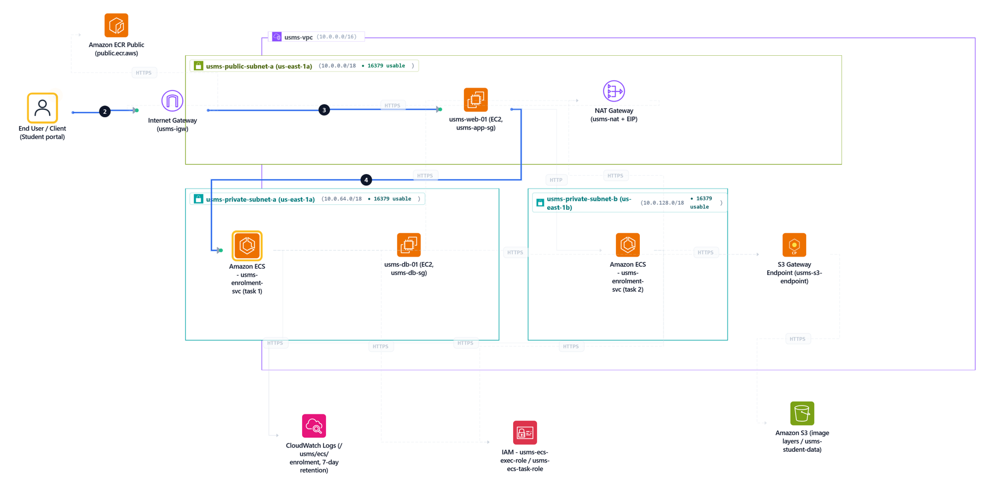

**How it works in simple words:**

1. A student opens the USMS portal. The request comes from the internet through the **Internet Gateway** (`usms-igw`).
2. It reaches the web server `usms-web-01` in the **public subnet**, which is protected by `usms-app-sg`.
3. The web server calls the **enrolment service** on port 80. The two ECS tasks live in `usms-private-subnet-a` (us-east-1a) and `usms-private-subnet-b` (us-east-1b).
4. The tasks are protected by `usms-enrolment-sg`, which **only** accepts port 80 from `usms-app-sg`. Nothing from the internet (`0.0.0.0/0`) is allowed.
5. To pull the container image from **Amazon ECR Public**, the tasks go out through the private route table → **NAT Gateway** (`usms-nat`) → Internet Gateway. Image layers can also come through the **S3 gateway endpoint**.
6. The containers write their logs to **CloudWatch Logs** (`/usms/ecs/enrolment`, kept for 7 days).
7. **IAM:** ECS uses `usms-ecs-exec-role` to pull the image and write logs. The application uses `usms-ecs-task-role` to access the `usms-student-data` S3 bucket.

## 5. Implementation Procedure

### Step 1: Resume the environment and load three env files

ECS depends on the IAM work (Lab 01), the network (Lab 02) and the web server (Lab 03). I started Floci, loaded `course.env`, `lab-01.env`, `lab-02.env` and `lab-03.env`, and ran `whoami.sh`. The account is `000000000000`, which confirms I am talking to Floci and not real AWS. All eight values this lab needs were filled in, including **both** private subnets (`subnet-d41ed02b` and `subnet-811295b5`), the app security group, VPC, NAT gateway and web instance.

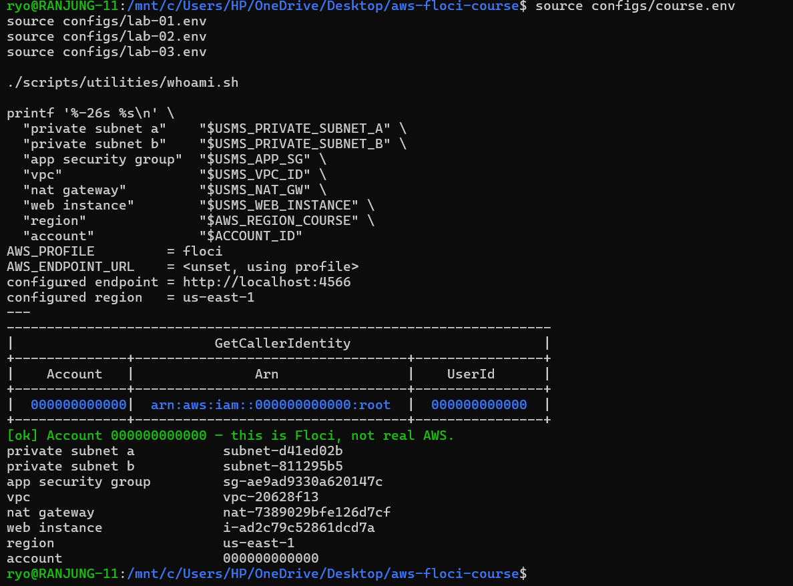

### Step 2: Confirm Labs 2 and 3 are still intact

Before building on top of earlier labs, I checked that they were still correct, using `verify-lab-02.sh` and `verify-lab-03.sh`. Two things matter most for this lab: the private route table must **not** have a route to the Internet Gateway, and `usms-web-01` must carry `usms-app-sg`. The final verification script (see Verification below) re-checks these dependencies and they all passed.

### Step 3: Probe what this Floci build actually supports

Floci does not support every AWS API, so I tested which ECS, Application Auto Scaling, CloudWatch and CloudWatch Logs calls work.

- **ECS:** `list-clusters` and `register-task-definition` are supported. `describe-services` showed "not available" only because the probe asked for a cluster called `probe` that does not exist; it worked normally later in Step 11.
- **Application Auto Scaling:** scalable targets and scaling policies are supported; scheduled actions are not.
- **CloudWatch and CloudWatch Logs:** all supported.

So this Floci build follows **Path A (full support)** for this lab. The one gap is scheduled actions, which only matters for Lab 06.

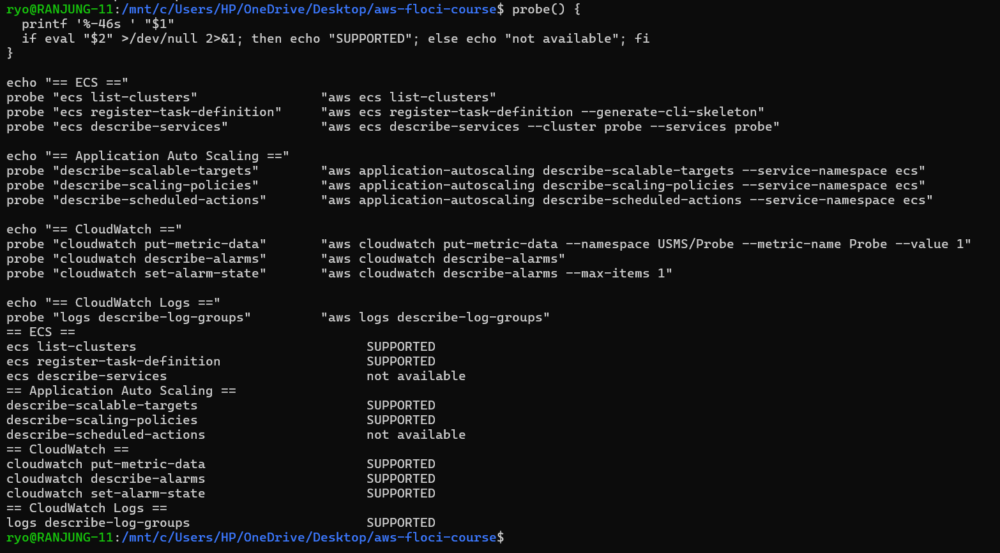

### Step 4: Create the ECS cluster, as the developer role

Creating infrastructure is a developer's job, so I used the least-privilege `usms-developer-role` from Lab 01 instead of the root identity.

**Part 1: assume the role.** I used `sts assume-role` and saved the temporary credentials to `outputs/lab-04-assumed-role.json` with permission `600`. After exporting them, `get-caller-identity` showed `assumed-role/usms-developer-role`.

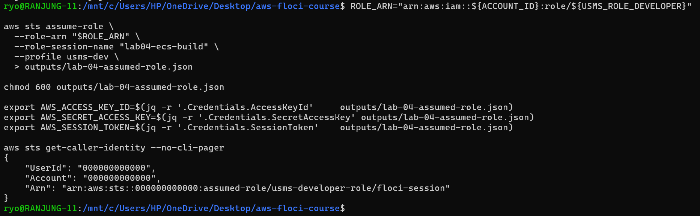

**Part 2: create the cluster.** I created `usms-ecs-cluster` with **Container Insights enabled**, because Lab 06 needs its CPU metric for auto scaling. Note: ECS tags use lowercase `key=`/`value=`, unlike EC2 which uses `Key=`/`Value=`.

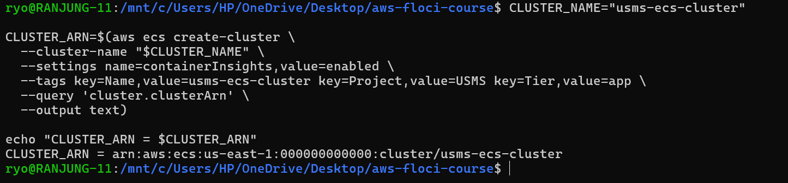

**Part 3: restore my normal identity.** I unset the three `AWS_*` credential variables. This is important because these variables override the profile and expire after one hour, which would cause confusing errors later.

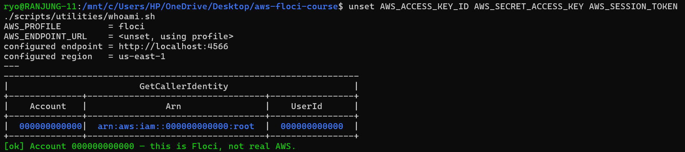

**Verify:** the cluster is `ACTIVE`, has 0 services and 0 tasks (expected at this point), and `containerInsights` is `enabled`.

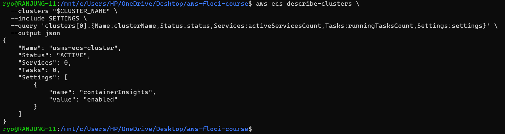

### Step 5: Create the log group the tasks will write to

I created the log group `/usms/ecs/enrolment` and set a **7-day retention policy**. Without retention, CloudWatch keeps logs forever and you keep paying for them. The read-back shows the group with retention `7`.

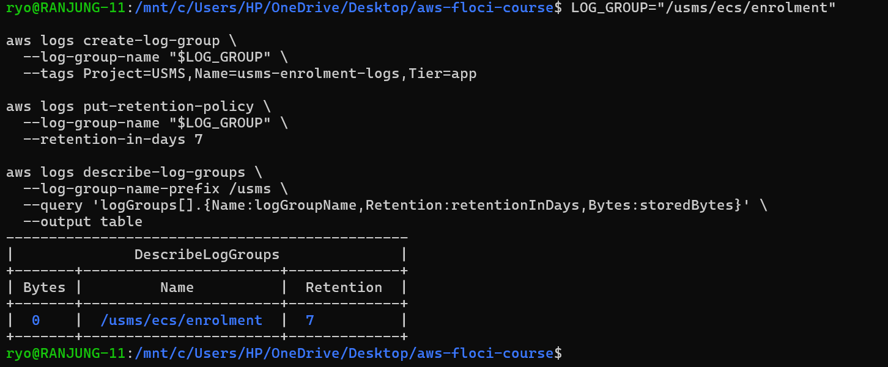

### Step 6: Create the task execution role

**Part 1: the trust policy.** I wrote `policies/trust-ecs-tasks.json`, which allows only the service `ecs-tasks.amazonaws.com` to assume the role.

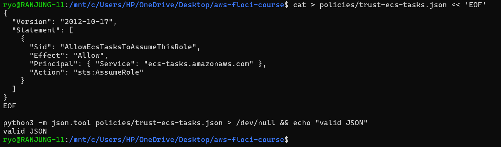

**Part 2: create the role.** I created `usms-ecs-exec-role` with this trust policy.

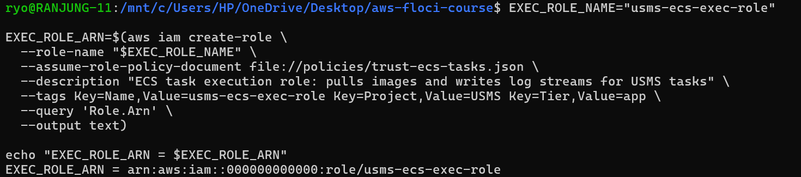

**Part 3: least-privilege permissions.** I wrote the customer-managed policy `USMSECSTaskExecution` with two statements:

- **PullContainerImages:** the four ECR actions needed to pull an image. `ecr:GetAuthorizationToken` does not support resource-level permissions, so `Resource` must be `*`.
- **WriteTaskLogsToItsOwnGroupOnly:** `logs:CreateLogStream` and `logs:PutLogEvents`, limited to the `/usms/ecs/enrolment` log group only.

I checked the file was valid JSON, created the policy and attached it.

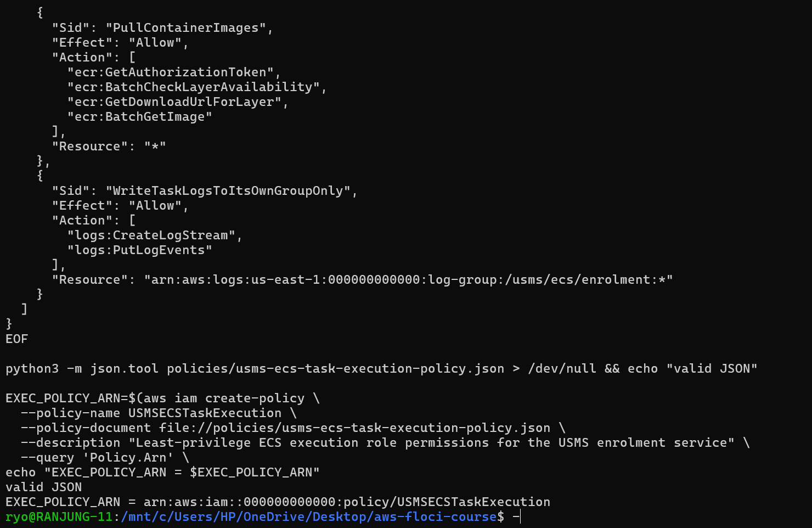

**Verify:** the trust principal is `ecs-tasks.amazonaws.com` and the attached policy is `USMSECSTaskExecution`.

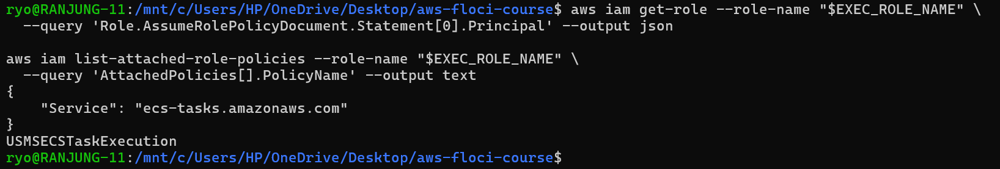

### Step 7: Create the task role, and reuse Lab 1's policy on it

I created `usms-ecs-task-role` using the **same** trust policy and attached Lab 01's `USMSStudentDataReadWrite` policy. This shows that one permission can serve both an EC2 instance (through an instance profile) and a container (through a task role).

When I ran the command a second time, two errors appeared (explained in Section 7). The final table still proves that `USMSStudentDataReadWrite` is attached to the role.

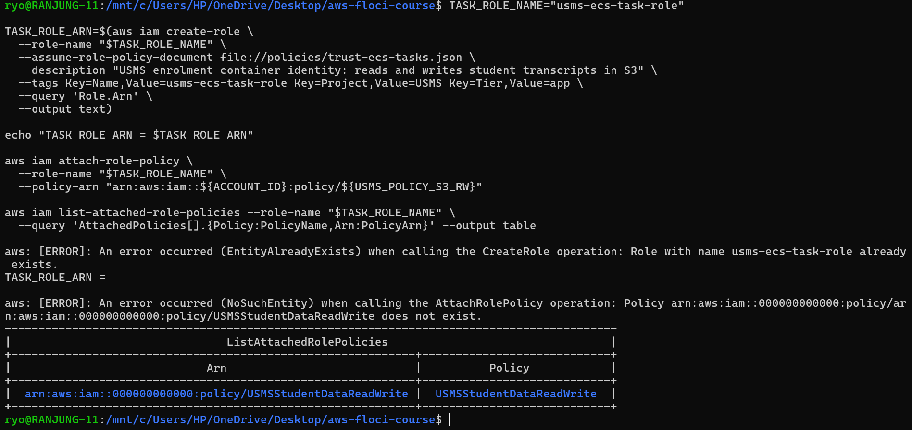

Because `TASK_ROLE_ARN` was empty after the failed `create-role`, I read the ARN back with `get-role`:

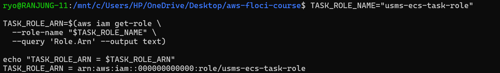

I also saved the policy document to confirm what the task role can do: list the bucket, read/write/delete objects inside `usms-student-data`, and it is **denied** from deleting the bucket itself.

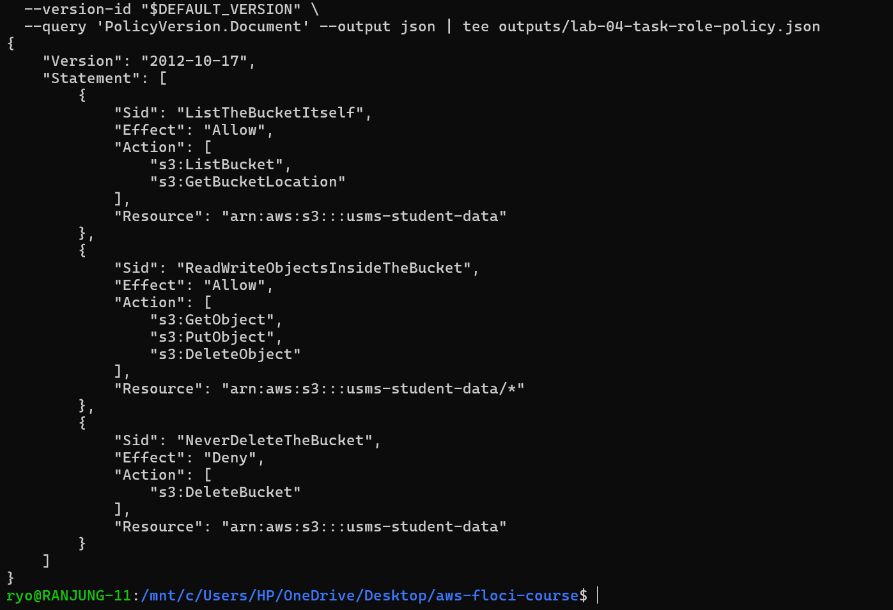

### Step 8: Create the enrolment security group, sourced from the web tier's group

I created `usms-enrolment-sg` in `usms-vpc` and added **one** inbound rule: TCP port 80, with the source set to the **security group ID** of `usms-app-sg`, not an IP range (CIDR). Fargate tasks get new IP addresses every time they start, so a group reference is the only rule that keeps working when tasks are replaced or scaled.

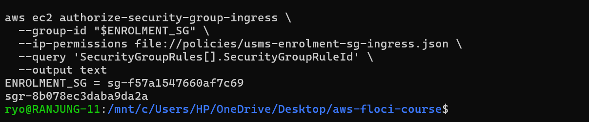

The read-back shows port 80 from `sg-ae9ad9330a620147c` (`usms-app-sg`), with `FromCIDR: null`.

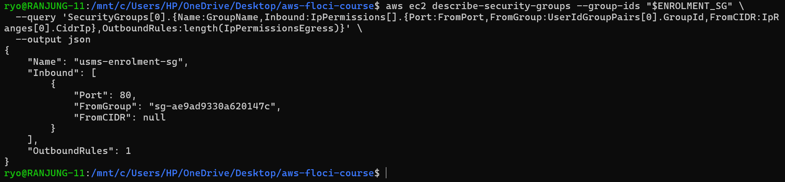

### Step 9: Write and register the task definition

**Part 1: write the document.** I wrote `templates/lab-04-taskdef.json`:

- Family `usms-enrolment`, `networkMode: awsvpc`, `requiresCompatibilities: FARGATE`.
- `cpu: "256"` and `memory: "512"`. These must be **strings** and must be a valid Fargate pair.
- `executionRoleArn` and `taskRoleArn` set to the two different roles.
- One container `enrolment-api` using the placeholder image `public.ecr.aws/nginx/nginx:stable-alpine` on port 80.
- `awslogs` log driver sending logs to `/usms/ecs/enrolment`.

The file is valid JSON, and `grep -c '\$'` printed `0`, which proves every shell variable was expanded.

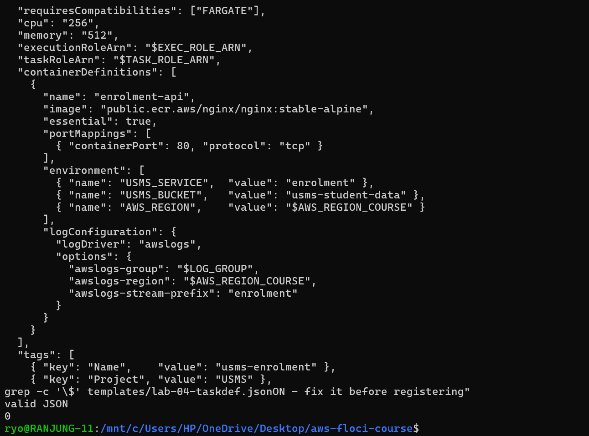

**Part 2: register it.** ECS returned `usms-enrolment:1`, which is **revision 1** of the family.

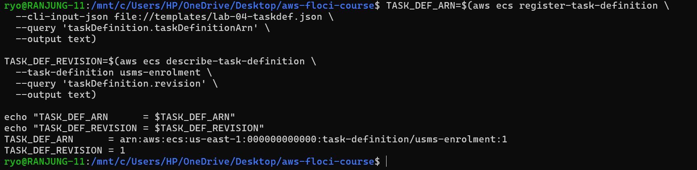

### Step 10: Create the service in Lab 2's private subnets

I created `usms-enrolment-svc` with:

- `--desired-count 2` and `--launch-type FARGATE`
- both private subnets, `usms-enrolment-sg`, and `assignPublicIp=DISABLED`
- tags propagated from the service to its tasks

The tasks have no public IP, so they can only pull the image because Lab 02's private route table sends outbound traffic through the NAT gateway. Without that, tasks would fail with image-pull timeouts.

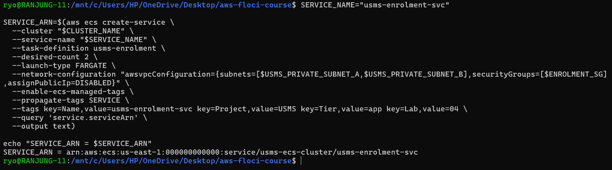

I waited with `aws ecs wait services-stable`, and it printed `service stable`.

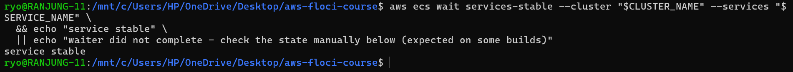

### Step 11: Read the service back, and learn the four numbers

`describe-services` shows exactly what I asked for:

| Field | Value | Meaning |
|---|---|---|
| Status | `ACTIVE` | The service exists and is working |
| Desired | `2` | How many tasks I want (the only number scaling changes) |
| Running | `2` | How many tasks are actually running |
| Pending | `0` | How many tasks are still starting |
| TaskDef | `usms-enrolment:1` | Blueprint used |
| Launch | `FARGATE` | No servers to manage |
| Subnets | `subnet-d41ed02b`, `subnet-811295b5` | Two private subnets in two AZs |
| SG | `sg-f57a1547660af7c69` | `usms-enrolment-sg` |
| PublicIP | `DISABLED` | Not reachable from the internet |

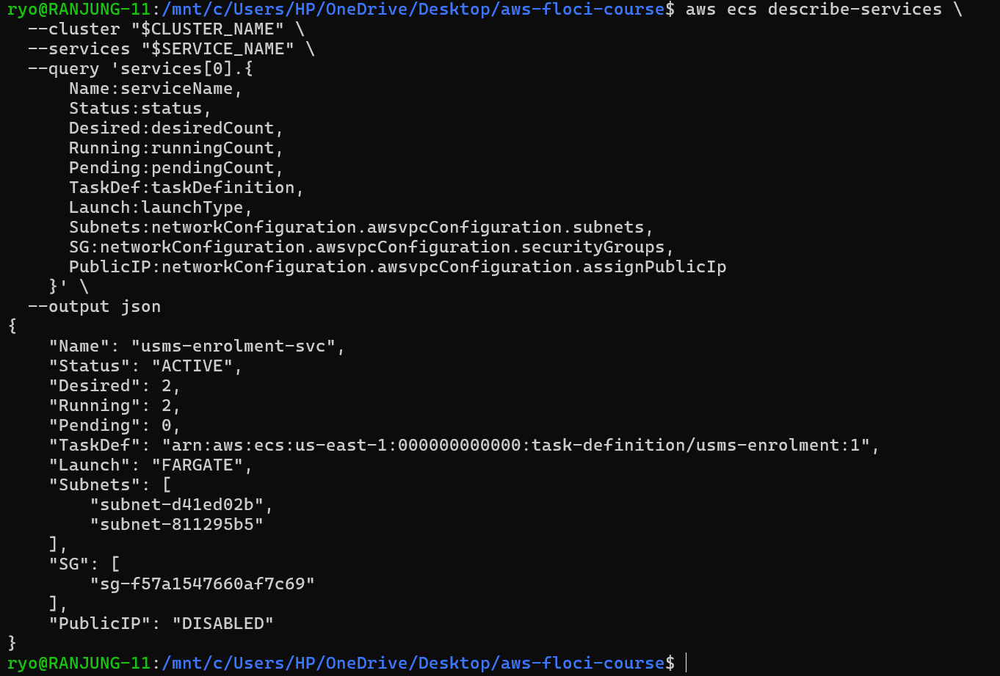

`list-tasks` returned `2` tasks. The service events returned `None`, because this Floci build does not record service events.

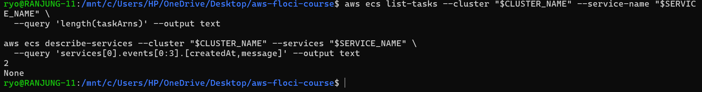

### Step 11 "Your turn": scale by hand

This exercise changes the service to `--desired-count 3` with `aws ecs update-service`, waits for it to settle, and then sets it back to `2`. This is **manual scaling**: only `desiredCount` changes, and the task definition stays the same. Lab 06 will do exactly the same thing automatically.

<!-- Add a screenshot of update-service --desired-count 3 and back to 2 here -->

### Step 12: Write configs/lab-04.env

I wrote `configs/lab-04.env` with an unquoted heredoc, so every value was **looked up from the API** at write time instead of being typed by hand. For example, the baseline desired count is read from the service, not hard-coded.

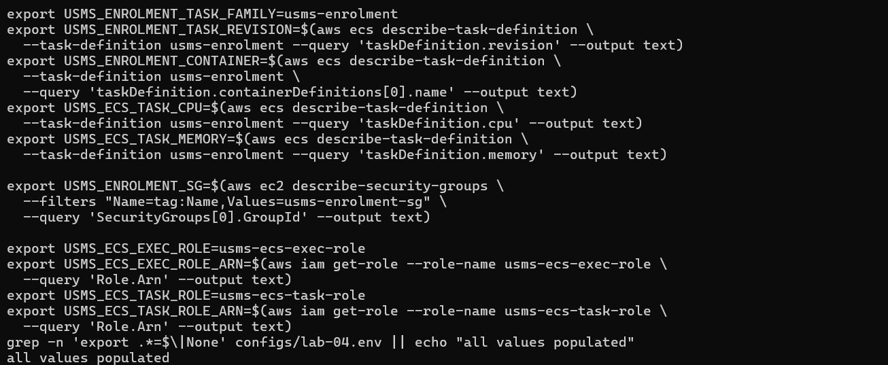

After sourcing the file, all values were filled in and `grep -c '^export'` counted **17 exports**, as expected.

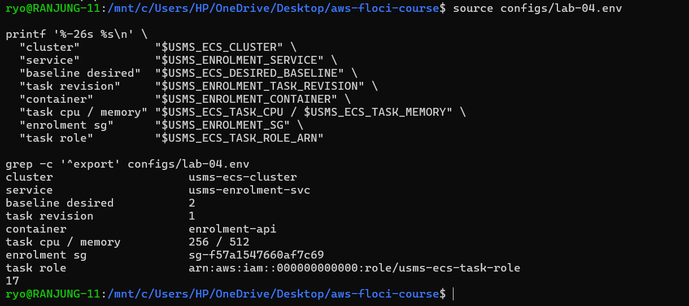

### Step 13: Commit

**Part 1: look before you add.** `git status` showed the new lab files, policies and template, and **nothing under `outputs/`**. `git check-ignore -v` proved that `outputs/lab-04-assumed-role.json` (which contains temporary credentials) is ignored by rule `outputs/*` on line 35 of `.gitignore`.

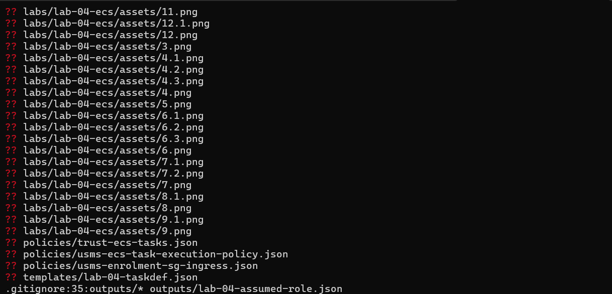

**Part 2: commit.** I staged the files by name (not `git add -A`) so that no secret could be committed by mistake, then committed them.

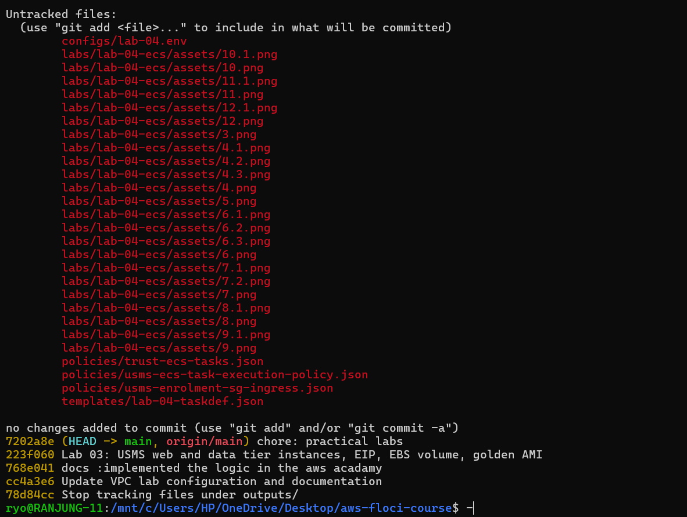

### Verification

I ran `scripts/utilities/verify-lab-04.sh`, which runs 38 checks in seven groups (environment, Lab 01–03 dependencies, IAM, logging, ECS, networking, and files/Git hygiene). The result was **PASS=38, FAIL=0**.

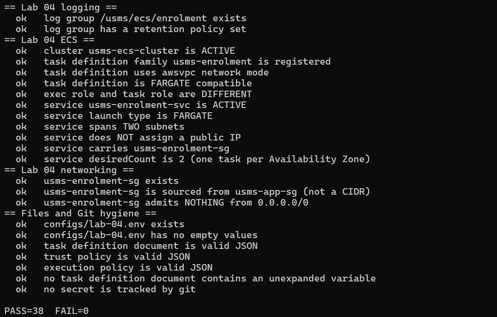

## 7. Analysis and Discussion

### 7.1 What was achieved

In this lab, I deployed the USMS enrolment service on Amazon ECS using Fargate. By the end of the lab:

- The ECS cluster `usms-ecs-cluster` was created with Container Insights turned on.
- The service `usms-enrolment-svc` was running **two tasks**, one in each private subnet, so the enrolment API is spread across **two Availability Zones**.
- The tasks have **no public IP** and can only be reached from the web server through `usms-app-sg`.
- The log group `/usms/ecs/enrolment` was created with a **7-day retention** policy.
- Two separate IAM roles were created: one for ECS (execution role) and one for the application (task role).
- All important values were saved in `configs/lab-04.env` for Lab 05 and Lab 06.

### 7.2 Observations

- **Scaling only changes one number.** The service's `desiredCount` is the only value that changes when scaling. The task definition is a fixed blueprint (like an AMI in Lab 03) and is never edited. The service just runs more or fewer copies of it.
- **Fargate removes servers, not networking.** I did not choose an AMI or instance type, but I still needed subnets, route tables, a NAT gateway, security groups and IAM roles. Tasks follow the same VPC rules as EC2 instances.
- **Two roles, two jobs.**
  - The **execution role** is used by ECS to pull the image and write logs. If it is wrong, the task **never starts**.
  - The **task role** is used by the application to access S3. If it is wrong, the task starts but gets **`AccessDenied`**.
  - Keeping them separate makes problems easier to find and follows **least privilege**.
- **Security group reference instead of an IP range.** Fargate tasks get a new IP address every time they start, so an IP-based rule would break. Referencing `usms-app-sg` works for any number of tasks, which is essential when Lab 06 adds auto scaling.
- **One policy, two types of compute.** The same `USMSStudentDataReadWrite` policy from Lab 01 now works for both:
  - the **EC2 web server**, through an instance profile, and
  - the **container tasks**, through the task role.

  Neither stores access keys on disk. When Lab 10 creates the `usms-student-data` bucket, both will work without any change to the policy or code.

## 8. Reflection

### What I learned about ECS

Before I started this lab, I thought a container was just a smaller version of an EC2 server. While doing the lab, I realised that ECS works very differently. I created the cluster first and was surprised that it had no servers in it at all. It was only a name where my service could live. When I wrote the task definition, I understood that it is a blueprint, just like the AMI I made in Lab 03, and when I registered it, ECS gave it revision 1 instead of letting me change it. The moment that made everything clear for me was in Step 11, when I read back the service and saw `Desired: 2` and `Running: 2`. I understood that the service's job is simply to keep these two numbers equal, and that scaling only means changing the desired number.

I also learned why ECS needs two roles. At first I did not see why I needed both `usms-ecs-exec-role` and `usms-ecs-task-role`, since I gave them the same trust policy. After writing the execution policy myself, I understood that the execution role is for ECS to pull the image and write logs, and the task role is for my application to use S3. I understand it like the trust policy says *who* can use the role, and the permissions policy says *what* the role can do.

### Challenges I faced

The biggest challenge I faced was in Step 7. I ran the task role commands a second time and got two errors, `EntityAlreadyExists` and `NoSuchEntity`. At first I panicked because I thought I had broken something. When I read the errors slowly, I understood that the role already existed from my first run, and that my `USMS_POLICY_S3_RW` variable already held the full ARN, so the ARN was written twice. I checked the attached policies and saw that the policy was already there, so nothing was actually broken. This taught me to read error messages carefully, to check what is inside a variable before using it, and to always read a resource back instead of guessing.

## 9. Conclusion

In this lab I deployed the USMS enrolment service on Amazon ECS with Fargate using the AWS CLI. All objectives were achieved: I created the cluster as the developer role, a log group with retention, separate execution and task roles, a security group that only trusts the web tier, a Fargate task definition, and a service running two tasks across two private subnets with no public IP. Every resource was read back to prove it was correct, and the verification script passed all **38 of 38** checks.

The key concepts I learned are the four ECS objects, the fact that only the service's `desiredCount` changes when scaling, the difference between the task execution role and the task role, and why security group references are needed when IP addresses keep changing. The skills I practised include assuming roles, writing least-privilege IAM policies, JSON templates, JMESPath queries and safe Git practice. ECS is important because it lets applications scale quickly without managing servers, and this lab prepares the ground for the load balancer in Lab 05 and auto scaling in Lab 06.