# Lab 04 Exercises: Amazon ECS on Fargate

This file covers the **Step 11 "Your turn"** task and the five **Independent Lab Exercises** of Lab 04. All commands were run with the AWS CLI against Floci (account `000000000000`), after loading `course.env` and `lab-01.env` to `lab-05.env`.

---

## Step 11 "Your turn": scaling by hand

**Task:** Change the enrolment service from 2 tasks to 3 using `aws ecs update-service`, wait for it to settle, and then set it back to 2.

**What I did:** I ran `update-service --desired-count 3` on `usms-enrolment-svc`, waited with `aws ecs wait services-stable`, and read the service back. It showed **Desired 3, Running 3, Pending 0**. The task definition was still `usms-enrolment:1`.

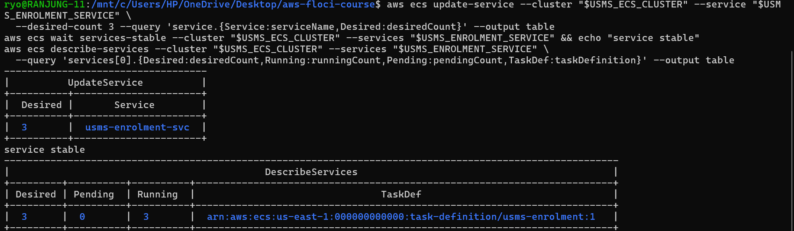

Then I set it back to `--desired-count 2`. After the wait, the service showed **Desired 2, Running 2, Pending 0**.

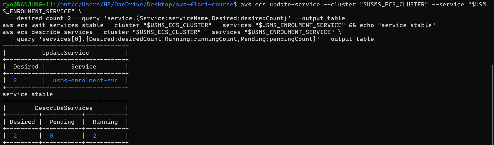

**What I learned:** Scaling only changed **one number**, `desiredCount`. The task definition stayed exactly the same. This is manual scaling, and in Lab 06 auto scaling does the same thing automatically. I had to put it back to 2 because `verify-lab-04.sh` checks that the baseline is 2 (one task per Availability Zone).

---

## Exercise 1: A second service, deployed

**Task:** Create a second service `usms-results-svc` in the same cluster, from the same `usms-enrolment` task definition family, with 1 task, both private subnets and `usms-enrolment-sg`. Tag it `Project=USMS`, `Tier=app`, `Lab=04`, `Service=results`, and do not record it in `configs/lab-04.env`.

**What I did:** I reused the Step 10 `create-service` command and only changed four things: the **service name**, the **desired count** (1 instead of 2), the **tags** (added `Service=results`) and the variable that stores the ARN. I captured the ARN with `--query 'service.serviceArn'` instead of copying it by hand. The service became stable.

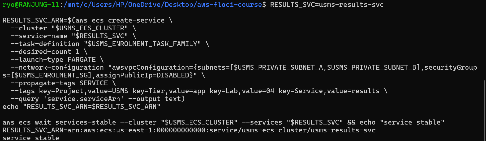

**Result:** `describe-services` now shows **two ACTIVE services** in the cluster with different names and desired counts. Both have `PublicIP: DISABLED`. `list-tags-for-resource` shows the four tags I set.

| Service | Desired | Running | Status | Public IP |
|---|---|---|---|---|
| `usms-enrolment-svc` | 2 | 2 | ACTIVE | DISABLED |
| `usms-results-svc` | 1 | 1 | ACTIVE | DISABLED |

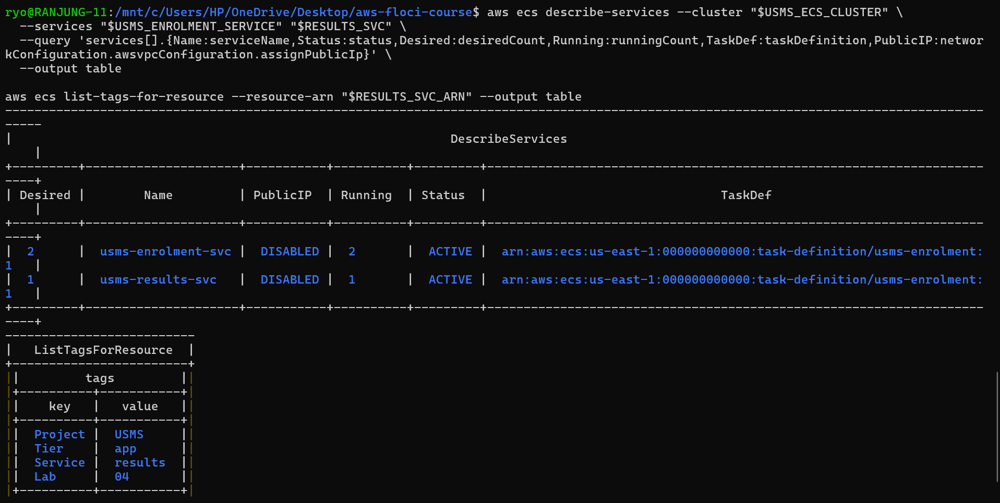

**What I learned:** One task definition can be used by many services. The service decides *how many* copies run and *where*. The task definition only decides *what* runs.

---

## Exercise 2: A new revision, and a deployment that does not drop traffic

**Task:** Register `usms-enrolment:2` from a copy of the template, with memory raised from 512 to 1024 MiB and a new environment variable `USMS_LOG_LEVEL=info`. Then move the service to revision 2 and show that revision 1 still exists.

**What I did:**

1. I kept the original template as `templates/lab-04-taskdef-rev1.json`.
2. I made `templates/lab-04-taskdef-rev2.json` with a small Python script. It only changed `memory` to `"1024"` and added `USMS_LOG_LEVEL=info`. 256 CPU with 1024 MiB is still a valid Fargate size.
3. I checked the new file was valid JSON and used `diff` to confirm that only those two things changed.

<!-- assets/ex2.png (the diff screenshot) is empty. Retake it and it will show here. -->


4. I registered it and ECS returned `usms-enrolment:2`. Then I ran `update-service --task-definition` with the new ARN and waited with `services-stable` (not a fixed `sleep`).

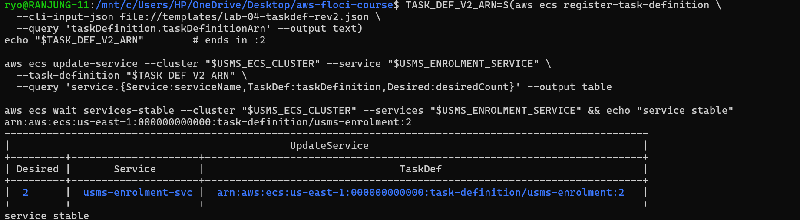

**Result:**

| Check | Value |
|---|---|
| Service task definition | `usms-enrolment:2` |
| Desired / Running | 2 / 2 |
| Deployments | 1 (the rollout finished) |
| Revision 1 | 256 CPU, **512** MiB, **ACTIVE** |
| Revision 2 | 256 CPU, **1024** MiB, **ACTIVE** |
| New env var | `USMS_LOG_LEVEL = info` |

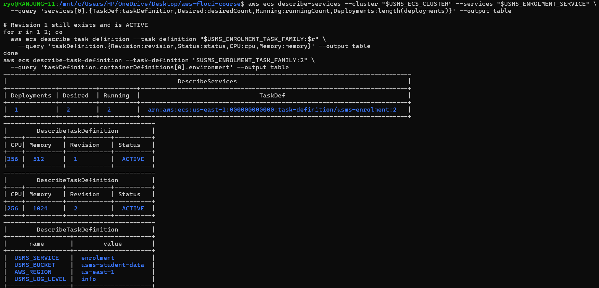

**One sentence:** Only the service's `taskDefinition` pointer changed from `usms-enrolment:1` to `usms-enrolment:2`. The desired count, subnets, security group and service name stayed the same, and revision 1 was not edited. It is still ACTIVE, so I can roll back by pointing the service at `:1` again.

**Why no traffic is dropped:** During a rolling deployment ECS starts the new tasks first and only stops the old ones after the new ones are running. So there is always a task available to answer requests.

---

## Exercise 3: An ECS configuration drift report

**Task:** Write `scripts/utilities/lab-04-ecs-inventory.sh`. It must print one line per service with desired/running counts, the task definition, a `roles` verdict and a `publicip` verdict, and also save the same data as JSON.

**How the script works:**

- It finds the repo folder from `${BASH_SOURCE[0]}`, so it works from **any directory**.
- It uses `list-services`, so **no service name is hard-coded**. A new service shows up automatically.
- **`roles`** is worked out by comparing the two ARNs on the task definition: `SAME` if the execution role and task role are the same, `SEPARATE` if they are different. It is **never** guessed from names or tags.
- **`publicip`** is worked out from `assignPublicIp`: `ENABLED` → `RISK`, `DISABLED` → `OK`, and no network configuration → `N/A` (so the script does not crash).
- It uses `set -uo pipefail` but **not** `-e`. This is a report, so if one service fails to describe, the script should note it and continue with the rest instead of stopping halfway. Every AWS call is checked with `if !` instead.
- It writes `outputs/lab-04-ecs-inventory.json` and checks that it is valid JSON with `python3 -m json.tool`.

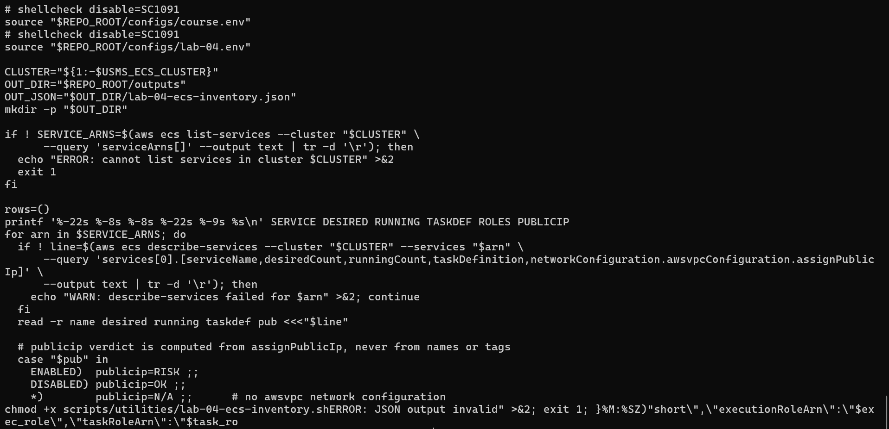

**Result:** I ran the script once from my home folder `~` and once from `labs/lab-04-ecs`. `diff` printed **IDENTICAL from both directories**.

```
SERVICE                DESIRED  RUNNING  TASKDEF                ROLES     PUBLICIP
usms-results-svc       1        1        usms-enrolment:1       roles=SEPARATE publicip=OK
usms-enrolment-svc     2        2        usms-enrolment:2       roles=SEPARATE publicip=OK
```

Both services use separate roles and have no public IP, so there is **no drift**. The report also shows that the two services now use different revisions: `usms-results-svc` is still on `:1` because Exercise 2 only updated the enrolment service.

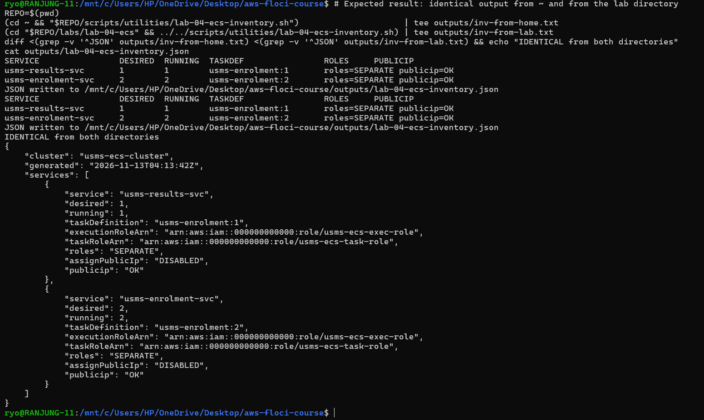

---

## Exercise 4 (Challenge): The enrolment week capacity plan

### Why a fixed desiredCount of 2 cannot handle the spike

`desiredCount` is just a number stored on the service. In Lab 04 **nothing reads a CPU metric or a clock** to change it. So at 08:00 on Monday of enrolment week, when thousands of students log in, the service still runs only 2 tasks. Requests queue up and the portal becomes slow, until someone changes the number by hand like I did in Step 11.

### Proposed values

| Setting | Value | If set too low | If set too high |
|---|---|---|---|
| **Minimum** | 2 | With 1 task, one AZ failure stops enrolment. | We pay for idle tasks all year. |
| **Scheduled floor** (enrolment week, Mon–Fri 08:00–18:00) | 6 | The first minutes of the spike are slow, because reactive scaling takes minutes to react. | Money is wasted during the week if fewer students come. |
| **Maximum** | 10 | Students get slow responses or errors at the peak. | A bug or attack could start many tasks and create a big bill, and overload S3/databases. |

Note: in Step 3, this Floci build showed that **scheduled actions are not supported**. So the scheduled floor would only work on real AWS. Lab 06 uses target tracking, which Floci does support.

### Monthly cost comparison

**Source:** AWS Fargate pricing, https://aws.amazon.com/fargate/pricing/ (us-east-1, Linux/x86): **$0.04048 per vCPU-hour** and **$0.004445 per GB-hour**.

**Cost of one task** (0.25 vCPU, 0.5 GB):
- per hour = 0.25 × 0.04048 + 0.5 × 0.004445 = **$0.01234**
- per month = 0.01234 × 730 hours = **$9.01**

| Option | Task-hours per month | Cost per month | Comment |
|---|---|---|---|
| A. Fixed 2 tasks (now) | 2 × 730 = 1,460 | **$18.02** | Cheap, but cannot handle the spike |
| B. Fixed 10 tasks all month | 10 × 730 = 7,300 | **$90.10** | Handles the spike, but most of it is idle |
| C. Min 2 + floor 6 for 50 h + about 20 h of 4 extra tasks | 1,460 + (4 × 50) + (4 × 20) = 1,740 | **$21.48** | Handles the spike for about $3.50 more than A |

Option C is the best choice. It costs almost the same as option A but can handle enrolment week, and it is about **4 times cheaper** than option B. (If revision 2 with 1024 MiB is used, one task costs $0.01457/hour = $10.63/month, so every option costs about 18% more.)

### What to switch off: the Exercise 1 results service

The results service was only for practice, so I removed it. I did it in **dependency order**: scale to 0 first, then delete. Nothing in the KEEP list (cluster, enrolment service, task definitions, roles, security group, log group) was touched.

> **DANGER: scaling `usms-results-svc` to 0**
> What: stops all running tasks of the results service.
> Why it is safe: it is the Exercise 1 practice service, and no load balancer, env file or later lab uses it.
> Undo: `aws ecs update-service --desired-count 1`.

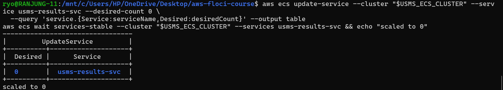

> **DANGER: deleting `usms-results-svc`**
> What: permanently removes the service object. It cannot be undeleted.
> Why it is safe: it has 0 tasks now and is not in the KEEP list. Nothing else is deleted.
> Undo: run the Exercise 1 `create-service` command again.

**Result:** After the clean-up, `verify-lab-04.sh` reported **PASS=39, FAIL=0**. This proves that removing the practice service did not break anything in Lab 04. It also shows that the enrolment SG is now sourced only from `usms-alb-sg` (from Lab 05).

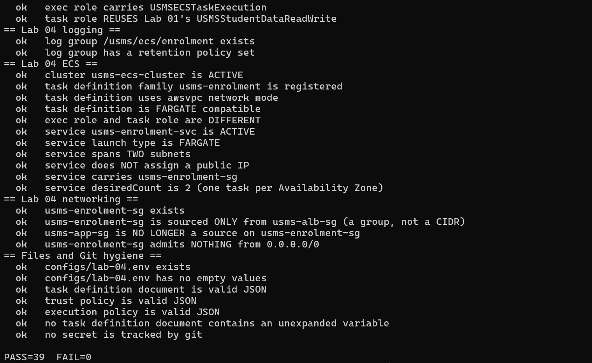

---

## Exercise 5: Close the loop back to Lab 3, and hand Lab 05 what it needs

**Task:** Follow the inbound rule on `usms-enrolment-sg` back to the EC2 instance that carries the source group, compare it with Lab 03's web server, write a linkage file and audit the tags.

**What I did:**

1. I read the source group of the inbound rule on `usms-enrolment-sg`.
2. I searched for **running** EC2 instances with that group using the `instance.group-id` filter.
3. I compared the result with `$USMS_WEB_INSTANCE` from `configs/lab-03.env`.

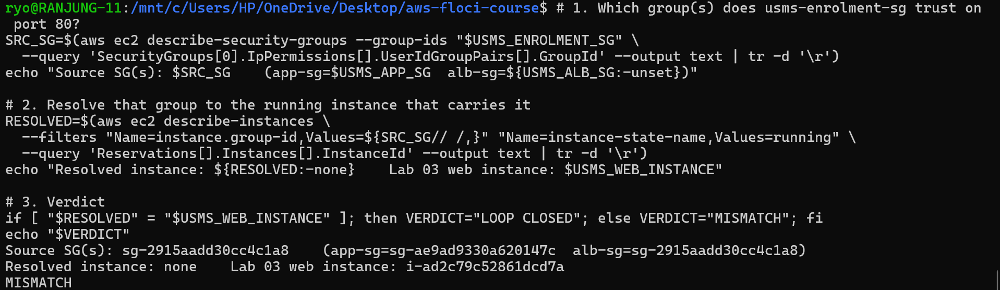

**Result:**

| Item | Value |
|---|---|
| Enrolment SG | `sg-f57a1547660af7c69` |
| Inbound source group | `sg-2915aadd30cc4c1a8` (**usms-alb-sg**) |
| Resolved running instance | none |
| Lab 03 web instance | `i-ad2c79c52861dcd7a` |
| Verdict | **MISMATCH** |

**Why it is a MISMATCH (and why that is correct):** When I did Lab 04, the source of the rule was `usms-app-sg` (`sg-ae9ad9330a620147c`), which is attached to the Lab 03 web server, so the loop was closed then. I have since finished **Lab 05**, which removed that temporary app-sg rule and replaced it with the **ALB security group** as the only source. An ALB is not an EC2 instance, so the filter finds no instance. This is the expected and safer design: only the load balancer can reach the tasks now. `verify-lab-04.sh` confirms this with *"usms-enrolment-sg is sourced ONLY from usms-alb-sg"* and *"usms-app-sg is NO LONGER a source"*.

4. I wrote everything into `outputs/lab-04-lab03-linkage.txt` and added a tag audit with `aws ecs list-tags-for-resource`, using **ARNs, not names**, because that command only accepts ARNs.

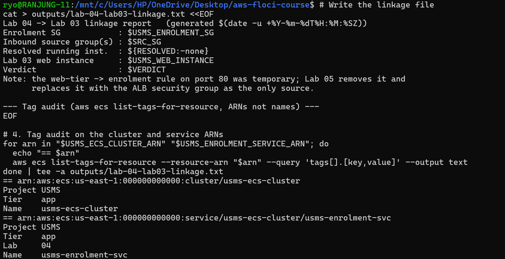

**Tag audit result:**

| Resource | Tags |
|---|---|
| `usms-ecs-cluster` | Project=USMS, Tier=app, Name=usms-ecs-cluster |
| `usms-enrolment-svc` | Project=USMS, Tier=app, Lab=04, Name=usms-enrolment-svc |

Both resources had tags. I ran `aws ecs tag-resource` on the service and audited again; the tags stayed the same. One small gap: the **cluster has no `Lab=04` tag**. It can be fixed with `aws ecs tag-resource --resource-arn "$USMS_ECS_CLUSTER_ARN" --tags key=Lab,value=04`.

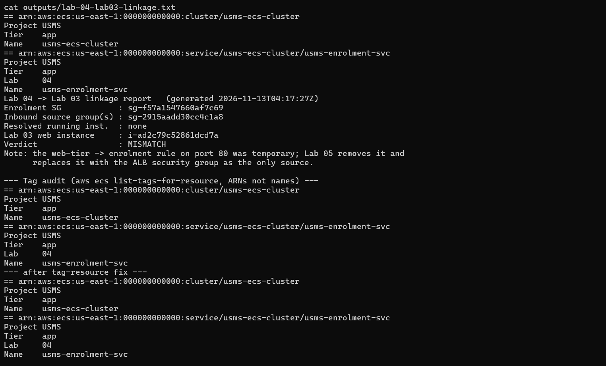

The final file tells a Lab 05 reader exactly what changed: the enrolment tasks are now protected by the ALB security group instead of the web server's group. Nothing from the internet can reach them directly.

---

## Summary of what the exercises taught me

- **Scaling = changing one number.** Step 11 and Exercise 4 showed that `desiredCount` is the only thing that changes, and that a fixed number cannot react to a spike by itself.
- **Task definitions are versioned, not edited.** Exercise 2 created revision 2 while revision 1 stayed ACTIVE, which makes rollback easy.
- **Check settings from facts, not names.** My inventory script compares role ARNs and reads `assignPublicIp` directly, so a badly named service cannot hide a risk.
- **Clean up carefully.** Scale to 0, then delete, and run the verify script afterwards (FAIL=0).
- **Labs build on each other.** Exercise 5 showed how the Lab 03 → Lab 04 security group link was replaced by the ALB in Lab 05. Reading back resources is the only way to know the real current state.
