# Lab 05 - Independent Lab Exercises

## Exercise 1 - A second path through the same load balancer

I wanted `/results` to go to its own target group, using the same load balancer.

- I made a new target group, `usms-results-tg` (`ip`, HTTP, port 80). Its health check accepts `200-399`, and its deregistration delay is 15 seconds.
- I wrote the rule in two JSON files in `templates/` and added it at **priority 20**: `/results` and `/results/*` go to `usms-results-tg`.
- I tagged both with `Service=results` and saved every ARN in a variable.

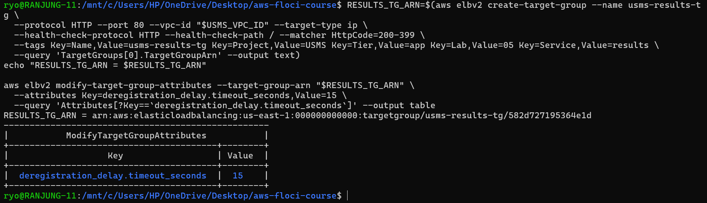

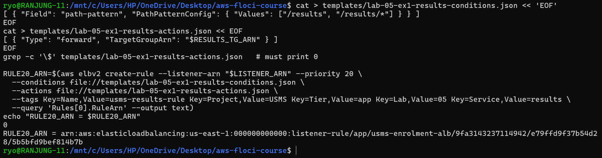

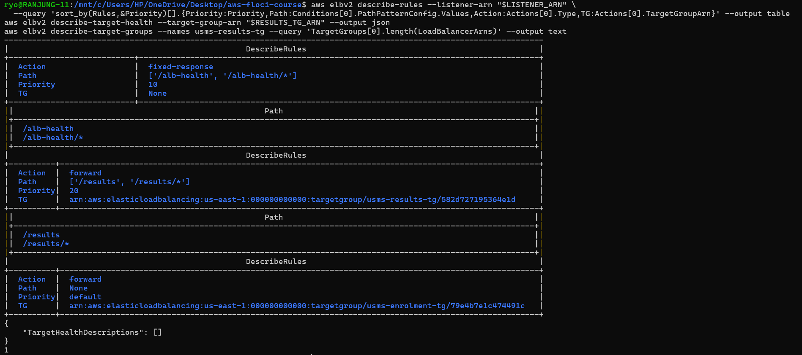

When I read the rules back, I saw three: **10** (`/alb-health`), **20** (`/results`) and **default**. The new target group was empty, which is correct because there's no results service yet.

If someone opened `/results` right now, the load balancer would answer **503**, because there's no task behind it.

---

## Exercise 2 - Fixing the script I broke

In Step 13, I made `verify-lab-04.sh` fail on purpose. The check was really testing one idea: **the tasks only accept traffic from one named security group, never from an IP range.** That idea was still true; only the group had changed from `usms-app-sg` to `usms-alb-sg`.

So I changed the script:

- The check now makes sure the **only** source is `usms-alb-sg`.
- I added a new check that `usms-app-sg` is **gone**. This matters because in Step 13 the old rule didn't really get removed the first time.
- The script reads `usms-alb-sg` from `configs/lab-05.env`. If that file is missing, the check just fails clearly instead of crashing.
- I wrote the new count, **39**, at the top of the script.

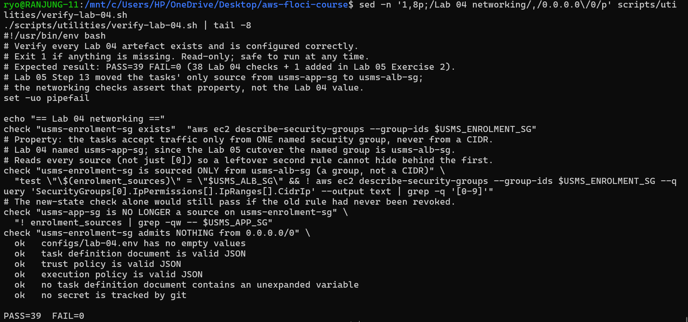

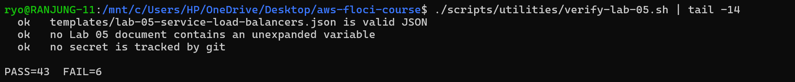

`verify-lab-04.sh` now gives **PASS=39 FAIL=0**. `verify-lab-05.sh` gives **PASS=43 FAIL=6**; those 6 come from the Floci bug in Step 10, not from this change.

Writing the count down matters, because otherwise nobody notices if a check gets deleted. Changing a script is fine when the design really changed, but not when you just want a red check to go green.

**Commit message:**

```text
verify-lab-04: assert tasks accept traffic only from usms-alb-sg

Lab 05 moved the enrolment tasks behind the ALB, so the only allowed
source is now usms-alb-sg, not usms-app-sg. The check now asserts the
same property (one named group, no CIDR) for the new architecture, and
a second check proves the old usms-app-sg rule is really gone.
```

---

## Exercise 3 - A load balancer report tool

I made `scripts/utilities/usms-lb-report.sh`. It shows every `usms-` load balancer, its listeners, its rules in order (default last), and how many targets each target group has.

- Priority is stored as text, so I turn it into a number before sorting.
- It doesn't crash if there are no listeners, no extra rules, or no targets.
- I didn't use `set -e`, so one failed call doesn't stop the whole report.
- It also saves the report to `outputs/lab-05-lb-report.json`.

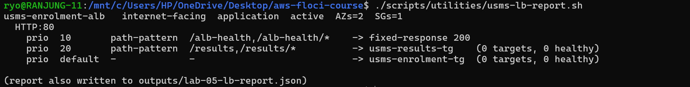

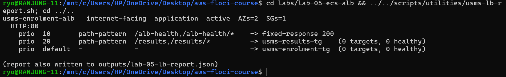

The output was the same from both folders.

---

## Exercise 4 - The exposure review

**What changed:** before, only the portal server could call the enrolment API. Now the internet reaches a load balancer, and only the load balancer can reach the tasks.

**Internet-facing or internal?** If I used `--scheme internal`, the load balancer would only have private IPs, and its security group would allow just the portal instead of everyone. Since the portal is the only client, **I'd pick internal**: it's safer and costs the same. I'd only keep it internet-facing if students' browsers needed to call the API directly.

**Who can reach what:**

| Who can reach... | Before | After |
|---|---|---|
| Load balancer | No load balancer | Anyone, on port 80 |
| Tasks (any way) | Only the portal | Anyone, but only through the load balancer |
| Tasks directly | The portal | Only the load balancer |

**Cost per month** (730 hours, prices from [ELB pricing](https://aws.amazon.com/elasticloadbalancing/pricing/) and [Fargate pricing](https://aws.amazon.com/fargate/pricing/), checked on ____):

| Item | Working | Cost |
|---|---|---|
| ALB running | 730 × $0.0225 | $16.43 |
| ALB under load | 0.8 LCU × 730 × $0.008 | $4.67 |
| 2 Fargate tasks | (0.25 × $0.04048 + 0.5 × $0.004445) × 730 × 2 | $18.02 |

So the ALB costs about **$16.43 when idle** and **$21.10 under load**. By "under load" I mean 20 requests a second, a new connection each time, and about 5 KB per reply. The cost comes from **new connections** (20 per second ÷ 25 per LCU = 0.8 LCU), not from data, because 0.36 GB per hour is only 0.36 LCU.

**HTTPS plan:** opening port 443 isn't enough; something has to listen on it.

1. Port 443 rule on the security group. I already added it in Step 4.
2. A domain name. This comes from **outside** (the university's domain or a registrar) and costs money.
3. A certificate from AWS Certificate Manager. It's **free** ([guide](https://docs.aws.amazon.com/acm/latest/userguide/gs-acm-request-public.html)).
4. A DNS record to prove I own the domain, and another one pointing the domain at the load balancer.
5. An HTTPS listener on port 443 with the certificate ([guide](https://docs.aws.amazon.com/elasticloadbalancing/latest/application/create-https-listener.html)).
6. Change port 80 to a **redirect** to HTTPS, so no password is sent without encryption.

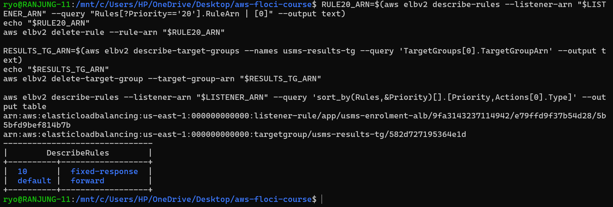

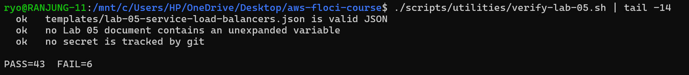

After the tidy-up, `verify-lab-05.sh` still gave **PASS=43 FAIL=6**, the same as before, so I didn't break anything.

---

## Exercise 5 - The ResourceLabel for Lab 06

Lab 06 can scale on "requests per task", but it needs a label made from two ARNs. I made `scripts/utilities/usms-resource-label.sh` to build it.

- It looks up both ARNs from AWS every time; nothing is typed by hand.
- From the load balancer ARN, I **remove** `loadbalancer/` with `${LB_ARN#*:loadbalancer/}`.
- From the target group ARN, I **keep** `targetgroup/` with `${TG_ARN##*:}`.
- Before printing, it checks the label has 6 parts and starts with `app`.

My label:

```text
app/usms-enrolment-alb/9fa3143237114942/targetgroup/usms-enrolment-tg/79e4b7e1c474491c
```

It starts with `app` because this is an Application Load Balancer. A Network Load Balancer would start with `net`.

I added it to `configs/lab-05.env`, which now has **16 exports**.

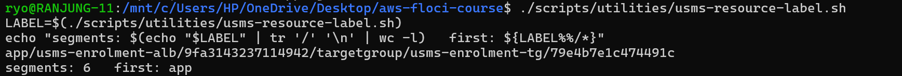

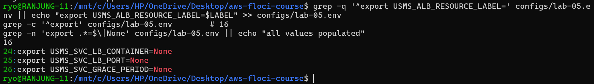

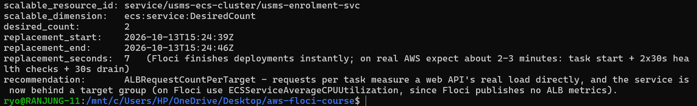

I also timed a full deployment with `python3`: it started at 15:24:39 and ended at 15:24:46, so **7 seconds**. That isn't realistic, because Floci doesn't run real containers. On real AWS I'd expect about **2–3 minutes**: around 30 - 60 seconds to start a task, 60 seconds for 2 health checks, and up to 30 seconds to drain the old task.