# Lab 06 Practical Report: Auto Scaling the ECS Service

## 1. Aim / Objective

The aim of this lab is to make the USMS **enrolment service** from Labs 04 and 05 **scale by itself**. When the service is busy it should add tasks, and when it is quiet it should remove them, without me changing `desiredCount` by hand. Everything was done with the AWS CLI on the local emulator Floci.

The specific objectives were to:

- Create the **service-linked role** that lets Application Auto Scaling change the service's `desiredCount`.
- Register the service as a **scalable target** with a floor of **2** tasks and a ceiling of **10**.
- Create a **CPU target tracking policy** that keeps average CPU near **50%**.
- Create a **request-count target tracking policy** that uses the Lab 05 target group (`ALBRequestCountPerTarget`, 1000 requests per task).
- Create a **step scaling policy** driven by my own CloudWatch metric (`EnrolmentQueueDepth`) and my own alarm.
- Create **scheduled actions** for a morning scale-out and an evening scale-in.
- Fire the alarm and prove that **auto scaling, not me**, changed the number of tasks.
- Suspend and resume scaling, prove everything survives a Floci restart, save the values to `configs/lab-06.env`, and check the lab with a verification script.

## 2. Introduction

**Application Auto Scaling** is the AWS service that changes the size of a resource for you. For an ECS service, the only thing it changes is **one number: `desiredCount`**. ECS then starts or stops tasks to match that number.

Auto scaling does not watch the service directly. It works through **CloudWatch**:

1. A **metric** (for example CPU or queue depth) is sent to CloudWatch.
2. A **CloudWatch alarm** watches the metric and goes into `ALARM` when it crosses a line.
3. The alarm **invokes a scaling policy**.
4. The policy tells Application Auto Scaling to change `desiredCount`, but never below the **minimum** or above the **maximum**.

There are three kinds of scaling I used:

| Type | Simple meaning |
|---|---|
| **Target tracking** | "Keep this metric near this value." Like a thermostat. AWS creates and manages the alarms for me. |
| **Step scaling** | "If the alarm fires, add this many tasks, depending on how far over the line we are." I create the alarm myself. |
| **Scheduled scaling** | "At this time, change the minimum and maximum." Good for load I already know is coming. |

## 3. Use Case

**USMS use case:** During enrolment week, thousands of students log in at the same time, especially in the morning. At night almost nobody uses the system. With auto scaling:

- When **CPU goes above 50%**, more tasks are added, so students do not get slow pages or timeouts.
- When **each task gets more than 1000 requests**, more tasks are added, using the request count from the Lab 05 load balancer.
- When the **enrolment work queue backs up** (100 or more items), the step policy adds 1 task, or **3 tasks** if the queue is 200 or more.
- Before office hours the **floor is raised to 4**, so the service is ready before students arrive. In the evening it goes back to **2**.
- At quiet times the service shrinks back to **2 tasks**, so USMS does not pay for tasks doing nothing. It never goes below 2, so one task can always fail without the service going down.

## 4. System Architecture / Design

**How it works in simple words:**

1. The service sends **CPU** to CloudWatch (namespace `AWS/ECS`), the load balancer sends **request count** (`AWS/ApplicationELB`), and I send **queue depth** myself (`USMS/Enrolment`).
2. Each **alarm** watches one metric. The two target tracking policies each created **two alarms** for me (`AlarmHigh` and `AlarmLow`). I created the queue alarm `usms-enrolment-queue-high` myself.
3. When an alarm goes into `ALARM`, it calls its **scaling policy**.
4. The policy changes **`desiredCount`** on the **scalable target** (`service/usms-ecs-cluster/usms-enrolment-svc`), but only between **2 and 10**.
5. ECS sees the new number and starts or stops tasks in the **two private subnets**. The new tasks are put into the **Lab 05 target group** by ECS, so the load balancer sends traffic to them.

## 5. Implementation Procedure

### Step 1: Start the environment

I started Floci and loaded the six env files (`course.env` and Labs 01–05). This gave me all the names and IDs I need from the earlier labs.

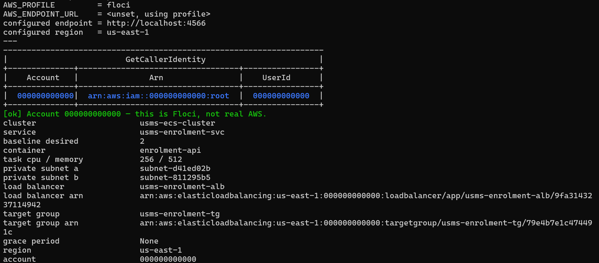

### Step 2: Check the earlier labs

I ran the earlier verification scripts and checked the service.

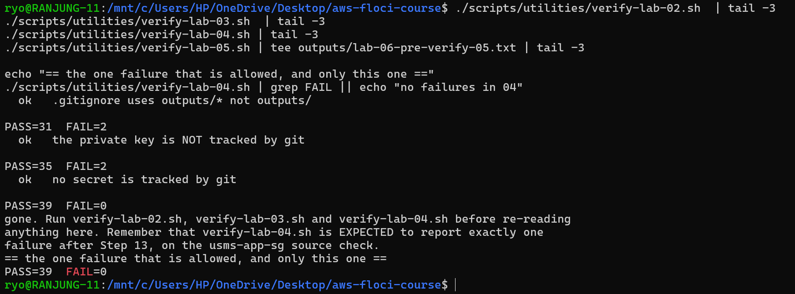

The first time, the service check gave an **error** (`length()` on `null`). When I looked closer, the service had **no load balancer attached** (`loadBalancers: null`). This was left over from Lab 05, where Floci accepted the attach command but did not save it.

I tried `update-service --load-balancers` again, but Floci **ignored it again**. So I used the Lab 05 Step 10 **fallback**: I scaled the service to 0, deleted it, and **created it again** with the same name, cluster, task definition and desired count, plus the load balancer. After that:

- Service: **Desired 2, Running 2, Deployments 1, LBs 1**
- Lab 04: **PASS=39 FAIL=0**
- Lab 05: **PASS=48 FAIL=1**. The one failure is the **health-check grace period**, which Floci does not save. This is listed on the course Known Issues page.

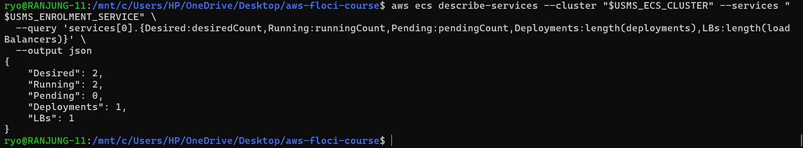

### Step 3: Test what Floci supports

I tested the commands before building anything. Almost everything was **SUPPORTED**. The only one **not available** was `describe-scheduled-actions`, so I knew Step 11 would not work on this build.

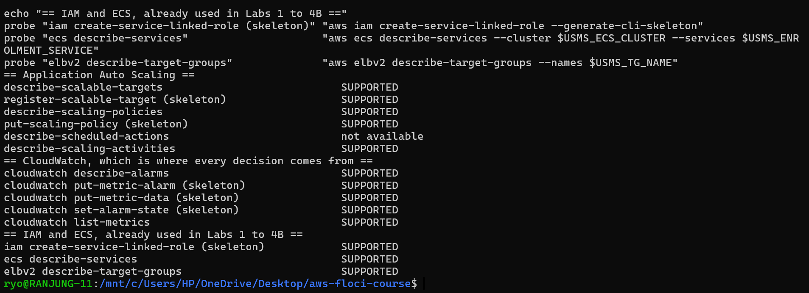

### Step 4: Create the service-linked role

Application Auto Scaling needs a **service-linked role** so it is allowed to change `desiredCount`. The create command said the role **already exists**, which is fine.

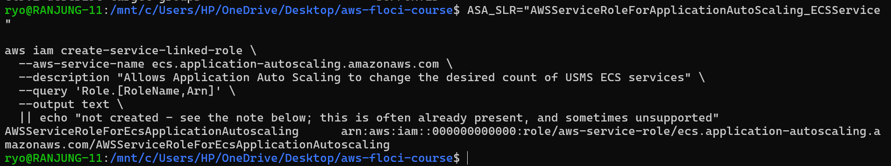

One thing I found: Floci names the role **`AWSServiceRoleForEcsApplicationAutoscaling`**, but on real AWS it is called **`AWSServiceRoleForApplicationAutoScaling_ECSService`**. So when I read it back, I had to use Floci's name.

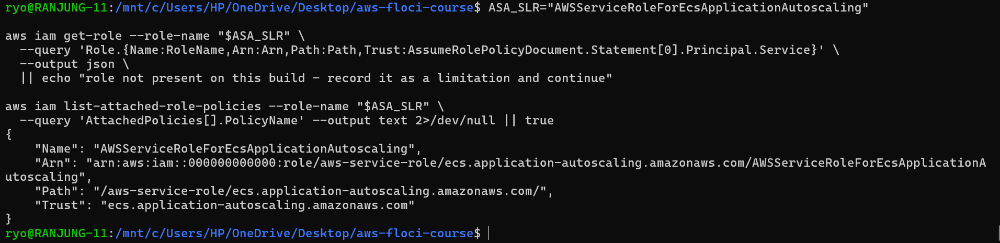

### Step 5: Register the scalable target

First I built the **resource ID** from the service ARN, not by typing it: `service/usms-ecs-cluster/usms-enrolment-svc`. The scalable dimension is `ecs:service:DesiredCount`.

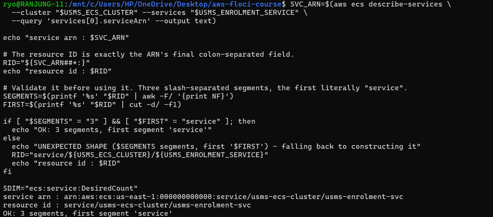

Then I registered it with **min 2** (the Lab 04 baseline) and **max 10**.

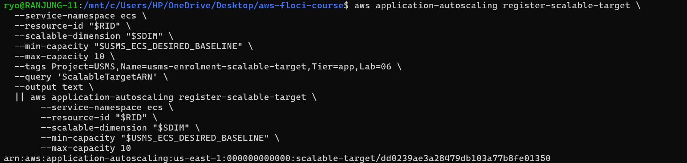

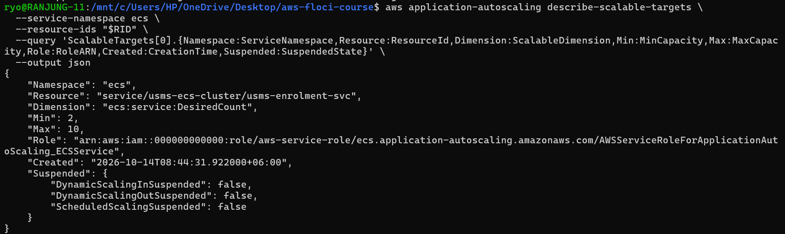

Registering the target **did not change the service**. It was still Desired 2, Running 2. Registering only sets the limits; it does not scale anything by itself.

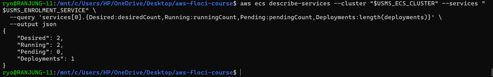

### Step 6: Change the limits

I ran `register-scalable-target` again with only `--max-capacity 12`. The max changed to **12** and the min **stayed 2**. So registering again is an **update**, not a new target. Then I put the max back to **10**.

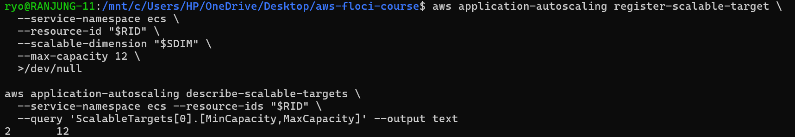

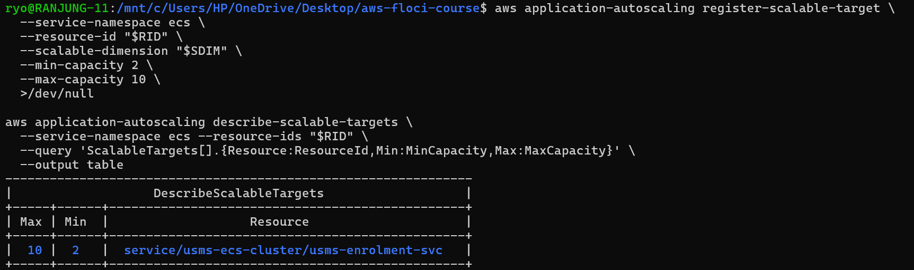

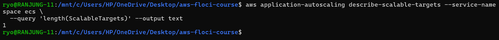

### Step 7: Create the CPU target tracking policy

I wrote a JSON file and created `usms-enrolment-cpu-target-tracking`:

- **Target:** 50% average CPU (`ECSServiceAverageCPUUtilization`)
- **Scale-out cooldown:** 60 seconds, so it adds tasks quickly
- **Scale-in cooldown:** 300 seconds, so it removes tasks slowly and does not go up and down too fast

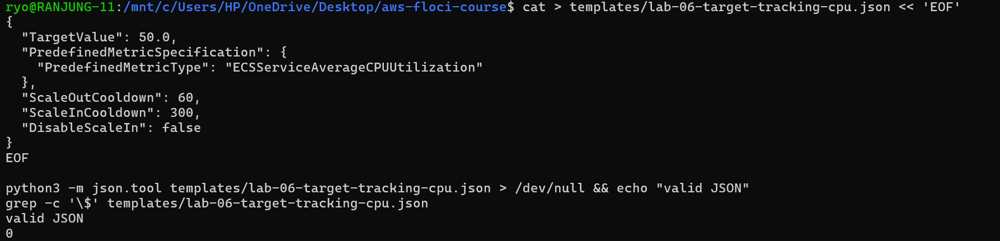

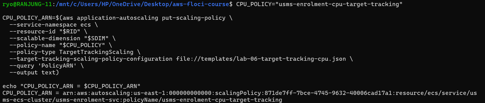

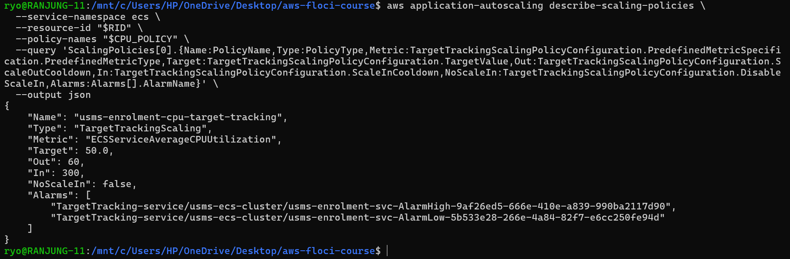

### Step 8: Look at the alarms target tracking made

I did **not** create any alarm for the CPU policy, but AWS made **two** for me:

- **AlarmHigh:** CPU **> 50** for **3** minutes, which adds tasks
- **AlarmLow:** CPU **< 50** for **15** minutes, which removes tasks

Removing tasks waits much longer (15 minutes vs 3) so the service does not shrink after a short quiet moment. Both alarms start as `INSUFFICIENT_DATA` because no CPU data had come in yet.

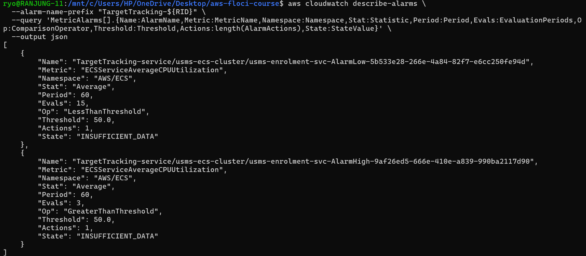

The alarm names always start with `TargetTracking-` plus the resource ID, so I could find them by prefix. The count was **2**.

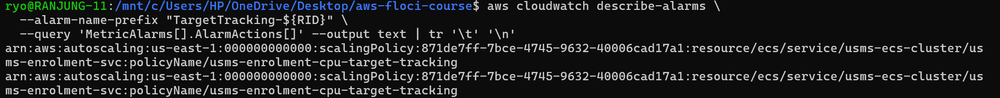

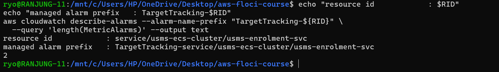

### Step 9: Create the request-count policy

This policy uses the **Lab 05 load balancer**. It needs a **resource label** that joins the ALB and the target group. I used the label I saved in Lab 05 and checked its shape: **6 parts**, starting with `app`, and the 4th part is `targetgroup`. Result: **OK**.

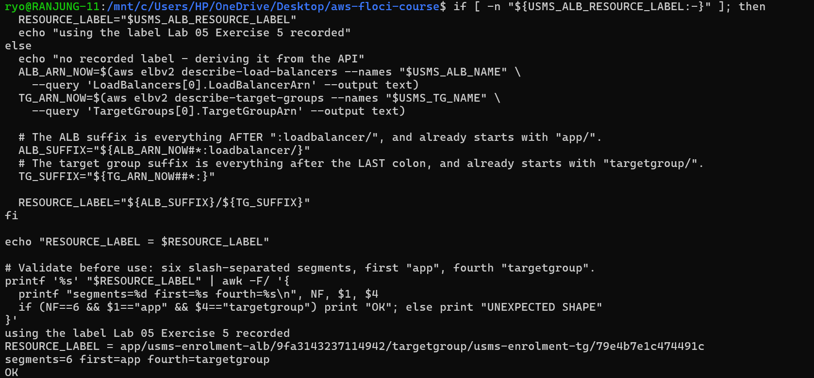

Then I created `usms-enrolment-requests-target-tracking` with a target of **1000 requests per task** (`ALBRequestCountPerTarget`).

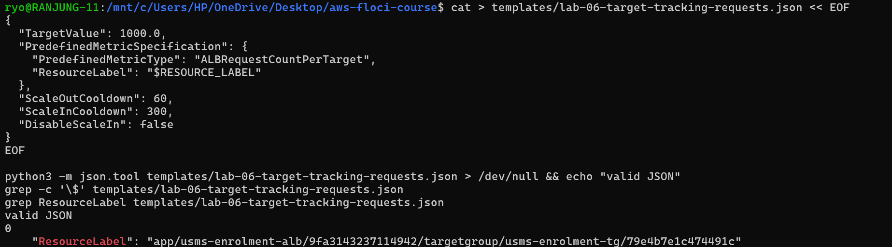

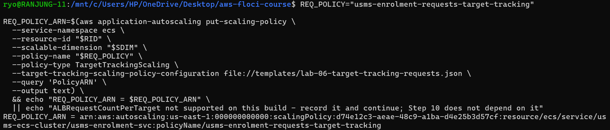

Both target tracking policies now have **2 alarms each**.

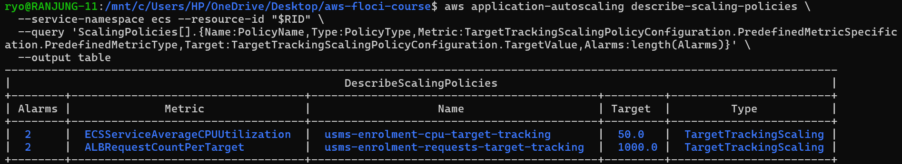

### Step 10: Create a step scaling policy and its alarm

First I sent my own metric, `EnrolmentQueueDepth` in the `USMS/Enrolment` namespace, with values 3, 5 and 4, so that the metric exists.

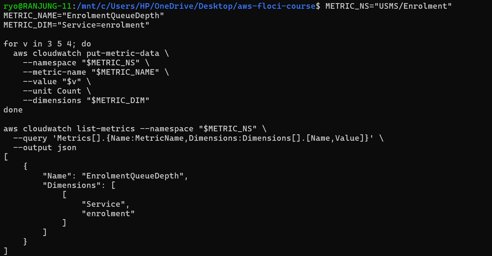

Then I wrote the step file. The steps are measured **from the alarm threshold (100)**:

| Queue depth | Action |
|---|---|
| 100 to 199 | add **1** task |
| 200 or more | add **3** tasks |

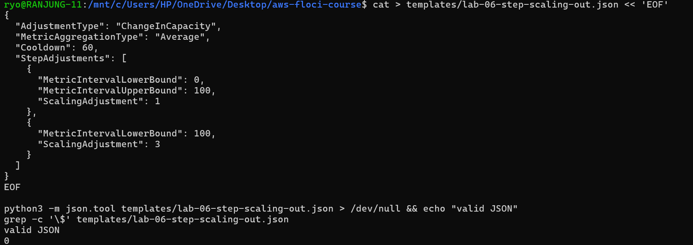

I created the policy `usms-enrolment-queue-step-out`, then the alarm `usms-enrolment-queue-high` (Average ≥ 100 for 1 minute). The alarm's **action is the policy ARN**. This is the link I made myself; with target tracking, AWS makes this link for you.

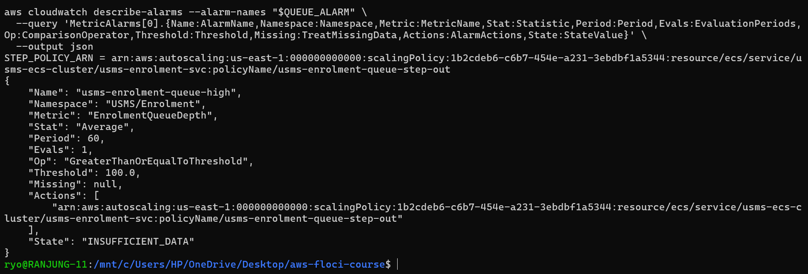

When I read the policy back, its `Alarms` list was **empty (`[]`)**. On real AWS it would show the alarm. The alarm still points to the policy correctly, so it is only a Floci display problem. Floci also did not save `TreatMissingData` (it shows `null`).

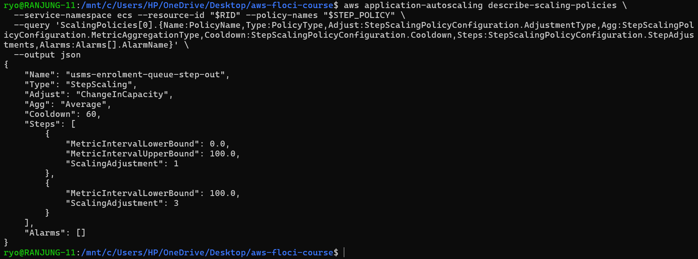

### Step 11: Create two scheduled actions

I wanted two actions:

- **Morning scale-out:** 07:45 Bhutan time → **`cron(45 1 ? * MON-FRI *)`** in UTC → min 4, max 10
- **Evening scale-in:** 20:00 Bhutan time → **`cron(0 14 ? * MON-FRI *)`** in UTC → min 2, max 10

Bhutan is **UTC+6**, so I subtracted 6 hours by hand.

Floci answered **`UnsupportedOperation`** for both. Step 3 had already warned me about this. My commands and times were correct, but Floci cannot create scheduled actions.

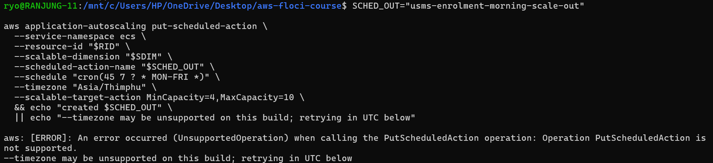

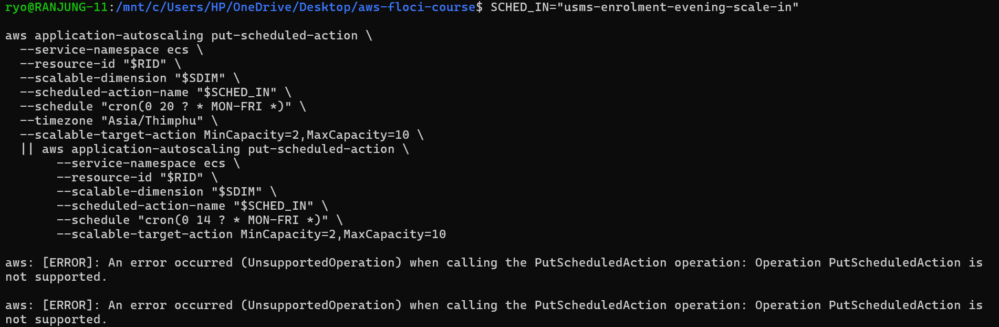

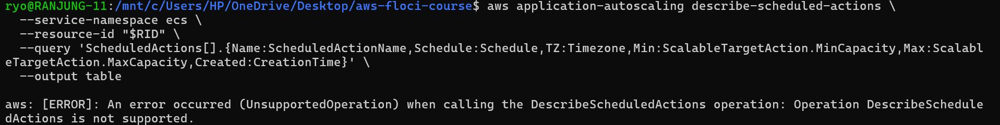

### Step 12: Fire the alarm and prove auto scaling moved the number

**Part 1:** I saved the "before" state: **Desired 2, Running 2, Pending 0**.

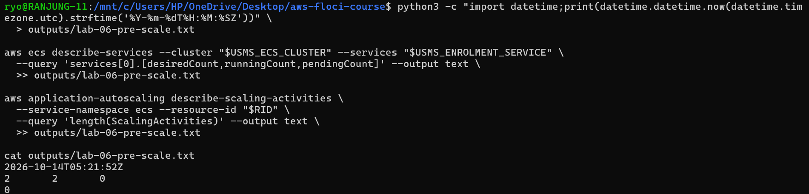

**Part 2:** I sent the queue metric **260** three times. CloudWatch showed **Average 260**.

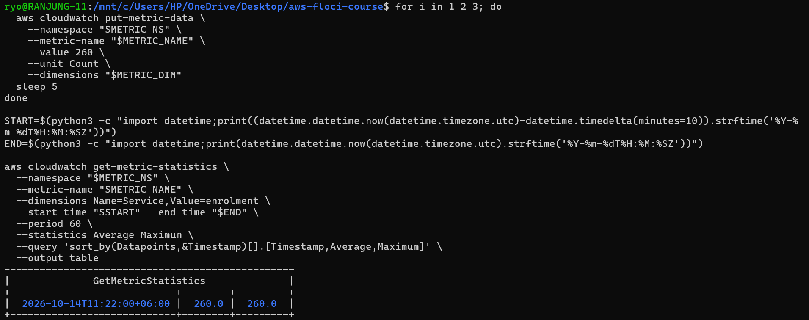

**Part 3:** The alarm did not change by itself on Floci, so I set it to `ALARM` with `set-alarm-state`.

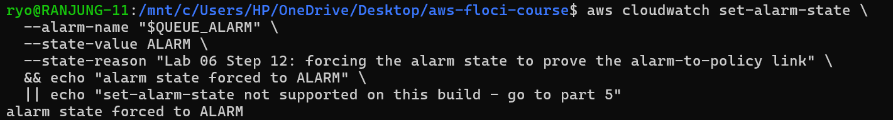

**Part 4:** `desiredCount` went from **2 to 5**. The scaling activity says:

> *"monitor alarm usms-enrolment-queue-high in state ALARM triggered policy usms-enrolment-queue-step-out"*, *"Setting desired capacity to 5"*

This proves that **auto scaling changed the number, not me**. It added **3** tasks because 260 is more than 100 above the threshold (the 200+ step).

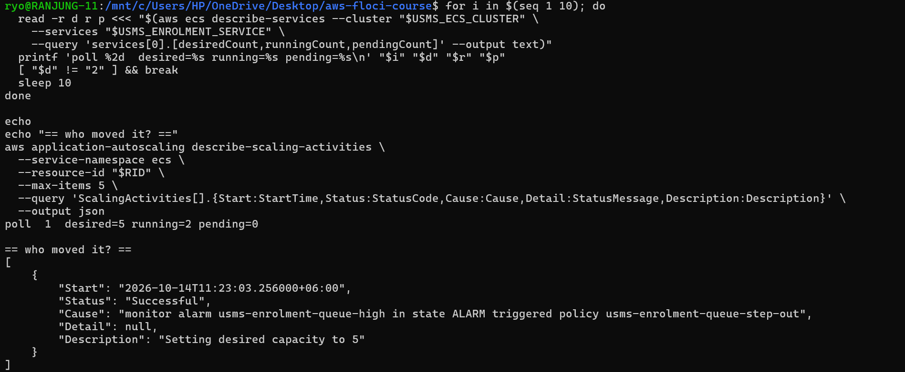

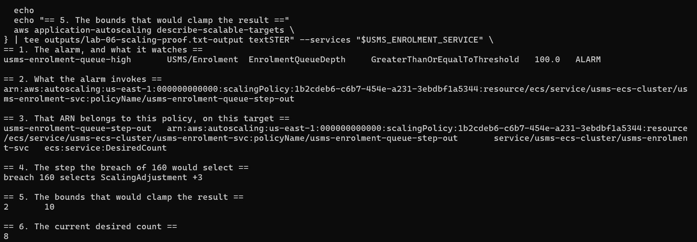

**Part 6:** I cleaned up. First I set the alarm back to `OK` and sent low values (4, 3, 2), **then** set the count back to 2. If I set the count first, the alarm could push it up again.

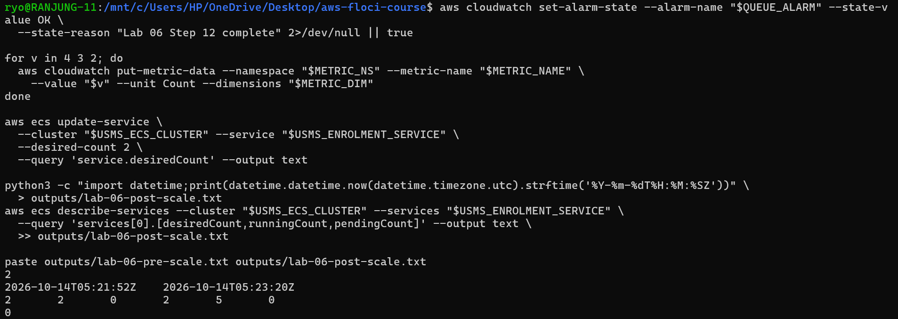

### Step 13: Suspend and resume scaling

I suspended **scale-in only** (`DynamicScalingInSuspended: true`). This is useful during a busy event: the service can still grow but will not shrink.

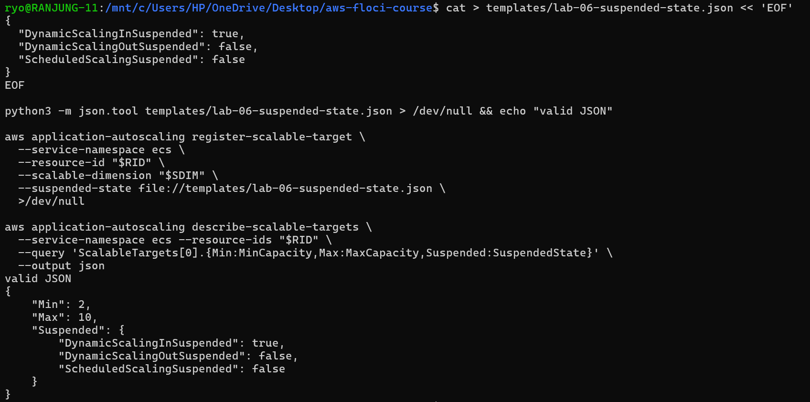

Suspending did **not delete** anything. All **3 policies** and their **4 managed alarms** were still there.

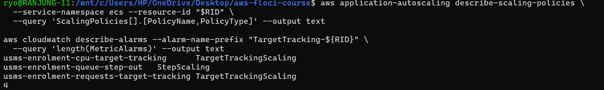

Then I resumed it. All three switches are back to **False**.

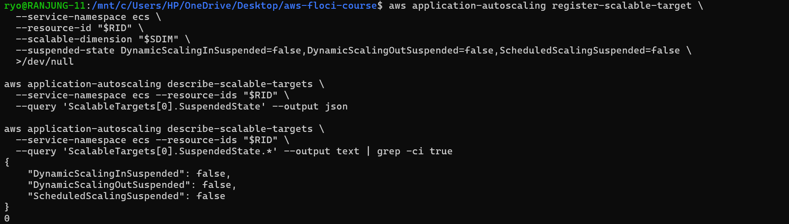

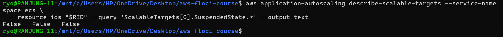

### Step 14: Restart test

I saved the scaling setup to `outputs/lab-06-pre-restart.txt`, restarted Floci, found everything again by name, and compared. Result: **PERSISTENCE PROVEN**.

The scalable target, the 3 policies and the queue alarm were all unchanged. The scheduled actions were **not tested**, because they could not be created in Step 11.

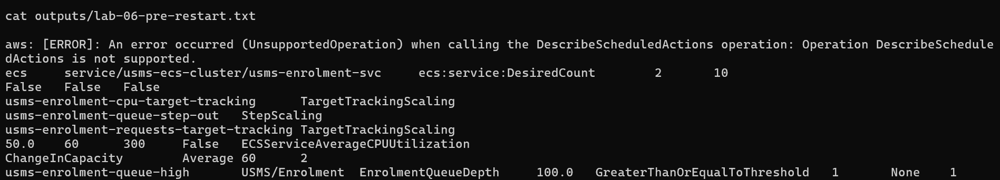

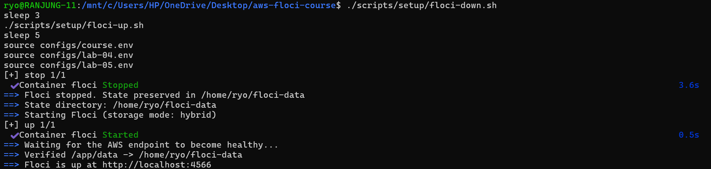

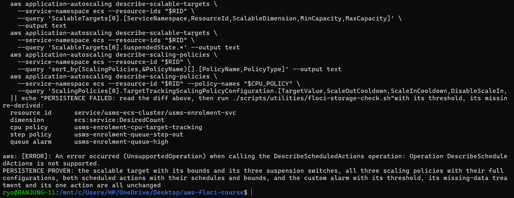

### Step 15: Follow one request to one new task

This step put the whole chain together: alarm → policy → scalable target (2–10) → service → private subnets → target group. Because I recreated the service in Step 2, the target group now **has targets**, and they show as **healthy**. In Lab 05 it stayed empty.

When I took this screenshot, the service was at **10 tasks** from the scaling tests. I set it back to 2 before the final verification.

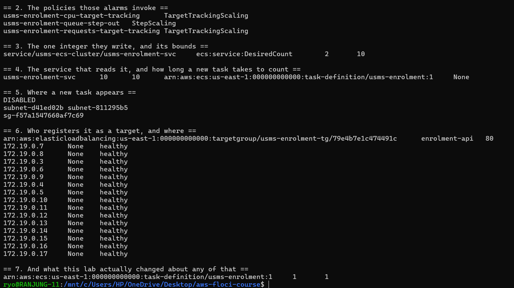

### Step 16: Save the values

I saved all the Lab 06 names and ARNs to `configs/lab-06.env` for later labs.

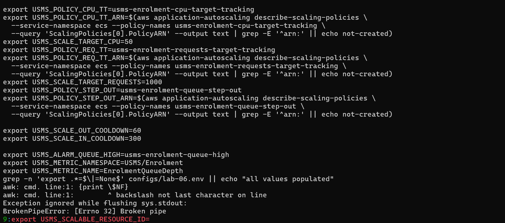

The first time, `USMS_SCALABLE_RESOURCE_ID` was **empty**, because `$RID` was not set in that terminal. I filled it in as `service/usms-ecs-cluster/usms-enrolment-svc`, and changed the role name to Floci's name.

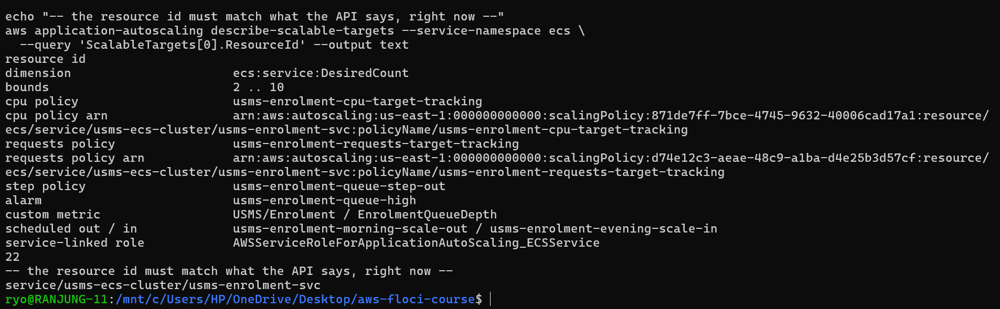

### Step 17: Commit

I fixed two old hint strings in the scripts, checked with `git status` what would be added, and committed the Lab 06 files by name. Nothing from `outputs/` was added.

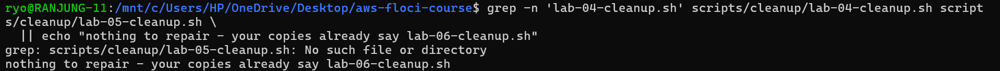

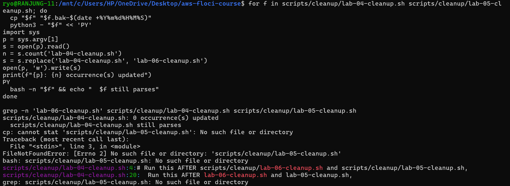

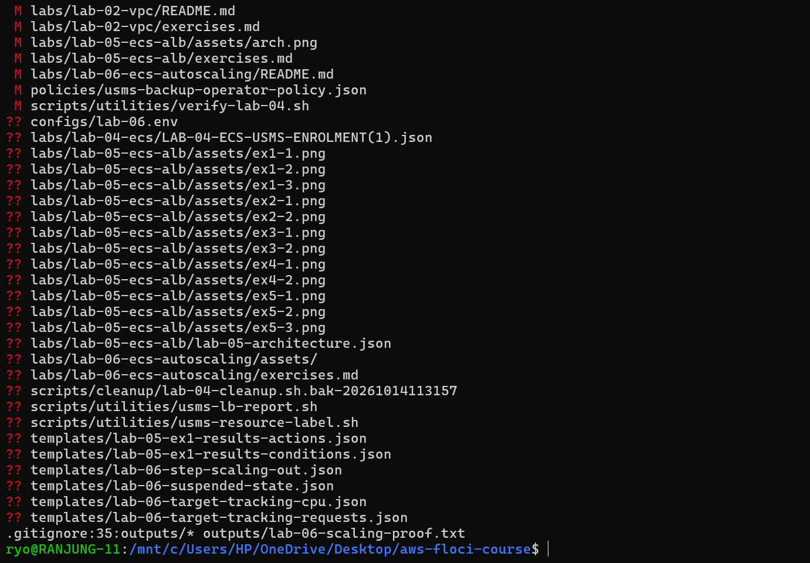

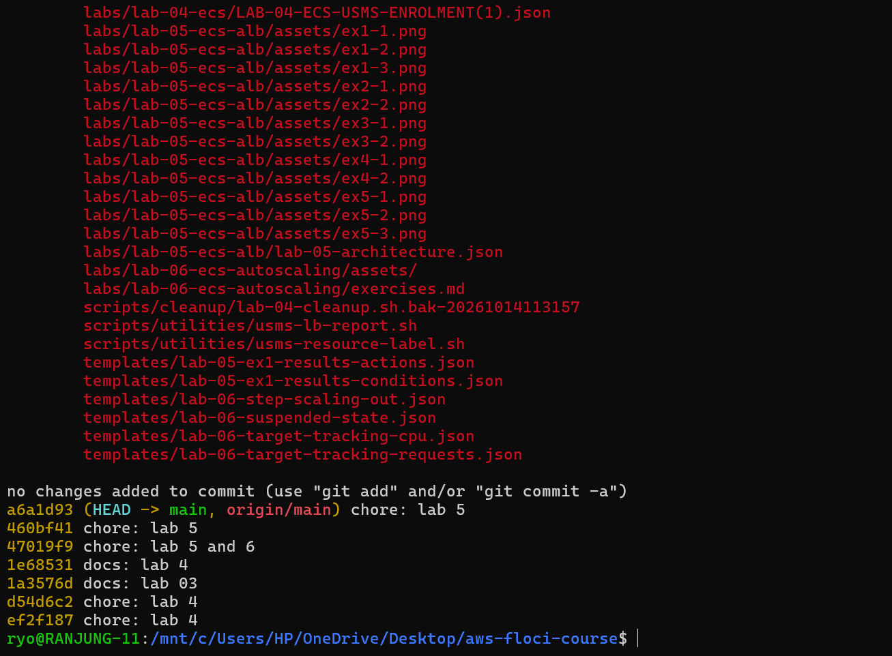

### Verification

The verification script gave **PASS=39, FAIL=3**.

All 3 failures are the **scheduled actions**, because Floci does not support `PutScheduledAction`. On real AWS they would pass and the result would be **42/42**. Before this, I also had two other failures that I fixed:

- `desiredCount` was not back at 2 after the tests → I lowered the metric first, then set it to 2.
- `lab-06.env` had an empty value → I filled in the resource ID.

## 7. Analysis and Discussion

### 7.1 What was achieved

I registered the enrolment service as a scalable target (2–10 tasks), and created three scaling policies: CPU target tracking, request-count target tracking, and step scaling with my own metric and alarm. I proved that the **alarm, not me, changed `desiredCount` from 2 to 5**. I also suspended and resumed scaling, proved everything survives a restart, and saved the values to `configs/lab-06.env`.

### 7.2 Observations

- **Auto scaling only changes one number: `desiredCount`.** ECS does the rest.
- **Min and max are the safety limits.** Whatever the alarms say, the service stays between 2 and 10.
- **Target tracking is easier** because AWS creates both alarms for me. **Step scaling** gives more control, but I have to create and link the alarm myself.
- **Scale out fast, scale in slow.** A 60 s vs 300 s cooldown, and 3 vs 15 minute alarms, stop the service from going up and down too often.
- **Clean up in the right order.** Lower the metric first, then reset the count. Otherwise the alarm pushes it up again.
- **A command that works is not proof.** Floci accepted several settings but did not save them. Reading back is the only way to know.

## 8. Reflection

### What I learned about auto scaling

Before this lab, I thought auto scaling was something that watches the service and adds servers. Now I understand it is a chain of separate pieces: a **metric**, an **alarm** that watches it, a **policy** that decides what to do, and a **scalable target** that holds the limits. The only thing it changes at the end is `desiredCount`. When I saw it as a chain, it was easy to know where to look when something did not work.

I also learned why scaling in should be slower than scaling out. If the service removes tasks too quickly, it can shrink in a short quiet moment and then be too small when the next wave of students arrives.

### Challenges I faced

My biggest problem was at the start, in Step 2. The service check gave an error, and I found the load balancer from Lab 05 was not really attached. I tried to attach it again with `update-service`, but Floci said nothing and still did not save it. In the end I had to delete the service and create it again with the same name and settings. This taught me to always read back what I created, and not trust "no error" as success.

## 9. Conclusion

In this lab I made the USMS enrolment service scale automatically using only the AWS CLI. I created the service-linked role, registered a scalable target with a floor of 2 and a ceiling of 10, created two target tracking policies (CPU and request count), and a step scaling policy with my own metric and alarm. I proved that auto scaling, not me, changed the task count from 2 to 5, and that the setup survives a restart.

The main things I learned are how metrics, alarms, policies and the scalable target work together, the difference between target tracking, step and scheduled scaling, why scale-in should be slower than scale-out, and how to clean up after a test in the right order. I was also honest about what Floci could not do, like scheduled actions. Auto scaling is important because it keeps the service fast when many students use it and saves money when nobody does.
