# Lab 06 Exercises: ECS Service Auto Scaling

This file covers the five **Independent Lab Exercises** of Lab 06. All commands were run with the AWS CLI against Floci (account `000000000000`) after loading `course.env` and `lab-01.env` to `lab-06.env`.

Before starting, I worked out the resource ID from the service ARN instead of typing it:

```
RID=service/usms-ecs-cluster/usms-enrolment-svc
```

**Note on the verify script:** in the main lab, `verify-lab-06.sh` already gave **PASS=39, FAIL=3**. All three failures are the **scheduled actions**, because this Floci build answers `UnsupportedOperation` to `PutScheduledAction` (see Step 3 and Step 11 of the README). That result was the same before and after every exercise. The exercises did not add any new failure.

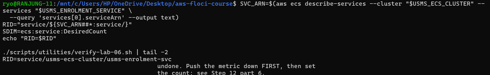

---

## Exercise 1: A memory policy, and a scale-out-only policy

**Task:** Add a third target tracking policy on memory (target 70%, scale-out cooldown 60 s, scale-in cooldown 600 s) with `DisableScaleIn = true`, and check how the number of managed alarms changes.

**What I did:**

1. I counted the managed alarms first. There were **4**: an AlarmHigh and an AlarmLow for CPU, and an AlarmHigh and an AlarmLow for requests.
2. I wrote `templates/lab-06-target-tracking-memory.json` with a **quoted** heredoc (`<<'EOF'`). The file has no shell variables, so quoting stops the shell from changing anything inside it. I checked it was valid JSON.

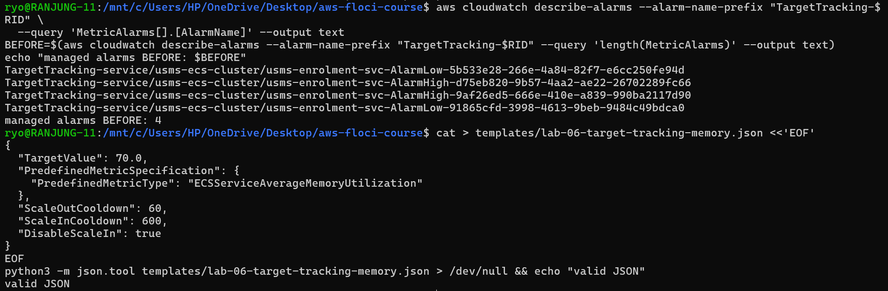

3. I created `usms-enrolment-memory-target-tracking` with `put-scaling-policy` and saved its ARN with `--query 'PolicyARN'`.

**Result:**

| Policy | Type | DisableScaleIn | Alarms |
|---|---|---|---|
| usms-enrolment-cpu-target-tracking | TargetTracking | False | 2 |
| **usms-enrolment-memory-target-tracking** | TargetTracking | **True** | 2 |
| usms-enrolment-queue-step-out | StepScaling | – | 0 |
| usms-enrolment-requests-target-tracking | TargetTracking | False | 2 |

So the target now has **three target tracking policies and one step policy**. The managed alarm count went from **4 to 6**, not 4 to 5 as on real AWS. Floci also created an **AlarmLow** for the memory policy (`MemoryUtilization < 70`), even though scale-in is disabled.

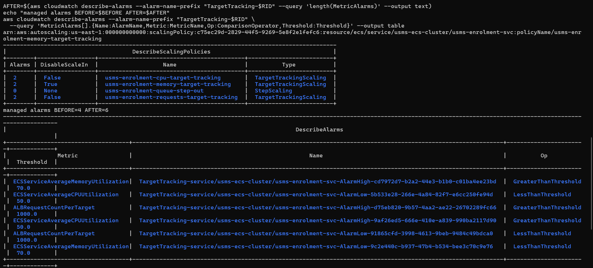

The scalable target bounds did not change (min 2, max 10), and the verify script showed the same result as before (the 3 known scheduled-action failures only). I had predicted this, because the script checks the CPU policy, the step policy and "2 or more" managed alarms, and adding a policy does not break any of those.

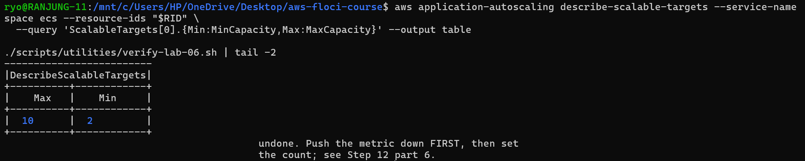

**Answers:**

- **Why five and not six?** On real AWS, a policy with `DisableScaleIn = true` gets only an **AlarmHigh**. The **AlarmLow** is not created, because its only job is to trigger scale-in, and this policy is never allowed to remove tasks. Floci created it anyway, which is why I saw 6. That is an emulator difference, not a mistake in my policy.
- **Memory 70 vs CPU 50, which scales out first?** This can't be answered from the target numbers alone. I would need to know how much CPU and how much memory one enrolment request uses, from a load test that measures both at the same time.
- **Does a scale-out-only policy change scale-in for the other two?** No. The rule from Step 9 is: scale **out** if **any** policy wants to, scale **in** only when **all** policies that are allowed to scale in agree. The memory policy does not vote on scale-in, so CPU and requests still decide it.

---

## Exercise 2: The scale-in half of step scaling

**Task:** Build a step scaling policy that **removes** tasks, together with a low-queue alarm. Test it, then delete both cleanly.

**What I did:**

1. I wrote `templates/lab-06-step-scaling-in.json` (ChangeInCapacity, Average, cooldown **300 s**) and created the policy `usms-enrolment-queue-step-in`.
2. I created the alarm `usms-enrolment-queue-low` on `USMS/Enrolment EnrolmentQueueDepth` (dimension `Service=enrolment`). It fires when the average is **below 20 for 3 periods of 60 seconds**, and its only action is the step-in policy ARN.

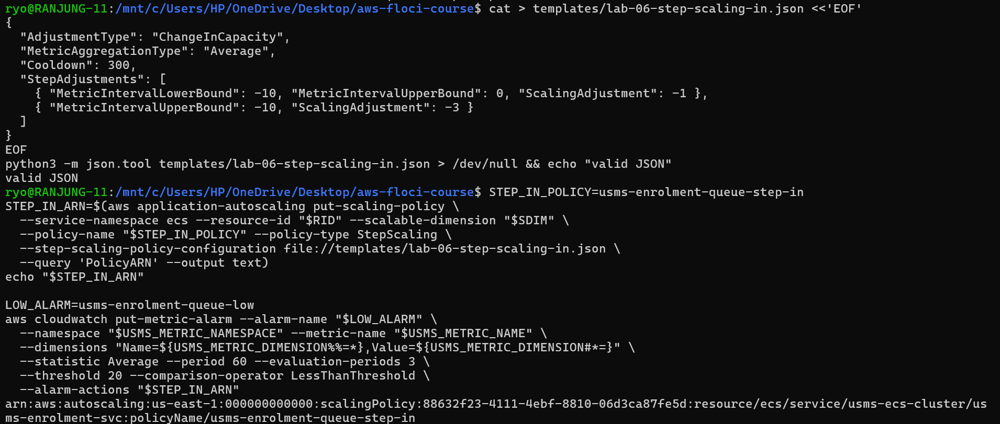

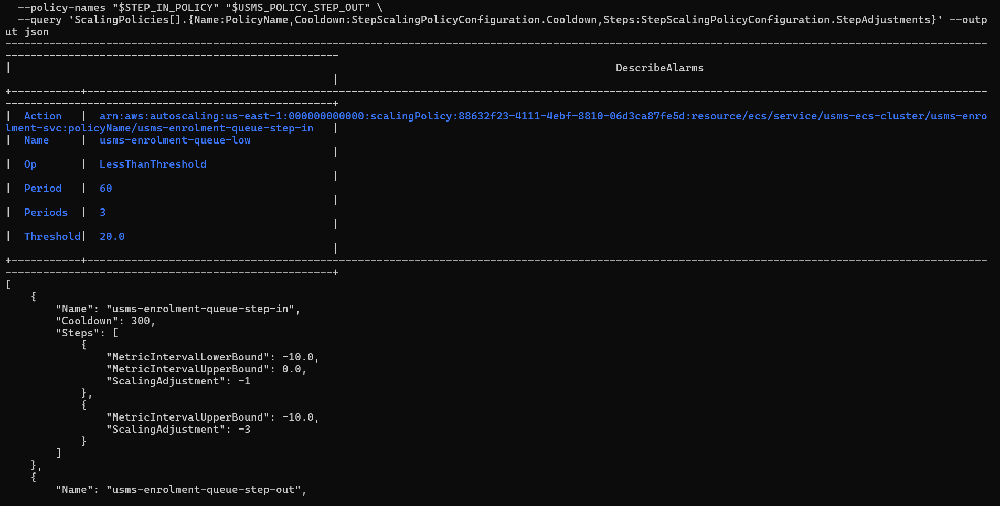

**The signs, explained.** The threshold is 20, so the "breach" is `metric − 20`. When the queue is low, this number is negative, so all the bounds are 0 or below and all the adjustments are negative:

| Queue depth | Breach | Interval | Adjustment |
|---|---|---|---|
| 10 to 20 | −10 to 0 | lower −10, upper 0 | **−1** (mild) |
| below 10 | below −10 | upper −10, no lower bound (open-ended) | **−3** (strong) |

`MetricIntervalUpperBound: 0` with `ScalingAdjustment: -1` means: "when the metric is below the threshold by up to 10, remove one task".

**Why the cooldown is 300 s (longer than the step-out's 60 s):** removing tasks too fast is risky. If traffic comes back a minute later, we have to wait for new tasks to start again. Adding tasks quickly is cheap insurance, but removing them should be slow and careful.

**The unreachable step:** the **−3** step. From the baseline of 2 tasks, 2 + (−3) = −1, which is below `MinCapacity` 2, so Application Auto Scaling clamps it to 2 and nothing happens. The −3 step can only fully apply when there are 5 or more tasks.

**Testing it:**

- I published three datapoints with value **5** (breach −15, which falls in the −3 step), then forced the low alarm into `ALARM` with `set-alarm-state`.
- **At the floor (2 tasks):** desired stayed **2** and running stayed **2**, which is exactly what the floor predicts. `describe-scaling-activities` showed only the old activities from the main lab (the queue-high alarm triggering `usms-enrolment-queue-step-out` on 14 Oct). No new activity was recorded.

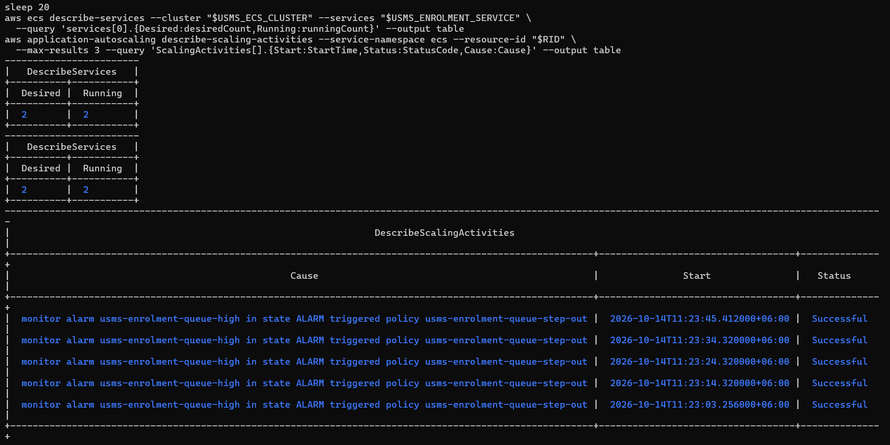

- **From 5 tasks:** I set the service to 5 tasks, reset the alarm to `OK` and forced it to `ALARM` again. After 20 seconds desired was still **5**. **Nothing happened.** Floci did not run the step-in policy this time. On real AWS, I would expect 5 + (−3) = **2** tasks and a new scaling activity naming `usms-enrolment-queue-low` as the cause.

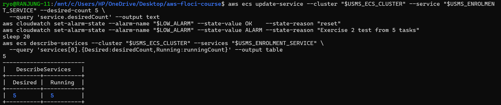

**Clean-up:** I deleted the policy `usms-enrolment-queue-step-in`. The policy list showed it was gone, and I set the service back to 2 tasks (stable).

> ⚠️ **DANGER: deleting policy `usms-enrolment-queue-step-in`**
> What: removes the Exercise 2 scale-in step policy.
> Why it is safe: it is practice only, and the KEEP step-out policy is a separate object.
> Undo: run `put-scaling-policy` again with `templates/lab-06-step-scaling-in.json`.

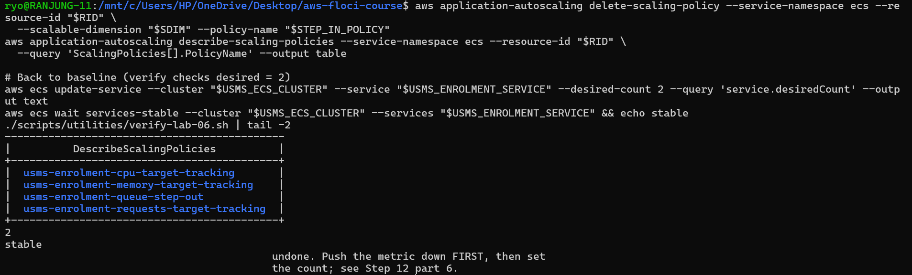

**My mistake:** the correct order is to delete the **alarm first**, because the alarm points at the policy. In Exercise 2 I only deleted the policy. I noticed this in the Exercise 4 check, where the count for `usms-enrolment-queue-low` came back as **1**, so I deleted the alarm there (see Exercise 4). This taught me to always read back that **both** objects are gone, not just the one I remembered.

**CPU step policy + CPU target tracking (paragraph):** If someone adds a step scaling policy on CPU with its own alarm at 60%, next to the CPU target tracking policy at 50%, the two policies will fight. Target tracking **calculates** the number of tasks that should bring CPU to 50% (roughly current tasks × actual CPU ÷ 50). The step policy just adds a fixed number of tasks whenever CPU passes 60%. The step policy pushes CPU well below 50%, so target tracking's low alarm removes tasks again, CPU climbs back over 60%, and the service keeps going up and down. I would keep the **target tracking** policy, because it scales in proportion to the load and AWS manages its alarms for me, and delete the step policy on CPU.

---

## Exercise 3: A scaling report tool

**Task:** Write `scripts/utilities/usms-scaling-report.sh`, a read-only report for every `usms-*` scalable target, with a computed verdict.

**How the script works:**

- It finds the repo from `${BASH_SOURCE[0]}`, so it works from **any directory**. It takes **no arguments** and has no hard-coded names. It finds every target in the `ecs` namespace whose cluster name starts with `usms-`.
- After the first `describe-scalable-targets`, the work is done in `python3`. For each target it reads the policies, the scheduled actions, the last activity and the ECS service counts. All alarm names go into **one** `describe-alarms` call.
- Step adjustments are shown as a signed list, for example `+1 / +3`, read from the configuration.
- It never crashes on missing data. No policies, no scheduled actions, an empty `Alarms` list, or an unsupported `describe-scaling-activities` are all printed as `(none)` or `n/a`.
- It uses `set -uo pipefail` **without** `-e`. It is a report, so one failing call should show as `n/a` in its row instead of stopping the whole script.
- It also writes `outputs/lab-06-scaling-report.json`.

**Verdict rules (checked top to bottom):**

| Verdict | When |
|---|---|
| PINNED | MinCapacity = MaxCapacity |
| FROZEN | any suspension switch is true |
| AT-CEILING | desired = MaxCapacity |
| AT-FLOOR | desired = MinCapacity and more than one policy |
| ELASTIC | none of the above |

**Why this order:** PINNED is first because if min = max nothing can move, whatever else is true. **FROZEN outranks AT-CEILING** because a suspended target that happens to sit at its maximum is not "at the ceiling because of demand". The suspension switch is the real reason it cannot move, and it is the first thing an operator must fix. AT-CEILING comes before AT-FLOOR because hitting the maximum may mean students are not being served, which is urgent, while sitting at the floor is the normal quiet state.

**Result:** I ran it from `~` and from the lab directory, and `diff` printed **IDENTICAL from both directories**. With the Exercise 1 memory policy still present, the verdict was **AT-FLOOR** (min 2, max 10, desired 2, running 2, no suspension). The memory policy correctly showed `scale-in=OFF`, and the step policy showed `+1 / +3`.

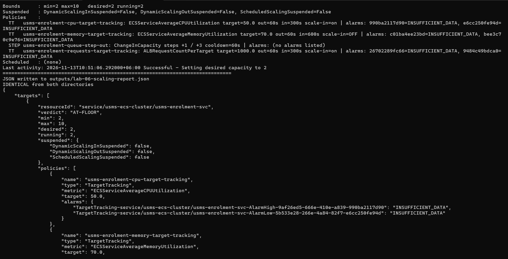

**Testing the verdicts:**

- I suspended all three switches, and the report said **FROZEN**. Then I set them back to false.
- I set min = max = 3, and the report said **PINNED**. Floci left desired at 2 even though the floor was now 3. Real AWS would raise it to 3 right away.

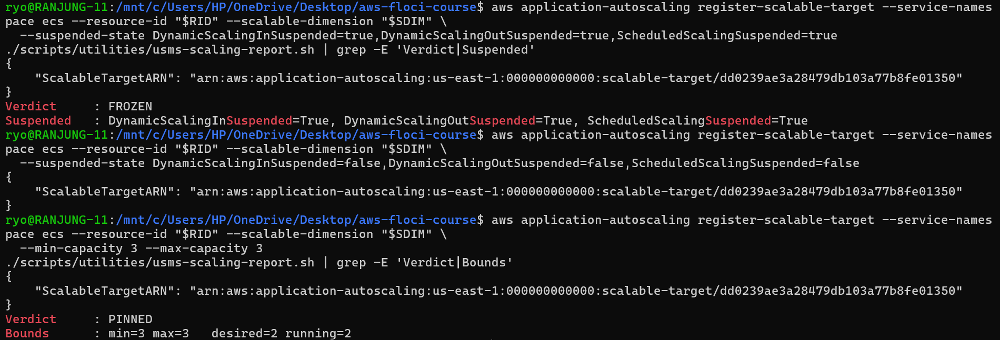

- I restored min 2 / max 10 and desired 2. The report was back to **AT-FLOOR** with all suspension switches `False`.

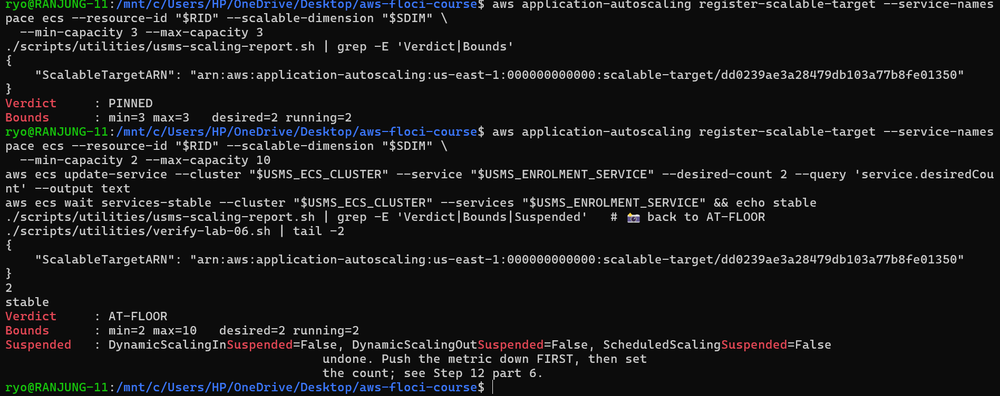

---

## Exercise 4: The enrolment-week capacity plan

### Evidence from my environment

| Item | Value |
|---|---|
| Managed **AlarmHigh** | Period 60 s × **3** evaluation periods |
| Managed **AlarmLow** | Period 60 s × **15** evaluation periods |
| Health-check grace period | `None` on Floci (Floci does not save it; Lab 05 set **60 s**) |
| Private subnets | `10.0.3.0/24` (us-east-1a) and `10.0.4.0/24` (us-east-1b) |
| Free IPs | **251** in each subnet |
| ENIs already in each subnet | 1 |

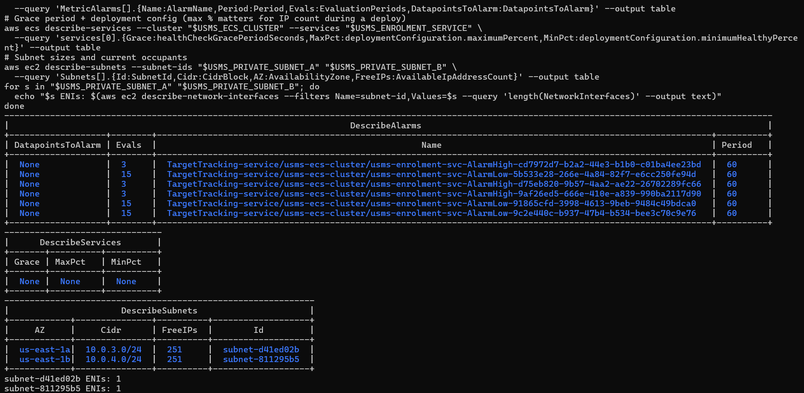

### Is the problem solved? (three sentences)

Reactive auto scaling is good at following load that grows over several minutes, and at shrinking again so we do not pay for idle tasks. It is bad at sudden spikes, because every step waits for alarms, task start-up and health checks before new capacity serves traffic. In the first twenty minutes of a cohort opening, the service would still be climbing from 2 tasks while forty times the normal traffic is already arriving, which is exactly how the portal failed last year.

### Why forty times the traffic is not a scaling problem

**Time to go from 2 to 10 tasks** (CPU target tracking):

| Delay | Seconds | Source |
|---|---|---|
| AlarmHigh: 3 periods × 60 s | 180 | my alarm table above |
| CloudWatch metric delay | about 60 | metrics arrive about 1 minute late |
| Policy invocation | about 0 | seconds |
| Task start-up | about 60 | Fargate start time; Floci could not measure it (Exercise 5) |
| Health-check grace period | 60 | Lab 05 |
| **One scaling round** | **about 360 s (6 min)** | |

Target tracking scales in proportion: at 100% CPU it calculates 2 × 100 / 50 = **4**, then 4 → **8**, then 8 → **10** (the cap). That is 3 rounds × 6 minutes ≈ **18 minutes**, which is almost the whole first twenty minutes.

**What the ceiling of 10 means:** at Step 9's target of 1000 requests per target per minute, 10 tasks handle 10 × 1000 = 10,000 requests per minute ≈ **167 requests per second**. If normal traffic needs about 2 tasks, forty times the traffic needs about **80 tasks**. A ceiling of 10 can never serve it, however fast scaling is. This is a **capacity** problem (the ceiling is too low), not a **throughput** or speed problem.

### The ceiling, checked against Lab 02

- Each `/24` subnet has 256 addresses. AWS reserves **5 addresses in every subnet**: the first four and the last one. Source: AWS VPC User Guide, "Subnet CIDR blocks", https://docs.aws.amazon.com/vpc/latest/userguide/subnet-sizing.html. That gives 256 − 5 = **251**, which matches the `FreeIPs` in my screenshot.
- Each subnet already has 1 ENI, so 251 − 1 = **250** usable in each, and **500** in total.
- Each Fargate task (`awsvpc` mode) uses **1 IP address**. During a rolling deployment ECS can run up to 200% of the tasks (old and new together), so the safe ceiling is 500 ÷ 2 = **250 tasks**.
- So the subnets are **not** the limit. A ceiling of 40 (or even 80) fits easily.

### Capacity plan

**Assumptions:** enrolment opens on **14 January 2027** and lasts three weeks. A new cohort becomes eligible at **08:00** on the **14th, 21st and 28th**. Time zone is **Asia/Thimphu**.

| Action | Schedule | Min | Max |
|---|---|---|---|
| Enrolment window starts | `at(2027-01-14T00:00:00)` | 4 | 40 |
| Cohort morning, before the spike | `cron(30 7 14,21,28 1 ? 2027)` | 30 | 40 |
| Cohort morning, after the first hour | `cron(30 9 14,21,28 1 ? 2027)` | 4 | 40 |
| Enrolment window ends | `at(2027-02-04T00:00:00)` | 2 | 10 |

- Every action uses `--timezone Asia/Thimphu`.
- The floor of 30 is raised **30 minutes before** each cohort opens, because reactive scaling is too slow for the first hour.
- The floor of 4 covers the "double traffic" for the rest of the three weeks.
- The **ceiling is raised from 10 to 40** for the window, which the subnets can support. The request `TargetValue` of 1000 should only be changed after a load test.
- Every change is **reversible in one command**: `delete-scheduled-action` for an action, or one `register-scalable-target --min-capacity 2 --max-capacity 10` to go back to normal.
- Note: this Floci build does not support scheduled actions, so the plan can only be applied on real AWS.

### Monthly cost estimate

**Prices** (us-east-1, Linux/x86): Fargate **$0.04048 per vCPU-hour** and **$0.004445 per GB-hour** (https://aws.amazon.com/fargate/pricing/). CloudWatch is **$0.10 per standard alarm per month** and **$0.30 per custom metric per month** (https://aws.amazon.com/cloudwatch/pricing/).

**One task** (from `configs/lab-04.env`: 256 CPU = 0.25 vCPU, 512 MiB = 0.5 GB):
0.25 × 0.04048 + 0.5 × 0.004445 = **$0.01234 per hour**.

| Extra cost | Derivation | Cost |
|---|---|---|
| Floor 4 instead of 2 for 3 weeks | 2 extra tasks × 504 h = 1,008 task-hours | |
| Cohort peaks | 26 extra tasks × 2 h × 3 days = 156 task-hours | |
| **Fargate total** | 1,164 task-hours × $0.01234 | **$14.36** |
| CloudWatch alarms | 5 alarms × $0.10 | $0.50 |
| Custom metric | 1 × $0.30 | $0.30 |
| **Total extra for enrolment month** | | **≈ $15.16** |

Assumptions: normal traffic is served by 2 tasks, each cohort peak lasts about 2 hours, and scaling above the floor during the rest of the window is small enough to ignore.

### What I need from the project lead

1. The **exact dates and times** when each cohort becomes eligible, so the scheduled actions fire at the right moment.
2. **Approval of the budget** and of raising the maximum from 10 to 40 tasks (and the Fargate quota on the account).
3. **A load test that measures how many requests per second one task can really serve.** Nobody has measured this yet. Section 11 says the `TargetValue` of 1000 is only a starting guess, and the whole plan depends on this number.

### Tidy-up

> ⚠️ **DANGER: deleting `usms-enrolment-memory-target-tracking`**
> What: removes the Exercise 1 memory policy, and its managed alarms are removed with it.
> Why it is safe: it is practice. It is not in `configs/lab-06.env` and not in the KEEP list. The CPU and requests policies stay.
> Undo: run Exercise 1's `put-scaling-policy` again with `templates/lab-06-target-tracking-memory.json`.

After the delete, only the **three KEEP policies** were left (CPU, requests, queue-step-out), and the managed alarm count was back to **4**. The step-in policy count was **0**, but the `usms-enrolment-queue-low` alarm count was **1**, which is how I found the alarm I had missed in Exercise 2.

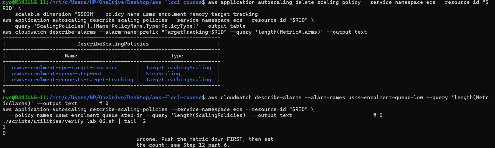

> ⚠️ **DANGER: deleting alarm `usms-enrolment-queue-low`**
> What: removes the Exercise 2 low-queue alarm permanently.
> Why it is safe: its policy is already deleted, so the alarm points at nothing. The KEEP alarm `usms-enrolment-queue-high` is not touched.
> Undo: run the Exercise 2 `put-metric-alarm` command again.

```bash
aws cloudwatch delete-alarms --alarm-names usms-enrolment-queue-low
aws cloudwatch describe-alarms --alarm-names usms-enrolment-queue-low --query 'length(MetricAlarms)' --output text   # 0
./scripts/utilities/verify-lab-06.sh | grep -E 'FAIL|PASS='
```

<!-- Add the screenshot of the alarm delete + verify here as assets/ex4.2.png -->


Nothing in the KEEP list was deleted. The verify script shows the same result as before the exercises: only the 3 scheduled-action failures that Floci cannot support.

---

## Exercise 5: The hand-off to Lab 10

### 5.1 History export

I wrote `scripts/utilities/usms-scaling-history.sh`. It finds the service ARN, works out the resource ID from it (`service/usms-ecs-cluster/usms-enrolment-svc`), and then exports the following into **one** JSON document, `outputs/lab-06-scaling-history.json`:

- the scalable target
- every policy
- every scheduled action
- every alarm involved, including custom alarms whose `AlarmActions` point at one of the policies
- every scaling activity, including not-scaled activities if the CLI supports the flag

No policy name, alarm name or resource ID is typed in the script. The `"generated"` timestamp comes from `python3`.

**Result:** I ran it from `~`. It wrote **3 policies, 0 scheduled actions (Floci cannot create them) and 5 alarms** (the 4 managed alarms plus `usms-enrolment-queue-high`). The file is valid JSON, **11,366 bytes**, generated at `2026-11-13T05:00:26Z`.

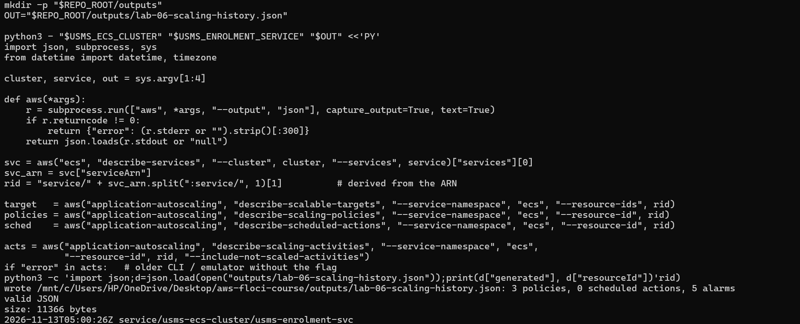

### 5.2 Scale-out latency

I recorded a UTC timestamp, raised `MinCapacity` to **4** by re-registering the target, and polled `desiredCount` and `runningCount` every 5 seconds.

**Result: nothing scaled.** For 20 polls, desired and running both stayed at **2**, so I stopped the loop after **129 seconds** (`05:00:50Z` → `05:02:59Z`, capacity 2 → 2). Floci saves the new floor, but it does not raise `desiredCount` to match it. I saw the same thing in Exercise 3 with min = 3.

So the **129 s in `outputs/lab-06-scale-latency.txt` is not a real latency**. It only means "no scale-out was seen within 129 seconds". On real AWS, raising the floor sets desired to 4 within seconds, and a small Fargate task like `nginx:stable-alpine` usually takes **under a minute** to reach RUNNING. That is the figure I used in the Exercise 4 calculation.

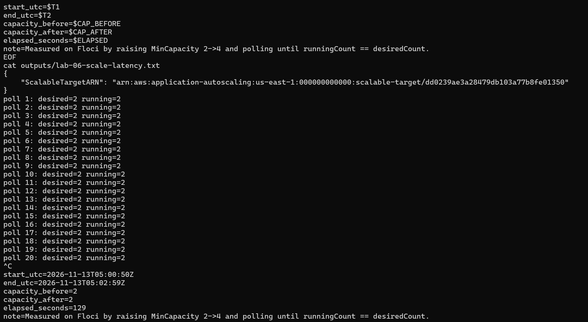

Afterwards I set the floor back to **min 2 / max 10** and the service back to **2** tasks (stable).

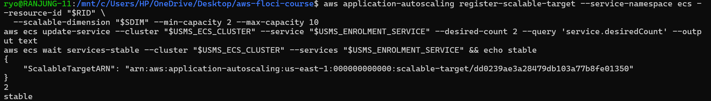

### 5.3 configs/lab-06.env

I appended two values, both taken from files rather than typed:

```
export USMS_SCALING_HISTORY_FILE=outputs/lab-06-scaling-history.json
export USMS_SCALE_LATENCY_SECONDS=129
```

The empty-value check passed, and the file now has **24 exports** (22 + 2).

<!-- assets/ex5.3.png is empty (0 bytes). Retake: tail -4 configs/lab-06.env; the empty-value check; grep -c '^export' -->


### 5.4 Readiness file for Lab 10

I read the policy attached to `usms-ecs-task-role` with `list-attached-role-policies`, `get-policy` and `get-policy-version`, and took the bucket ARN **from the policy document**. The policy has two `Resource` entries. I recorded the **bucket** one (`arn:aws:s3:::usms-student-data`), not the objects one (`.../usms-student-data/*`).

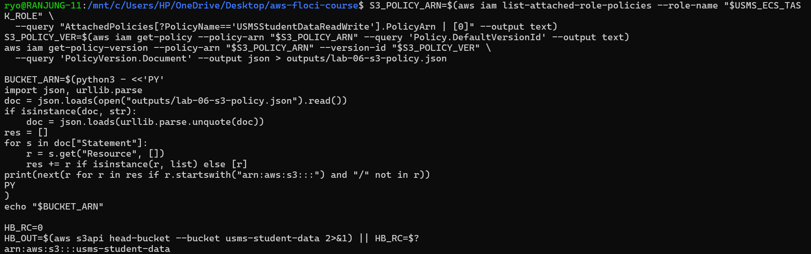

`outputs/lab-06-lab10-readiness.txt`:

| Line | Value |
|---|---|
| history_file | `outputs/lab-06-scaling-history.json` (11,366 bytes) |
| scale_latency | 129 s (no scale-out observed on Floci, see 5.2) |
| task_role_arn | `arn:aws:iam::000000000000:role/usms-ecs-task-role` |
| bucket_arn | `arn:aws:s3:::usms-student-data` |
| permissions | `USMSStudentDataReadWrite` (Lab 01) lets the task role list the bucket and get/put/delete objects in it, and denies deleting the bucket itself |
| head_bucket_exit | **0** (`"BucketRegion": "us-east-1"`) |

**The `head-bucket` result was different from what the lab expected.** The exercise says the command will fail, but it returned **exit code 0**. The bucket `usms-student-data` **already exists** in my Floci, because I have already done the later labs. So the "after Lab 10" state is already true: the bucket exists, and `usms-ecs-task-role` already has real access to it through the same Lab 01 policy, with no change to the role.

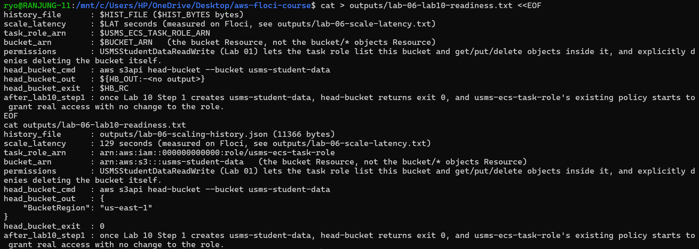

---

## What the exercises taught me

- **A policy that never scales in has no low alarm on real AWS.** Floci still made one, so an emulator can differ from AWS in small details.
- **Scale-in needs negative numbers and more patience.** All bounds are 0 or below, all adjustments are negative, and the cooldown is longer. The floor can make a step impossible to reach.
- **Delete things in dependency order and read back every object.** I forgot the low alarm in Exercise 2, and only a read-back in Exercise 4 found it.
- **Verdicts should come from real fields.** My report reads the bounds, suspension switches and counts, so FROZEN and PINNED were detected correctly.
- **Auto scaling is not a fix for a 40× spike.** It takes about 18 minutes to grow from 2 to 10 tasks, and 10 tasks are far too few anyway. The answer is scheduled floors before each cohort, a higher ceiling, and a load test to find the real numbers.
- **Write down what really happened.** Floci did not run the step-in policy and did not apply the new floor. I recorded that instead of pretending it worked.
