# Lab 07 Practical Report: Deploying a Microservices Application on Amazon EKS

## 1. Aim / Objective

The aim of this lab is to run the USMS application on **Kubernetes** instead of ECS. I created an **EKS cluster** and a **managed node group** inside the Lab 02 VPC, then deployed **three microservices** (`usms-gateway`, `usms-enrolment` and `usms-results`) with `kubectl`. The AWS side was done with the AWS CLI on the local emulator Floci, and the Kubernetes side was done with `kubectl`.

The specific objectives were to:

- Create **two IAM roles**: a cluster role that trusts `eks.amazonaws.com` and a node role that trusts `ec2.amazonaws.com`, each with its own permissions policy.
- Attach Lab 01's **`USMSStudentDataReadWrite`** to the node role without changing it.
- Create the **cluster** `usms-eks-cluster` across all four Lab 02 subnets, with the **`_lb_ports_`** tag that Lab 08 needs.
- Create the **node group** `usms-eks-nodes` in the two **private** subnets only (min 2, max 4, desired 2).
- Point `kubectl` at the cluster and deploy the three services from **YAML manifests**.
- Prove the services find each other **by DNS name**, not by IP address.
- Use a **ConfigMap** and a **Secret**, and show that a Secret is only base64, not encryption.
- Do a **rolling update** and a **rollback**, and cause **failures on purpose** so I can diagnose them.
- Prove everything survives a Floci restart, save the values to `configs/lab-07.env`, and check the lab with a verification script.

## 2. Introduction

**Amazon EKS (Elastic Kubernetes Service)** is AWS's managed Kubernetes. Kubernetes is a system that runs containers on a group of machines and keeps them running.

An EKS cluster has two halves:

| Half | Who runs it | What is in it |
|---|---|---|
| **Control plane** | AWS. I cannot log in to it. | The API server, etcd (the cluster's database), the scheduler and the controllers |
| **Data plane** | Me. These are my machines. | The **nodes** (EC2 instances), the kubelet on each node, and my **pods** |

Because of this split there are **two IAM roles**. The control plane uses the **cluster role**, and the nodes use the **node role**. They trust different services and cannot be swapped.

The main Kubernetes objects I used:

| Object | Simple meaning |
|---|---|
| **Namespace** | A folder for objects. All my objects are in `usms`. |
| **Deployment** | "Keep N copies of this pod running." It creates a **ReplicaSet**, and the ReplicaSet creates the pods. |
| **Service (ClusterIP)** | A fixed name and IP address in front of a group of pods. It sends traffic only to pods that are **ready**. |
| **ConfigMap** | Settings (not secret) given to the pods as environment variables or files. |
| **Secret** | Like a ConfigMap but for passwords. It is only **base64 encoded**, not encrypted. |
| **ServiceAccount** | An identity for pods. With IRSA it can be linked to an IAM role. |

There are also two kinds of health check (probes):

- **Readiness probe:** "Can this pod take traffic?" If it fails, the pod is **removed from the Service**, but it is not restarted.
- **Liveness probe:** "Is this pod stuck?" If it fails, the container is **restarted**.

## 3. Use Case

**USMS use case:** USMS has many small services: one for enrolment, one for results, and later more. A student's request first reaches a **gateway**, which sends it to the right service:

- `/enrolment/` goes to **usms-enrolment** (2 pods), for example when a student registers for a module.
- `/results/` goes to **usms-results** (2 pods), for example when a student checks their marks.

With Kubernetes:

- The gateway uses **DNS names** such as `usms-enrolment.usms.svc.cluster.local`, so pods can be added, removed or replaced without changing the gateway.
- Each service has **2 pods**, so one pod can fail and the service still works.
- A new version can be rolled out **without downtime**. If it is bad, it can be **rolled back** with one command.
- The same YAML files would work on any Kubernetes cluster, not only on AWS.

## 4. System Architecture / Design

**How it works in simple words:**

1. The **AWS CLI** talks to Floci on port **4566** and creates the AWS objects: roles, security group, cluster and node group.
2. **kubectl** does not talk to Floci. It talks to the **Kubernetes API server** on port **6443**. These are two different tools and two different endpoints.
3. A request to the gateway goes to the gateway pod. nginx forwards it **by name** to the enrolment or results Service.
4. **CoreDNS** turns the name into the Service's **ClusterIP**, and **kube-proxy** spreads the traffic across the healthy pods behind it.
5. Nothing inside the cluster mentions AWS, so the Kubernetes part is portable. Only the AWS part (roles, VPC, node group) is AWS-specific.

## 5. Implementation Procedure

### Step 1: Start the environment

I loaded the five env files (`course.env` and Labs 01–04) and ran `whoami.sh` and `floci-storage-check.sh`. The account is **000000000000** (Floci, not real AWS), and the storage mode is **hybrid**, so the data survives a restart.

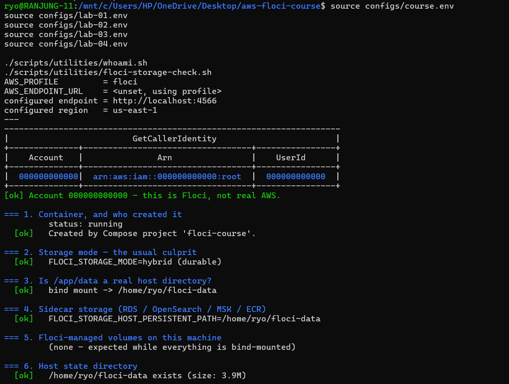

Then I ran the earlier verify scripts and printed the four subnets:

- Lab 02: **PASS=31, FAIL=2**
- Lab 04: **PASS=39, FAIL=0**
- All four subnet IDs are present: public-a `subnet-d65d69cb`, public-b `subnet-0fbe427b`, private-a `subnet-d41ed02b`, private-b `subnet-811295b5`.

The lab asks for FAIL=0 from Lab 02. I had 2 failures, but the parts this lab needs (the VPC and all four subnets) are there, and the Lab 07 verify script checks them again later.

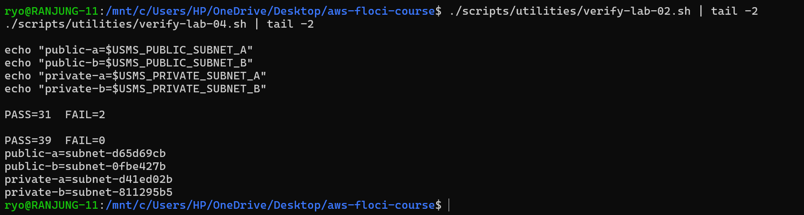

### Step 2: Find out what my Floci build supports

I wrote `scripts/utilities/eks-support-probe.sh` to check whether the `eks` API works and which tools are installed. The result was **PATH A - use aws eks throughout**: `eks list-clusters` was **OK**, and kubectl, docker and python3 were installed. k3d was **MISSING** at this point, which is fine for Path A.

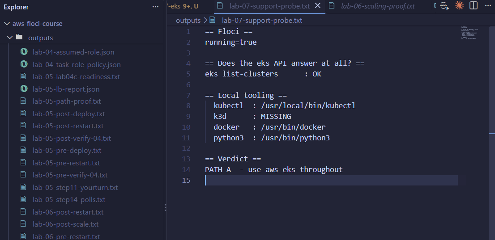

I added the verdict to `notes/lab-07-notes.md`.

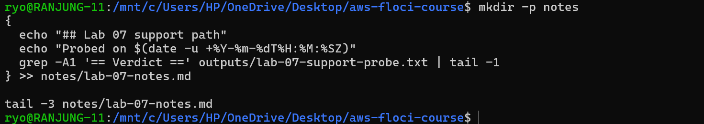

### Step 3: Control plane and data plane

There was nothing to run in this step. I read about the control plane / data plane split, which is explained in Section 2. The important point: an ACTIVE cluster with **no nodes runs nothing**, and the two halves need **two different IAM roles**.

### Step 4: Write the two trust policies

A trust policy says **who may use a role**. I wrote two:

- `trust-eks-cluster.json`: **`eks.amazonaws.com`** (the EKS control plane)
- `trust-eks-node.json`: **`ec2.amazonaws.com`** (a node is an EC2 instance)

I used a **quoted heredoc** (`<< 'EOF'`) so the shell does not change anything inside the JSON. Both files are valid JSON.

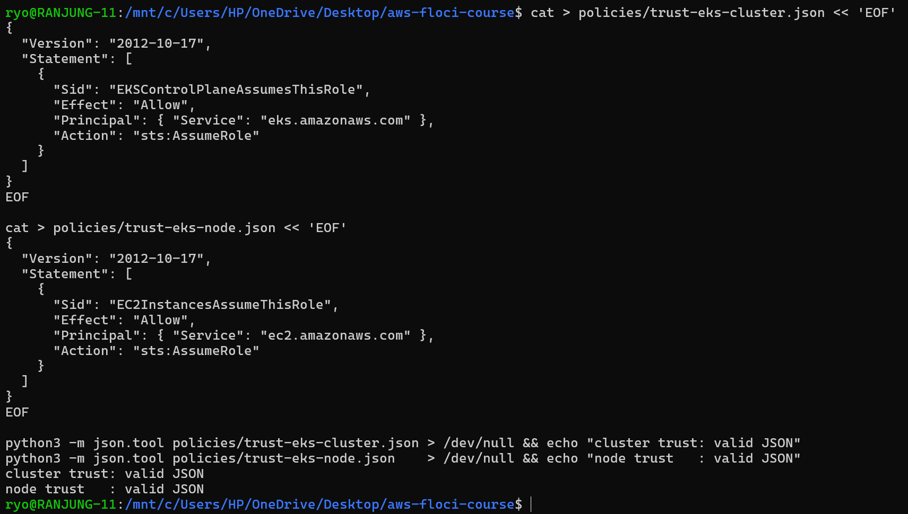

The check prints the right service and `sts:AssumeRole` for each file.

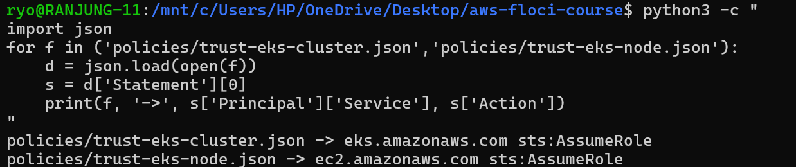

### Step 5: Write the two permissions policies

On real AWS I would attach the AWS managed policies (`AmazonEKSClusterPolicy`, `AmazonEKSWorkerNodePolicy`, `AmazonEKS_CNI_Policy` and the ECR read-only policy). Floci may not have them, so I wrote my own local versions.

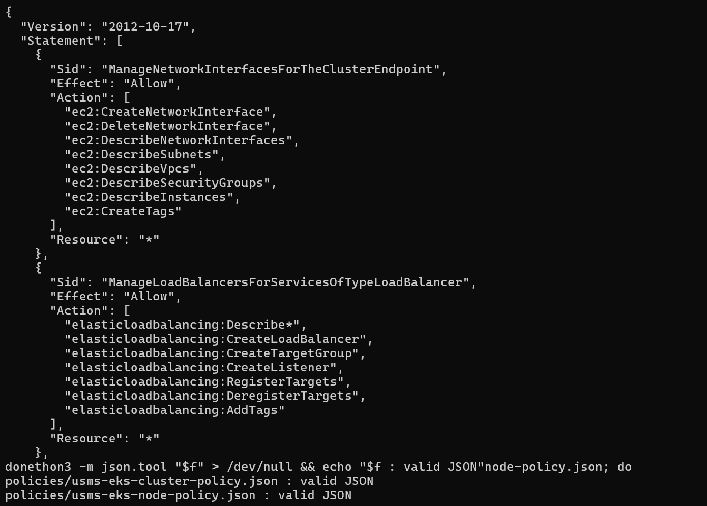

| Policy | Statements |
|---|---|
| **USMSEKSClusterPolicy** | Network interfaces (8 actions), load balancers (7 actions), and a **Deny** outside `us-east-1` |
| **USMSEKSNodePolicy** | Kubelet registers with the cluster (3), VPC CNI gives pods IP addresses (11), pull images from ECR (4), write logs to `/usms/eks/*` (4), and a **Deny** outside `us-east-1` |

`"Resource": "*"` is needed for the network actions, because the network interfaces do not exist yet, so their ARNs cannot be known in advance. The log action names its log group, because that ARN *is* known.

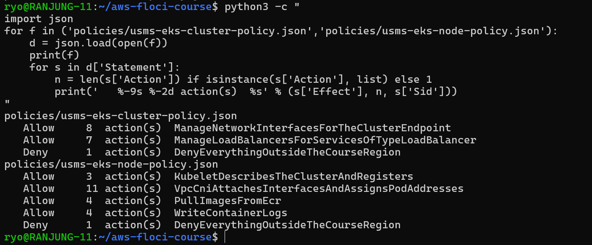

### Step 6: Create the cluster role and the security group

**Part 1:** `create-role` said **`EntityAlreadyExists`**, because the role was left over from an earlier try. Instead of creating it again, I read it back. It already trusted **`eks.amazonaws.com`**. I also ran `update-assume-role-policy` with my file to make sure the trust policy matched exactly.

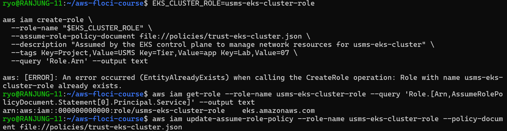

**Part 2:** I created `USMSEKSClusterPolicy` and attached it to the role. The `||` fallback means that if the policy already exists, the command looks up its ARN instead of failing.

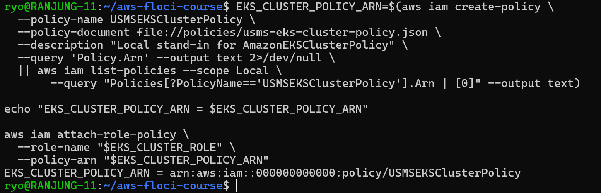

**Part 3:** I created the security group **`usms-eks-cluster-sg`** (`sg-a63d3d7c3d0e5469f`) **inside the Lab 02 VPC**, and allowed **TCP 443 only from the VPC CIDR** (`10.0.0.0/16`). Port 443 is used because the Kubernetes API speaks HTTPS. It is limited to the VPC because this is an admin API, not a public website.

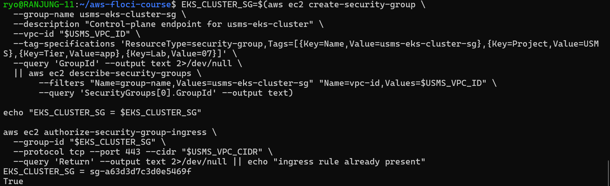

Verify: the role has `USMSEKSClusterPolicy`, trusts `eks.amazonaws.com`, and the security group is in **`vpc-20628f13`** with port **443**.

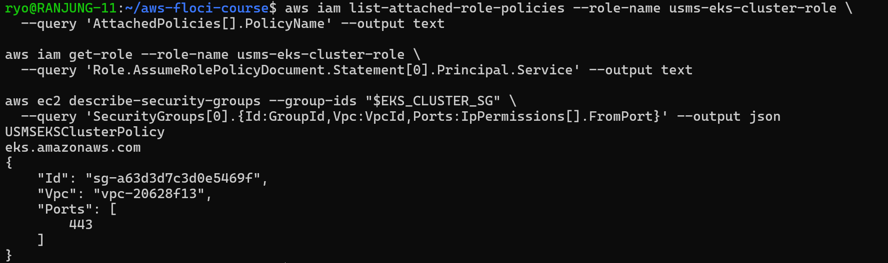

### Step 7: Create the node role and attach Lab 01's policy

I created **`usms-eks-node-role`** (trusts `ec2.amazonaws.com`) and attached `USMSEKSNodePolicy` to it.

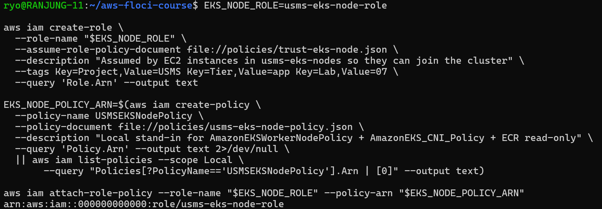

Then I looked up Lab 01's `USMSStudentDataReadWrite` **by name** and attached it to the node role without changing it. It now has **three holders**: `usms-ec2-app-role` (Lab 03), `usms-ecs-task-role` (Lab 04) and `usms-eks-node-role` (this lab).

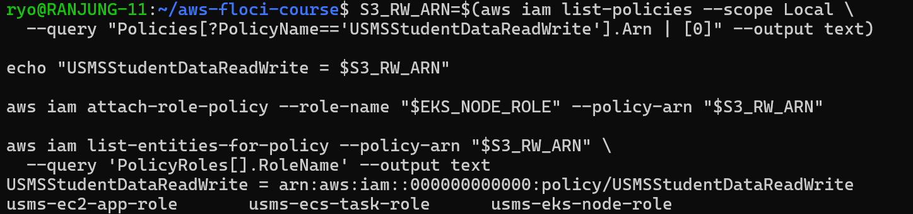

Verify: the node role has both policies and trusts **`ec2.amazonaws.com`**.

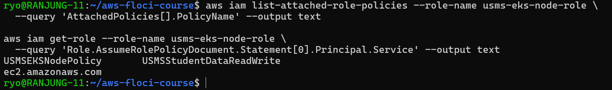

One weakness: a policy on the node role is given to **every pod on every node**. The better way is IRSA (Step 21).

### Step 8: Create the cluster

**Part 1:** I wrote the request body `templates/lab-07-create-cluster.json`. This time I used an **unquoted heredoc** (`<< EOF`) on purpose, so the shell put in the real subnet IDs, security group and role ARN. The file has all **four subnets** and the tag **`_lb_ports_: 8081,8082`**. Lab 08 needs this tag to expose services, and it can only be set when the cluster is created.

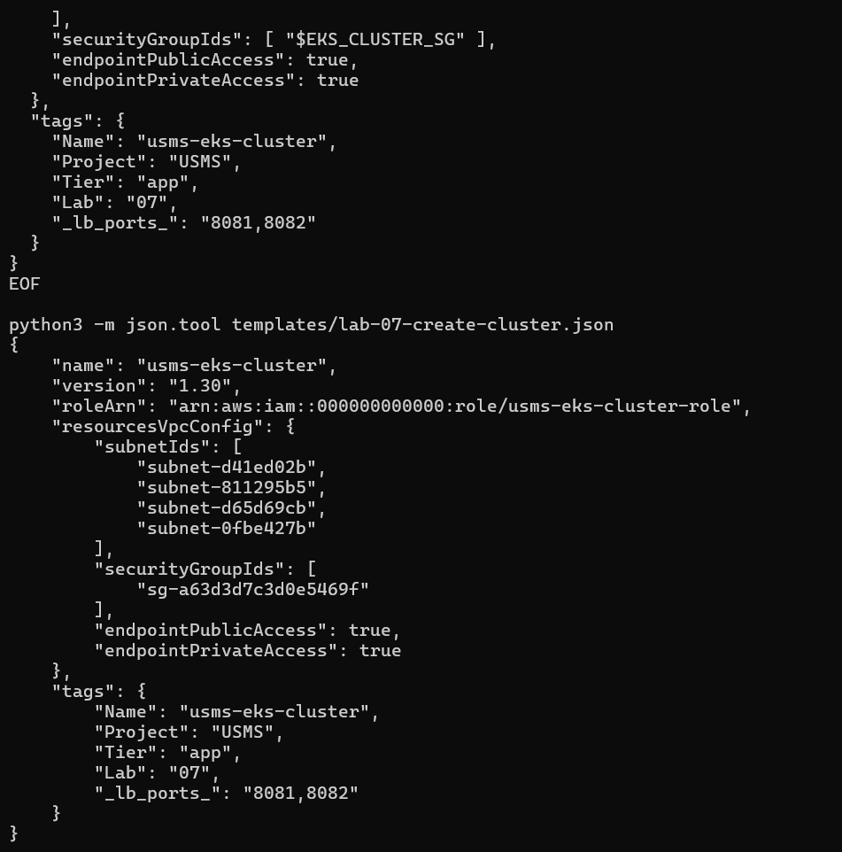

**Part 2:** I assumed **`usms-developer-role`** from Lab 01 to create the cluster. `get-caller-identity` shows `assumed-role/usms-developer-role`.

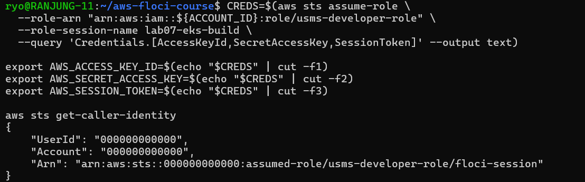

**Part 3 (Path A):** `aws eks create-cluster` returned status **CREATING** and version **1.30**. CREATING is correct, because cluster creation takes time.

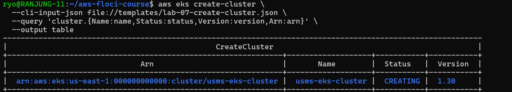

**Part 3 (k3d):** After installing k3d, I also created a k3d cluster with the same name (1 server, 2 agents, API port 6443, ports 8081/8082 to the load balancer). I used this cluster for all the `kubectl` work from Step 11 onward (see Step 11).

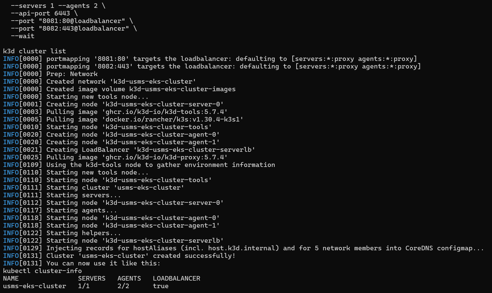

**Part 4:** I removed the assumed-role credentials with `unset`, and `whoami.sh` shows me back as `root` in account 000000000000.

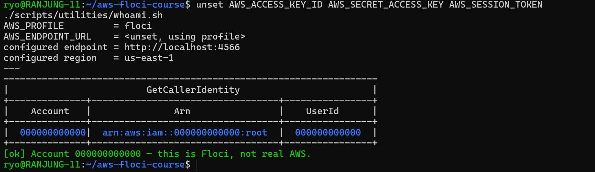

### Step 9: Wait for the cluster

I waited for the cluster with `aws eks wait cluster-active`, which has a polling loop as a fallback. The status became **ACTIVE**.

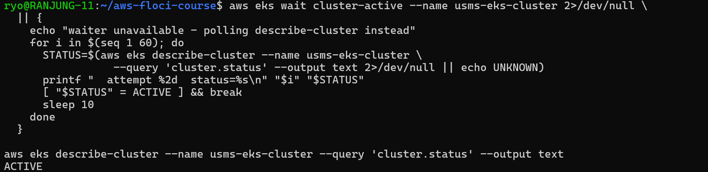

I read the cluster back and saved it to `outputs/lab-07-cluster.json`:

- Status **ACTIVE**, version **1.30**
- Endpoint **`https://localhost:6500`**
- **4 subnets**, VPC **`vpc-20628f13`** (the Lab 02 VPC)
- Security group `sg-a63d3d7c3d0e5469f`
- Tags include **`_lb_ports_: 8081,8082`**

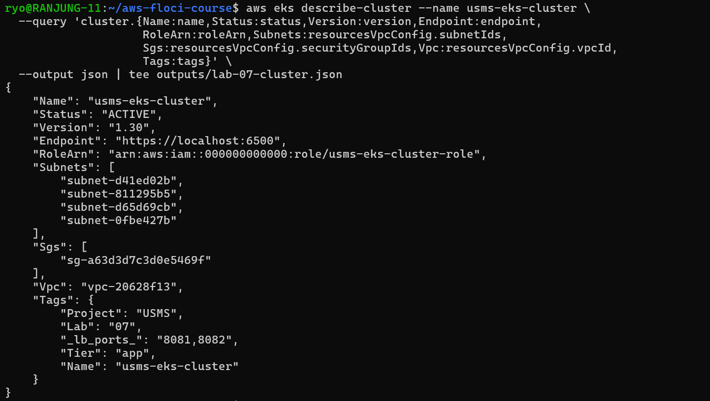

The `_lb_ports_` tag on its own prints **`8081,8082`**, so Lab 08 Step 15 will work.

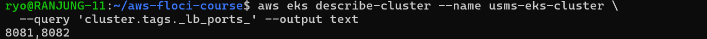

### Step 10: Create the managed node group

I wrote `templates/lab-07-create-nodegroup.json`: **min 2, max 4, desired 2**, only the **two private subnets**, instance type `t3.small`, AMI `AL2023_x86_64_STANDARD`, node role `usms-eks-node-role`, and node labels `workload=usms` and `tier=app`.

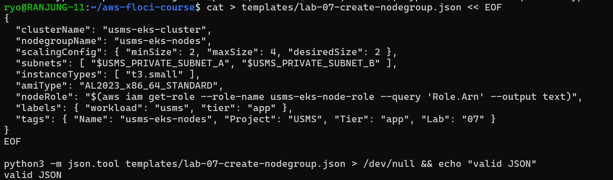

`create-nodegroup` returned **ACTIVE** with desired **2**.

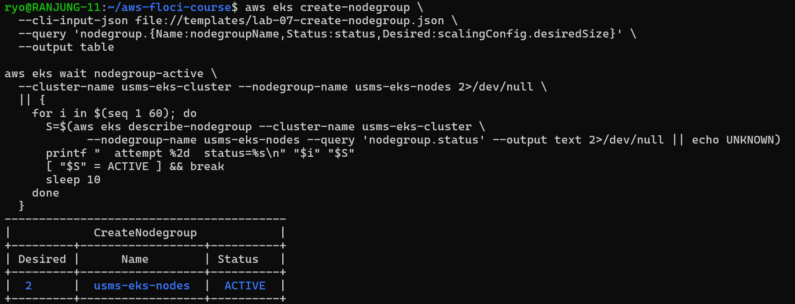

Verify: **ACTIVE**, subnets are exactly `subnet-d41ed02b` and `subnet-811295b5` (the private pair), and the role is `usms-eks-node-role`. Nodes should never be in a public subnet.

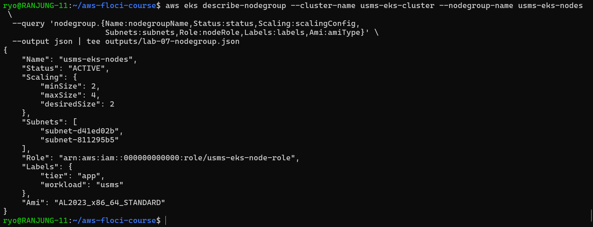

On Floci, `t3.small` and the AMI are **only recorded**. No real EC2 instances are started.

### Step 11: Point kubectl at the cluster

**Part 1 (Path A):** `aws eks update-kubeconfig` added the context **`usms-eks`** to `~/.kube/config`. My kubeconfig also had other contexts from other courses (kind clusters).

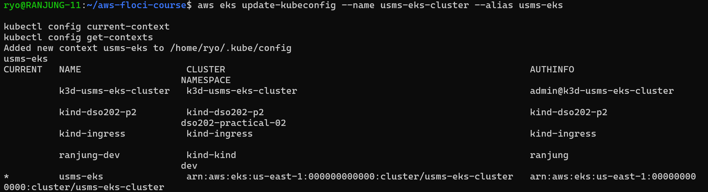

**Part 1 (k3d):** I merged the k3d kubeconfig and switched to the context **`k3d-usms-eks-cluster`**. I did all the Kubernetes steps on this context.

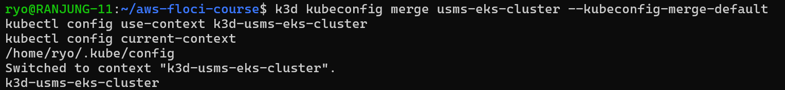

**Part 2:** `kubectl cluster-info` shows the control plane at `https://0.0.0.0:6443`, plus CoreDNS and metrics-server. `kubectl get nodes` shows **3 nodes, all Ready**: `server-0` (control-plane) and `agent-0` / `agent-1`, on Kubernetes **v1.30.4+k3s1**.

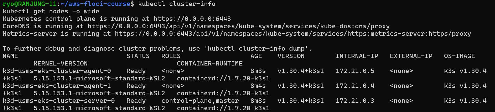

I also used the Step 11 fallback: I saved the cluster's own certificate-based kubeconfig to `outputs/lab-07-kubeconfig.yaml` with `chmod 600`. This file contains certificates, so it is a credential.

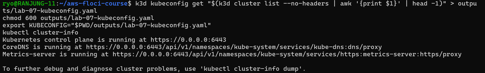

`git check-ignore` proves Git ignores it (rule `outputs/*` on line 35 of `.gitignore`).

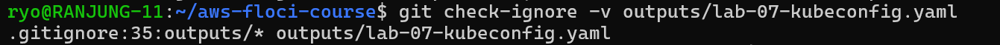

Verify: **3** nodes, **yes** to `auth can-i create deployments`, and the resource list includes configmaps, pods, secrets and serviceaccounts.

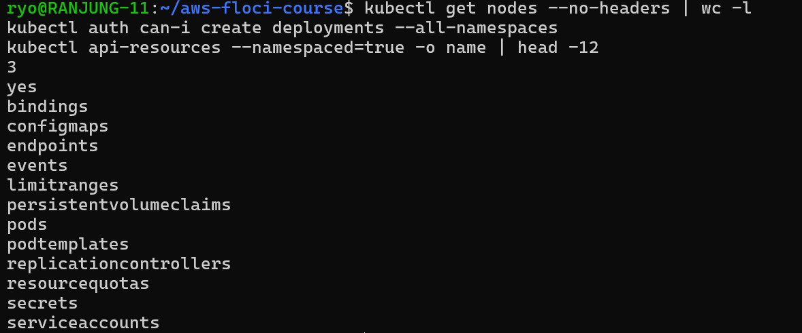

### Step 12: Create the namespace

I wrote `manifests/lab-07/00-namespace.yaml` and applied it: **`namespace/usms created`**. The `manifests/lab-07/` folder did not exist the first time, so I created it with `mkdir -p` first.

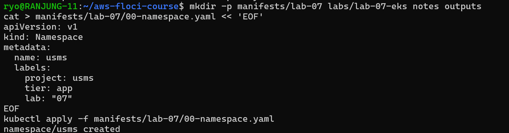

I made `usms` the **default namespace** for my context, so I do not have to type `-n usms` every time.

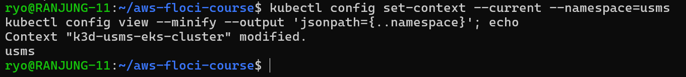

Verify: the namespace is **Active** with labels `lab=07`, `project=usms` and `tier=app`, and it is empty.

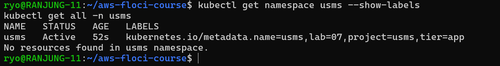

### Step 13: Deploy usms-enrolment

**Part 1:** I created the shared ConfigMap **`usms-app-config`** with 4 keys: `APP_ENVIRONMENT=laboratory`, `APP_CAMPUS=rtc`, `APP_VERSION=1.0.0` and `APP_REGION=us-east-1`.

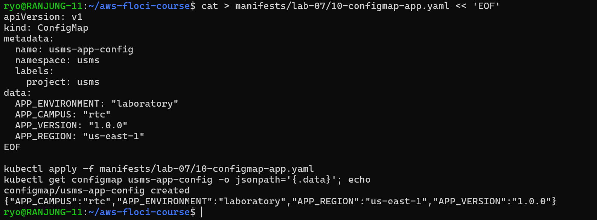

**Part 2:** `20-enrolment.yaml` has three objects separated by `---`:

- A **ConfigMap** with the nginx template. `/healthz` returns `ok`, and `/` returns JSON with the pod name and node name.
- A **Deployment** with **2 replicas**, image `nginx:1.27-alpine`, **CPU request 50m** (Lab 08's autoscaler needs this), a **readiness** and a **liveness** probe on `/healthz`, and a rolling update with **`maxUnavailable: 0, maxSurge: 1`**.
- A **ClusterIP Service** on port 80.

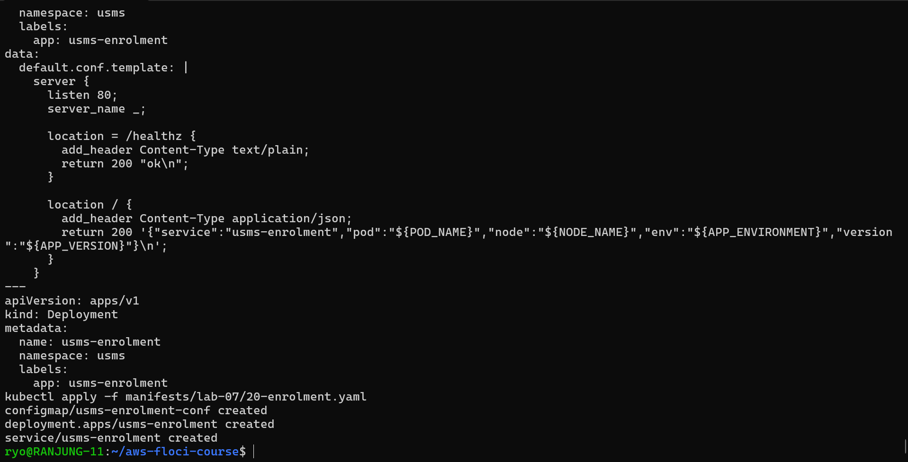

Verify: the Deployment is **2/2**, the ReplicaSet is `usms-enrolment-5cf94ff846`, the two pods are on **different nodes** (agent-0 and agent-1), and the Service `10.43.24.45` has **2 endpoints** (`10.42.0.5:80` and `10.42.1.5:80`).

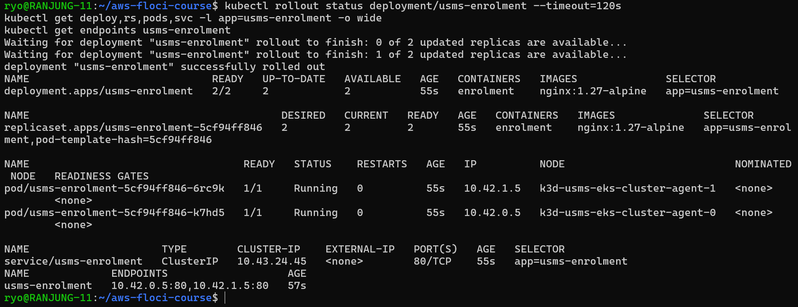

**Part 3:** A busybox pod fetched `http://usms-enrolment.usms.svc.cluster.local/` and got JSON with the real pod name, node `k3d-usms-eks-cluster-agent-1`, and version **1.0.0**. So nginx replaced the `${POD_NAME}` variables correctly.

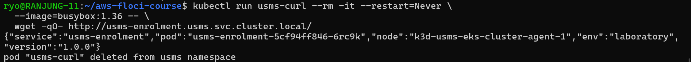

### Step 14: Deploy usms-results

`30-results.yaml` is like the enrolment file but with three deliberate differences: **no liveness probe**, the **default rolling update strategy**, and it returns `campus` instead of `node`.

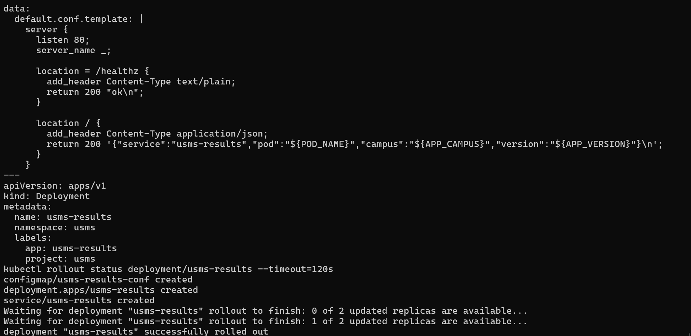

Verify: both Deployments are **2/2**. Enrolment has **MAXUNAVAIL 0**, and results has the default **25%**. Each Service has **2 endpoints**.

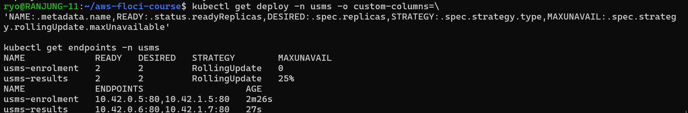

### Step 15: Deploy the gateway

`40-gateway.yaml` is an nginx reverse proxy. Its config has **no IP addresses**, only two DNS names:

- `/enrolment/` → `http://usms-enrolment.usms.svc.cluster.local/`
- `/results/` → `http://usms-results.usms.svc.cluster.local/`

The **trailing slash** on `proxy_pass` removes the prefix, so `/enrolment/x` becomes `/x` on the backend. I deployed the gateway **last**, because nginx looks up the names when it starts and crashes if the Services do not exist yet.

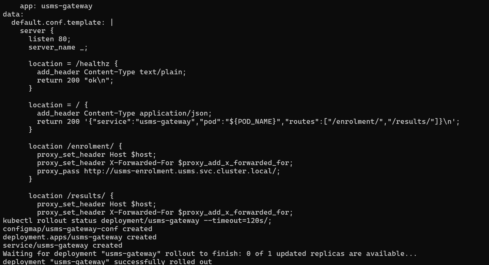

Verify: **5 pods Running** (2 enrolment, 2 results, 1 gateway), spread over agent-0 and agent-1. The gateway log shows the readiness probe getting **200** on `/healthz` every 5 seconds.

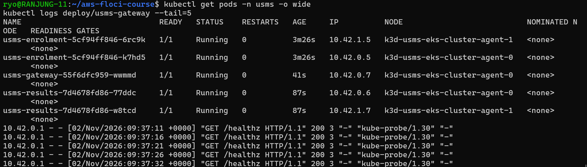

### Step 16: Prove service discovery

**Part 1:** `nslookup` from inside a pod. The DNS server is CoreDNS at **10.43.0.10**. `usms-enrolment.usms.svc.cluster.local` resolves to **10.43.24.45** and `usms-results...` to **10.43.144.189**. These are the **ClusterIPs** of the Services, not pod IPs.

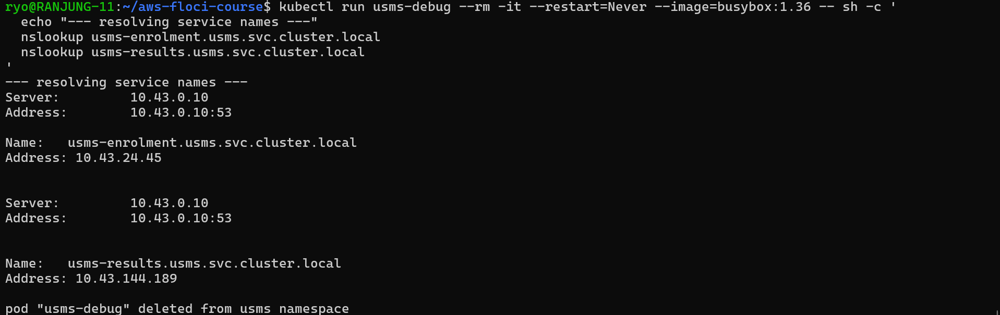

**Part 2:** Through the gateway, all three paths work:

- `/` → `usms-gateway` with its routes
- `/enrolment/` → `usms-enrolment` (pod `...-k7hd5`)
- `/results/` → `usms-results` (pod `...-w8tcd`, campus `rtc`)

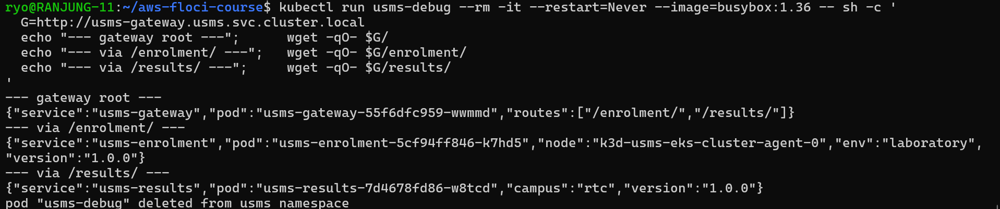

**Part 3:** I sent **12 requests** through `/enrolment/` and counted which pod answered. The result was **6 and 6**, split across two different pods (`...-6rc9k` and `...-k7hd5`). The gateway knows only one name, and kube-proxy spreads the load underneath it.

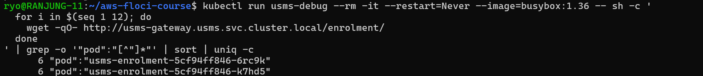

### Step 17: ConfigMaps and Secrets

**Part 1:** I created **`usms-enrolment-secret`** with two **dummy** values (`ENROLMENT_API_TOKEN` and `ENROLMENT_DB_PASSWORD`), using `--dry-run=client -o yaml` to generate a manifest file and then applying it.

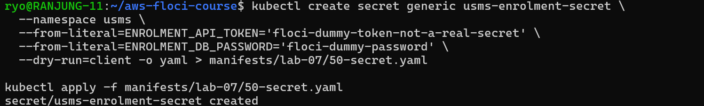

**Part 2:** This is the important part. The stored value `ZmxvY2ktZHVtbXktdG9rZW4tbm90LWEtcmVhbC1zZWNyZXQ=` becomes **`floci-dummy-token-not-a-real-secret`** with just `base64 -d`. No key was needed. **A Secret is encoded, not encrypted.**

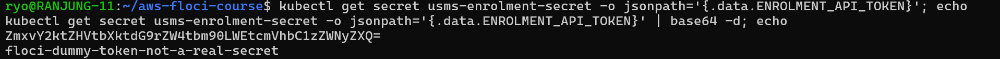

**Part 3:** `kubectl set env --from=secret/...` added the Secret to the enrolment Deployment. This changed the pod template, so a **new rollout** happened. The last line, printed by `jsonpath`, only shows `usms-app-config` in `envFrom`, because `set env` added the Secret keys as separate `env` entries instead.

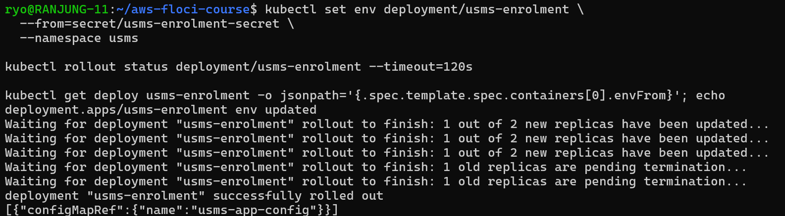

Verify: `describe` lists `usms-app-config` and the two Secret keys. Inside the container, `printenv` shows **4 `APP_*`** values and **2 `ENROLMENT_*`** values, and the token is **plain text** inside the pod.

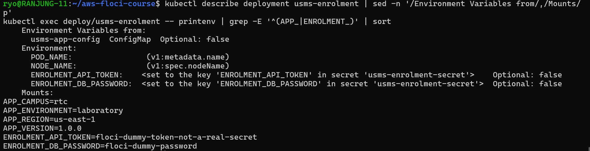

I kept `50-secret.yaml` in `manifests/lab-07/` because the values are dummies. In a real project I would never commit this file.

### Step 18: Roll out a change, then roll it back

**Part 1:** I changed `APP_VERSION` from **1.0.0 to 1.1.0** in the ConfigMap file with `sed -i.bak` and applied it.


**Part 2:** The pod still answered **1.0.0**. Changing a ConfigMap **does not restart pods**, because the pods read their environment only when they start.


**Part 3:** I annotated the Deployment. `rollout status` returned **straight away**, so nothing rolled. The annotation was on the Deployment's own metadata, not on the pod template.


**Part 5:** `rollout history` shows **2 revisions**:

| Revision | ReplicaSet | Desired | Made by |
|---|---|---|---|
| 1 | `usms-enrolment-5cf94ff846` | 0 | The first apply in Step 13 |
| 2 | `usms-enrolment-ff96cc87d` | 2 | `set env` with the Secret in Step 17 |


Then I ran **`rollout undo`**. It scaled the old ReplicaSet `5cf94ff846` (revision 1) back up, and the new pod answered **version 1.1.0**. This shows two things:

- `rollout undo` only reverts the **pod template**. The ConfigMap was still at 1.1.0, and the new pods read it when they started.
- Revision 1 was from **before** the Secret was added, so going back to it also takes the Secret variables out of the pod template. I have not yet checked this inside the running pods.


Finally, I put the ConfigMap back to **1.0.0** and ran `rollout restart`, so the lab ends in a known state.


### Step 19: Break pods on purpose and diagnose them

**Failure 1: an image that does not exist.** I set the results image to `nginx:this-tag-does-not-exist`. The new pod went into **ImagePullBackOff (0/1)**, but the **two old pods kept Running**. The bad version never took over, because the rolling update waits for new pods to be ready.


I fixed it with `rollout undo`, and the Deployment rolled back successfully.


**Failure 2: a pod that cannot be scheduled.** I asked for **64 CPUs and 256 GiB of memory**. The pod stayed **Pending**, and `describe` showed **FailedScheduling: "0/3 nodes are available: 3 Insufficient cpu, 3 Insufficient memory"**. The answer was in the **Events** at the bottom of `describe`, not in `logs`, because the container never started.


**Failure 3: a container that crashes (CrashLoopBackOff).** I do not have a screenshot of this failure in my assets folder. For this failure, `kubectl logs --previous` is the right command, because the container *does* start and prints its error before it exits.

### Step 20: ECS and Kubernetes side by side

I looked at both platforms at the same time:

- **ECS:** `usms-enrolment-svc` with **Desired 2, Running 10**, 1 load balancer and 1 deployment. Running 10 is left over from the Lab 06 scaling tests: the desired count is back at 2, but the 10 tasks had not stopped yet on Floci.
- **EKS:** 3 Deployments (2/2, 1/1, 2/2) and 3 ClusterIP Services with **no external IP**.


I added the comparison table to `notes/lab-07-notes.md`.


My answers:

| Question | ECS answer | Kubernetes answer |
|---|---|---|
| What holds the container spec? | Task definition (`usms-enrolment:1`) | The pod template inside the Deployment |
| What keeps N copies alive? | The ECS service (`desiredCount`) | The ReplicaSet (made by the Deployment) |
| What gives it a stable name? | The load balancer / Cloud Map | The Service (ClusterIP + DNS name) |
| How does another service find it? | Through the ALB DNS name | Cluster DNS: `usms-enrolment.usms.svc.cluster.local` |
| What does a rolling update create? | A new deployment with new tasks | A new ReplicaSet |
| Where does rollback state live? | Old task definition revisions | Old ReplicaSets (`revisionHistoryLimit: 5`) |
| Which IAM role does the app code use? | The task role (`usms-ecs-task-role`) | The node role here, or IRSA on real EKS |
| What would I have to change to move to another cloud? | Almost everything, because ECS is AWS-only | The manifests stay the same. The IAM roles, VPC, node group and load balancer settings must change. |

**My choice for USMS:** I would choose **ECS (Fargate)** for USMS. It is a small team in one region, and ECS needed far fewer steps and has no nodes to manage. Kubernetes is better only if USMS needs to be portable or grows into many services.

### Step 21: IRSA

IRSA (IAM Roles for Service Accounts) gives an IAM role to **only the pods that use one ServiceAccount**, instead of to every pod on the node.

**Part 1:** My build **does** publish an OIDC issuer: `https://oidc.eks.us-east-1.amazonaws.com/id/A565170B62BE4341B7CDA44CAAC16C81`. The lab said most builds print `None`, so my build supports more than expected.

**Part 2:** Because there was an issuer, `create-open-id-connect-provider` created the provider `arn:aws:iam::000000000000:oidc-provider/oidc.eks.us-east-1.amazonaws.com/id/A565170B62BE4341B7CDA44CAAC16C81`.


**Part 3:** I created the ServiceAccount **`usms-enrolment-sa`** in `usms`. `list-open-id-connect-providers` shows the provider ARN.


Of the six IRSA steps, I completed 1 (issuer), 2 (provider) and the ServiceAccount. I did **not** create a workload role with a web-identity trust policy, and I did **not** annotate the ServiceAccount. So I have **not** configured IRSA end to end. On Floci, the OIDC document is on my machine, so STS could not reach it anyway.

### Step 22: Restart test

**Part 1:** Before the restart: cluster **ACTIVE 1.30**, node group **ACTIVE 2**, Deployments **2 / 1 / 2**, and the three Service IPs.


**Part 2:** I stopped Floci with `floci-down.sh` (`docker compose stop`, which keeps the data in `/home/ryo/floci-data`) and started it again. It came back up in **hybrid** mode.


**Part 3:** After the restart, I found everything again **from the API** (not from shell variables):

- The cluster came back from `list-clusters`, and the node group from `list-nodegroups`.
- The namespace `usms` is **Active**, the Deployments are still **2 / 1 / 2**, and all 4 ConfigMaps are there.

The `diff` showed differences, and I read them:

- The cluster showed **CREATING** straight after the restart, because Floci was still bringing the cluster back. A minute later, Step 23 read it as **ACTIVE**, and the verify script also shows ACTIVE.
- The other lines are different only because the "before" file lists **Service IPs** and the "after" file lists **ConfigMaps**. The two scripts collect different things, so nothing was lost.


So the persistence test passed: the cluster, the node group and all the Kubernetes objects survived the restart.

### Step 23: Save the values

I wrote `configs/lab-07.env`. The AWS values are looked up from the API, and the Kubernetes names are fixed. The check printed **all values populated**.


Verify: `cluster=usms-eks-cluster`, `ns=usms`, `lb_ports=8081,8082`, and **21** exports.


### Step 24: Commit

I ran `git status --short` **before** adding anything. No file under `outputs/` is listed, including the kubeconfig with certificates. `git check-ignore -v outputs/lab-07-support-probe.txt` shows it is protected by **`.gitignore:35:outputs/*`**.


`git ls-files | grep -c '^outputs/'` returns **0**, so no output file is tracked by Git. When I took this screenshot, the last commit was still Lab 03, so the Lab 07 commit is the next step after this report.


## 6. Verification

I wrote `scripts/utilities/verify-lab-07.sh`. It checks the environment, the earlier labs, the IAM roles, the cluster, the Kubernetes objects and Git hygiene. The result was **PASS=30, FAIL=0**.

Because I am on **Path A**, the three EKS checks (cluster ACTIVE, `_lb_ports_` tag, node group ACTIVE) also passed. On Path B those three would fail.


The smoke test sent requests to the gateway root, `/enrolment/` and `/results/`. All three returned JSON, and it printed **SMOKE TEST PASSED**.


## 7. Analysis and Discussion

### 7.1 What was achieved

I created the cluster role and node role with local versions of the AWS managed policies, and attached Lab 01's `USMSStudentDataReadWrite` to the node role as its third holder. I created the security group in the Lab 02 VPC, the cluster across four subnets with the `_lb_ports_` tag, and the node group in the two private subnets. I then deployed three microservices into the `usms` namespace, proved they find each other by DNS, used a ConfigMap and a Secret, did a rollout and a rollback, caused failures on purpose, proved everything survives a restart, and got **PASS=30 FAIL=0**.

### 7.2 Observed, recorded and conceptual

| Type | Items |
|---|---|
| **Observed** (I saw it work) | Deployments, ReplicaSets and Services; DNS discovery; load spread over 2 pods (6/6); rolling update and rollback; ImagePullBackOff and FailedScheduling; Secret decoded with base64; persistence after restart |
| **Recorded only** (Floci saves it but does not enforce it) | IAM policies on both roles; node group size and instance type; the security group rule; the AMI type |
| **Conceptual** (real AWS only) | Full IRSA (role and annotation not done), KMS encryption of Secrets, EKS access entries, control plane logging |

### 7.3 Observations

- **The two halves are separate.** The AWS CLI created the cluster in Floci, but kubectl talked to the Kubernetes API on port 6443. The two tools never talk to each other.
- **Names, not IP addresses.** The gateway has only DNS names, and a pod can be replaced without changing the gateway.
- **ConfigMap changes need a restart.** Changing the ConfigMap did nothing until the pods were recreated.
- **Rollback is not a full rollback.** `rollout undo` reverted the pod template but not the ConfigMap, so the pod still said 1.1.0. It also went back to a revision from before the Secret was added. Configuration should be versioned together with the workload.
- **The rolling update protected me.** With a bad image, the old pods kept serving and the broken pod never took traffic.
- **`describe` before `logs`.** For ImagePullBackOff and Pending the container never started, so there were no logs. The answer was in the Events.
- **A Secret is not a lock.** One `base64 -d` command showed the token in plain text.

## 8. Reflection

### What I learned about Kubernetes

Before this lab, I thought EKS was just ECS with different names. Now I understand the split: AWS runs the control plane, but I am responsible for the nodes, and each half needs its own IAM role. I also learned that most of the work happens in Kubernetes objects that know nothing about AWS. The Deployment, Service and ConfigMap files would work on any cluster, and only the roles, VPC and node group are AWS-specific.

The most useful thing was service discovery. The gateway only knows a name, and Kubernetes keeps that name pointing at healthy pods. When I sent 12 requests, they were split 6 and 6 across two pods without me configuring anything.

### Challenges I faced

My biggest problem was **working in two copies of the project**. Some steps I ran in `/mnt/c/.../aws-floci-course` (Windows) and others in `~/aws-floci-course` (WSL). Files I created in one folder were missing in the other, so some commands said "No such file or directory", for example when the `manifests/lab-07/` folder did not exist. I learned to check the prompt and use one folder for the whole lab.

Another problem was **copying commands from the web page**. When I copied the ```` ```bash ```` lines too, bash treated the backticks as a command and the file was never created. I also learned that `| tee ...` must be on the same line as the command.

Finally, the `create-role` command failed with `EntityAlreadyExists` because of an earlier try. Instead of deleting the role, I read it back and checked that its trust policy was correct.

## 9. Conclusion

In this lab I deployed the USMS application as three microservices on an EKS cluster. On the AWS side, I created two IAM roles with their own trust and permissions policies, a security group in the Lab 02 VPC, the cluster `usms-eks-cluster` with the `_lb_ports_` tag, and the node group `usms-eks-nodes` in the private subnets. On the Kubernetes side, I created the `usms` namespace and deployed `usms-gateway`, `usms-enrolment` and `usms-results` from YAML manifests.

I proved that the services find each other by DNS name, that traffic is spread across pods, that a Secret is only base64, and that a rollback does not revert a ConfigMap. I also caused failures on purpose and diagnosed them with `describe`, proved that everything survives a restart, and passed the verification with **PASS=30 FAIL=0**. I was honest about what Floci only records (IAM enforcement, real EC2 nodes) and what I did not finish (full IRSA). The cluster, namespace, CPU request and `_lb_ports_` tag are all ready for Lab 08, where the services will be scaled and exposed outside the cluster.
