# Lab 07 - Exercises

I did all five exercises on my k3d cluster (context `k3d-usms-eks-cluster`). It has three nodes, and all of them carry the label `workload=usms`, so the enrolment `nodeSelector` allows every node.

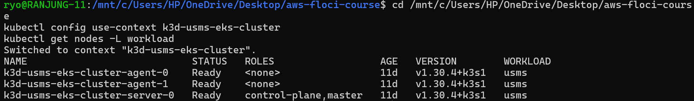

| Node | Role | `workload` label |
| --- | --- | --- |
| k3d-usms-eks-cluster-server-0 | control-plane | usms |
| k3d-usms-eks-cluster-agent-0 | worker | usms |
| k3d-usms-eks-cluster-agent-1 | worker | usms |

Not everything worked the first time. I kept those mistakes in this report, because finding and fixing them taught me more than the parts that worked.

---

## Exercise 1 - A fourth microservice (`usms-timetable`)

**Goal:** deploy one `usms-timetable` replica with its own ConfigMap, a readiness probe (no liveness probe) and a ClusterIP Service, all in one hand-written file: `manifests/lab-07/70-timetable.yaml`.

### What I wrote

I copied the structure of `30-results.yaml` and changed it as follows:

| Object | What it contains |
| --- | --- |
| ConfigMap `usms-timetable-conf` | nginx config: `/healthz` returns `ok`, `/` returns JSON with `service`, `pod`, `campus` and `version` |
| Deployment `usms-timetable` | 1 replica, `nginx:1.27-alpine`, labels `app` / `project` / `tier`, requests `50m` CPU / `32Mi` memory, **readiness probe on `/healthz`, no liveness probe** |
| Service `usms-timetable` | ClusterIP, port 80 → named port `http` |

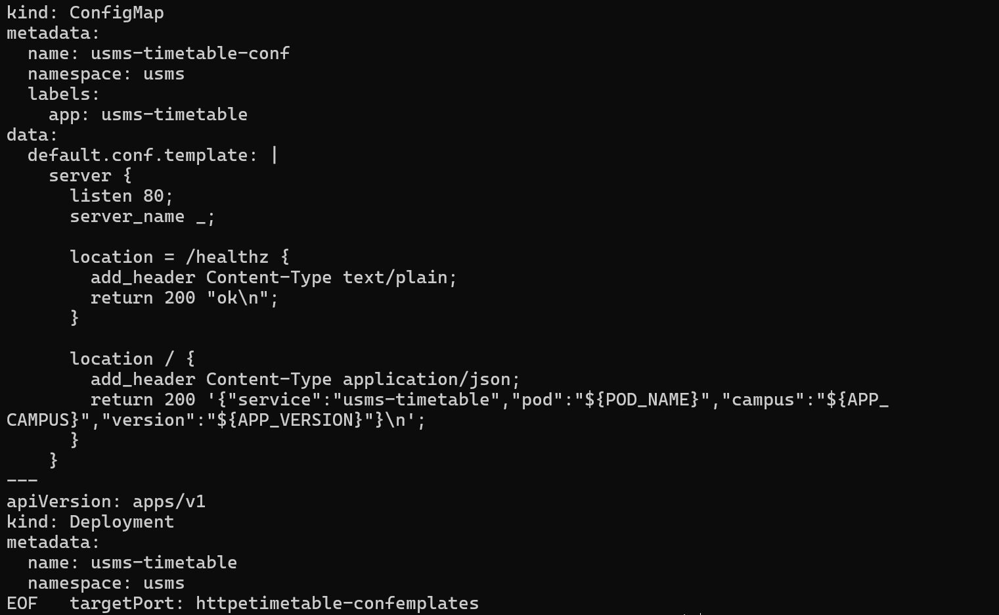

### First attempt: it failed

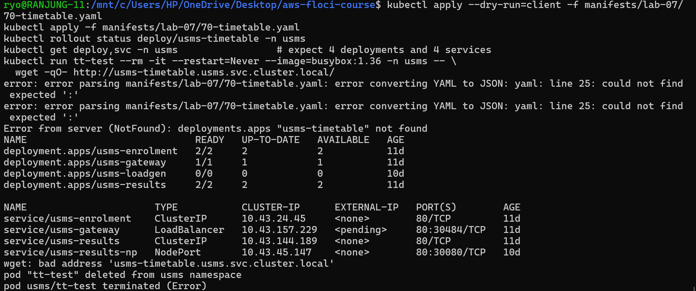

`kubectl apply` refused the file with this error:

```
error converting YAML to JSON: yaml: line 25: could not find expected ':'
```

So the Deployment and Service were never created. The busybox test then failed with `bad address 'usms-timetable.usms.svc.cluster.local'`, because a Service that doesn't exist has no DNS name.

**Cause:** when I pasted the heredoc, the terminal wrapped the long JSON line and inserted a real newline inside `${APP_CAMPUS}`, giving `${APP_` and `CAMPUS}` on two lines. That broke the YAML block. I joined the line back together and ran `--dry-run=client` first. This time all three objects were accepted.

### Second attempt: it worked

```
configmap/usms-timetable-conf created
deployment.apps/usms-timetable created
service/usms-timetable created
deployment "usms-timetable" successfully rolled out

deployment.apps/usms-enrolment   2/2     service/usms-enrolment   ClusterIP
deployment.apps/usms-gateway     1/1     service/usms-gateway     ClusterIP
deployment.apps/usms-results     2/2     service/usms-results     ClusterIP
deployment.apps/usms-timetable   1/1     service/usms-timetable   ClusterIP

{"service":"usms-timetable","pod":"usms-timetable-75b4cd7c79-22mp2","campus":"rtc","version":"1.0.0"}
```

<!-- screenshot: assets/ex1.2.png -->


**Result:** there are four microservices, each with its own Service. The busybox pod reached `usms-timetable` by DNS name and got JSON with the real pod name.

(`usms-loadgen` and `usms-results-np` also appear in the list. They are left over from Lab 08 and aren't part of this exercise.)

---

## Exercise 2 - Route `/timetable/` through the gateway

**Goal:** add a `/timetable/` route to the gateway by editing `40-gateway.yaml` (not `kubectl edit`), end up on a new ReplicaSet, and show all routes working in one command.

### The change

In `manifests/lab-07/40-gateway.yaml` I added the route to the list on `/`, plus a new `location` block:

```nginx
location /timetable/ {
  proxy_set_header Host $host;
  proxy_set_header X-Forwarded-For $proxy_add_x_forwarded_for;
  proxy_pass http://usms-timetable.usms.svc.cluster.local/;
}
```

### Why `kubectl apply` alone is not enough

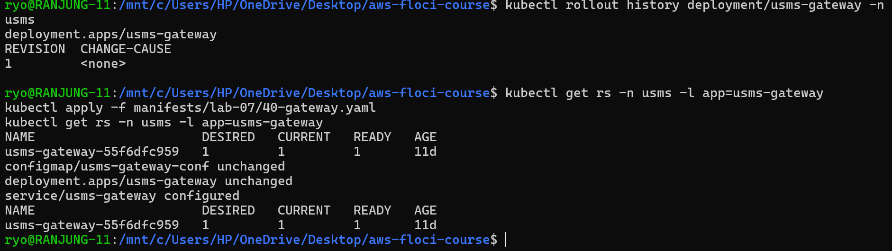

```
configmap/usms-gateway-conf configured
deployment.apps/usms-gateway unchanged
```

`apply` updated only the **ConfigMap**. The pod template didn't change, so the Deployment said `unchanged` and kept the same ReplicaSet. nginx reads its config only when it starts, so the running pod still had the old routes. This is the same lesson as Step 18.

### The command that created the new ReplicaSet

```bash
kubectl rollout restart deployment/usms-gateway -n usms
```

`rollout restart` writes a `restartedAt` timestamp into the **pod template**. Kubernetes treats that as a new template, so it creates a new ReplicaSet. The new pod starts and reads the new ConfigMap. I also added a `change-cause` annotation so the history shows why each revision happened.

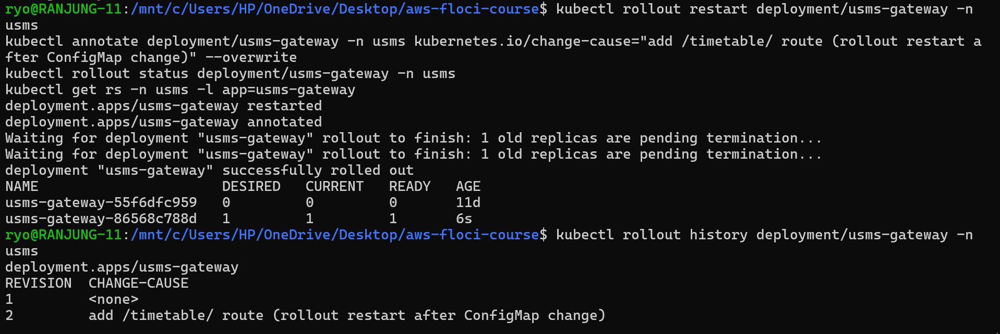

### A mistake on the first try

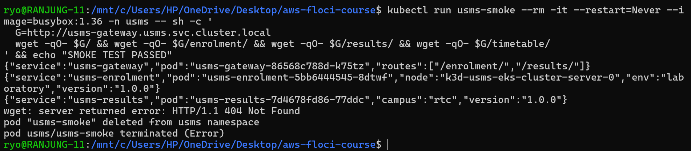

The first time, I had **not saved the YAML edit**, so `apply` re-applied the old ConfigMap and the restart only reloaded the old routes. The gateway still listed only `/enrolment/` and `/results/`, and `/timetable/` returned **404 Not Found**. Revision 2 in the history is this wasted restart.

### Second try: it worked

I saved the route in the file, applied it (the ConfigMap now showed `configured`), and restarted again:

```
usms-gateway-55f6dfc959   0   0   0   11d
usms-gateway-5f48699c75   1   1   1   6s      <- new ReplicaSet
usms-gateway-86568c788d   0   0   0   87m

REVISION  CHANGE-CAUSE
1         <none>
2         add /timetable/ route (rollout restart after ConfigMap change)
3         add /timetable/ route: apply 40-gateway.yaml then rollout restart

{"service":"usms-gateway","pod":"usms-gateway-5f48699c75-zntqq","routes":["/enrolment/","/results/","/timetable/"]}
{"service":"usms-enrolment","pod":"usms-enrolment-5bb6444545-hn9gc","node":"k3d-usms-eks-cluster-agent-0","env":"laboratory","version":"1.0.0"}
{"service":"usms-results","pod":"usms-results-7d4678fd86-w8tcd","campus":"rtc","version":"1.0.0"}
{"service":"usms-timetable","pod":"usms-timetable-75b4cd7c79-22mp2","campus":"rtc","version":"1.0.0"}
SMOKE TEST PASSED
```

<!-- screenshot: assets/ex2.3.png -->


**Result:** one command returned JSON from three different services through the gateway, and `/enrolment/` and `/results/` still work. The gateway is on a new ReplicaSet, and the rollout history gained new revisions.

> **Side effect I noticed:** `40-gateway.yaml` defines the gateway Service as `ClusterIP`. In Lab 08 I had changed it to a `LoadBalancer`, so re-applying the Lab 07 file changed it back (`service/usms-gateway configured`). I restored it with `kubectl apply -f manifests/lab-08/50-service-loadbalancer.yaml`. The lesson is that when two labs' manifests own the same object, the last `apply` wins.

---

## Exercise 3 - Find the misconfiguration in `usms-broken`

**Goal:** `kubectl apply` accepts the manifest, but the Service returns nothing. Find the two faults with commands only, and fix each one by changing a single line.

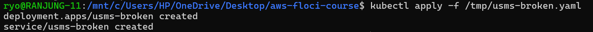

> **Note:** the copy of the manifest in my `/tmp/usms-broken.yaml` was slightly different from the lab page: image `nginx:1.27`, probe path `/health`, and `periodSeconds` left empty, so the default of 10 s was used. The two faults are the same kind of fault, so the diagnosis is the same.

### Step 1: the symptom

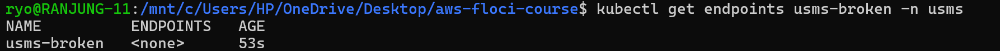

```
NAME          ENDPOINTS   AGE
usms-broken   <none>      53s
```

The Service has **no endpoints**, so there's nothing to send traffic to.

### Step 2: fault 1, the selector doesn't match the labels

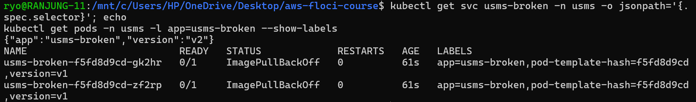

```
Service selector : {"app":"usms-broken","version":"v2"}
Pod labels       : app=usms-broken, version=v1
```

The Service looks for `version: v2`, but every pod has `version: v1`, so the Service selects **zero pods**.

(At this point the pods also showed `ImagePullBackOff`, because `nginx:1.27` was still downloading. This cleared by itself after a few minutes and isn't one of the two faults.)

### Step 3: fault 2, the readiness probe fails

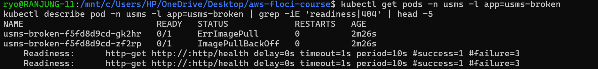

```
Readiness:  http-get http://:http/health  period=10s #failure=3
Warning  Unhealthy  Readiness probe failed: HTTP probe failed with statuscode: 404
```

The base nginx image only serves its welcome page. There's no `/health` page, so every probe gets **404**. The pod stays `0/1` and never becomes Ready, and **Kubernetes never adds a pod that isn't Ready to a Service's endpoints**, even when the labels match.

### Fix 1: one line in the Service

```
version: v2  ->  version: v1
```

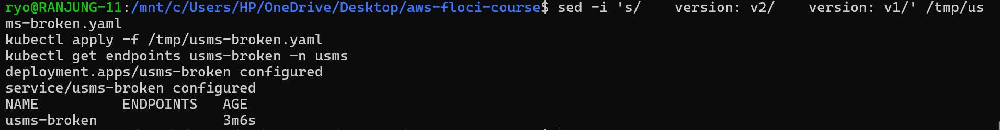

The endpoints were **still empty**. That proves the second fault is separate: the selector matched now, but no pod was Ready.

### Fix 2: one line in the probe

My first `sed` looked for `/healthz`, but my file used `/health`, so nothing changed. The pods stayed `0/1` and the rollout timed out:

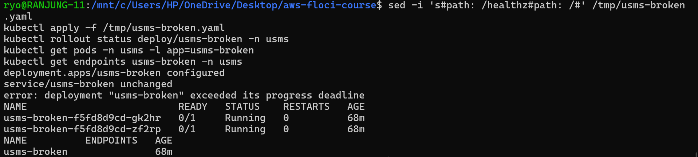

I corrected the `sed` to change `path: /health` to `path: /`. nginx returns 200 on `/`:

```
deployment.apps/usms-broken configured
deployment "usms-broken" successfully rolled out
usms-broken-85c55f8696-hf82q   1/1   Running   k3d-usms-eks-cluster-agent-1
usms-broken-85c55f8696-rtxr7   1/1   Running   k3d-usms-eks-cluster-server-0

NAME          ENDPOINTS                     AGE
usms-broken   10.42.1.35:80,10.42.2.40:80   85m
```

**Result:** the Service has **two endpoints**. After that I deleted `usms-broken` (Deployment and Service).

### Diagnosis summary

| # | Fault | Command that showed it | One-line fix |
| --- | --- | --- | --- |
| 1 | Service selector `version: v2` but pods have `version: v1` | `kubectl get svc -o jsonpath='{.spec.selector}'` next to `kubectl get pods --show-labels` | selector → `version: v1` |
| 2 | Readiness probe on a path nginx doesn't serve, so the probe gets 404 and the pod is never Ready | `kubectl get pods` (0/1) and the `Unhealthy … statuscode: 404` event in `describe` | probe `path:` → `/` |

Fixing only one isn't enough. With fault 1 fixed, the pods aren't Ready. With fault 2 fixed, the Service still selects nothing.

---

## Exercise 4 - Survive a node going away

**Goal:** keep `usms-enrolment` serving when one node disappears, without creating a new Deployment.

### Starting point

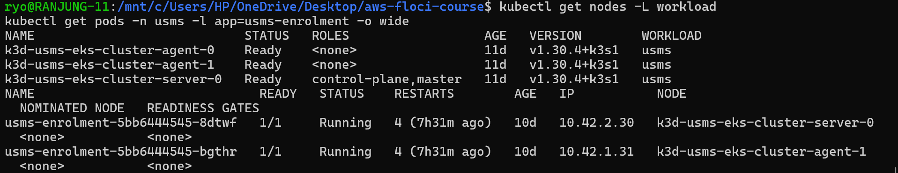

Both enrolment pods were already on different nodes (`server-0` and `agent-1`), but **only by luck**: nothing in the Deployment required it.

### What I changed

**1. In `manifests/lab-07/20-enrolment.yaml`, I added a topology spread constraint and pod anti-affinity:**

```yaml
topologySpreadConstraints:
  - maxSkew: 1
    topologyKey: kubernetes.io/hostname
    whenUnsatisfiable: DoNotSchedule
    labelSelector:
      matchLabels:
        app: usms-enrolment
affinity:
  podAntiAffinity:
    preferredDuringSchedulingIgnoredDuringExecution:
      - weight: 100
        podAffinityTerm:
          topologyKey: kubernetes.io/hostname
          labelSelector:
            matchLabels:
              app: usms-enrolment
```

**2. I added a new object, `manifests/lab-07/25-enrolment-pdb.yaml`, a PodDisruptionBudget with `minAvailable: 1`.**

**3. The pod JSON already includes `"node":"${NODE_NAME}"`, taken from `spec.nodeName`, and `kubectl get pods -o wide` shows the NODE column. So the cluster itself shows where each pod runs.**

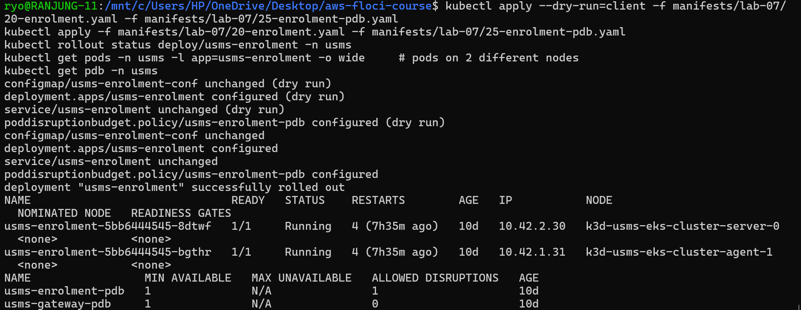

> **Honest note:** on my first apply I hadn't saved the spread rules in `20-enrolment.yaml`. That's why the pods didn't change (same ReplicaSet `5bb6444545`, still 10 days old). The PDB already existed from Lab 08, so it showed `configured` with age 10d. After saving the file and applying again, the Deployment rolled to a new ReplicaSet:

```
deployment "usms-enrolment" successfully rolled out
usms-enrolment-6d6f744995-csddl   1/1   Running   k3d-usms-eks-cluster-agent-0
usms-enrolment-6d6f744995-pqpmb   1/1   Running   k3d-usms-eks-cluster-server-0

usms-enrolment-pdb   MIN AVAILABLE 1   ALLOWED DISRUPTIONS 1
spread rule: DoNotSchedule   anti-affinity weight: 100
```

<!-- screenshot: assets/ex4.5.png -->


### The drain test

I ran a busybox loop calling `usms-enrolment` once a second, then drained the node running the first enrolment pod (`k3d-usms-eks-cluster-server-0`).

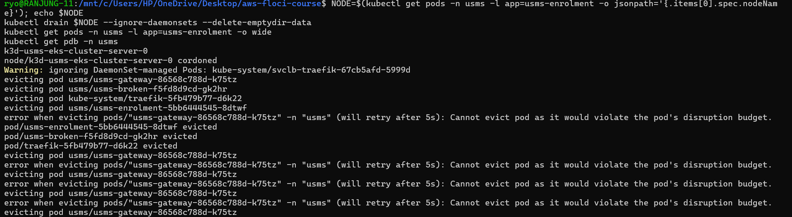

What happened:
- `usms-enrolment-…-8dtwf` was **evicted**. The PDB allowed it, because the other pod was still Ready, so `ALLOWED DISRUPTIONS` was 1.
- A replacement pod `usms-enrolment-…-hn9gc` started on **agent-0**, a different node.
- `usms-gateway` could **not** be evicted: `Cannot evict pod as it would violate the pod's disruption budget`. The gateway has only **1 replica** and `usms-gateway-pdb` requires `minAvailable: 1`, so `ALLOWED DISRUPTIONS = 0`. The drain kept retrying and never finished. This is the PDB doing its job, but it also shows that **a PDB on a single-replica Deployment blocks node maintenance completely**.

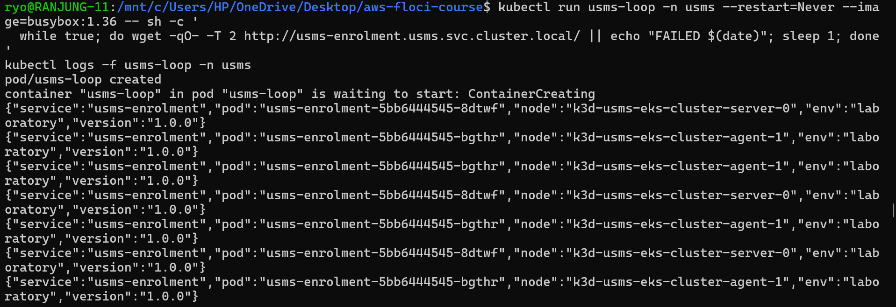

The loop kept getting answers from both pods (`8dtwf` on server-0 and `bgthr` on agent-1), and **no `FAILED` line appeared**, so there was no downtime.

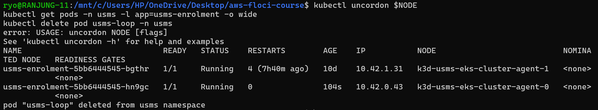

`kubectl uncordon $NODE` failed with `USAGE: uncordon NODE` because I ran it in a new terminal where `$NODE` was empty. The node stayed `SchedulingDisabled` until I ran `kubectl uncordon k3d-usms-eks-cluster-server-0` by name. The final placement was `agent-1` and `agent-0`, still two different nodes.

### Why I chose these settings

A Deployment with 2 replicas only promises that **2 pods exist**. It doesn't say where they run. If the scheduler puts both on one node and that node dies, enrolment goes down completely, even though the "replicas: 2" box is ticked. So I added three layers:

1. **`topologySpreadConstraints` with `maxSkew: 1` on `kubernetes.io/hostname`, set to `DoNotSchedule`.** This is the hard rule. The number of enrolment pods on any two nodes can differ by at most 1, so 2 replicas must land on 2 nodes. I chose `DoNotSchedule` rather than `ScheduleAnyway`, because I'd rather have a pod stay **Pending** (which is visible, and a clear sign we need another node) than silently put both pods on one node and lose the protection without anyone noticing.
2. **Preferred `podAntiAffinity`.** This is a soft extra push to keep enrolment pods apart. It's *preferred*, not *required*. A required rule would leave the third pod unschedulable if Lab 08's HPA scales to more replicas than there are nodes. The spread constraint already handles that case properly, because it allows 2-2-1 across 3 nodes.
3. **`PodDisruptionBudget minAvailable: 1`.** The first two rules protect against **placement** problems. The PDB protects against **voluntary** disruptions such as `kubectl drain`, node upgrades or the cluster autoscaler removing a node. It makes Kubernetes evict enrolment pods one at a time, and only while another pod is Ready. Together with the Deployment's `maxUnavailable: 0`, at least one pod is always serving.

**Limits:** a PDB doesn't help when a node **crashes**, because nothing asks for permission. In that case only the spread rules save us: the surviving pod on the other node keeps serving while a replacement is scheduled. Also, all three of my nodes are containers on one laptop, so a real hardware failure would take them all down. On EKS I would spread across **Availability Zones** with `topologyKey: topology.kubernetes.io/zone`. The gateway is now the weak point. It has 1 replica plus a PDB, which blocked my drain, so it should run at least 2 replicas with the same spread rules.

---

## Exercise 5 - Prepare for Lab 08 using Lab 01's resources

### Part 1: CPU baseline

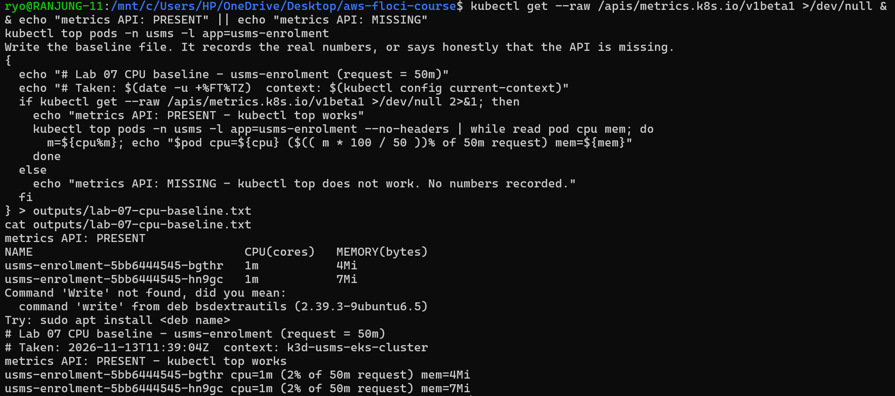

The metrics API exists: `kubectl get --raw /apis/metrics.k8s.io/v1beta1` worked, because k3d includes metrics-server. So `kubectl top` **works**, and these are real numbers:

| Pod | CPU | % of 50m request | Memory |
| --- | --- | --- | --- |
| usms-enrolment-5bb6444545-bgthr | 1m | 2% | 4Mi |
| usms-enrolment-5bb6444545-hn9gc | 1m | 2% | 7Mi |

Saved to `outputs/lab-07-cpu-baseline.txt`. The pods are idle at **about 2% of their request**, so a CPU-based HPA in Lab 08 with a target such as 50% won't scale until real load arrives. (The `Command 'Write' not found` line in the screenshot is just a comment line that I accidentally pasted as a command.)

### Part 2: Lab 01 readiness from the CLI only

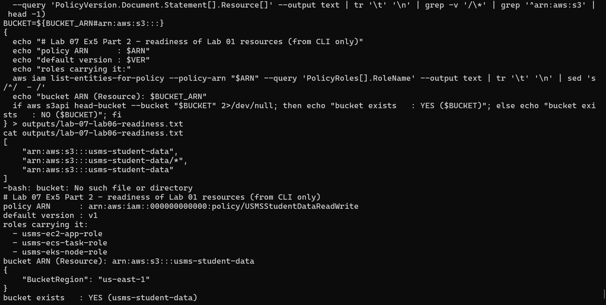

I found everything with `aws iam` and `aws s3api`, without opening Lab 01's document:

| Question | Answer |
| --- | --- |
| Policy ARN | `arn:aws:iam::000000000000:policy/USMSStudentDataReadWrite` |
| Default version | `v1`, found with `get-policy` and then read with `get-policy-version` |
| Roles carrying it | `usms-ec2-app-role`, `usms-ecs-task-role`, `usms-eks-node-role` |
| Bucket ARN in `Resource` | `arn:aws:s3:::usms-student-data` (the entry ending in `/*` is the **object** ARN, not the bucket) |
| Does the bucket exist? | **Yes**: `head-bucket` returned `BucketRegion: us-east-1` |

The policy's `Resource` list has 3 entries: the bucket ARN twice (one per statement) and the object ARN `usms-student-data/*` once. Saved to `outputs/lab-07-lab06-readiness.txt`. (The `-bash: bucket: No such file or directory` line came from pasting my own note text into the terminal and didn't affect the result.)

### Both files are git-ignored

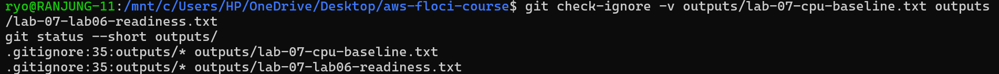

```
.gitignore:35:outputs/*  outputs/lab-07-cpu-baseline.txt
.gitignore:35:outputs/*  outputs/lab-07-lab06-readiness.txt
```

`git status --short outputs/` printed nothing, so neither file will be committed.

### Part 3: What Lab 08 needs

I added a new section to `notes/lab-07-notes.md` listing which of the 21 variables in `configs/lab-07.env` Lab 08 needs:

| Variable | Why Lab 08 needs it |
| --- | --- |
| USMS_EKS_CLUSTER | every eks/kubectl command targets this cluster |
| USMS_EKS_NODEGROUP | node scaling changes this node group |
| USMS_EKS_NAMESPACE | the HPA, PDBs and new objects go into `usms` |
| USMS_K8S_DEPLOY_ENROLMENT | the HPA scales this Deployment |
| USMS_K8S_CPU_REQUEST | HPA CPU % is measured against this 50m request |
| USMS_K8S_DEPLOY_GATEWAY | the gateway gets its own PDB and receives the load |
| USMS_K8S_SVC_GATEWAY | this Service is exposed outside the cluster |
| USMS_EKS_LB_PORTS | 8081/8082 are the load-balancer ports |
| USMS_K8S_MANIFEST_DIR | Lab 08 manifests sit next to Lab 07's |
| USMS_EKS_NODE_ROLE_ARN | new nodes from scaling use this role |

The others (cluster role/policy ARNs, SG, endpoint, status, version, results Service names) describe how the cluster was **built**, not what gets **scaled or exposed**.

<!-- screenshot: assets/ex5.3.png -->


---

## Summary

| Exercise | Result |
| --- | --- |
| 1 - Fourth microservice | `usms-timetable` running and reachable by DNS (the first apply failed on a wrapped YAML line, which I fixed) |
| 2 - Gateway route | Four JSON responses through the gateway, new ReplicaSet created by `rollout restart` |
| 3 - Two faults | Wrong selector label and failing readiness probe, both fixed, 2 endpoints, then deleted |
| 4 - Node going away | Spread constraint + anti-affinity + PDB; the drain caused no failed requests; I found that the gateway PDB blocks drains |
| 5 - Lab 08 prep | Real CPU baseline (2%), policy, roles and bucket found from the CLI, outputs git-ignored, notes written |

**What I learned:**
- A ConfigMap change doesn't restart pods. Only a pod-template change, such as `rollout restart`, creates a new ReplicaSet.
- A Service with no endpoints means either the selector is wrong or the pods aren't Ready. You have to check both.
- "2 replicas" isn't high availability until the pods are on different nodes and protected by a PDB.
- When pasting long YAML, always run `--dry-run=client` and check the file actually saved before you trust `apply`.
