# Lab 08 Practical Report: Scaling and Exposing the USMS Services on Amazon EKS

## 1. Aim / Objective

The aim of this lab is to make the USMS services from Lab 07 **scale** and to **expose** them outside the cluster. I scaled them by hand, by manifest and automatically with a **HorizontalPodAutoscaler (HPA)**, tried to change the **node group** from the AWS side, and climbed the **exposure ladder** from `port-forward` up to an **Ingress**. The AWS side was done with the AWS CLI on Floci, and the Kubernetes side with `kubectl` on the k3d cluster from Lab 07.

The specific objectives were to:

- Scale a Deployment **by hand**, **by manifest** and with an **HPA**, and compare the HPA with Lab 06's auto scaling.
- Understand **requests**, **limits** and **QoS classes**, and why the CPU request matters so much.
- Change the **node group** size from the AWS side and explain why it is separate from the HPA.
- Use a **nodeSelector** and **PodDisruptionBudgets**.
- Expose the services with **port-forward**, **NodePort**, **LoadBalancer** and **Ingress**.
- Prove the setup survives a restart, save values to `configs/lab-08.env`, and check the lab with a verification script.

## 2. Introduction

**Scaling** means changing how much capacity an application has so it can handle more or fewer users. In Kubernetes there are **four ways** to scale:

| Dimension | What changes | Who owns it |
|---|---|---|
| **Pod replicas** | How many copies of a pod run | The Deployment's `replicas`, changed by me or by the **HPA** |
| **Pod size** | How much CPU/memory each pod asks for | The pod's `requests` and `limits` |
| **Node count** | How many machines are in the cluster | The **node group** (AWS side), Cluster Autoscaler or Karpenter |
| **Node size** | How big each machine is | The node group's instance type |

The **HPA** works like a thermostat. Every 15 seconds it reads the pods' CPU from **metrics-server**, compares it with a target and changes `replicas`. The target is a **percentage of the pod's CPU request**, so a pod with no request cannot be autoscaled on CPU.

To reach a service from outside the cluster there is a **ladder** of four options:

| Rung | Object | Simple meaning |
|---|---|---|
| 1 | **ClusterIP + port-forward** | Only inside the cluster. port-forward makes a private tunnel for testing. |
| 2 | **NodePort** | Opens the same port (30000–32767) on **every node** |
| 3 | **LoadBalancer** | Asks the cloud for a load balancer (an NLB on AWS) |
| 4 | **Ingress** | One load balancer (an ALB on AWS) that routes by **path** to many Services |

This lab was done on **Floci** and k3d. Floci stores the node group but does not support changing its size, and it does not create real load balancers. Where something could not be shown, the expected AWS behaviour is explained.

## 3. Use Case

**USMS use case:** During enrolment week, `usms-enrolment` gets far more traffic than the rest of the year.

- The **HPA** keeps `usms-enrolment` between **2 and 8 pods**, aiming at **50% of the CPU request**. Pods are added quickly in a rush and removed slowly afterwards.
- If the pods do not fit on the nodes, the **node group** can grow.
- **PodDisruptionBudgets** make sure maintenance never removes too many pods at once.
- Students reach the portal through one **Ingress**: `/enrolment`, `/results` and `/` each go to the right service. This is the same routing I built by hand with an ALB in Lab 05, but in one YAML file.

**Other real-world uses:**

- Online shops scaling up on sale days and back down at night.
- News or ticket websites handling sudden traffic spikes.
- Exposing many microservices behind one public address with path-based routing.

## 4. System Architecture / Design

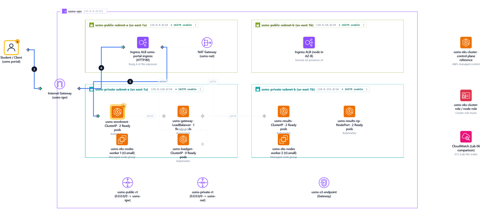

**How it works in simple words:**

1. **metrics-server** reads CPU and memory from each node and publishes them through the metrics API.
2. The **HPA** reads the average CPU of the enrolment pods, compares it with **25m (50% of 50m)** and changes `replicas` between 2 and 8.
3. The **Deployment** creates or removes pods, and the **scheduler** places them on nodes that have room.
4. On the AWS side, the **node group** decides how many nodes exist. This is a separate control loop; the HPA never talks to it.
5. Outside traffic comes in through **Ingress → Service → pods**. New pods from the HPA get traffic automatically.

## 5. Implementation Procedure

### Step 1: Start the environment and check Lab 07

I started Floci (hybrid mode), loaded the env files and set `usms` as the default namespace. The account is **000000000000**.

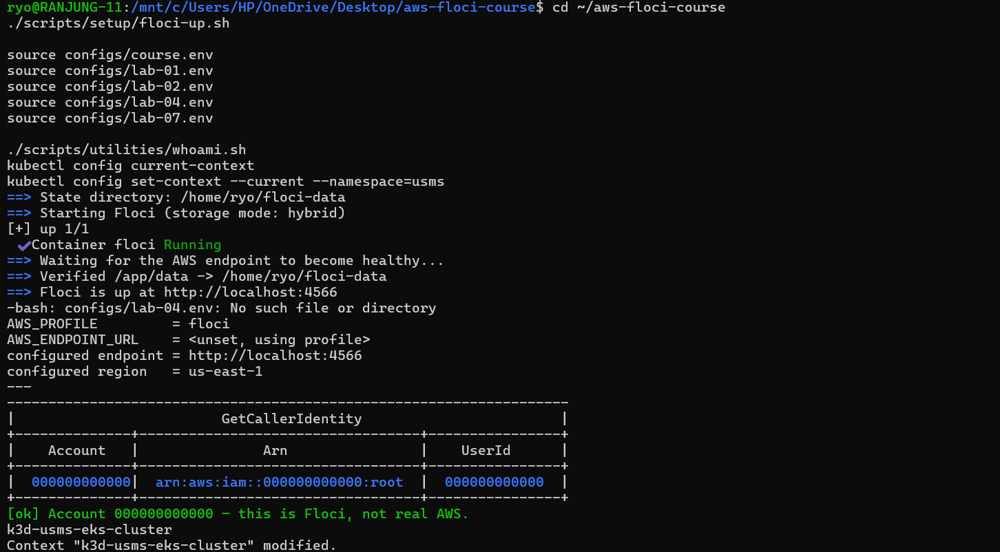

I checked the two things this lab needs from Lab 07: `usms-enrolment` has a **CPU request of 50m**, and the cluster has the **`_lb_ports_: 8081,8082`** tag. I also set limits of 200m / 128Mi.

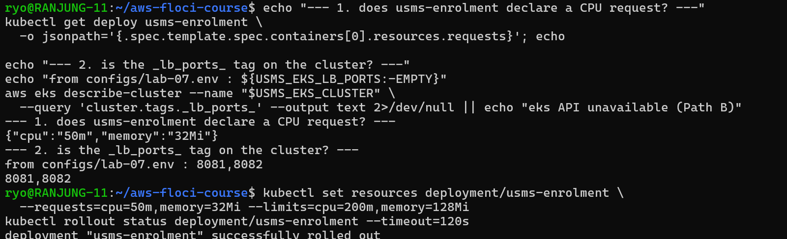

The Lab 07 verify script still gives **PASS=30 FAIL=0**.

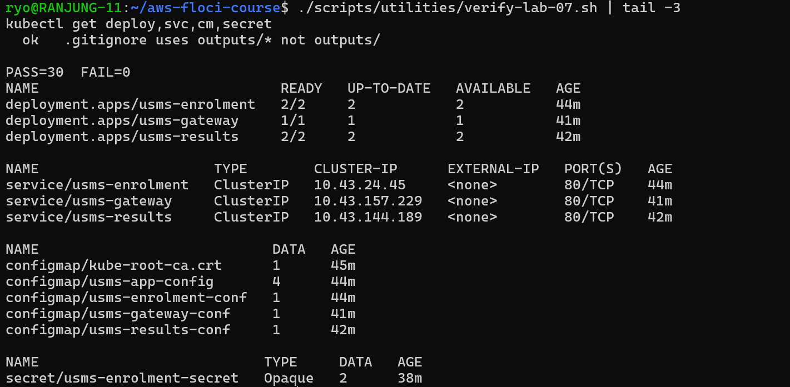

### Step 2: Record the baseline

I saved a snapshot: Deployments **2/2, 1/1, 2/2**, all Services **ClusterIP** with no external address, and **3 Ready nodes**.

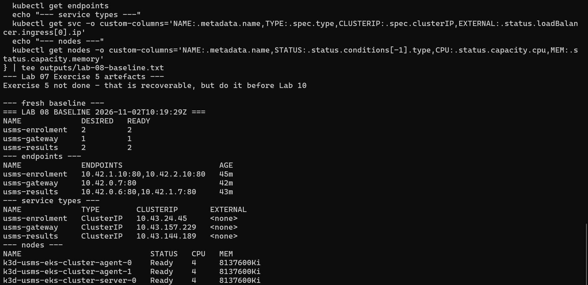

### Step 3: The four dimensions of scaling

This step was reading only (see Section 2). The key point: **the HPA only changes pod replicas; it cannot add nodes.**

### Step 4: Scale by hand

I scaled `usms-enrolment` to **5 replicas** and watched three new pods go from Pending to Running in about **6 seconds**.

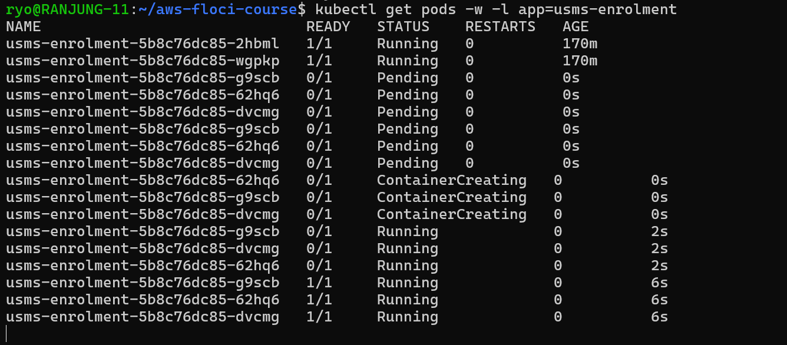

The Service picked up all **5 endpoints** by itself.

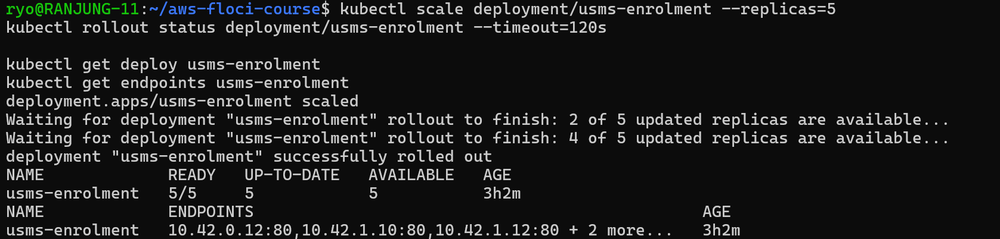

I sent **40 requests** and all 5 pods answered (11, 11, 9, 6 and 3 requests). Then I scaled back to 2.

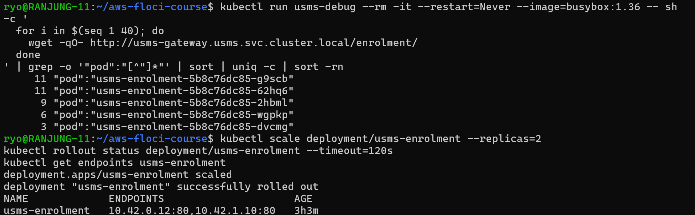

### Step 5: Scale declaratively and see configuration drift

I scaled to **6** by hand, then ran `kubectl apply` on the manifest, which still said `replicas: 2`. The Deployment went **back to 2 without warning**. A hand change not saved in the file is lost; this is **configuration drift**.

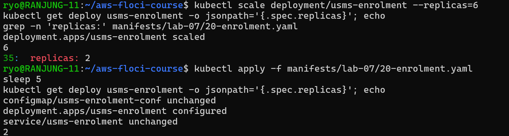

I changed the manifest to `replicas: 3` and used **`kubectl diff`** to preview the change before applying it.

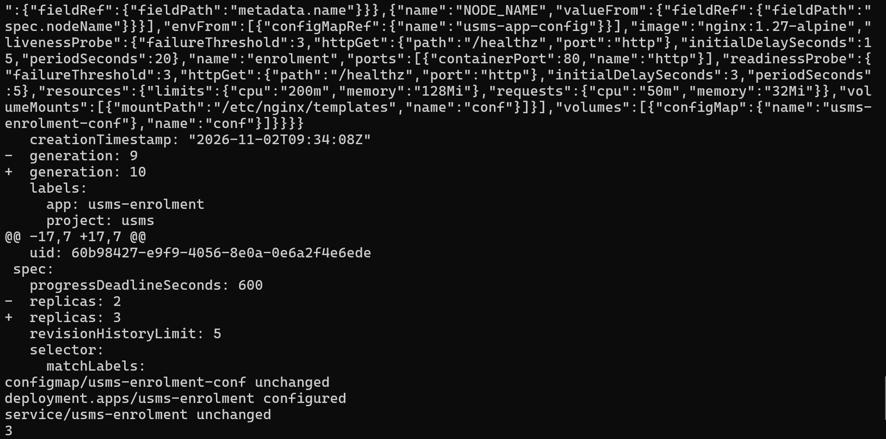

I put the manifest back to 2.

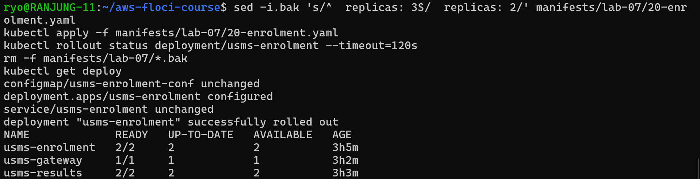

### Step 6: Requests, limits and QoS classes

All USMS pods are **Burstable** (request 50m, limit 200m). A pod is **Guaranteed** only when request equals limit, and **BestEffort** when it has neither. The scheduler only looks at **requests**, not real usage, when placing pods.

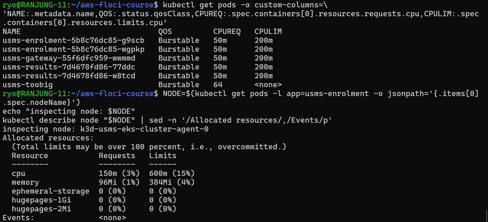

The same 50m request is what the HPA uses: a **50% target means 25m on average**.

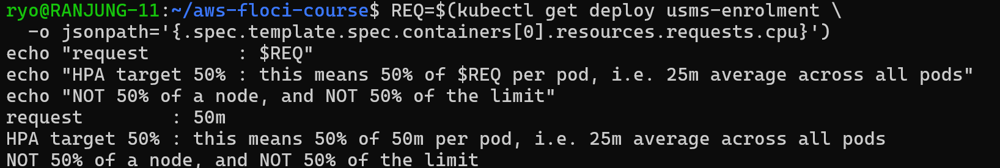

### Step 7: The metrics pipeline

The metrics API was already **AVAILABLE**, because k3s installs metrics-server by default.

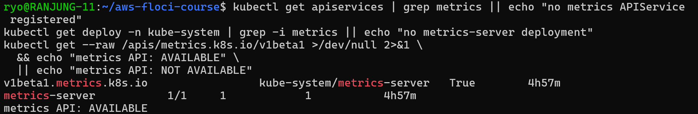

I also applied the upstream metrics-server. The rollout timed out at first, but a few minutes later the new pod was **1/1 Running**.

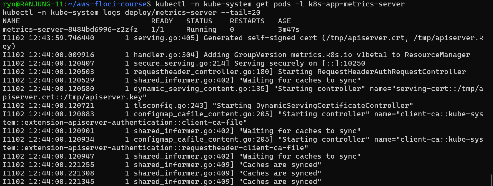

`kubectl top` works. Each node uses about **1% CPU**, and each USMS pod uses **1m CPU** when idle.

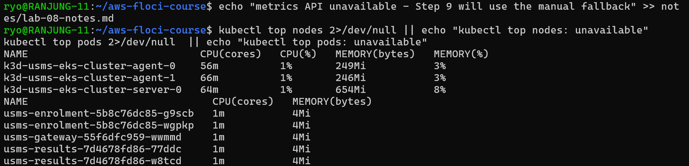

### Step 8: Create the HorizontalPodAutoscaler

I created `usms-enrolment-hpa` (`autoscaling/v2`): **min 2, max 8, CPU target 50%**. At first it showed `<unknown>/50%` because it had not read metrics yet.

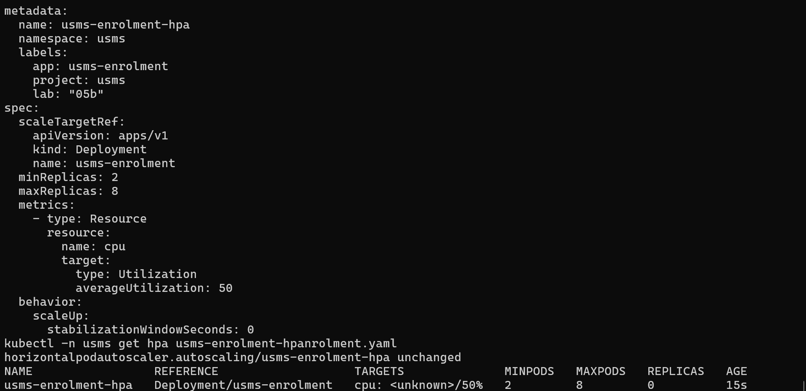

After 30 seconds it showed **2%/50%** with **2 replicas**, and all conditions were healthy.

| Setting | Value | Why |
|---|---|---|
| Scale up | No wait, up to 100% or 2 pods every 15s | React fast to a rush |
| Scale down | 300s wait, 1 pod every 60s | Remove pods slowly to avoid flapping |

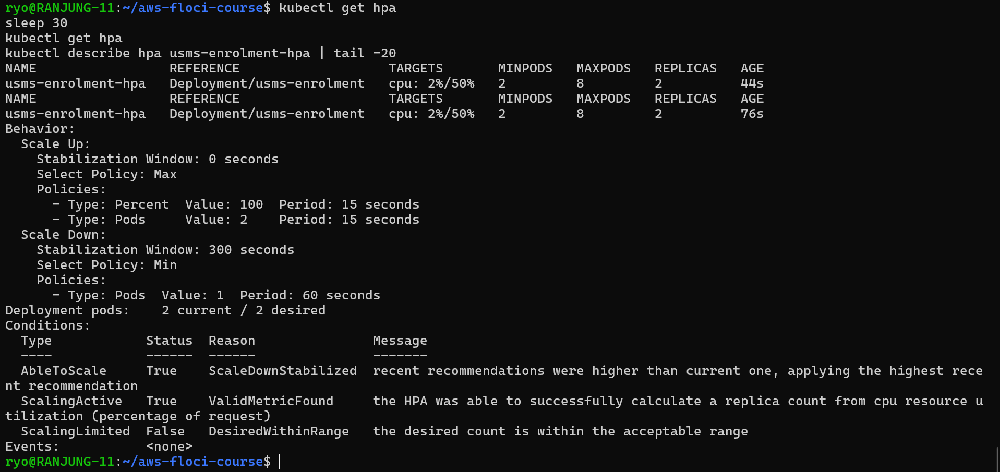

**Compared with Lab 06:**

| | Lab 06 (ECS) | Lab 08 (EKS) |
|---|---|---|
| What scales | `desiredCount` | `replicas` |
| Who decides | Application Auto Scaling + CloudWatch | HPA inside the cluster |
| Metrics from | CloudWatch | metrics-server |
| Limits | 2–10 | 2–8 |

### Step 9: Generate load and watch it respond

I wrote `scripts/utilities/hpa-watch.sh`, which prints the HPA status every 10 seconds.

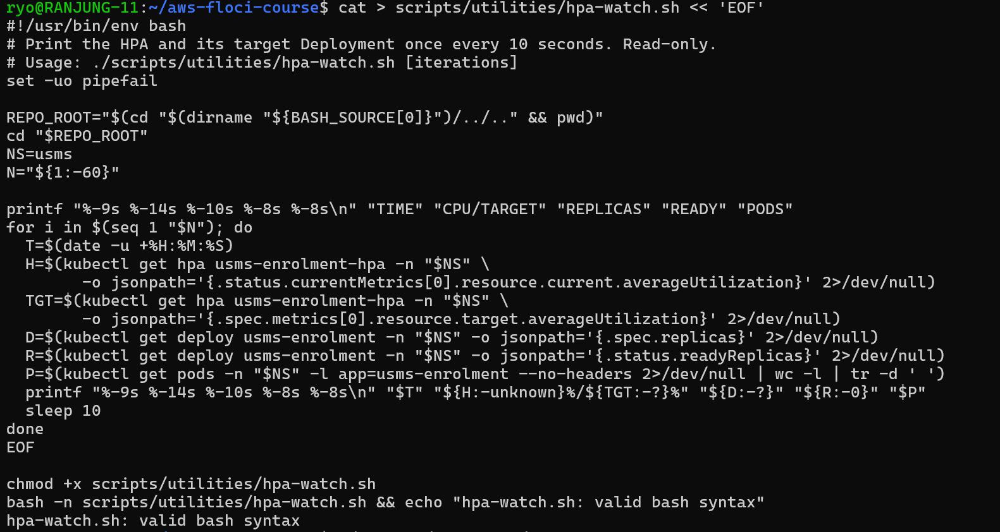

I started `usms-loadgen`, **3 busybox pods** sending requests in a loop.

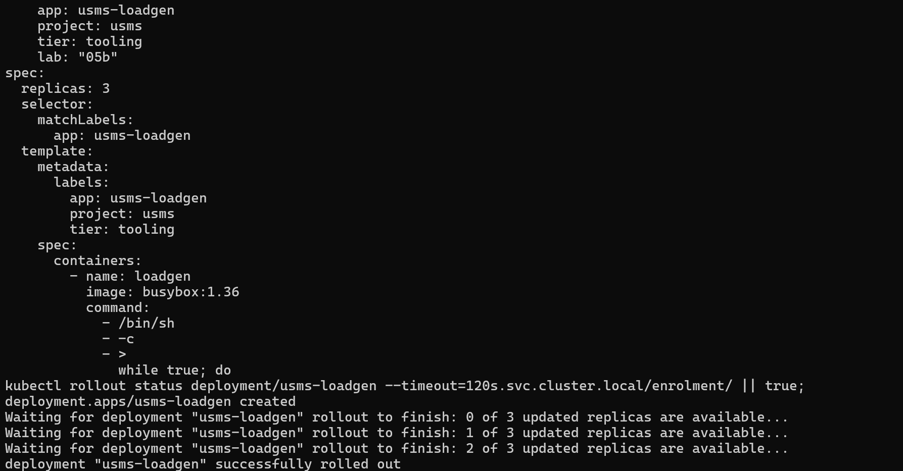

The HPA reacted by itself: **"SuccessfulRescale — New size: 3; reason: cpu resource utilization above target"**. Then I stopped the load. Later screenshots show the HPA back at **2 replicas**.

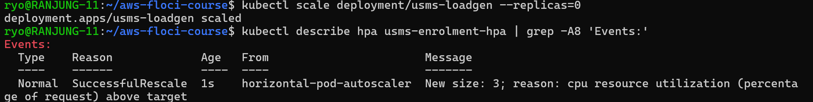

### Step 10: Scale the node group from the AWS side

Before the change, the node group was **min 2, max 4, desired 2**.

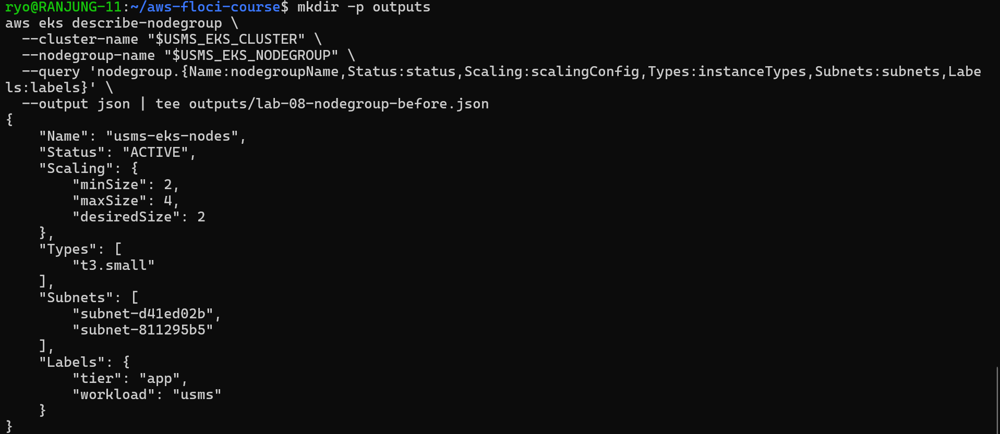

`aws eks update-nodegroup-config` (to 2/6/3) returned **`UnknownOperationException`**, because this Floci build does not support it.

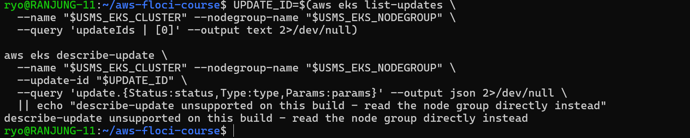

The node group stayed at **2/4/2**.

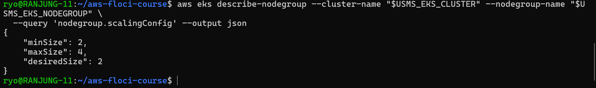

**On real AWS**, a new EC2 node would start and join the cluster, and any Pending pods would be placed on it. If the HPA asks for more pods than the nodes can fit, the extra pods wait in **Pending** until a node is added.

### Step 11: Cluster Autoscaler, Karpenter and a nodeSelector

**Cluster Autoscaler** and **Karpenter** add nodes automatically when pods are Pending. Cluster Autoscaler changes the node group size; Karpenter starts the best-fitting EC2 instances directly and is faster. Both need real EC2, so I did not install them.

The node group labels did not reach the k3d nodes, so I labelled the nodes myself with `workload=usms`.

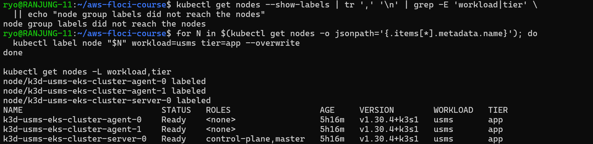

I added **`nodeSelector: workload=usms`** to the enrolment Deployment, and the pods rolled onto labelled nodes.

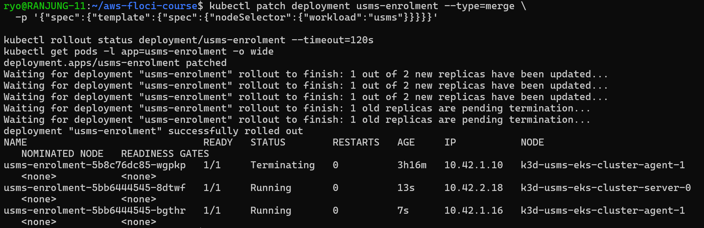

With `workload=nonexistent` the new pod stayed **Pending**, which proves the selector is enforced. Then I set it back.

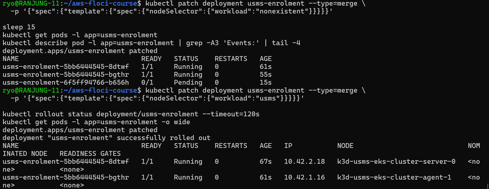

I also saved the nodeSelector in the manifest, so the next `apply` does not remove it.

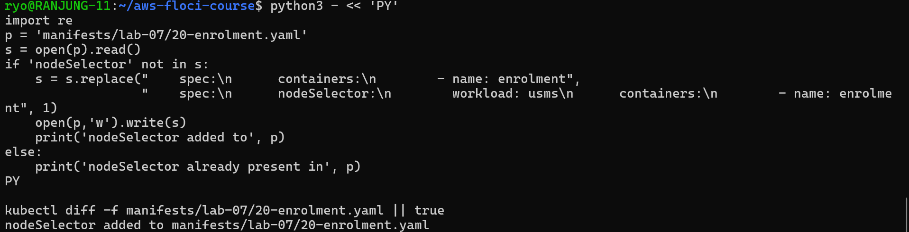

### Step 12: PodDisruptionBudgets

A **PodDisruptionBudget (PDB)** limits how many pods can be removed on purpose at one time.

| PDB | Rule | Allowed disruptions |
|---|---|---|
| `usms-gateway-pdb` | minAvailable: 1 | 0 |
| `usms-enrolment-pdb` | maxUnavailable: 1 | 1 |

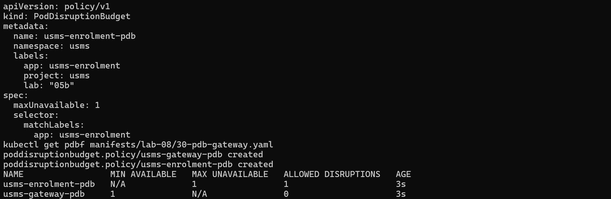

Evicting the gateway pod was **refused**: "Cannot evict pod as it would violate the pod's disruption budget." But a plain `kubectl delete` **worked**, so a PDB does not protect against deletes or crashes.

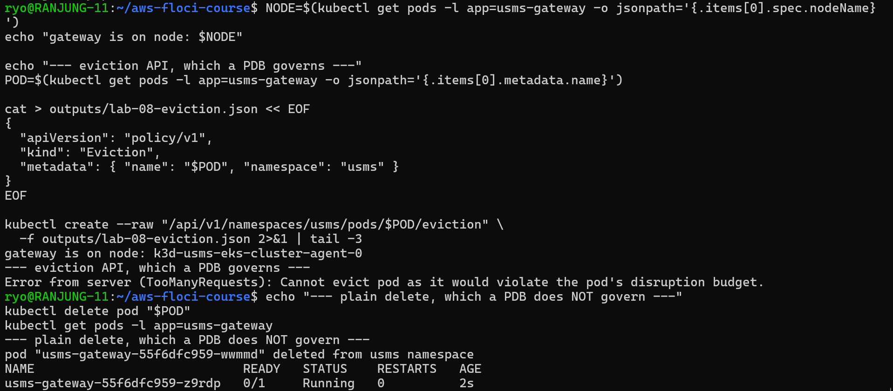

A drain dry run listed the pods that would be evicted from the node.

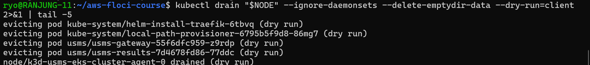

### Step 13: Rung 1 — ClusterIP and port-forward

`curl` to the ClusterIP failed, because a ClusterIP is not reachable from my machine. `kubectl port-forward` opened a tunnel on **127.0.0.1:18080**.

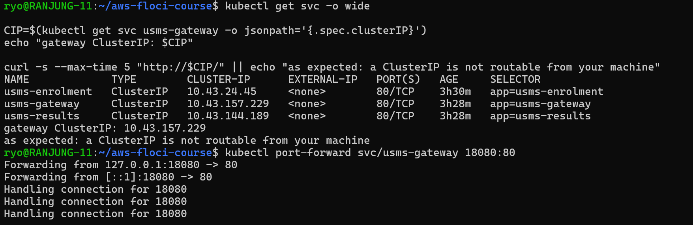

All three paths worked through the tunnel. This is only for testing.

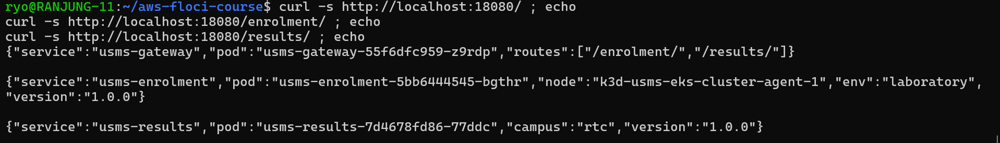

### Step 14: Rung 2 — NodePort

I created `usms-results-np` with **nodePort 30080**.

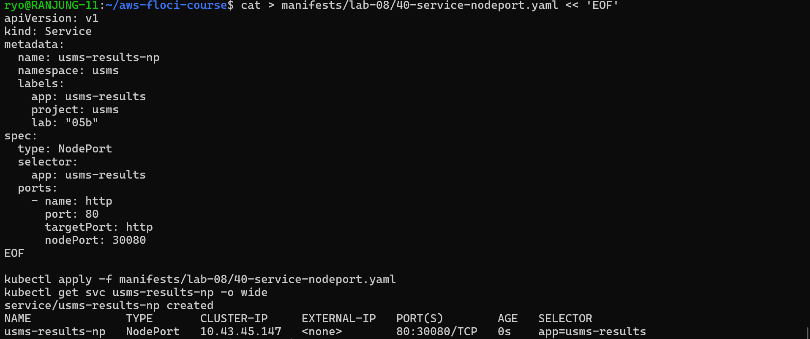

**All three nodes answered** on port 30080, even nodes without a results pod, because kube-proxy forwards the request to a pod wherever it is.

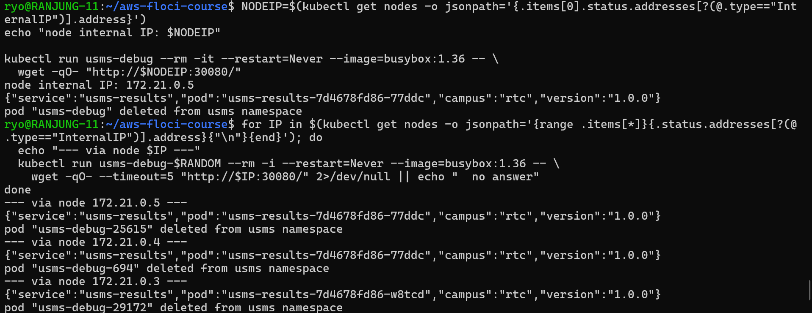

### Step 15: Rung 3 — LoadBalancer

I changed `usms-gateway` to `type: LoadBalancer` with AWS NLB annotations. It got a new nodePort (30484), but **EXTERNAL-IP stayed `<pending>`**.

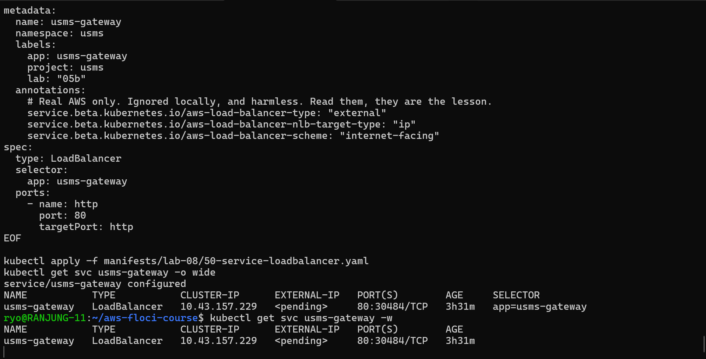

Ports 8081 and 8082 returned **404**. These came from **Traefik**, k3s's built-in ingress controller, which already owns port 80 and had no routes yet.

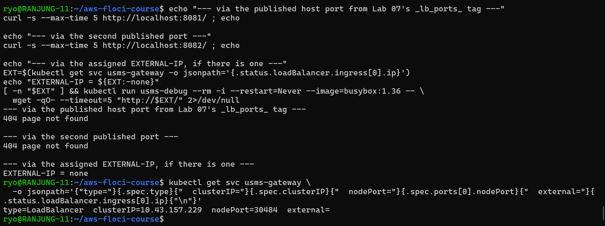

### Step 16: Rung 4 — Ingress

Traefik was already installed as the ingress controller.

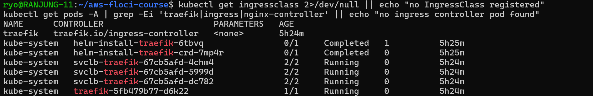

I created `usms-portal-ingress` with three path rules: `/enrolment`, `/results` and `/`.

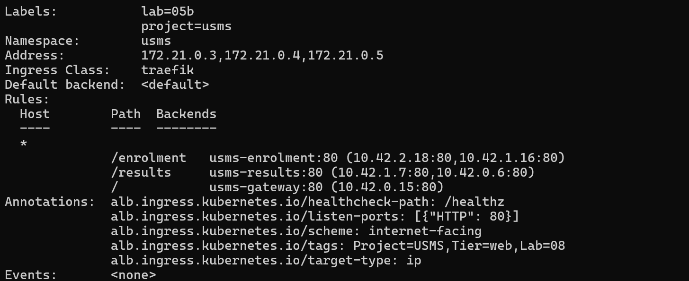

Now port **8081** worked for all three paths.

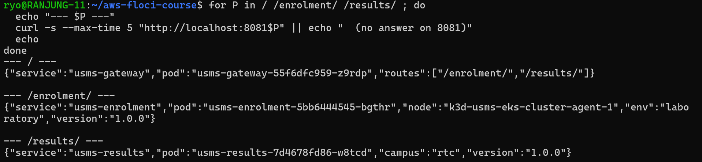

**Compared with the Lab 05 ALB:**

| | Lab 05 (ALB by hand) | Lab 08 (Ingress) |
|---|---|---|
| How it is made | Many `elbv2` commands | One YAML file |
| Path routing | Listener rules | `spec.rules` paths |
| Changing a route | Edit the listener rule | `kubectl apply` |

### Step 17: ECS and EKS side by side

I printed both systems at the same time.

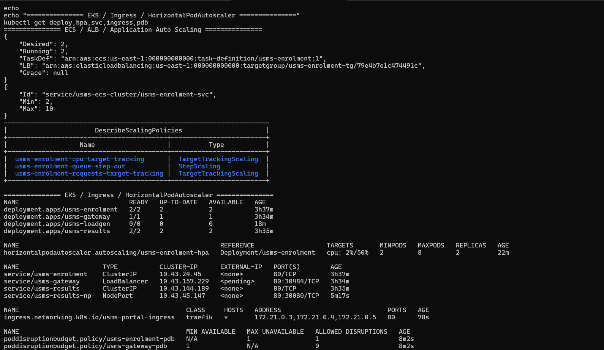

| | ECS (Labs 04–06) | EKS (Labs 07–08) |
|---|---|---|
| Scale pods/tasks | Application Auto Scaling (2–10) | HPA (2–8) |
| Metrics | CloudWatch | metrics-server |
| Scale machines | Fargate: nothing to manage | Node group / Karpenter |
| Expose | ALB built by hand | LoadBalancer or Ingress |
| Protect during maintenance | `minimumHealthyPercent` | PodDisruptionBudget |

### Step 18: Restart test

I recorded the HPA, PDBs, Services, Ingress and node group before the restart.

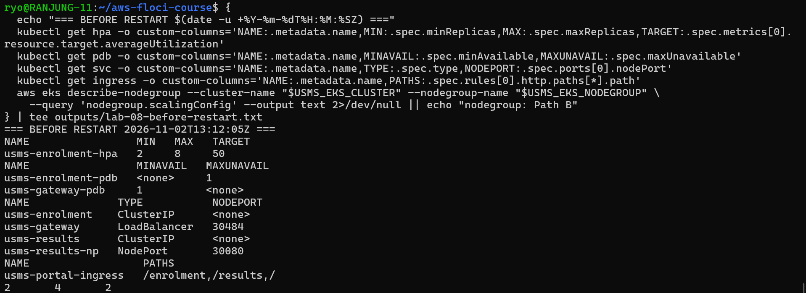

I stopped and started Floci.

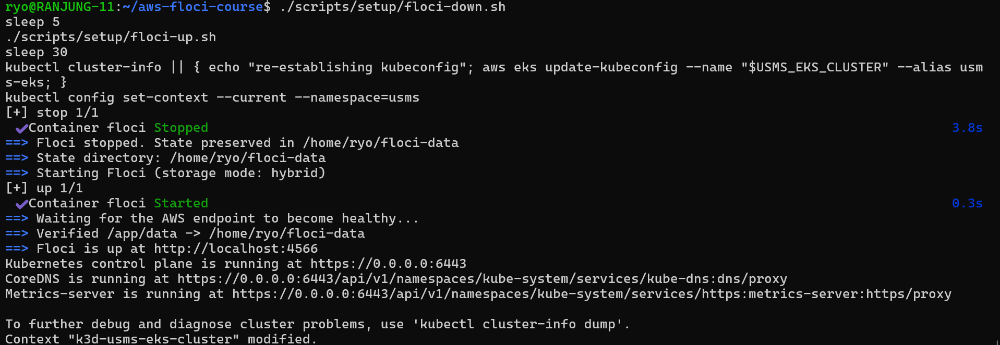

Every value was the same afterwards: **PERSISTENCE PROVEN**.

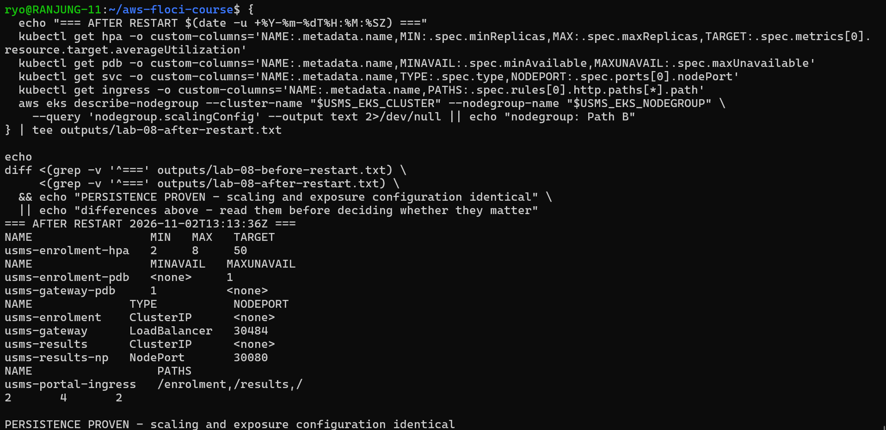

### Step 19: Save the values

I wrote `configs/lab-08.env` with values looked up from the cluster and AWS. It has **19 exports**. The node group values are the real ones (2/4), because Floci never accepted the change.

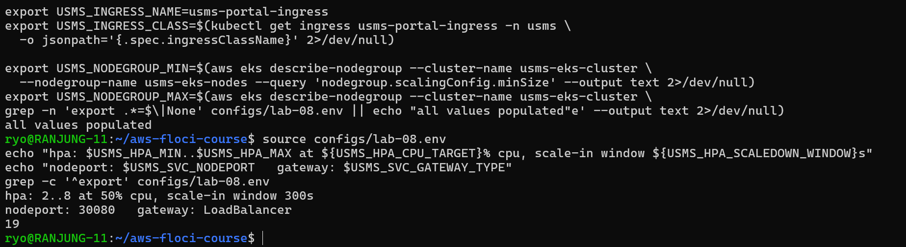

### Step 20: Commit

`git status` showed no file under `outputs/`.

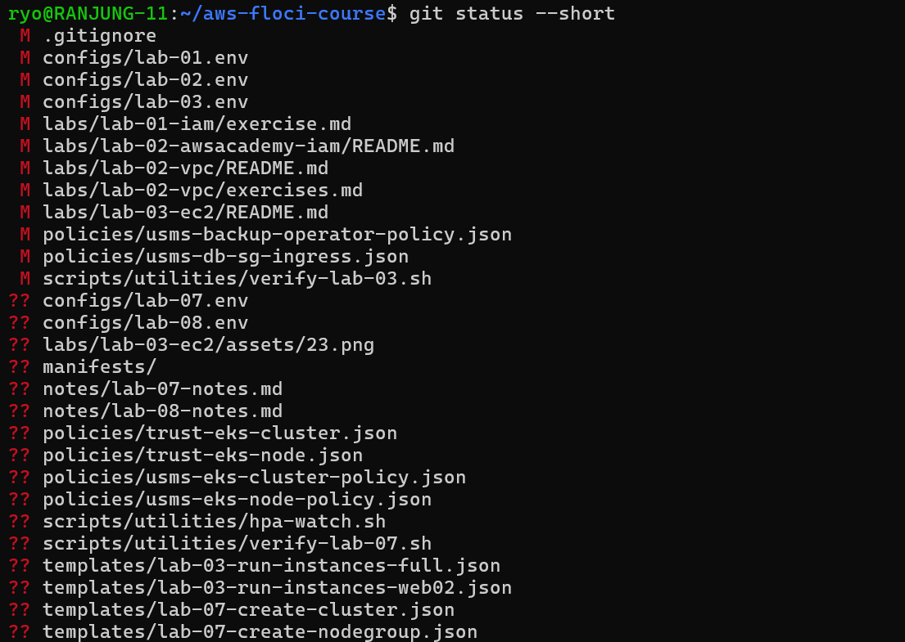

`git add` failed because `verify-lab-08.sh` did not exist yet, and when one path is wrong Git adds nothing.

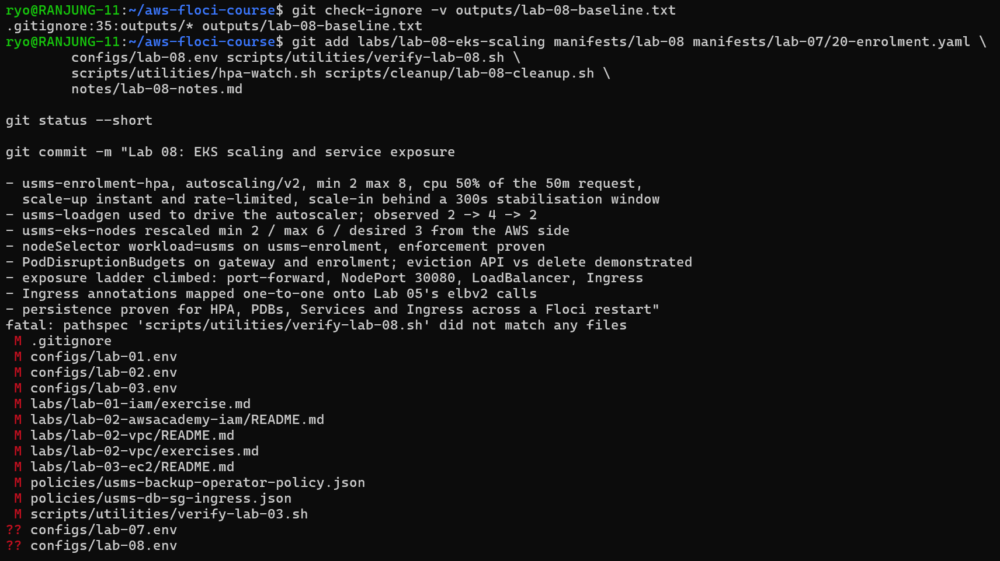

No output file is tracked by Git. The commit is made after the verify script is created.

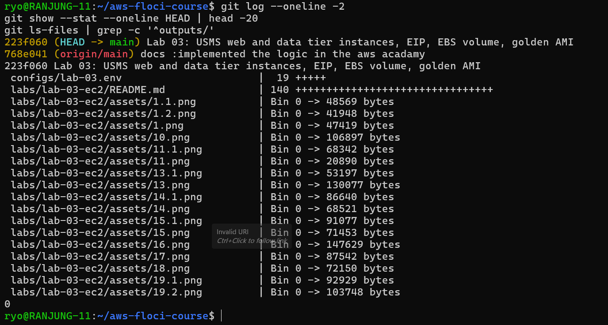

## 6. Verification

I ran `scripts/utilities/verify-lab-08.sh`, which checks the environment, Lab 07, the HPA, PDBs, the exposure ladder, the node group and Git hygiene. The result was **PASS=33, FAIL=1**. The only failure is "node group maxSize was raised to 6", which is expected because Floci does not support `UpdateNodegroupConfig`.

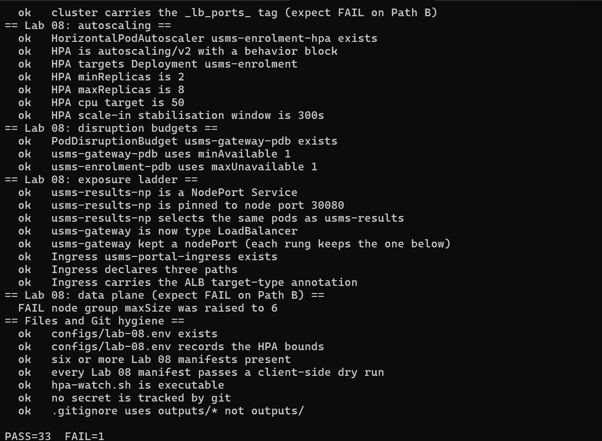

The smoke test called all three paths and printed **SMOKE TEST PASSED**.

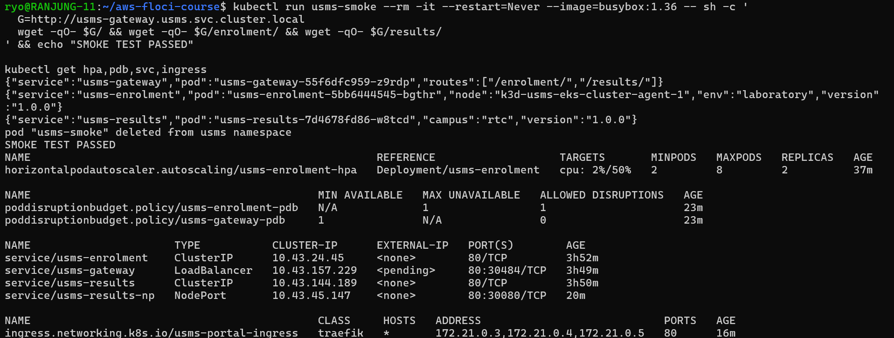

## 7. Analysis and Discussion

### 7.1 What was achieved

- `usms-enrolment` was scaled by hand, by manifest and automatically.
- The HPA `usms-enrolment-hpa` **scaled from 2 to 3 pods by itself** under load and returned to 2 afterwards.
- A `nodeSelector` and two PodDisruptionBudgets were added and tested.
- All four rungs of the exposure ladder were tried, and the **Ingress** routed all three paths.
- Everything survived a Floci restart, and the verification passed **33 of 34** checks.

### 7.2 Observations

- **The Service follows the pods.** New pods got traffic straight away without changing the gateway.
- **`kubectl apply` wins over `kubectl scale`.** Hand changes are lost unless they are saved in the file.
- **The HPA percentage is of the request.** 50% of 50m is only 25m, so a small load was enough to scale up.
- **The scheduler uses requests, not real usage.** A pod asking for 64 CPUs stays Pending even on idle nodes.
- **Pods and nodes are two separate loops.** The HPA adds pods; only the node group adds nodes.
- **A PDB is not a lock.** It blocked an eviction but not a delete.
- **Floci limits.** Node group updates are not supported and LoadBalancer Services get no external IP.

## 8. Reflection

### What I learned about scaling on Kubernetes

Before this lab I thought "autoscaling" was one thing. Now I understand there are four dimensions, each with its own owner, and the HPA only changes the number of pods. If there is no room on the nodes, new pods just wait. The most surprising thing was how much depends on the **CPU request**: the same 50m decides where a pod is placed, its QoS class and when the HPA scales it. Seeing the event "New size: 3" and knowing I did not change anything myself was the best moment of the lab. I also found the Ingress very useful, because one file gave me the same routing that took many commands in Lab 05.

### Challenges I faced

The first time I ran `describe-nodegroup`, I got "No cluster found for name: node-groups". I had opened a new terminal and my variables were empty, so the URL became broken. I learned to always check variables before using them. The verify script also failed with a syntax error because pasting a long heredoc changed a line, so I copied a checked file instead. Finally, `git add` failed because one file in the list did not exist yet, which taught me that Git adds nothing if one path is wrong.

## 9. Conclusion

In this lab I made the USMS services on EKS scalable and reachable from outside the cluster. All objectives were achieved except the node group resize, which Floci does not support. I scaled by hand and by manifest, saw configuration drift, and created an HPA that scaled the enrolment service from 2 to 3 pods under load. I tested a nodeSelector and PodDisruptionBudgets, and exposed the services with port-forward, NodePort, LoadBalancer and Ingress. Everything survived a restart, and the verification passed **33 of 34** checks.

The key concepts I learned are the four dimensions of scaling, how the CPU request controls scheduling and autoscaling, the difference between pod and node scaling, and the exposure ladder. Scaling is important because it lets USMS handle enrolment week without paying for extra capacity the rest of the year.
