# Lab 08 Practical Report: Scaling and Exposing the USMS Services on Amazon EKS

## 1. Aim / Objective

The aim of this lab is to make the USMS services from Lab 07 **scale** and to **expose** them outside the cluster. In Lab 07 the three services ran with a fixed number of pods and could only be reached from inside the cluster. In this lab I scaled them by hand, by manifest and automatically with a **HorizontalPodAutoscaler (HPA)**, changed the **node group** from the AWS side, and climbed the **exposure ladder** from `port-forward` to an **Ingress**. The AWS side was done with the AWS CLI on the local emulator Floci, and the Kubernetes side was done with `kubectl` on the k3d cluster from Lab 07.

The specific objectives were to:

- Scale a Deployment **by hand**, **by manifest**, and with an **`autoscaling/v2` HPA**, and compare the HPA with Lab 06's Application Auto Scaling.
- Change the **managed node group's** scaling configuration from the AWS side, and explain why it is a **separate control loop** from the HPA.
- Use **requests**, **QoS classes**, a **`nodeSelector`** and **PodDisruptionBudgets**, and explain what each one does and does not protect.
- Climb the **exposure ladder**: `port-forward`, **NodePort**, **LoadBalancer** and **Ingress**, and compare the Ingress with the ALB I built by hand in Lab 05.
- Prove the configuration survives a Floci restart, save the values to `configs/lab-08.env`, and check the lab with a verification script.

## 2. Introduction

Kubernetes can scale in **four dimensions**, and each one is owned by a different object:

| Dimension | What changes | Who owns it |
|---|---|---|
| **Pod replicas** (horizontal) | How many copies of a pod run | The Deployment's `replicas`, changed by me or by the **HPA** |
| **Pod size** (vertical) | How much CPU/memory each pod asks for | The pod's `requests` and `limits` |
| **Node count** | How many machines are in the cluster | The **managed node group** (AWS side), or Cluster Autoscaler / Karpenter |
| **Node size** | How big each machine is | The node group's **instance type** |

The **HPA** works like a thermostat. Every 15 seconds it reads the pods' CPU from the **metrics API**, compares it with the target, and changes the Deployment's `replicas`. The important detail is that the HPA's percentage is **a percentage of the pod's CPU request**, not of the node and not of the limit. A pod with no CPU request cannot be autoscaled on CPU.

The metrics API is **not built into Kubernetes**. It is an add-on called **metrics-server**. Without it, `kubectl top` and the HPA do not work.

To reach a service from outside the cluster there is a ladder of four options. Each rung keeps the one below it:

| Rung | Object | Simple meaning |
|---|---|---|
| 1 | **ClusterIP + port-forward** | Only inside the cluster. `kubectl port-forward` makes a private tunnel for testing. |
| 2 | **NodePort** | Opens the same port (30000–32767) on **every node**. |
| 3 | **LoadBalancer** | Asks the cloud for a load balancer (an NLB on AWS) in front of the NodePort. |
| 4 | **Ingress** | One load balancer (an ALB on AWS) that routes by **path** to many Services. |

## 3. Use Case

**USMS use case:** During enrolment week the `usms-enrolment` service gets far more traffic than the rest of the year. With this lab:

- The **HPA** keeps `usms-enrolment` between **2 and 8 pods**, aiming at **50% of the CPU request**. When students rush in, pods are added quickly. When the rush ends, pods are removed slowly, after a **5-minute** wait.
- If the pods do not fit on the nodes, the **node group** can grow (on real AWS, from 2 up to 6 nodes).
- **PodDisruptionBudgets** make sure that node maintenance never takes away the last gateway pod or more than one enrolment pod at a time.
- Students reach the portal through one **Ingress**: `/enrolment` goes to the enrolment service, `/results` to the results service, and `/` to the gateway. This is the same routing I built by hand with an ALB in Lab 05, but here it is written in one YAML file.

## 4. System Architecture / Design

**How it works in simple words:**

1. **metrics-server** reads CPU and memory from the kubelet on each node, and publishes them through the **metrics API** (`metrics.k8s.io`).
2. The **HPA** `usms-enrolment-hpa` reads the average CPU of the enrolment pods every 15 seconds, compares it with **50% of the 50m request (25m)**, and changes the Deployment's `replicas` (min 2, max 8).
3. The **Deployment** creates or removes pods, and the **scheduler** places them on nodes that have enough unrequested CPU and memory.
4. On the AWS side, the **node group** `usms-eks-nodes` decides how many nodes exist. This is a **different control loop**. The HPA never talks to it.
5. Outside traffic comes in through the ladder: **Ingress → Service → pods**. The **Service** always sends traffic only to pods that are ready, so new pods from the HPA get traffic automatically.

## 5. Implementation Procedure

### Step 1: Start the environment and check what Lab 07 left behind

I started Floci (storage mode **hybrid**), loaded the env files, ran `whoami.sh` and set `usms` as the default namespace on the context **`k3d-usms-eks-cluster`**. The account is **000000000000**, so this is Floci, not real AWS.

`configs/lab-04.env` gave **"No such file or directory"** in my WSL copy of the project. Lab 08 does not use any Lab 04 values, so this did not affect the lab.

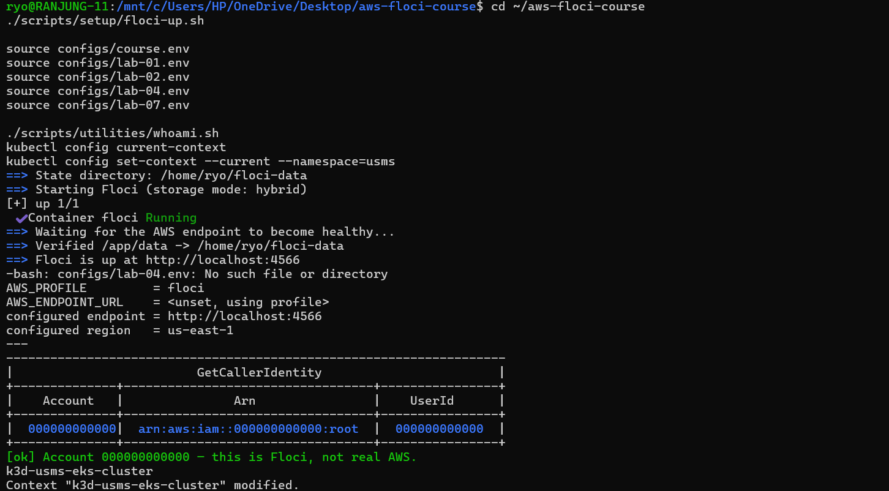

Then I checked the two things Lab 08 needs from Lab 07:

1. **`usms-enrolment` has a CPU request:** `{"cpu":"50m","memory":"32Mi"}`. The HPA needs this as its denominator.
2. **The `_lb_ports_` tag is on the cluster:** **`8081,8082`**, both in `configs/lab-07.env` and from `aws eks describe-cluster`.

I also ran `kubectl set resources` to set requests **50m / 32Mi** and limits **200m / 128Mi**, and the rollout finished successfully.

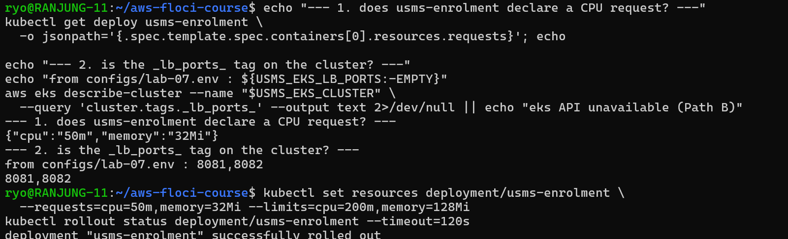

The Lab 07 verify script still gives **PASS=30 FAIL=0**. All three Deployments are ready (**2/2, 1/1, 2/2**), all three Services are **ClusterIP** with no external IP, and the ConfigMaps and the Secret are there.

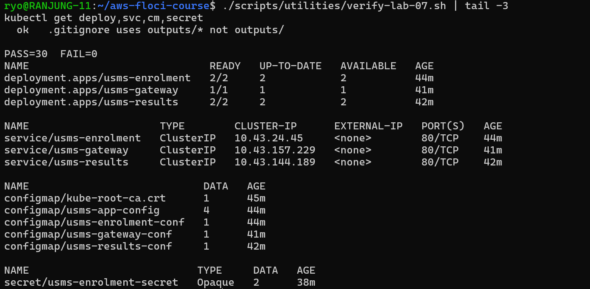

### Step 2: Read my baseline before changing anything

I saved a snapshot to `outputs/lab-08-baseline.txt` at **2026-11-02T10:19:29Z**:

- The script reported **"Exercise 5 not done"** for Lab 07. The lab says this can be recovered later, but it must be done before Lab 10.
- Deployments: enrolment **2/2**, gateway **1/1**, results **2/2**.
- Endpoints: enrolment has **2** (`10.42.1.10`, `10.42.2.10`), gateway **1**, results **2**.
- All three Services are **ClusterIP** with **no external address**.
- **3 nodes** (`agent-0`, `agent-1`, `server-0`), all **Ready**, each with **4 CPUs and about 8 GiB** of memory.

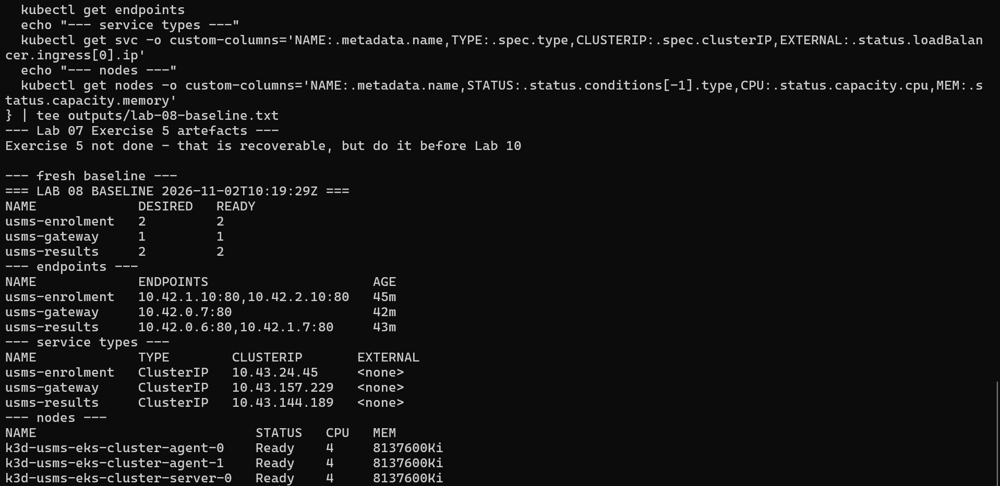

### Step 3: The four dimensions of scaling

There was nothing to run in this step. I read about the four dimensions of scaling (pod replicas, pod size, node count and node size) and which object owns each. They are explained in the table in Section 2. The main point is that **the HPA only changes pod replicas**. It cannot add nodes.

### Step 4: Scale by hand and watch what moves

I scaled `usms-enrolment` to **5 replicas** while watching the pods with `kubectl get pods -w`. The two old pods (`2hbml` and `wgpkp`, 170 minutes old) kept running, and three new pods went **Pending → ContainerCreating → Running (0/1) → Running (1/1)** in about **6 seconds**. They were `0/1` for a few seconds because the readiness probe had not passed yet.

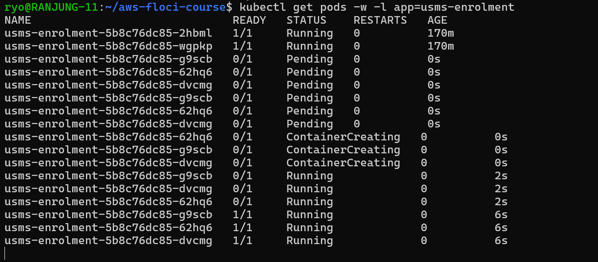

`rollout status` waited until **5 of 5** replicas were available. The Deployment showed **5/5**, and the Service had **5 endpoints**: `10.42.0.12`, `10.42.1.10`, `10.42.1.12` and **2 more**. The Service picked up the new pods by itself.

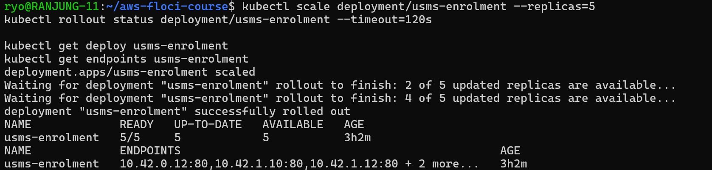

Then I sent **40 requests** through the gateway to `/enrolment/` and counted which pod answered:

| Pod | Requests |
|---|---|
| `usms-enrolment-5b8c76dc85-g9scb` | 11 |
| `usms-enrolment-5b8c76dc85-62hq6` | 11 |
| `usms-enrolment-5b8c76dc85-2hbml` | 9 |
| `usms-enrolment-5b8c76dc85-wgpkp` | 6 |
| `usms-enrolment-5b8c76dc85-dvcmg` | 3 |

All **5 pods** received traffic, so the new pods joined the load balancing without any change to the gateway. The split is not exactly even, because kube-proxy picks a pod at random for each connection.

Finally, I scaled back to **2**. The Service went back to **2 endpoints**.

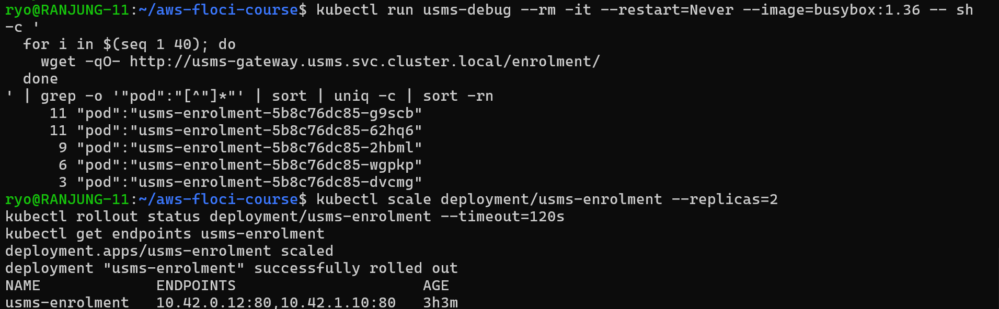

### Step 5: Scale declaratively and meet configuration drift

**Part 1 (drift):** I scaled to **6** by hand. The live Deployment said **6**, but the manifest `manifests/lab-07/20-enrolment.yaml` still says **`replicas: 2`** on line 35. When I ran `kubectl apply` on the manifest, the Deployment went **back to 2 without any warning**. A hand change that is not in the file is lost on the next apply. This is called **configuration drift**.

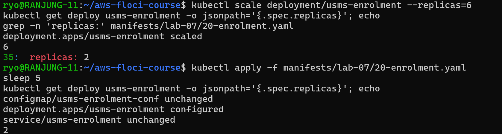

**Part 2 (the declarative way):** I changed the manifest to **`replicas: 3`** and ran **`kubectl diff`** first. It showed exactly what would change: `replicas: 2` → `replicas: 3`, and `generation: 9` → `10`. Then I applied it, and the Deployment became **3**. `kubectl diff` is the safe way to check a change before applying it.

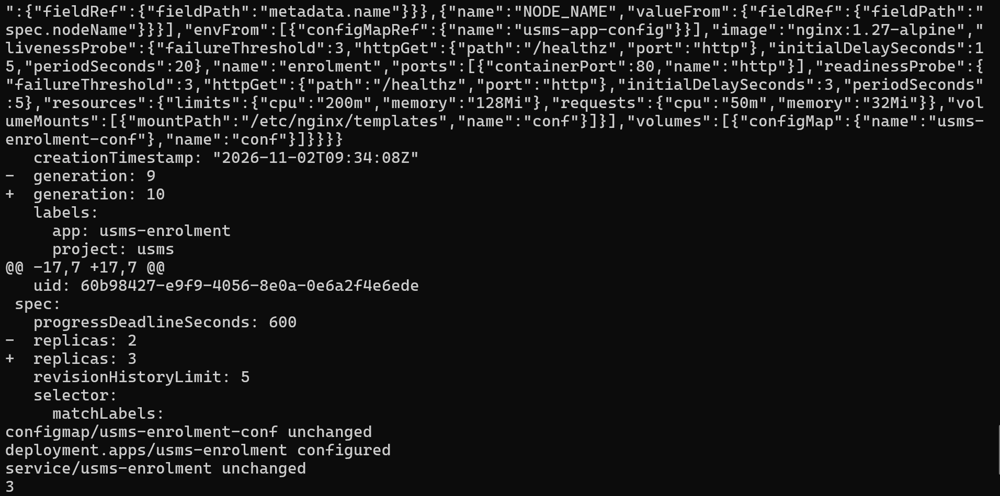

**Part 3:** I put the manifest back to **`replicas: 2`** with `sed -i.bak`, applied it, and removed the `.bak` file. All Deployments are back to **2/2, 1/1, 2/2**.

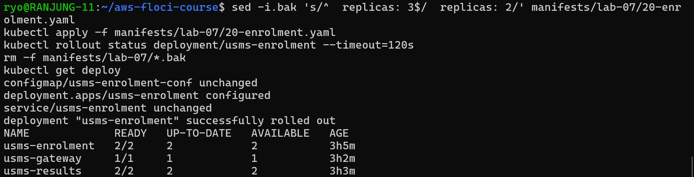

When the HPA is added in Step 8, it owns `replicas`. So the manifest should not keep setting `replicas`, or every `kubectl apply` will fight with the HPA.

### Step 6: Requests, limits and QoS classes

I listed the pods with their **QoS class**, CPU request and CPU limit:

| Pod | QoS | CPU request | CPU limit |
|---|---|---|---|
| `usms-enrolment` (×2) | Burstable | 50m | 200m |
| `usms-gateway` | Burstable | 50m | 200m |
| `usms-results` (×2) | Burstable | 50m | 200m |
| `usms-toobig` | Burstable | **64** | none |

All pods are **Burstable**, because their request is lower than their limit. A pod is **Guaranteed** only when request = limit for both CPU and memory, and it is **BestEffort** when it has none at all. The `usms-toobig` pod is left over from the Lab 07 failure test (64 CPUs). It is still Pending, because no node can fit it.

Then I looked at what the **scheduler** has given out on node **`k3d-usms-eks-cluster-agent-0`**: CPU requests **150m (3%)**, CPU limits **600m (15%)**, memory requests **96Mi (1%)** and limits **384Mi (4%)**. The scheduler only looks at **requests**, not real usage, when it decides whether a pod fits on a node.

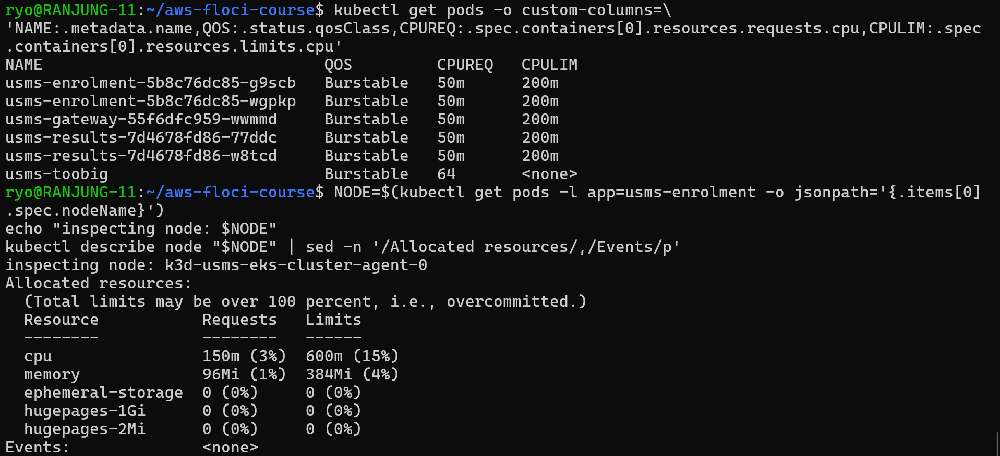

This is the coupling the lab title talks about. The request of **50m** is also what the HPA uses. A **50% target** means **25m on average across all pods**. It is **not** 50% of a node and **not** 50% of the limit.

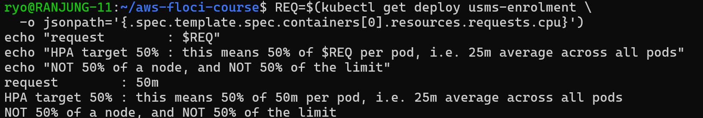

### Step 7: The metrics pipeline

I checked whether the metrics API exists before installing anything:

- The APIService **`v1beta1.metrics.k8s.io`** → `kube-system/metrics-server` is **True**.
- The `metrics-server` Deployment is **1/1** and **4h57m** old.
- **metrics API: AVAILABLE**.

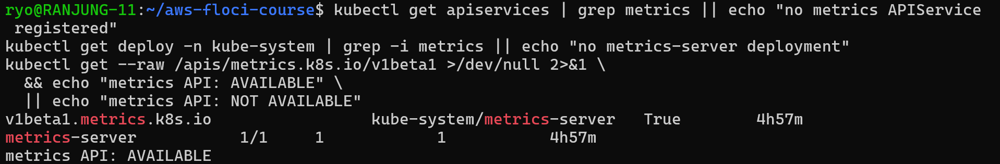

k3d is based on k3s, and k3s installs metrics-server by default, so it was already there. I also ran the lab's install command (`kubectl apply` of the upstream `components.yaml`). It printed warnings that the existing objects were **missing the last-applied-configuration annotation**, because k3s had created them without `kubectl apply`. The `rollout status` command then **timed out after 120 seconds** with "1 old replicas are pending termination".

When I checked a few minutes later, the new pod `metrics-server-8484bd6996-z2zfz` was **1/1 Running** with **0 restarts**. Its log shows a normal start: it is serving on port **10250**, it registered `metrics.k8s.io v1beta1`, and its caches synced. The rollout simply took longer than the timeout, so I did not need the `--kubelet-insecure-tls` fallback.

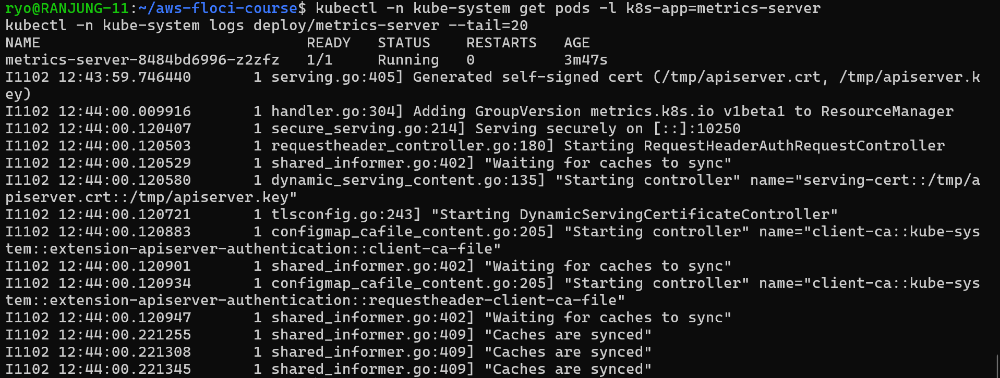

`kubectl top` works:

| Node | CPU | CPU % | Memory | Memory % |
|---|---|---|---|---|
| agent-0 | 56m | 1% | 249Mi | 3% |
| agent-1 | 66m | 1% | 246Mi | 3% |
| server-0 | 64m | 1% | 654Mi | 8% |

Every USMS pod uses only **1m CPU and 4Mi memory** when idle.

My `notes/lab-08-notes.md` has the line "metrics API unavailable – Step 9 will use the manual fallback", but that note is wrong: the metrics API **was** available, and Step 9 used the real HPA.

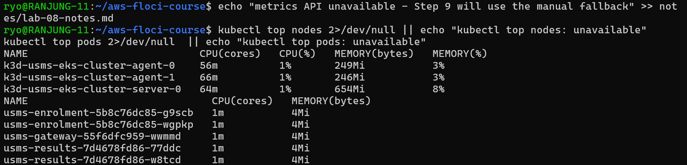

### Step 8: Create the HorizontalPodAutoscaler

I wrote `manifests/lab-08/10-hpa-enrolment.yaml`. The `manifests/lab-08/` folder did not exist the first time, so the heredoc failed with "No such file or directory". I created the folder with `mkdir -p` and wrote the file again.

The HPA **`usms-enrolment-hpa`** uses **`autoscaling/v2`**, targets the Deployment `usms-enrolment`, and has **minReplicas 2**, **maxReplicas 8** and a CPU target of **50% average utilisation**. The `apply` said **unchanged**, because I had already applied it once. Straight after creation it showed **`cpu: <unknown>/50%`** and **0 replicas**, because the HPA had not read any metrics yet.

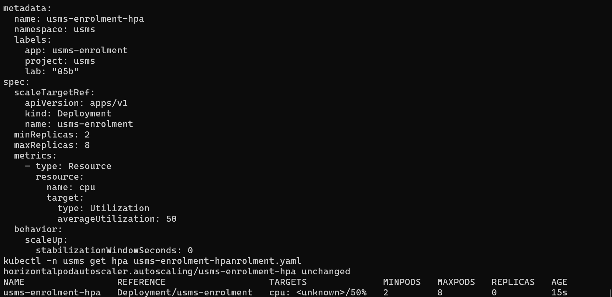

After about 30 seconds the HPA showed **`cpu: 2%/50%`** with **2 replicas**. `describe` shows the full behaviour:

| Setting | Value | Why |
|---|---|---|
| Scale up | Stabilisation window **0s**, `selectPolicy: Max`, **100% or 2 pods every 15s** | React fast to a rush |
| Scale down | Stabilisation window **300s**, `selectPolicy: Min`, **1 pod every 60s** | Remove pods slowly, to avoid flapping |

The conditions are all healthy:

- **AbleToScale = True** (`ScaleDownStabilized`)
- **ScalingActive = True** (`ValidMetricFound`: "cpu resource utilization (percentage of request)")
- **ScalingLimited = False** (`DesiredWithinRange`)

The `behavior` block only exists in `autoscaling/v2`. The design is **"scale out fast, scale in slowly"**, which is the same idea as the cooldowns in Lab 06.

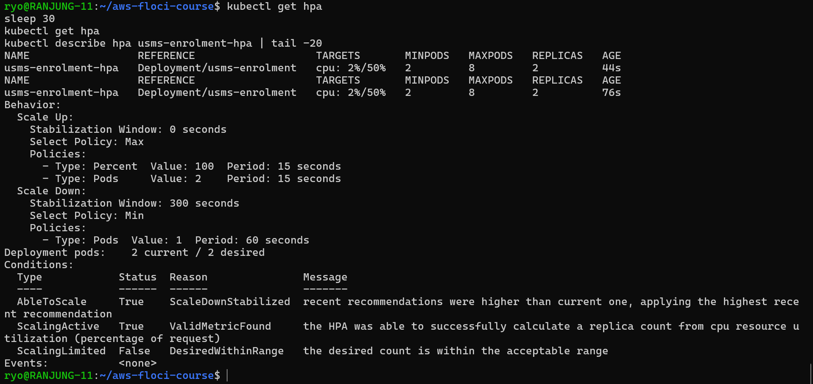

**Compared with Lab 06:**

| | Lab 06 (ECS) | Lab 08 (EKS) |
|---|---|---|
| What scales | `desiredCount` of the ECS service | `replicas` of the Deployment |
| Who decides | Application Auto Scaling + CloudWatch alarms | The HPA controller inside the cluster |
| Where metrics come from | CloudWatch | metrics-server |
| Floor / ceiling | Scalable target (2–10) | `minReplicas` / `maxReplicas` (2–8) |
| Cooldown | Scale-in / scale-out cooldown | `behavior.scaleDown.stabilizationWindowSeconds` |

### Step 9: Generate load and watch it respond

I created `scripts/utilities/hpa-watch.sh`. Every 10 seconds it prints the time, the HPA's current CPU / target, the desired replicas, the ready replicas and the pod count. It is read-only. `bash -n` said **valid bash syntax**.

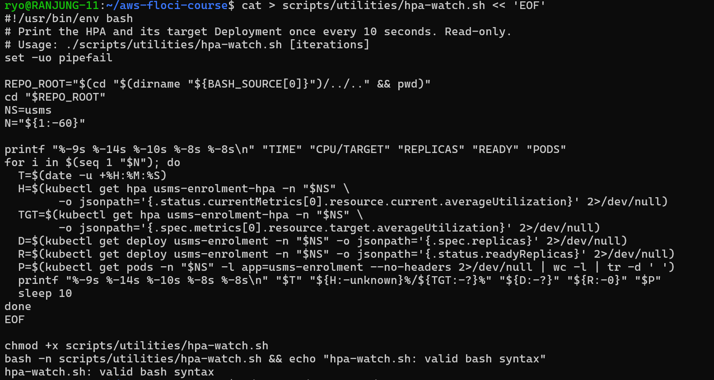

Then I created the **`usms-loadgen`** Deployment: **3 replicas** of `busybox:1.36`, each running a `while true` loop of requests to the enrolment service through the gateway. The rollout finished with **3 of 3** replicas available.

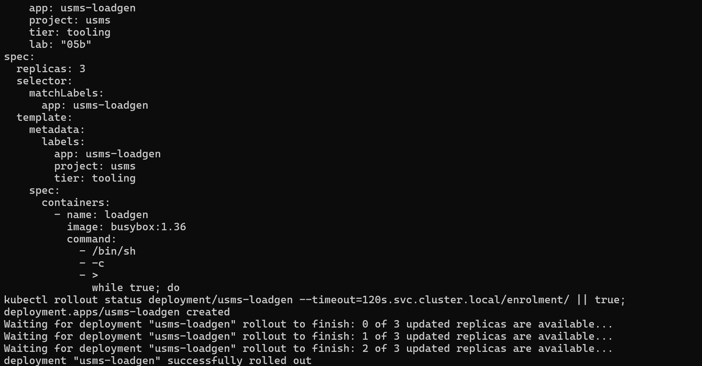

The HPA reacted. Its event says:

> **SuccessfulRescale — New size: 3; reason: cpu resource utilization (percentage of request) above target**

So the HPA, not me, raised `usms-enrolment` from 2 to **3** replicas, because the average CPU went above 25m (50% of the 50m request). Then I stopped the load by scaling `usms-loadgen` to **0**.

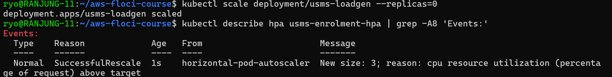

I do not have a screenshot of the scale-down itself. Later screenshots (Step 17 and the verification) show the HPA back at **2 replicas** with **`cpu: 2%/50%`**, so it scaled back in after the 300-second window.

### Step 10: Scale the data plane from the AWS side

I set `USMS_EKS_CLUSTER=usms-eks-cluster` and `USMS_EKS_NODEGROUP=usms-eks-nodes`. The first time, they were empty because I had opened a new terminal. The error said **"No cluster found for name: node-groups"**, because with an empty cluster name the API path becomes `/clusters//node-groups/...` and Floci read `node-groups` as the cluster name.

Before the change, `describe-nodegroup` showed (saved to `outputs/lab-08-nodegroup-before.json`):

- **usms-eks-nodes**, status **ACTIVE**
- Scaling **min 2, max 4, desired 2**
- Instance type **t3.small**
- The two private subnets `subnet-d41ed02b` and `subnet-811295b5`
- Labels **`tier=app`** and **`workload=usms`**

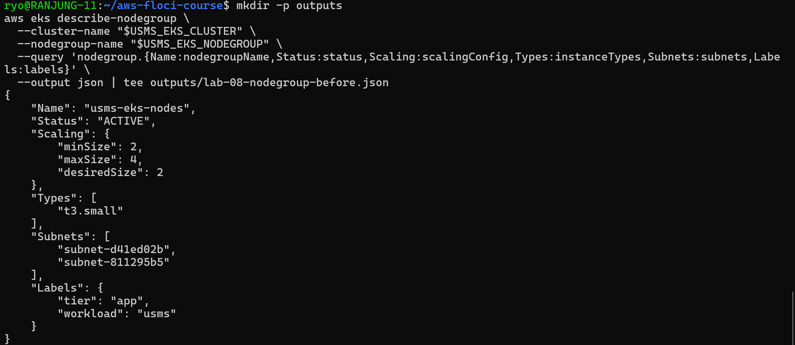

Then I ran `aws eks update-nodegroup-config` with **min 2, max 6, desired 3**. Floci returned:

```
UnknownOperationException: Unknown operation: POST /clusters/usms-eks-cluster/node-groups/usms-eks-nodes/update-config
```

My Floci build does **not support `UpdateNodegroupConfig`** at all. Because there was no update, `describe-update` also printed the lab's fallback message: **"describe-update unsupported on this build - read the node group directly instead"**.

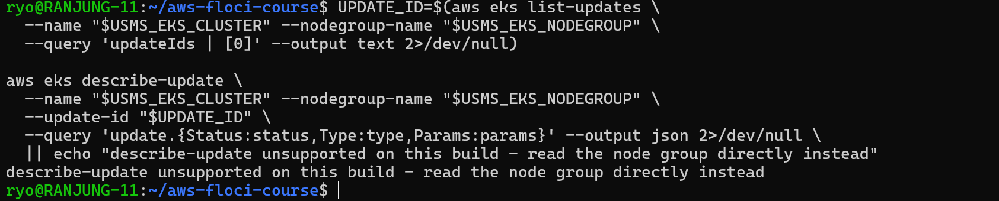

I read the node group directly. It is still **min 2, max 4, desired 2**. The restore command (back to 2/4/2) gave the same `UnknownOperationException`, and there was nothing to restore anyway.

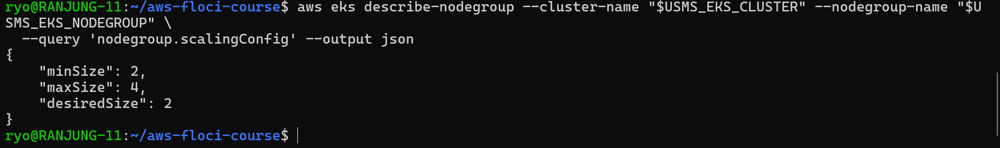

**What would happen on real AWS:** the node group's Auto Scaling group would raise its desired capacity to 3 and start a new EC2 instance. The new node would join the cluster, and any Pending pods would be scheduled on it. This is a **separate control loop**: the HPA adds pods, but only the node group (or Cluster Autoscaler / Karpenter) adds nodes. If the HPA asks for more pods than the nodes can fit, the extra pods stay **Pending**.

### Step 11: Cluster Autoscaler, Karpenter and a nodeSelector

**Cluster Autoscaler** and **Karpenter** both add nodes when pods are Pending. I did not install them, because they need real EC2:

| | Cluster Autoscaler | Karpenter |
|---|---|---|
| How it adds nodes | Changes the desired size of an existing node group | Starts EC2 instances directly, choosing the instance type |
| Speed | Slower (goes through the Auto Scaling group) | Faster |
| Node types | Fixed by the node group | Picks the best fit for the Pending pods |

**Part 1:** The node group has the labels `workload=usms` and `tier=app`, but the check printed **"node group labels did not reach the nodes"**. The k3d nodes are not real node group instances, so Floci's labels never reached them. I labelled all three nodes myself with `workload=usms tier=app`. Now **agent-0, agent-1 and server-0** all show `WORKLOAD=usms` and `TIER=app`.

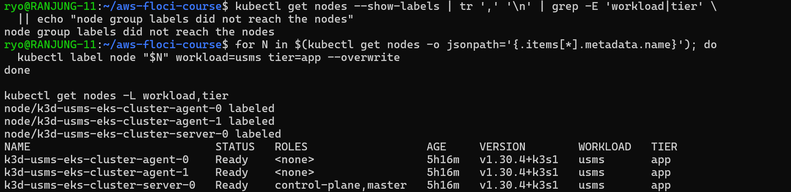

**Part 2:** I patched the enrolment Deployment with **`nodeSelector: workload=usms`**. This changed the pod template, so there was a rolling update. The new pods are `5bb6444545-8dtwf` on **server-0** and `5bb6444545-bgthr` on **agent-1**. One pod went to the control-plane node, because I had labelled server-0 too.

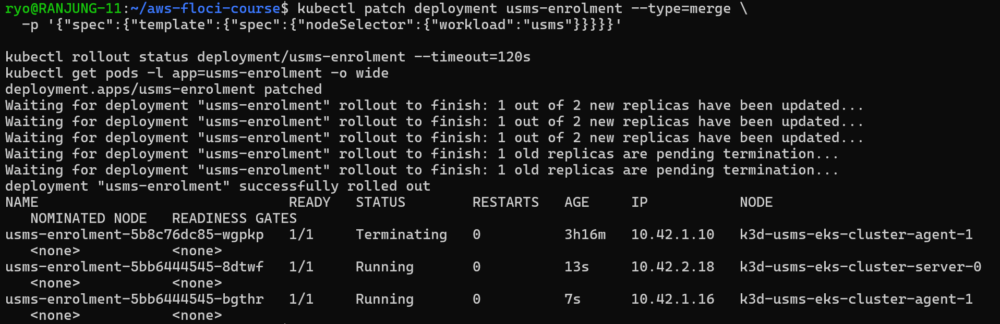

**Part 3:** To prove the nodeSelector is enforced, I changed it to **`workload=nonexistent`**. The new pod `6f5ff94766-b656h` stayed **Pending (0/1)**, because no node has that label, and the two old pods kept running. Then I set it back to `workload=usms`, and the rollout finished with the 2 pods on server-0 and agent-1.

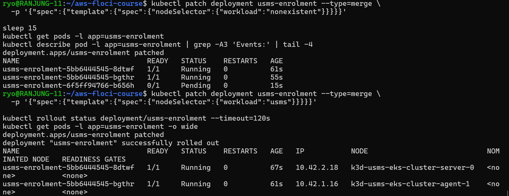

**Part 4:** I added the nodeSelector to `manifests/lab-07/20-enrolment.yaml` with a small Python script, so the next `kubectl apply` does not remove it. This is the drift lesson from Step 5 again.

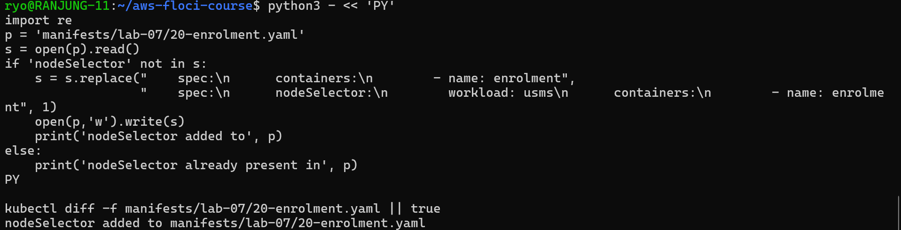

### Step 12: PodDisruptionBudgets

I created two PDBs from `manifests/lab-08/30-pdb-gateway.yaml` (and the enrolment one):

| PDB | Rule | Allowed disruptions |
|---|---|---|
| `usms-gateway-pdb` | **minAvailable: 1** | **0** (there is only 1 gateway pod) |
| `usms-enrolment-pdb` | **maxUnavailable: 1** | **1** |

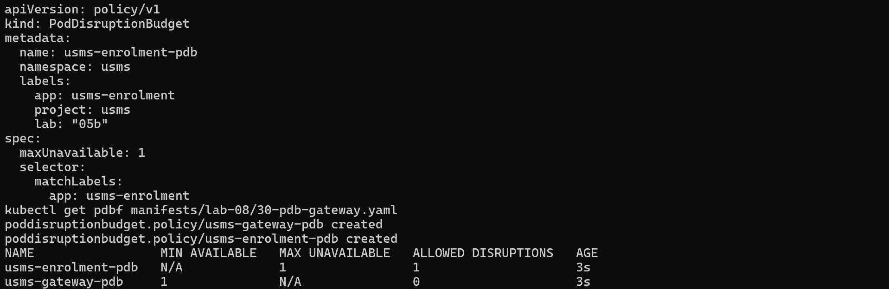

**Eviction API (governed by the PDB):** the gateway pod was on **agent-0**. I sent an `Eviction` for it through the API, and it was refused:

> **Error from server (TooManyRequests): Cannot evict pod as it would violate the pod's disruption budget.**

**Plain delete (not governed by the PDB):** `kubectl delete pod usms-gateway-55f6dfc959-wwmmd` **worked straight away**. The Deployment created a new pod `z9rdp`, but it was **0/1** for a few seconds, so for that moment there was **no ready gateway**. A PDB does not stop `kubectl delete`, and it does not help if a node crashes.

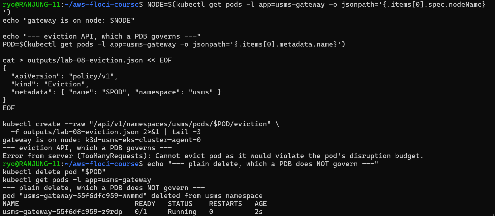

**Drain dry run:** `kubectl drain agent-0 --dry-run=client` listed the pods that would be evicted: `helm-install-traefik`, `local-path-provisioner`, **`usms-gateway-z9rdp`** and **`usms-results-77ddc`**, and printed "drained (dry run)". A client-side dry run does not ask the API server, so it does not check PDBs. A real drain would get stuck on the gateway pod until a second gateway pod existed somewhere else.

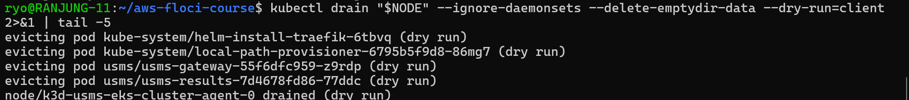

### Step 13: Rung one, ClusterIP and port-forward

All three Services were **ClusterIP** with **no external IP**. `curl` to the gateway's ClusterIP **10.43.157.229** failed, as expected: **a ClusterIP is not routable from my machine**.

`kubectl port-forward svc/usms-gateway 18080:80` opened a tunnel from **127.0.0.1:18080** to the Service, and it printed "Handling connection for 18080" for each request.

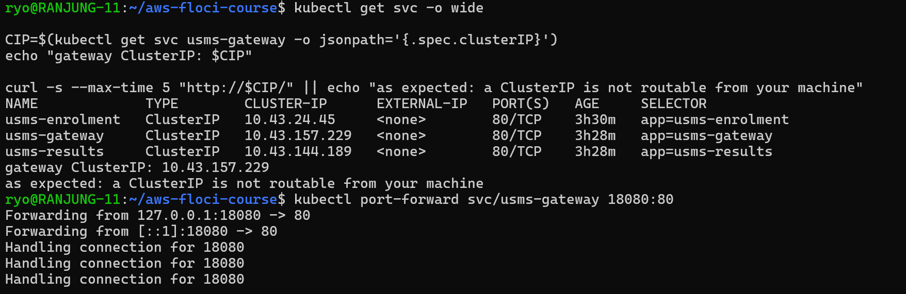

Through the tunnel, all three paths worked:

- `/` → `usms-gateway` (pod `z9rdp`) with its routes
- `/enrolment/` → `usms-enrolment` (pod `bgthr` on agent-1, version 1.0.0)
- `/results/` → `usms-results` (pod `77ddc`, campus `rtc`)

This only works while the command is running, and only on my machine, so it is for debugging, not for users.

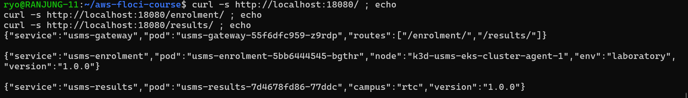

### Step 14: Rung two, NodePort

I wrote `manifests/lab-08/40-service-nodeport.yaml`: **`usms-results-np`**, `type: NodePort`, selector **`app=usms-results`** (the same pods as `usms-results`), port 80 and **nodePort 30080**. It got ClusterIP **10.43.45.147** and ports **80:30080/TCP**. A NodePort Service also has a ClusterIP, because each rung keeps the one below.

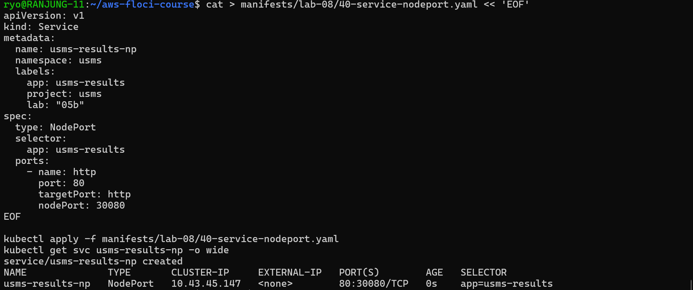

I called port **30080** on **every node's internal IP** from a busybox pod:

| Node IP | Answered by |
|---|---|
| 172.21.0.5 | `usms-results-77ddc` |
| 172.21.0.4 | `usms-results-77ddc` |
| 172.21.0.3 | `usms-results-w8tcd` |

**All three nodes answered**, even the ones with no results pod on them. kube-proxy opens the port on every node and forwards the request to a pod, wherever that pod is.

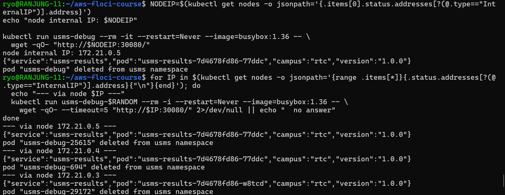

### Step 15: Rung three, LoadBalancer

I wrote `manifests/lab-08/50-service-loadbalancer.yaml`, which changes `usms-gateway` to **`type: LoadBalancer`**. It has three AWS annotations that are **ignored locally**:

- `aws-load-balancer-type: "external"`
- `aws-load-balancer-nlb-target-type: "ip"`
- `aws-load-balancer-scheme: "internet-facing"`

On real AWS, the AWS Load Balancer Controller would read these and create an internet-facing **NLB** with IP targets. After `apply`, the Service is **LoadBalancer** with ClusterIP **10.43.157.229** (unchanged) and a new nodePort **30484**, but **EXTERNAL-IP stayed `<pending>`**.

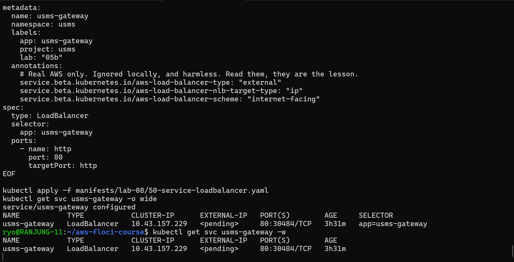

I tried the published host ports from Lab 07's `_lb_ports_` tag:

- `localhost:8081` → **404 page not found**
- `localhost:8082` → **404 page not found**
- **EXTERNAL-IP = none**

The final check shows `type=LoadBalancer`, `clusterIP=10.43.157.229`, **`nodePort=30484`** and an empty `external`. So the Service kept its nodePort and ClusterIP, but it has **no external address** on my cluster.

The 404s come from **Traefik**, k3s's built-in ingress controller, which already owns port 80 on the nodes (Step 16 shows its `svclb-traefik` pods). That is most likely also why k3s's built-in service load balancer could not give the gateway an external address. Traefik had no routes yet, so it answered 404. Step 16 proves this.

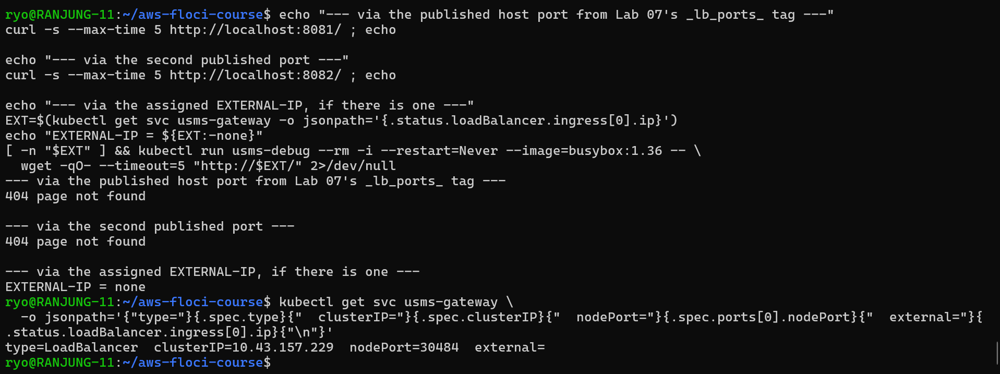

### Step 16: Rung four, Ingress

**Is there an ingress controller?** Yes. There is an IngressClass **`traefik`** (controller `traefik.io/ingress-controller`), and the Traefik pods are running in `kube-system`: `traefik-5fb479b77-d6k22` (1/1) and three `svclb-traefik` pods (2/2). k3s installs Traefik by default.

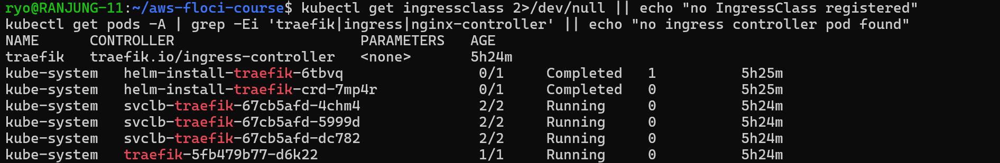

I wrote `manifests/lab-08/60-ingress.yaml` and applied it. `describe ingress usms-portal-ingress` shows:

- **Ingress class:** `traefik`
- **Address:** `172.21.0.3, 172.21.0.4, 172.21.0.5` (all three nodes)
- **Rules:**

| Path | Backend | Endpoints |
|---|---|---|
| `/enrolment` | `usms-enrolment:80` | 10.42.2.18, 10.42.1.16 |
| `/results` | `usms-results:80` | 10.42.1.7, 10.42.0.6 |
| `/` | `usms-gateway:80` | 10.42.0.15 |

- **ALB annotations** (real AWS only): `healthcheck-path: /healthz`, `listen-ports: [{"HTTP": 80}]`, `scheme: internet-facing`, `tags: Project=USMS,Tier=web,Lab=08` and **`target-type: ip`**

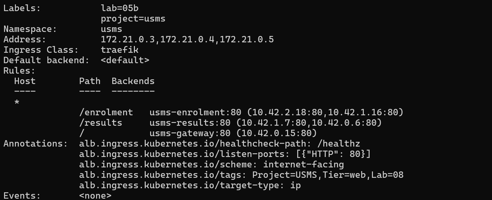

Now the same port **8081** that gave 404 in Step 15 works for all three paths:

- `/` → `usms-gateway` (pod `z9rdp`)
- `/enrolment/` → `usms-enrolment` (pod `bgthr`, version 1.0.0)
- `/results/` → `usms-results` (pod `w8tcd`, campus `rtc`)

So port 8081 goes to Traefik, and Traefik now routes by path using my Ingress.

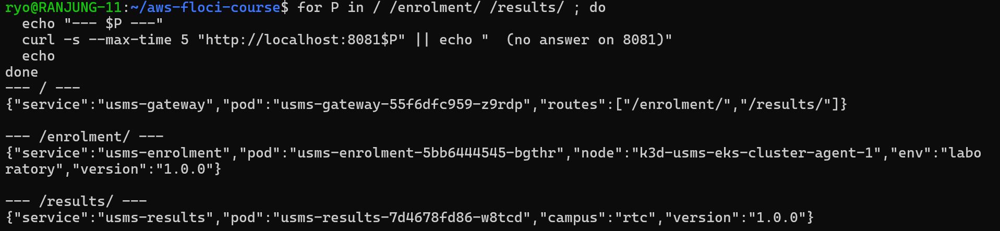

**Compared with the Lab 05 ALB:**

| | Lab 05 (ALB by hand) | Lab 08 (Ingress) |
|---|---|---|
| How it is made | Many `elbv2` commands: ALB, target groups, listener, rules | One YAML file |
| Path routing | Listener rules I wrote myself | `spec.rules[].http.paths` |
| Health check | Set on the target group | `alb.ingress.kubernetes.io/healthcheck-path` |
| Targets | Registered by ECS into the target group | Pod IPs (`target-type: ip`), kept up to date by the controller |
| Changing a route | Edit the listener rule | `kubectl apply` the changed file |

### Step 17: Practical 2 / Practical 4 comparison

I printed both systems side by side while both were running.

**ECS / ALB / Application Auto Scaling (Labs 04–06):**

- Service: **Desired 2, Running 2**, task definition `usms-enrolment:1`, target group `usms-enrolment-tg`. Grace is `null`, the Floci limitation from Lab 05.
- Scalable target `service/usms-ecs-cluster/usms-enrolment-svc`: **min 2, max 10**.
- Three scaling policies: `usms-enrolment-cpu-target-tracking` (TargetTracking), `usms-enrolment-queue-step-out` (StepScaling) and `usms-enrolment-requests-target-tracking` (TargetTracking).

**EKS / Ingress / HPA (Labs 07–08):**

- Deployments: enrolment **2/2**, gateway **1/1**, **loadgen 0/0** (load stopped), results **2/2**.
- HPA: **cpu 2%/50%**, min 2, max 8, **2 replicas**. It is back to 2 after the Step 9 load.
- Services: enrolment and results ClusterIP, **gateway LoadBalancer `<pending>` 80:30484**, **results-np NodePort 80:30080**.
- Ingress `usms-portal-ingress`, class traefik, on the three node addresses, port 80.
- PDBs: enrolment allows **1** disruption, gateway allows **0**.

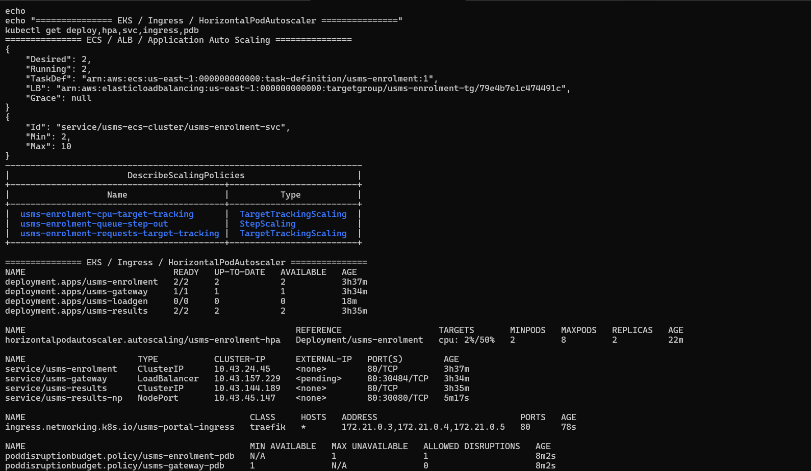

| | ECS (Labs 04–06) | EKS (Labs 07–08) |
|---|---|---|
| Scale pods/tasks | Application Auto Scaling on `desiredCount` (2–10) | HPA on `replicas` (2–8) |
| Metrics | CloudWatch | metrics-server |
| Scaling policies | 3 policies + CloudWatch alarms | 1 HPA object with a `behavior` block |
| Scale machines | Fargate: nothing to manage | Node group, Cluster Autoscaler or Karpenter |
| Expose | ALB built by hand | Service type LoadBalancer or Ingress |
| Protect during maintenance | Deployment `minimumHealthyPercent` | PodDisruptionBudget |

### Step 18: Restart test

**Before the restart** (2026-11-02T13:12:05Z), saved to `outputs/lab-08-before-restart.txt`:

- HPA `usms-enrolment-hpa`: **min 2, max 8, target 50**
- PDBs: enrolment **maxUnavailable 1**, gateway **minAvailable 1**
- Services: gateway **LoadBalancer 30484**, results-np **NodePort 30080**, the other two ClusterIP
- Ingress `usms-portal-ingress`: **/enrolment, /results, /**
- Node group: **2 4 2**

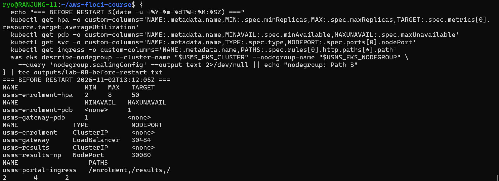

I stopped Floci with `floci-down.sh` ("State preserved in /home/ryo/floci-data") and started it again in **hybrid** mode. `kubectl cluster-info` still reached the control plane at `https://0.0.0.0:6443`, with CoreDNS and metrics-server running.

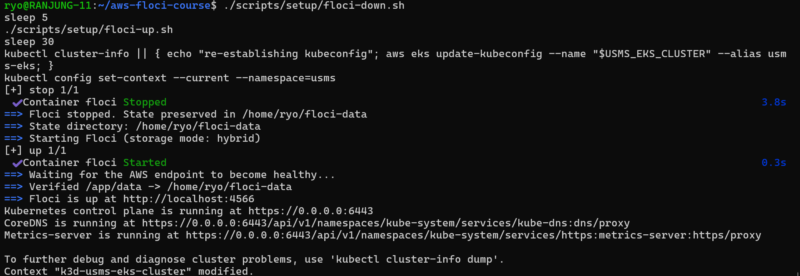

**After the restart** (2026-11-02T13:13:36Z), every value was the same, and the `diff` printed:

> **PERSISTENCE PROVEN – scaling and exposure configuration identical**

The Kubernetes objects live in the k3d cluster, not in Floci, so a Floci restart does not touch them. The node group values (2/4/2) live in Floci, and hybrid storage kept them.

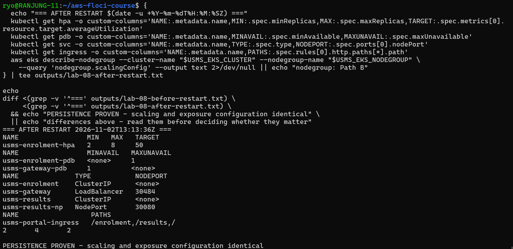

### Step 19: Save the values

I wrote `configs/lab-08.env`. The values are looked up from the cluster and the AWS API, such as `USMS_INGRESS_CLASS` from the Ingress, and `USMS_NODEGROUP_MIN` / `USMS_NODEGROUP_MAX` from `describe-nodegroup`. The check printed **all values populated**.

After `source configs/lab-08.env`:

- **hpa: 2..8 at 50% cpu, scale-in window 300s**
- **nodeport: 30080**, **gateway: LoadBalancer**
- **19** exports

The node group values are the real ones (**2/4**), not the 2/6/3 the lab asked for, because Floci never accepted that change.

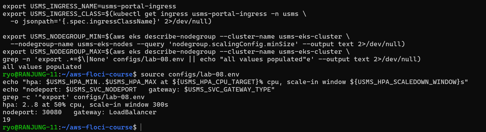

### Step 20: Commit

**Part 1:** I ran `git status --short` **before** adding anything. No file under `outputs/` is listed. The Lab 08 files (`configs/lab-08.env`, `manifests/`, `notes/lab-08-notes.md` and `scripts/utilities/hpa-watch.sh`) are untracked and ready to add.

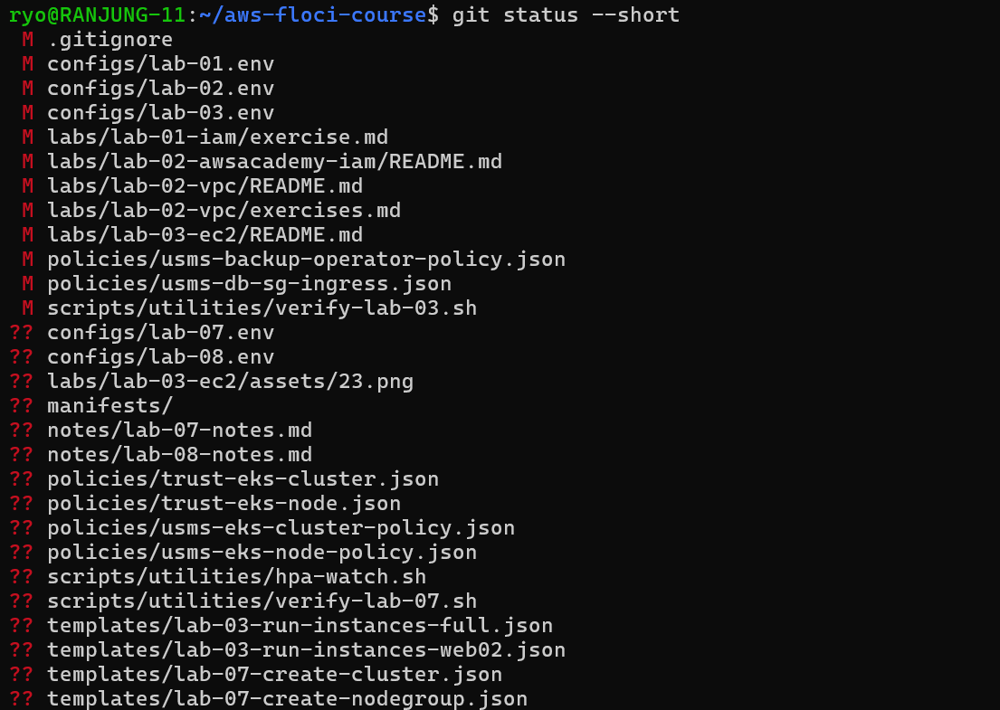

**Part 2:** `git check-ignore -v outputs/lab-08-baseline.txt` shows the file is protected by **`.gitignore:35:outputs/*`**.

Then I ran `git add` with the lab's file list, but it failed:

```
fatal: pathspec 'scripts/utilities/verify-lab-08.sh' did not match any files
```

At that point I had not created the verify script yet (I created it afterwards, in Section 6). When one path in `git add` is wrong, Git adds **nothing**, so the files stayed untracked (`??`) and the commit had nothing in it.

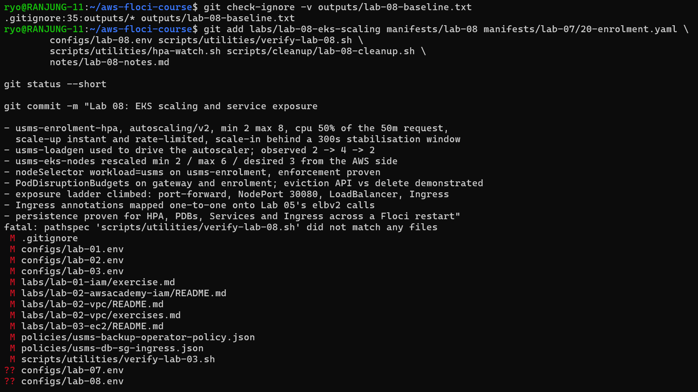

**Part 3:** `git log` confirms it: the last commit in my WSL copy is still **`223f060 Lab 03`**. `git ls-files | grep -c '^outputs/'` returns **0**, so no output file is tracked. The Lab 08 commit still has to be made, now that `verify-lab-08.sh` exists.

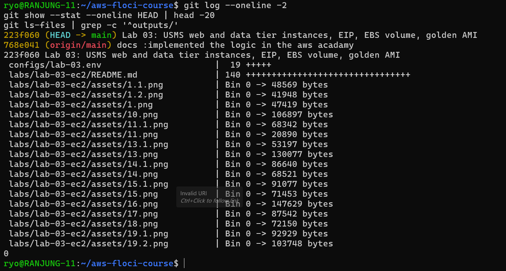

## 6. Verification

I created `scripts/utilities/verify-lab-08.sh`. It checks the environment, the Lab 07 dependencies, the HPA, the PDBs, the exposure ladder, the node group, the files and Git hygiene.

The first time, the script failed with a **syntax error on line 31**, because pasting the long heredoc into the terminal changed a line. I copied a checked copy of the file instead, and `bash -n` showed the syntax was OK. Later my terminal also stopped printing any output (even `echo hello`), because stdout was broken. `exec 1>&2` fixed it.

The result was **PASS=33, FAIL=1**:

- All **7 autoscaling** checks passed: the HPA exists, is `autoscaling/v2` with a behavior block, targets `usms-enrolment`, and has min 2, max 8, CPU 50 and a 300s scale-in window.
- All **3 disruption budget** checks and all **8 exposure ladder** checks passed.
- The `_lb_ports_` tag check **passed**, because I am on Path A.
- All **7 files and Git hygiene** checks passed.
- The **only FAIL** is **"node group maxSize was raised to 6"**. It is still 4, because Floci does not support `UpdateNodegroupConfig` (Step 10). The script itself labels this check "expect FAIL on Path B".

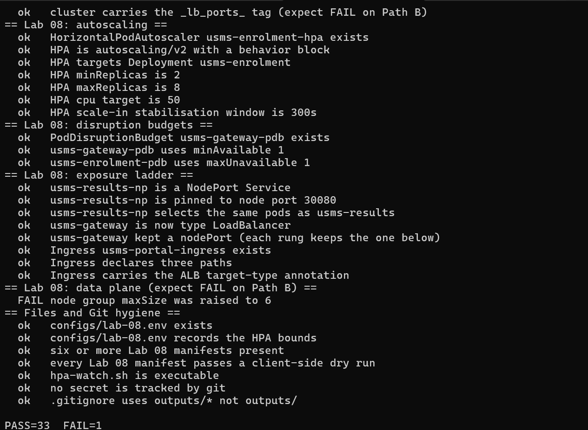

The smoke test sent requests from a busybox pod to the gateway root, `/enrolment/` and `/results/`. All three returned JSON, and it printed **SMOKE TEST PASSED**. The final state shows the HPA at **cpu 2%/50%** with **2 replicas**, both PDBs, the four Services and the Ingress.

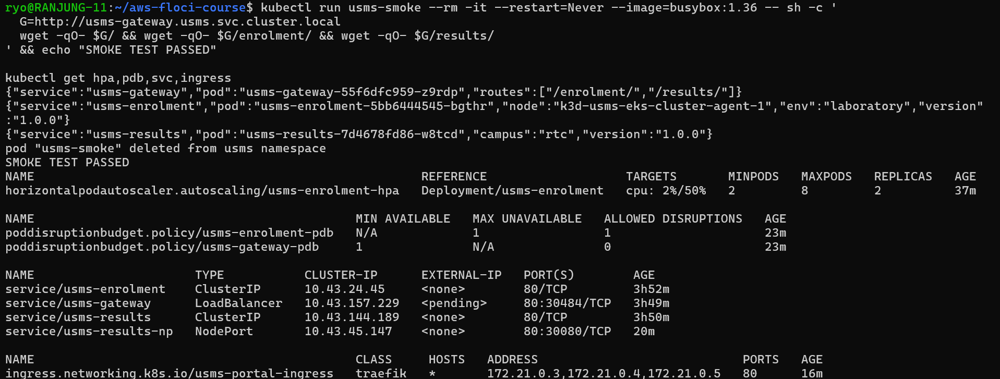

## 7. Analysis and Discussion

### 7.1 What was achieved

I scaled `usms-enrolment` by hand (to 5) and saw the traffic spread across all 5 pods. I saw a hand change get reverted by `kubectl apply`, and used `kubectl diff` to scale declaratively. I read the QoS classes and the scheduler's allocation, and confirmed the metrics API with `kubectl top`. I created an `autoscaling/v2` HPA and saw it **scale the Deployment from 2 to 3 by itself** under load, then go back to 2.

I tried to scale the node group from the AWS side (not supported on Floci), added a `nodeSelector` and proved it is enforced, and showed that a PDB blocks an eviction but not a delete. I climbed all four rungs of the exposure ladder, and the Ingress routed all three paths on port 8081. Everything survived a Floci restart, and the verification gave **PASS=33 FAIL=1**, where the one failure is the unsupported node group update.

### 7.2 Observed, recorded and conceptual

| Type | Items |
|---|---|
| **Observed** (I saw it work) | Manual scaling to 5 and back; traffic over 5 pods (11/11/9/6/3); configuration drift and `kubectl diff`; QoS classes and node allocation; `kubectl top`; **HPA scale-up 2 → 3** under load; nodeSelector enforcement (Pending with a bad value); PDB blocking an eviction (TooManyRequests); port-forward; NodePort on every node; **Ingress path routing on port 8081**; persistence after restart |
| **Recorded only** (Floci saves it but does not enforce it) | The node group's scaling configuration (2/4/2), instance type and labels (the labels did not reach the k3d nodes) |
| **Not working on my setup** | `aws eks update-nodegroup-config` (`UnknownOperationException`); `describe-update`; the LoadBalancer Service's external IP (stayed `<pending>`) |
| **Conceptual** (real AWS only) | New EC2 nodes joining the cluster; Cluster Autoscaler and Karpenter; a real NLB from the Service annotations and a real ALB from the Ingress annotations |

### 7.3 Observations

- **The Service follows the pods.** When I scaled to 5, the Service had 5 endpoints straight away, and all 5 pods got requests. The gateway did not change.
- **`kubectl apply` wins over `kubectl scale`.** My hand scale to 6 was silently undone by the manifest. With an HPA, the manifest should not keep setting `replicas`.
- **The HPA percentage is a percentage of the request.** 50% of a 50m request is only 25m, so a small load from 3 busybox pods was enough to scale up.
- **The scheduler uses requests, not real usage.** The `usms-toobig` pod (64 CPU) stays Pending even though the nodes are almost idle (1% CPU).
- **Pods and nodes are two different control loops.** The HPA can only add pods. Adding nodes is done on the AWS side, and on Floci that operation is not even supported.
- **A PDB is not a lock.** It stopped the eviction, but `kubectl delete` removed the only gateway pod, and for a few seconds no gateway pod was ready. With only 1 replica, `minAvailable: 1` also means a node drain would never finish.
- **k3s brings its own add-ons.** metrics-server and Traefik were already installed. Traefik owns port 80, which explains both the 404s on 8081/8082 before the Ingress existed and the `<pending>` LoadBalancer.

## 8. Reflection

### What I learned about scaling on Kubernetes

Before this lab I thought "autoscaling" was one thing. Now I understand that there are four separate dimensions, and each one has its own owner. The HPA only changes the number of pods. If there is no room on the nodes, the new pods just wait in Pending until something else adds a node. On ECS Fargate I never had to think about this, because AWS manages the machines.

The most surprising thing was how much depends on the **CPU request**. The same 50m number decides where a pod can be scheduled, what its QoS class is, and when the HPA scales it. It was also good to see the HPA event "New size: 3" and know that I did not change anything myself.

On the exposure side, I learned that each rung keeps the one below: the LoadBalancer Service still has a nodePort and a ClusterIP, and the Ingress points at ordinary ClusterIP Services. The Ingress was the most useful rung. One file gave me the same path routing that took many `elbv2` commands in Lab 05.

## 9. Conclusion

In this lab I took the three USMS microservices from Lab 07 and made them scalable and reachable. I scaled `usms-enrolment` by hand and by manifest, saw configuration drift, and created the HPA `usms-enrolment-hpa` (2–8 pods, 50% of the 50m CPU request, fast scale-up and a 300-second scale-down window). Under load from `usms-loadgen`, the HPA scaled the Deployment from 2 to 3 by itself, and went back to 2 when the load stopped. I learned that the CPU request controls scheduling, QoS and autoscaling at the same time.

On the AWS side, I tried to scale the node group `usms-eks-nodes` to 2/6/3. Floci returned `UnknownOperationException`, so the node group stayed at 2/4/2, and I explained the separate node control loop conceptually. I proved that a `nodeSelector` is enforced and that a PodDisruptionBudget blocks evictions but not deletes. I climbed the exposure ladder from port-forward through NodePort (30080 on every node) and LoadBalancer (external IP pending) to an Ingress that routes `/`, `/enrolment/` and `/results/` through Traefik. Everything survived a Floci restart, and the verification gave **PASS=33 FAIL=1**, where the only failure is the unsupported node group update. I was honest about what Floci only records or does not support at all.
