# Lab 08 - Exercises

I did all five exercises on my k3d cluster (context `k3d-usms-eks-cluster`), with Floci running at `http://localhost:4566`. Before starting I sourced the course env files and checked the starting state.

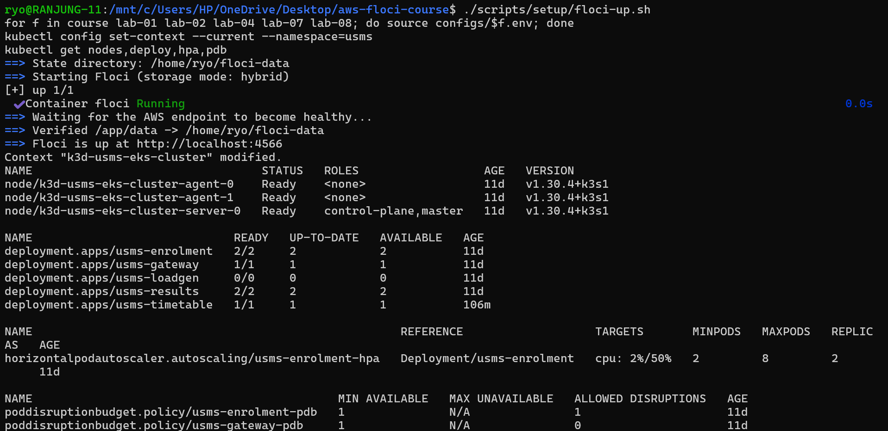

| Object | State at the start |
| --- | --- |
| Nodes | 3 Ready: `server-0` (control-plane), `agent-0`, `agent-1` |
| `usms-enrolment-hpa` | `cpu: 2%/50%`, min 2, max 8, 2 replicas |
| `usms-enrolment-pdb` | min available 1, **1** allowed disruption |
| `usms-gateway-pdb` | min available 1, **0** allowed disruptions |
| `usms-loadgen` | scaled to 0/0 (left over from the main lab) |

The gateway PDB showing **0 allowed disruptions** is the problem that Exercise 2 fixes.

---

## Exercise 1 - A second autoscaler (`usms-results-hpa`)

**Goal:** give `usms-results` its own HPA: min 2, max 6, 60% CPU target, a 180-second scale-in stabilisation window, and scale-up limited to 2 pods every 30 seconds. It had to be written as an `autoscaling/v2` manifest, not created with `kubectl autoscale`.

### The manifest: `manifests/lab-08/11-hpa-results.yaml`

```yaml
apiVersion: autoscaling/v2
kind: HorizontalPodAutoscaler
metadata:
  name: usms-results-hpa
  namespace: usms
  labels: { app: usms-results, project: usms, lab: "08" }
spec:
  scaleTargetRef:
    apiVersion: apps/v1
    kind: Deployment
    name: usms-results
  minReplicas: 2
  maxReplicas: 6
  metrics:
    - type: Resource
      resource:
        name: cpu
        target: { type: Utilization, averageUtilization: 60 }
  behavior:
    scaleDown:
      stabilizationWindowSeconds: 180
    scaleUp:
      policies:
        - type: Pods
          value: 2
          periodSeconds: 30
```

### Dry run, apply and check

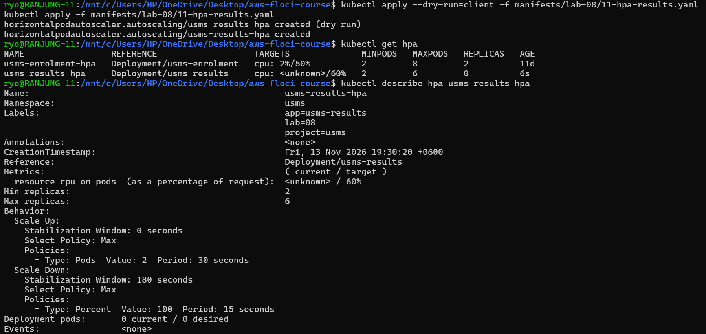


`kubectl describe` confirms the behaviour block was applied exactly as written:

| Setting | Value shown |
| --- | --- |
| Scale Up policy | `Pods`, value 2, period 30 seconds |
| Scale Down stabilisation window | 180 seconds |
| Metric | `resource cpu on pods (as a percentage of request): <unknown> / 60%` |

### Why `<unknown>` at first

The screenshot was taken **6 seconds** after the HPA was created. At that point it showed `REPLICAS 0` and `Deployment pods: 0 current / 0 desired`, which means the HPA controller hadn't finished its first sync yet. metrics-server reports a new sample about every 15 seconds, and the HPA needs one full cycle before it can calculate a percentage. The enrolment HPA next to it shows a real value (`2%/50%`), which proves metrics-server works. So `<unknown>` here is a **timing** issue, not a missing CPU request. (`usms-results` has a 50m CPU request from Lab 07.)

### Why 60% for results and 50% for enrolment

Results is a read-mostly service whose load is short and recovers quickly, so a higher 60% target avoids adding pods on every small spike. Enrolment is write-heavy and deadline-critical, so it scales earlier at 50%.

**Result:** two HPAs exist. The enrolment HPA reports a percentage, and the results HPA shows `<unknown>` only because it was a few seconds old.

---

## Exercise 2 - Make the gateway drainable

**Goal:** the gateway PDB allowed **0** disruptions, which blocked node drains in Lab 07. Fix it **without weakening the PDB**, and make sure gateway pods don't all sit on one node.

### Why it was blocked

`usms-gateway` had **1 replica** and `usms-gateway-pdb` requires `minAvailable: 1`. Evicting the only pod would leave 0 available, so Kubernetes allows 0 disruptions and `kubectl drain` waits forever. The fix is to give the PDB room by running more pods, not to lower `minAvailable`.

### First attempt: nothing changed

On my first try I pasted the explanation text into the terminal along with the commands, so bash tried to run lines like `spec:` and `replicas:` (`command not found`). The YAML file was never edited, so `apply` said `unchanged` and the PDB still showed `ALLOWED DISRUPTIONS 0`.

### The edit to `manifests/lab-07/40-gateway.yaml`

I made the change with `sed` so that the file is the source of truth:

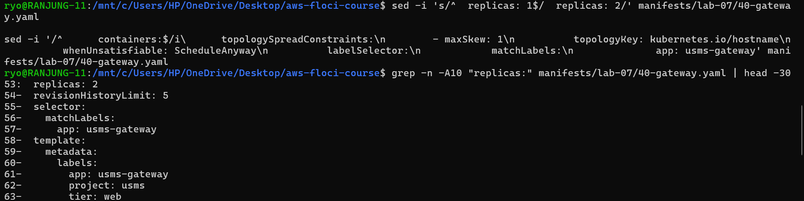

- `replicas: 1` → `replicas: 2`
- a `topologySpreadConstraints` block added to the pod template, above `containers:`:

```yaml
      topologySpreadConstraints:
        - maxSkew: 1
          topologyKey: kubernetes.io/hostname
          whenUnsatisfiable: ScheduleAnyway
          labelSelector:
            matchLabels:
              app: usms-gateway
```

`minAvailable: 1` in `usms-gateway-pdb` was **kept unchanged**.

### Diff, apply and verify

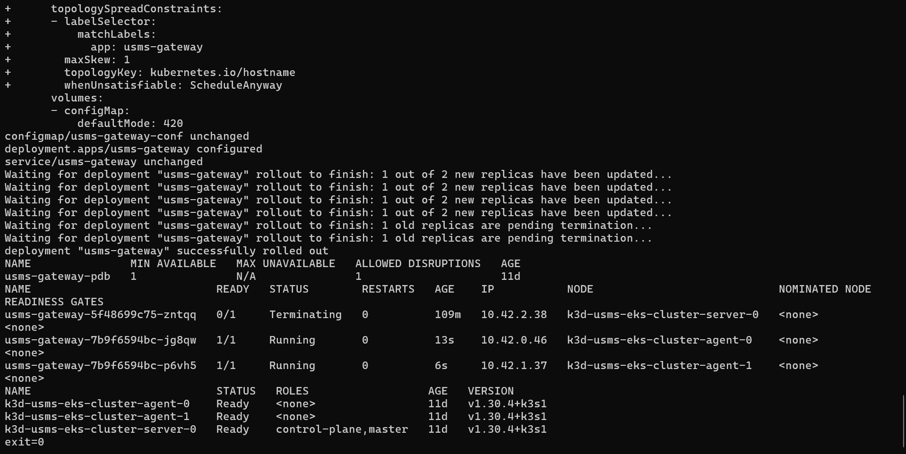


- The first `kubectl diff` showed the added `topologySpreadConstraints` lines (`+`).
- The rollout created a new ReplicaSet (`7b9f6594bc`). The old pod on `server-0` terminated.
- The PDB now shows **1 allowed disruption**.
- The two new gateway pods are on **different nodes** (`agent-0` and `agent-1`).
- The final `kubectl diff` printed nothing and returned **`exit=0`**, so the file and the cluster match.

### Why `ScheduleAnyway`

I chose `ScheduleAnyway` because the gateway is the single entry point. If only one node were available, I'd rather run both pods on it than leave one Pending and lose capacity. With 3 nodes, the scheduler still spread them. On a real multi-AZ EKS cluster I would use `topologyKey: topology.kubernetes.io/zone` with `DoNotSchedule`, so a single node or AZ failure can never take out both gateway pods.

**Result:** PDB allowance went from 0 to 1, pods are spread across two nodes, and the diff is clean.

---

## Exercise 3 - The autoscaler that will not act

**Goal:** apply `usms-reports` and `usms-reports-hpa`. The HPA is created, but the replica count never moves under load. Find both faults **with commands**, then fix each with a one-field change.

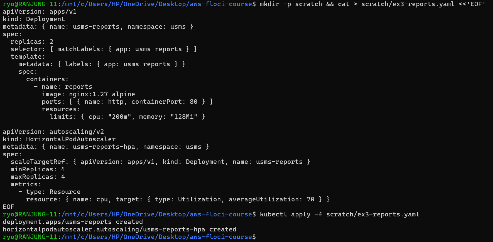


### Diagnosis

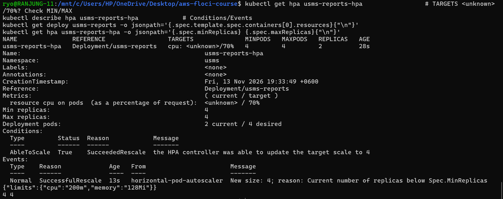

**Step 1: `kubectl get hpa usms-reports-hpa`**

```
NAME               REFERENCE                 TARGETS            MINPODS   MAXPODS   REPLICAS
usms-reports-hpa   Deployment/usms-reports   cpu: <unknown>/70%   4       4         2
```

There are two warning signs on one line: the target is `<unknown>`, and **MINPODS equals MAXPODS** (4/4).

**Step 2: `kubectl describe hpa usms-reports-hpa`**

```
resource cpu on pods (as a percentage of request):  <unknown> / 70%
Min replicas: 4
Max replicas: 4
Deployment pods: 2 current / 4 desired
Normal  SuccessfulRescale  New size: 4; reason: Current number of replicas below Spec.MinReplicas
```

The only scaling the HPA did was forced by `minReplicas`. It wasn't based on any metric. It jumped from 2 to 4, and it can never go anywhere else.

**Step 3: the resources on the pod**

```
{"limits":{"cpu":"200m","memory":"128Mi"}}
```

There's a **limits** block only and **no `requests`**. The HPA calculates CPU utilisation as *usage ÷ request*. With no request there's nothing to divide by, so the metric is `<unknown>`.

**Step 4: min and max**

```
4 4
```

### The two faults

| # | Fault | Evidence | Effect |
| --- | --- | --- | --- |
| 1 | The container has no CPU `requests`, only `limits` | `{"limits":{...}}` with no `requests` key | **Causes `<unknown>`**: utilisation can't be calculated without a request |
| 2 | `minReplicas: 4` equals `maxReplicas: 4` | `MINPODS 4  MAXPODS 4`, `4 4` | **Prevents action even with valid metrics**: there's no room to scale up or down |

Fixing only one isn't enough. With only fault 1 fixed, the HPA reads a percentage but stays pinned at 4. With only fault 2 fixed, it has room to move but no metric to act on.

### The fixes (one field each)

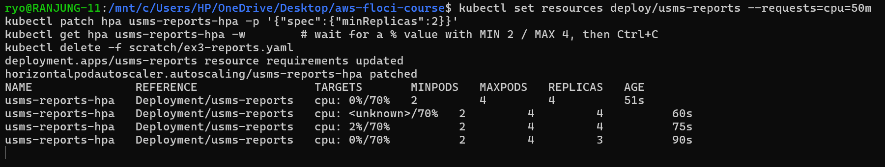

```bash
kubectl set resources deploy/usms-reports --requests=cpu=50m
kubectl patch hpa usms-reports-hpa -p '{"spec":{"minReplicas":2}}'
```

```
deployment.apps/usms-reports resource requirements updated
horizontalpodautoscaler.autoscaling/usms-reports-hpa patched

NAME               TARGETS            MINPODS   MAXPODS   REPLICAS   AGE
usms-reports-hpa   cpu: 0%/70%        2         4         4          51s
usms-reports-hpa   cpu: <unknown>/70% 2         4         4          60s
usms-reports-hpa   cpu: 2%/70%        2         4         4          75s
usms-reports-hpa   cpu: 0%/70%        2         4         3          90s
```

- The target now shows a **real percentage** (0–2%). The short `<unknown>` at 60s is the rollout replacing pods. New pods have no metrics for their first sample.
- With min 2 / max 4, the HPA can act. It already started **scaling in from 4 to 3**, because CPU is far below 70%. That's the proof that it's now autoscaling based on the metric.

After that I deleted the test objects with `kubectl delete -f scratch/ex3-reports.yaml`.

**Result:** both faults were found from command output, each was fixed with one field, and the HPA reports a percentage and changes the replica count.

---

## Exercise 4 - Expose the results service properly

**Brief:** the Examinations Office wants results reachable from the university network at a stable address, on a normal HTTP port, under its own path. Enrolment must not get the same exposure, and no second load balancer should be paid for.

### Design

I added a **second Ingress object** that only routes `/exams/results` to `usms-results`. It uses the **same Traefik ingress controller** as `usms-portal-ingress`, so it shares the one existing load balancer instead of creating a new one.

### The manifest: `manifests/lab-08/61-ingress-results.yaml`

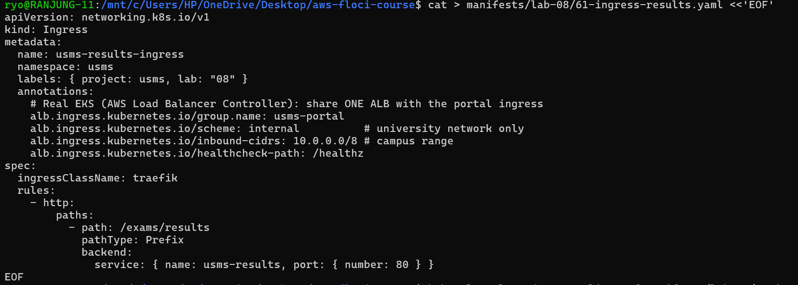

```yaml
apiVersion: networking.k8s.io/v1
kind: Ingress
metadata:
  name: usms-results-ingress
  namespace: usms
  labels: { project: usms, lab: "08" }
  annotations:
    # Real EKS (AWS Load Balancer Controller): share ONE ALB with the portal ingress
    alb.ingress.kubernetes.io/group.name: usms-portal
    alb.ingress.kubernetes.io/scheme: internal          # university network only
    alb.ingress.kubernetes.io/inbound-cidrs: 10.0.0.0/8 # campus range
    alb.ingress.kubernetes.io/healthcheck-path: /healthz
spec:
  ingressClassName: traefik
  rules:
    - http:
        paths:
          - path: /exams/results
            pathType: Prefix
            backend:
              service: { name: usms-results, port: { number: 80 } }
```

### Applied

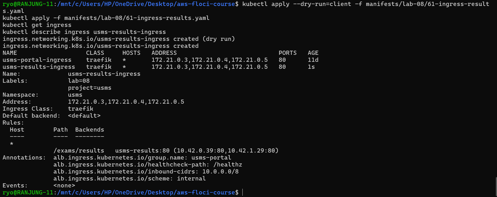


Both Ingresses have the **same addresses and port 80**. That shows they share one entry point and that no new load balancer was created. The backend lists two real pod endpoints.

### Routing evidence

I port-forwarded to the Traefik Service and tested with curl from a second WSL terminal:

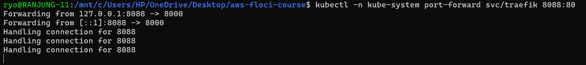

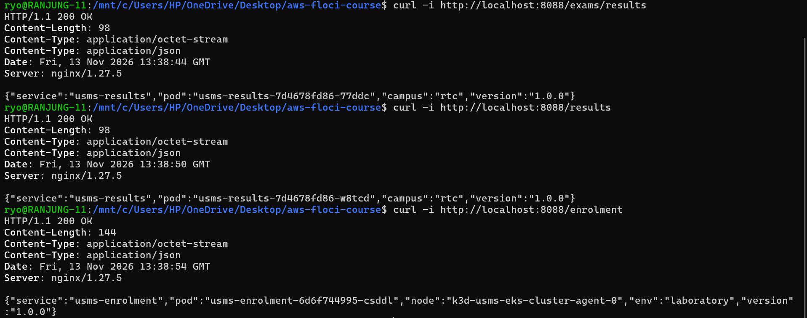

| Request | Status | Answered by |
| --- | --- | --- |
| `/exams/results` | **200 OK** | `usms-results-7d4678fd86-77ddc` (new results route) |
| `/results` | 200 OK | `usms-results-7d4678fd86-w8tcd` (existing portal route) |
| `/enrolment` | 200 OK | `usms-enrolment-6d6f744995-csddl` (existing portal route) |

> **A mistake I made:** my first curl was in Windows PowerShell, where `curl` is an alias for `Invoke-WebRequest`. It doesn't accept `-i`, so it asked for a `Uri` and failed with `Cannot find drive`. Running the same command in WSL (or calling `curl.exe`) worked.

The new path worked, and nginx answered it with the results JSON, so no path rewrite was needed for this backend. `/enrolment` still answers here only because the **Lab 08 portal Ingress** exposes it. In the real design, the portal Ingress would stay on the public scheme or be removed, and only the results Ingress would join the internal ALB group.

### Where each part sits on the exposure ladder

| Rung | Used for |
| --- | --- |
| ClusterIP | `usms-results` Service: the stable internal backend. Pods behind it can change. |
| port-forward | Local testing only (`svc/traefik 8088:80`). Not a real exposure. |
| NodePort | `usms-results-np :30080` from the main lab: for debugging only, not given to users. A high port isn't a "normal HTTP port". |
| LoadBalancer | **Not used for results.** The only LoadBalancer is the one in front of the ingress controller. |
| **Ingress** | **Chosen.** Port 80, its own path, shares the existing load balancer. |

### Why not a second `type: LoadBalancer` Service

Each `type: LoadBalancer` Service provisions its own AWS load balancer with its own hourly and capacity charges, while an Ingress reuses the load balancer the cluster already pays for.

### What my build can't demonstrate (and what would do it on real EKS)

| Requirement | What does it on EKS |
| --- | --- |
| Share one ALB between both Ingresses | `alb.ingress.kubernetes.io/group.name: usms-portal` (AWS Load Balancer Controller) |
| Only reachable from the university network | `alb.ingress.kubernetes.io/scheme: internal` plus `inbound-cidrs` / a security group limited to the campus CIDR, reached over VPN or Direct Connect |
| Stable address | A Route 53 record (e.g. `results.exams.<university>`) as an alias to the ALB, managed by ExternalDNS |
| HTTPS | `alb.ingress.kubernetes.io/certificate-arn` with an ACM certificate and `listen-ports` 443 |

Locally these annotations are **inert**: Traefik ignores them. They are documentation of the EKS intent.

### Cost

There's no new load balancer. With `group.name`, the results path is one more **listener rule** on the existing ALB, so the extra cost is close to zero (a small amount of LCU usage from results traffic). A second `LoadBalancer` Service would have added roughly another ~$16–20 per month for an always-on load balancer used only a few weeks a year.

### Failure mode

If the cluster is unavailable (nodes down, or Traefik or the results pods not running), the ALB has no healthy targets and returns **503**. Results go offline completely: nothing is cached and there's no fallback outside the cluster. Sharing one ALB also means one misconfigured Ingress in the group can affect the other routes. To reduce the risk I would keep the results Deployment at 2+ replicas with a PDB and spread, which it already has from Exercise 1 and Lab 07. For results day, I'd consider publishing a static copy to S3/CloudFront as a fallback.

**Result:** one manifest, `/exams/results` returns 200 from the results pods on port 80 through the shared ingress, and no second load balancer was created.

---

## Exercise 5 - Artefacts for Lab 10

### Part 1: `outputs/lab-08-scaling-evidence.json`

I built the file from **live API calls**: `kubectl get hpa -o json`, `kubectl get deploy -o json` and `aws eks describe-nodegroup`. A small Python script combines them.

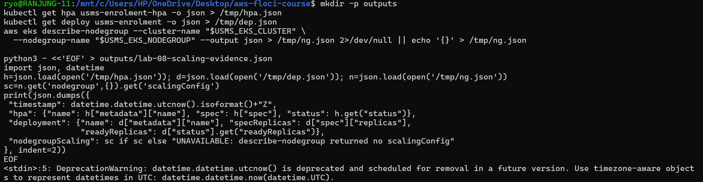

The `DeprecationWarning` about `datetime.utcnow()` is only a Python warning. The file was still written.

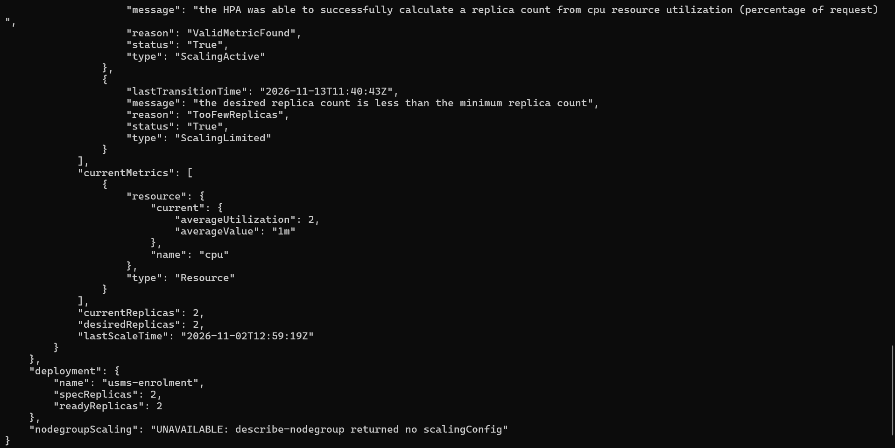

What the file contains:

| Key | Value |
| --- | --- |
| `timestamp` | UTC time the file was built |
| `hpa.spec` | full spec of `usms-enrolment-hpa` (min 2, max 8, 50% CPU, behaviour) |
| `hpa.status` | `currentReplicas: 2`, `desiredReplicas: 2`, `averageUtilization: 2`, condition `ScalingActive / ValidMetricFound`, condition `ScalingLimited / TooFewReplicas` |
| `deployment` | `usms-enrolment`, `specReplicas: 2`, `readyReplicas: 2` |
| `nodegroupScaling` | `"UNAVAILABLE: describe-nodegroup returned no scalingConfig"` |

Floci's EKS emulation didn't return a `scalingConfig` for the node group, so I **stated the absence explicitly** instead of copying the numbers from `lab-08.env`. `ScalingLimited / TooFewReplicas` is expected: at 2% CPU the HPA would like fewer than 2 pods, but `minReplicas` holds it at 2. The file passed `python3 -m json.tool`, which printed it as valid JSON.

### Part 2: `outputs/lab-08-lab06-readiness.txt`

Everything was looked up from the CLI. The bucket ARN was **taken from the policy document's `Resource`**, not copied from Lab 07.

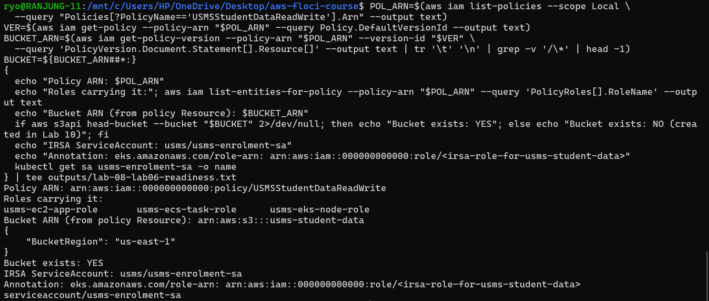

| Question | Answer |
| --- | --- |
| Policy ARN | `arn:aws:iam::000000000000:policy/USMSStudentDataReadWrite` |
| Roles carrying it | `usms-ec2-app-role`, `usms-ecs-task-role`, `usms-eks-node-role` |
| Bucket ARN (from `Resource`) | `arn:aws:s3:::usms-student-data`. I filtered out the `/*` object ARN. |
| Does the bucket exist? | **YES**: `head-bucket` returned `"BucketRegion": "us-east-1"` |
| IRSA ServiceAccount | `usms/usms-enrolment-sa` (it exists: `serviceaccount/usms-enrolment-sa`) |
| Annotation | `eks.amazonaws.com/role-arn: arn:aws:iam::000000000000:role/<irsa-role-for-usms-student-data>` |

All three compute roles currently carry the S3 policy, including `usms-eks-node-role`. On EKS that means **every pod on every node** inherits S3 access through the node role. In Lab 10 the cleaner design is IRSA: create a dedicated role trusted by the cluster's OIDC provider for `system:serviceaccount:usms:usms-enrolment-sa`, attach the policy to it, annotate the ServiceAccount, and remove the policy from the node role.

### Both files are git-ignored

```
.gitignore:35:outputs/*   outputs/lab-08-scaling-evidence.json
.gitignore:35:outputs/*   outputs/lab-08-lab06-readiness.txt
```

Neither file will be committed.

### Part 3: "ECS or Kubernetes for USMS"

I added the section to `notes/lab-08-notes.md` (under 400 words). Summary:

- **Recommendation:** ECS (Fargate). One small team, one region, and a quiet/busy seasonal pattern only need "add tasks when CPU rises". ECS does that with no nodes, metrics-server or PDBs to manage.
- **Strongest argument against:** Kubernetes is portable. One set of manifests describes scaling, availability and exposure together, and it runs the same anywhere.
- **Observations from the practicals:**
  1. ECS scaling is one layer. EKS has two (HPA for pods, node group for capacity) that both have to be tuned.
  2. The EKS HPA silently does nothing with no CPU request or with min = max (Exercise 3). That fault doesn't exist in ECS.
  3. EKS availability needed extra objects. A 1-replica gateway with a PDB blocked a node drain until Exercise 2.
  4. One ALB with listener rules (ECS) did the same job as one Ingress controller with two Ingresses, but the EKS annotations could only be half-tested locally.

---

## Summary

| Exercise | Result |
| --- | --- |
| 1 - Second autoscaler | `usms-results-hpa` (2–6, 60%, 180 s scale-in window, +2 pods/30 s) from a v2 manifest. `<unknown>` only during its first seconds |
| 2 - Drainable gateway | 2 replicas + topology spread, PDB allowance 0 → 1 with `minAvailable: 1` kept, pods on `agent-0` and `agent-1`, clean diff (`exit=0`) |
| 3 - HPA that won't act | Fault 1: no CPU request causes `<unknown>`. Fault 2: min = max = 4 means no room to move. Fixed with one field each; the HPA then reports % and scaled 4 → 3 |
| 4 - Expose results | Second Ingress on the shared Traefik entry, `/exams/results` → 200 OK on port 80, no second load balancer; EKS annotations documented |
| 5 - Lab 10 artefacts | Evidence JSON from live calls (node group scaling stated as unavailable), readiness file with policy, roles and bucket from the CLI, both git-ignored, notes section written |

**What I learned:**
- HPA CPU % is *usage ÷ request*. With no request, the HPA is blind, and `<unknown>` is the clue.
- An HPA with `minReplicas == maxReplicas` isn't an autoscaler. It's just a fixed replica count.
- A PDB on a single-replica Deployment blocks every drain. The fix is more replicas spread across nodes, not a weaker PDB.
- Several Ingress objects can share one controller and one load balancer. That's the cheapest way to give a service its own path without paying for another LB.
- Always check which shell you're in: `curl` in PowerShell isn't real curl.
