# Lab 09 Practical Report: Securing the USMS Application with IAM Roles and Security Groups

## 1. Aim / Objective

The aim of this lab is to **review and tighten the security** of everything I built in Labs 01–08. Security is checked on two axes: **who can call what** (IAM: users, roles, policies and trust) and **what can reach what** (security groups, routes and NACLs). Instead of building new services, I audited the existing ones with read-only scripts, fixed the findings, and proved that the fixes survive a restart without breaking earlier labs. Everything was done with the AWS CLI on the local emulator Floci.

The specific objectives were to:

- **Inventory** every role, user and customer-managed policy, and build read-only **audit scripts** for IAM and for security groups.
- Fix the **identity** findings: a **read-only** transcripts policy and role, **confused-deputy** conditions on a trust policy, a scoped **`iam:PassRole`**, a **permissions boundary**, a **session policy**, an **access key rotation** and **IMDSv2**.
- Fix the **network** findings: **written egress rules** on three security groups and an SSH rule sourced from a **bastion group** instead of a whole VPC range.
- Build a **reachability matrix** and prove that the data tier is not reachable from the internet through several **independent controls**.
- Prove the controls survive a Floci restart, check that the Lab 02–06 verify results did not change, save the values to `configs/lab-09.env`, and check the lab with `verify-lab-09.sh`.

## 2. Introduction

An AWS request is only allowed when **every layer** says yes. An **explicit Deny always wins**:

| Order | Layer | Effect |
|---|---|---|
| 1 | Explicit `Deny` in any policy | Denied, final |
| 2 | Service Control Policy | Must allow (not modelled in this course) |
| 3 | **Permissions boundary** | Must allow (a ceiling, it grants nothing) |
| 4 | **Session policy** | Must allow (a ceiling for one session) |
| 5 | **Identity policy** | Allows |
| 6 | Resource policy | Allows (for example a bucket policy) |
| 7 | Default | Denied |

The main ideas of this lab:

| Concept | Simple meaning |
|---|---|
| **Trust policy** | Decides **who may assume** a role |
| **Identity policy** | Decides **what the role may do** |
| **Confused deputy** | A service (like `ecs-tasks.amazonaws.com`) acts for many customers. Without `aws:SourceAccount` / `aws:SourceArn`, another account's task could get my role. |
| **`iam:PassRole`** | Giving a role to a service. If it is unscoped, a user can pass an admin role to EC2 and escalate. |
| **Permissions boundary** | A ceiling. The effective permissions are the **intersection** of the boundary and the identity policy. |
| **Egress control** | Limits what a compromised host can **send out** (data exfiltration). |
| **IMDSv2** | The instance metadata service needs a session token. A **hop limit of 1** stops a container on the host from reaching it. |

A useful rule for troubleshooting: **an error message means IAM, a hang means the network.**

The most important limitation: **Floci does not enforce IAM or security groups.** It stores them and returns them, so every proof in this lab is made by **reading the configuration** back and recording it.

## 3. Use Case

**USMS use case:** USMS stores student transcripts in the `usms-student-data` bucket, runs the enrolment service on ECS behind an ALB, and keeps its database in a private subnet. A security review asked for:

- A **reporting task** that can only **read** transcripts, never write or delete them. So I created `USMSStudentDataReadOnly` and `usms-transcripts-reader-role`, instead of reusing the read-write policy.
- ECS task roles that only **this account's** ECS tasks can assume (the confused-deputy fix).
- A **deploy role** for `usms-admin-01` that can only pass the three ECS roles, and only to ECS. It can never pass a role to EC2.
- Developer access keys that are **rotated** without downtime.
- The web instance's metadata protected with **IMDSv2**.
- The ALB may only talk to the enrolment tasks, the tasks may only make HTTPS calls, the database may only fetch OS updates, and SSH to the app tier must come from the **bastion** only.

## 4. System Architecture / Design

**How it works in simple words:**

1. **Network axis:** the internet reaches only the ALB (`usms-alb-sg`, tcp/80 and tcp/443). The ALB may only **send** tcp/80 to `usms-enrolment-sg`. The enrolment tasks may only send tcp/443 (to the S3 prefix list and HTTPS out). The database (`usms-db-sg`) accepts only tcp/5432 from `usms-app-sg`, and may only send tcp/443 out through the NAT gateway. SSH to `usms-app-sg` comes only from `usms-bastion-sg`.
2. **IAM axis:** a task gets permissions only if the **trust policy** lets the ECS tasks service assume the role (for this account only), **and** the **identity policy** allows the action, **and** no boundary, session policy or explicit Deny blocks it.
3. **The audit scripts** (`usms-iam-audit.sh`, `usms-sg-audit.sh`, `usms-reachability-matrix.sh`) are read-only. They read the configuration and print HIGH / MED / LOW findings.

## 5. Implementation Procedure

### Step 1: Resume the environment and load the seven env files

I started Floci (storage mode **hybrid**) and sourced `course.env` and `lab-01.env` to `lab-06.env`. `whoami.sh` showed account **000000000000**, so this is Floci, not real AWS. All 17 values printed and none were empty, including:

| Value | Result |
|---|---|
| dev user / admin user | `usms-dev-01` / `usms-admin-01` |
| VPC | `vpc-20628f13` |
| app / db / enrolment / ALB SG | `sg-ae9ad9330a620147c` / `sg-99ac1d4a9c7675d1d` / `sg-f57a1547660af7c69` / `sg-2915aadd30cc4c1a8` |
| S3 endpoint | `vpce-ff98a90b9c3b80e74` |
| web / db instance | `i-ad2c79c52861dcd7a` / `i-f2acbe38ee244cc57` |

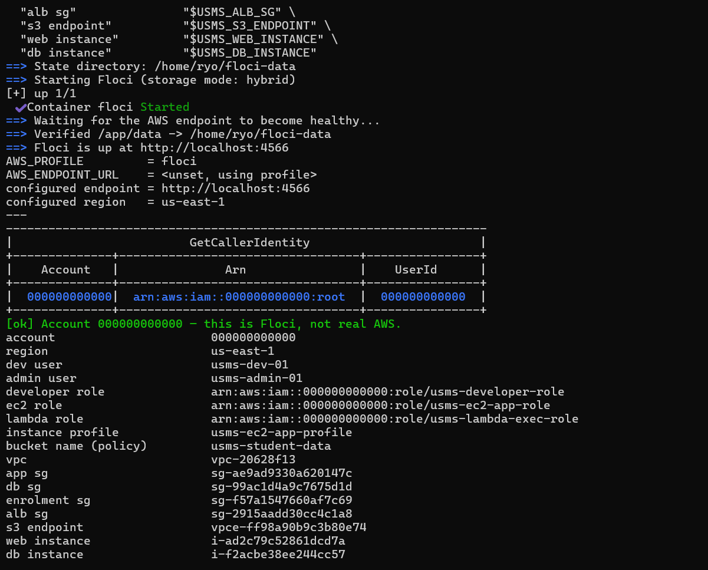

### Step 2: Record the security baseline

Before changing anything, I ran the verify scripts for Labs 02–06 and saved the last line of each to `outputs/lab-09-pre-verify.txt` at **2026-11-02T14:04:41Z**:

| Lab | Result |
|---|---|
| lab-02 | PASS=31 FAIL=2 |
| lab-03 | PASS=35 FAIL=2 |
| lab-04 | **PASS=39 FAIL=0** |
| lab-05 | The last line is a note: "failure after Step 13, on the usms-app-sg source check" |
| lab-06 | The last line is a note: "...the count; see Step 12 part 6" |

Labs 02 and 03 already had 2 failures each before this lab started. These are the numbers I must not make worse. For Labs 05 and 06, `tail -1` caught an explanation line instead of the PASS/FAIL line. That is fine for a diff, because the same line will be compared after the lab.

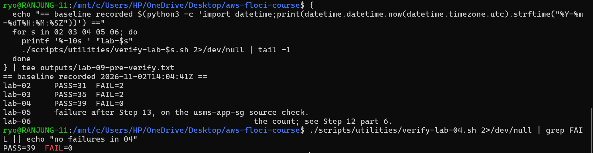

### Step 3: Probe what Floci supports

A `probe()` function tried each command and printed SUPPORTED or "not available":

| Area | Result |
|---|---|
| IAM read | `list-roles`, `list-policies` SUPPORTED. `get-role`, `list-attached-role-policies` and `get-account-authorization-details` **not available** in the probe |
| IAM change | `update-assume-role-policy`, `create-role --permissions-boundary`, `put-role-permissions-boundary` SUPPORTED |
| IAM evaluate | `simulate-principal-policy`, `accessanalyzer list-analyzers`, `sts assume-role --policy` SUPPORTED |
| Credentials | `list-access-keys`, `get-access-key-last-used` SUPPORTED, `get-credential-report` **not available** |
| EC2 | Security group rules, egress authorise/revoke, prefix lists, network interfaces and metadata options all SUPPORTED |

`get-role` showed "not available" in the probe, but it worked when I used it with a real role name in later steps (Steps 7, 8 and 18), so the probe was too strict for that call. Most writes are supported, so I followed **path B** (management only: Floci stores everything but enforces nothing).

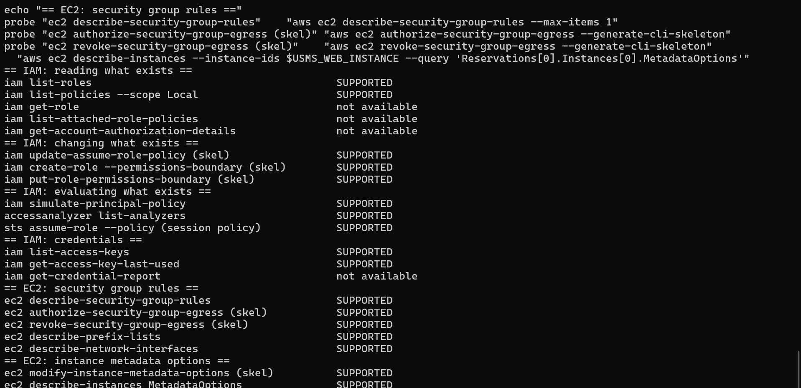

### Step 4: Inventory every identity

**Part 1:** `list-roles` returned **9 roles**, not the 5 the lab expected, because Labs 04–08 added more (`usms-ecs-exec-role`, `usms-ecs-task-role`, `usms-eks-cluster-role`, `usms-eks-node-role`, `usms-analytics-partner-role` and the service-linked `AWSServiceRoleForEcsApplicationAutoscaling`). All have a max session of **3600** seconds.

There are **5 users**. Only `usms-audit-01` and `usms-dev-01` have an access key (**1 each**). There are **11 customer-managed policies**. `USMSStudentDataReadWrite` is attached to **3** entities and `USMSDeveloperBase` (version **v3**) to **4**. `USMSBackupOperator`, `USMSReadOnly` and `USMSReportingReadOnly` are attached to **nothing**.

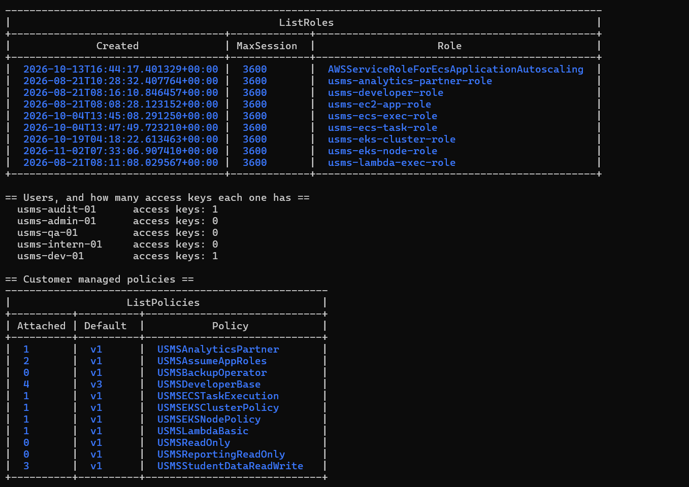

**Part 2:** A Python script wrote `outputs/lab-09-identity-inventory.json` with each role's trust policy, attached and inline policies and boundary. It printed **valid JSON**, **9 roles inventoried**, and **`boundary=-` for every role**, so no role has a permissions boundary yet.

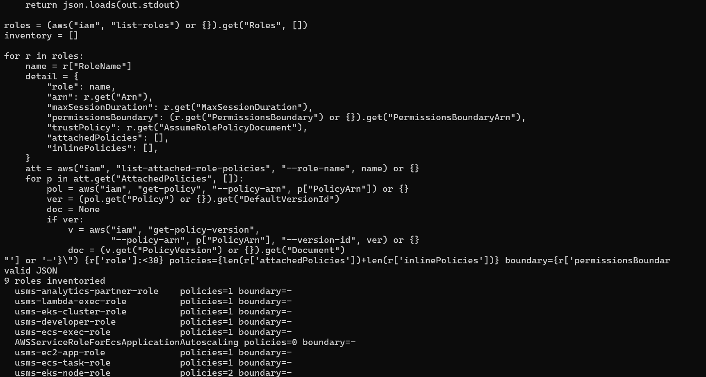

### Step 5: Build the IAM audit script

`scripts/utilities/usms-iam-audit.sh` checks every role for four problems: wildcard actions, wildcard resources on actions that change things, an unscoped `iam:PassRole`, and a service trust with no condition. The result was **HIGH=7 MED=31 roles=9** (the lab's example was HIGH=4 MED=5 for 5 roles, but I have 9 roles):

- **HIGH (confused deputy):** service principals with **no Condition** on `usms-ecs-exec-role`, `usms-ecs-task-role` (`ecs-tasks.amazonaws.com`), `usms-ec2-app-role`, `usms-eks-node-role` (`ec2.amazonaws.com`) and `AWSServiceRoleForEcsApplicationAutoscaling`.
- **MED:** `USMSDeveloperBase` allows `ec2:AuthorizeSecurityGroupIngress`, `ec2:CreateTags`, `ec2:ModifyVpcAttribute` and `ec2:DeleteVpc` on `Resource "*"`. `USMSEKSNodePolicy` allows the network-interface actions on `"*"`. Every role has **no permissions boundary**.

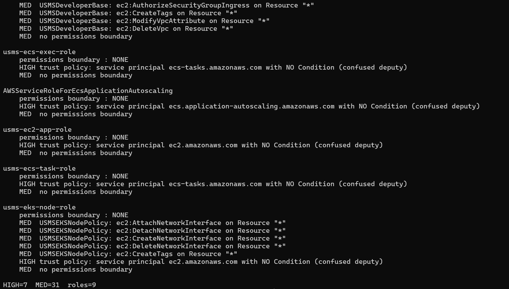

The script **exits with code 1** when there is any HIGH finding, so it could fail a CI pipeline.

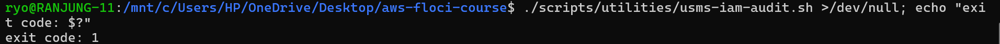

### Step 6: Read the transcripts policy

`USMSStudentDataReadWrite` allows `s3:ListBucket` and `s3:GetBucketLocation` on the bucket, **`s3:GetObject`, `s3:PutObject` and `s3:DeleteObject`** on the objects, and explicitly denies `s3:DeleteBucket`. It is carried by **`usms-ec2-app-role`, `usms-ecs-task-role` and `usms-eks-node-role`**, and by no users or groups.

A reporting job only needs to **read**, so `PutObject` and `DeleteObject` would be unused, dangerous permissions. This is why I made a separate read-only policy in Step 7 instead of giving the reporting job the read-write one.

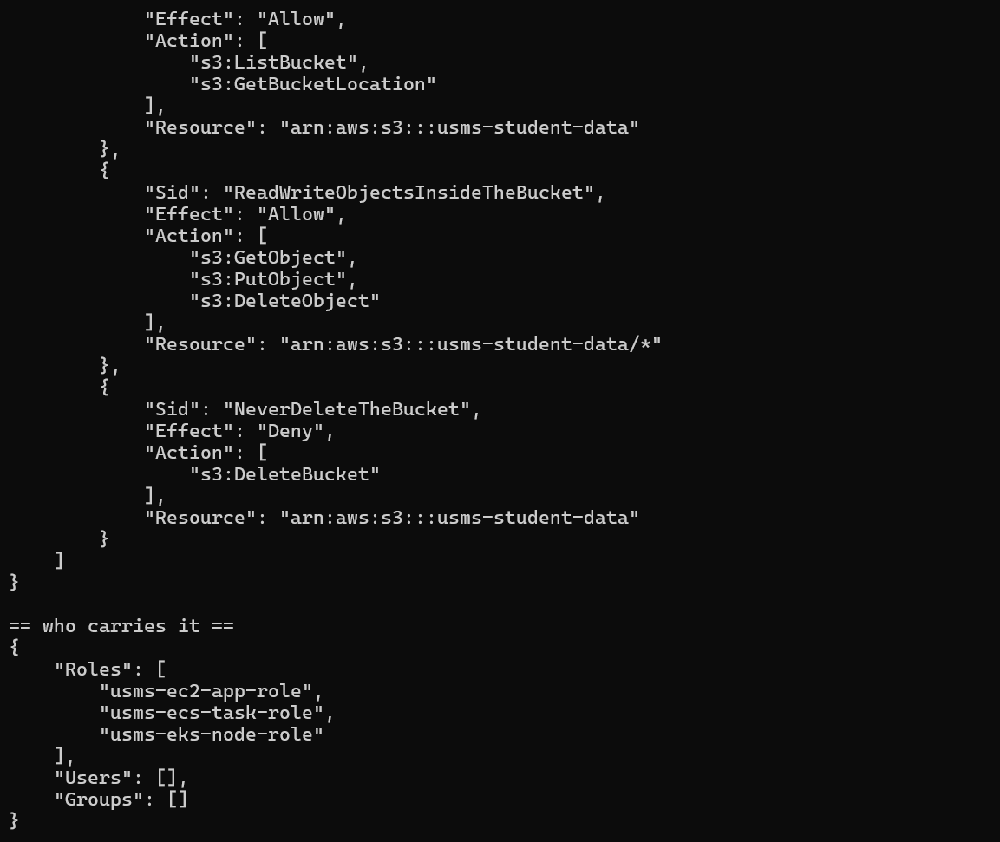

`head-bucket` on `usms-student-data` returned **404 Not Found** (exit code 254). This was expected, because Lab 10 creates the bucket. A policy can name a bucket that does not exist yet.

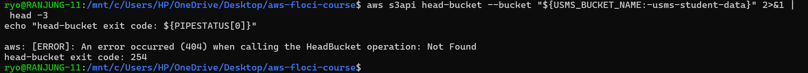

### Step 7: Create the read-only policy and role, and fix the confused deputy

**Part 1:** I wrote `policies/usms-student-data-ro-policy.json` with three statements:

- `ListTheTranscriptsBucket`: allow `s3:ListBucket` on the bucket
- `ReadTranscriptObjectsOnly`: allow `s3:GetObject` on `usms-student-data/*`
- `NeverWriteAndNeverDelete`: **explicit Deny** on `s3:PutObject`, `s3:DeleteObject`, `s3:DeleteBucket` and `s3:PutBucketPolicy`

It printed **valid JSON**, and `grep -c '\$'` returned **0**, so no shell variable was left unexpanded in the file.

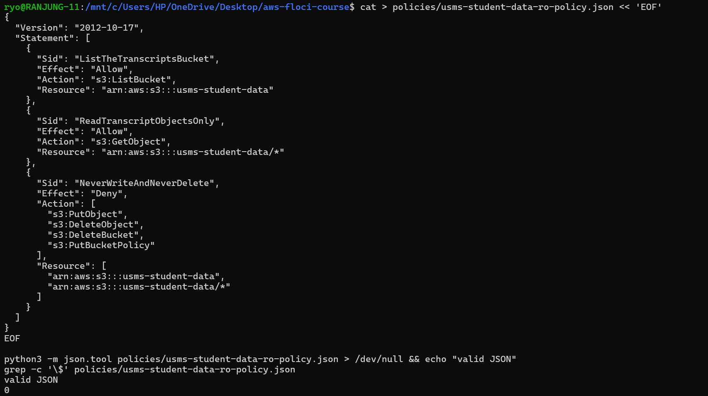

I created it as **`USMSStudentDataReadOnly`** (`arn:aws:iam::000000000000:policy/USMSStudentDataReadOnly`).

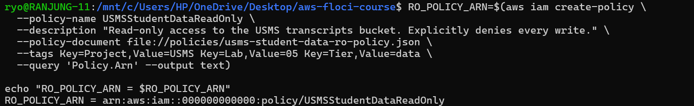

**Part 2:** I wrote `policies/trust-ecs-tasks-scoped.json`. It still trusts `ecs-tasks.amazonaws.com`, but now with two conditions:

- `StringEquals aws:SourceAccount = 000000000000`
- `ArnLike aws:SourceArn = arn:aws:ecs:us-east-1:000000000000:*`

The variables expanded correctly (the file shows the real account and region), and the `$` count was **0**.

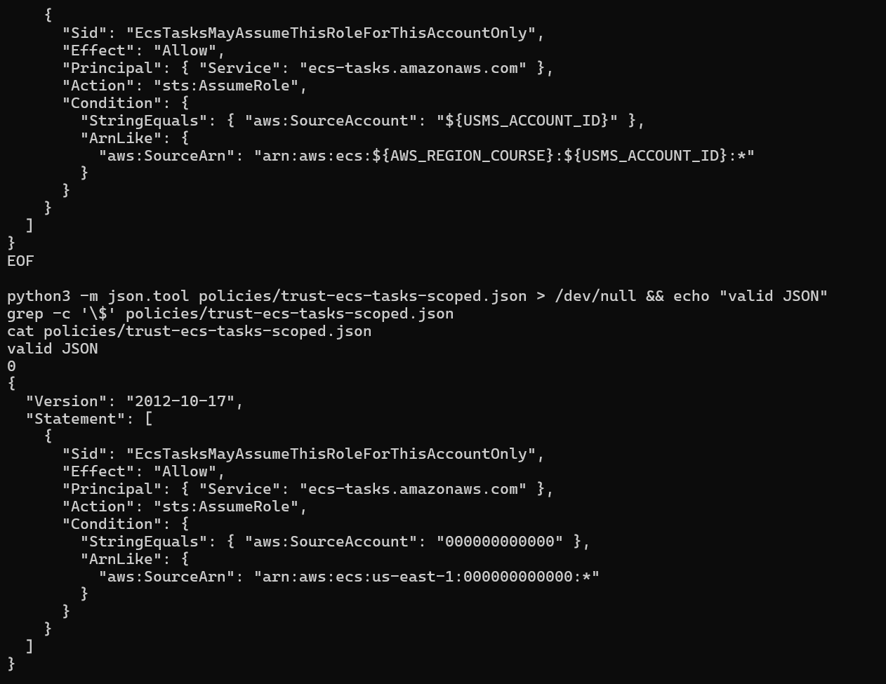

**Part 3:** I created **`usms-transcripts-reader-role`** with this trust policy and attached `USMSStudentDataReadOnly`. Then I saved the old trust policy of `usms-ecs-task-role` to `outputs/lab-09-ecs-task-role-trust-before.json` (the undo), and ran `update-assume-role-policy` to give it the scoped trust. The saved "before" policy shows the old statement `AllowEcsTasksToAssumeThisRole` with **no Condition**.

I did **not** remove `USMSStudentDataReadWrite` from `usms-ecs-task-role`, because Lab 10 needs it. The fix **adds** a condition, it does not replace permissions.

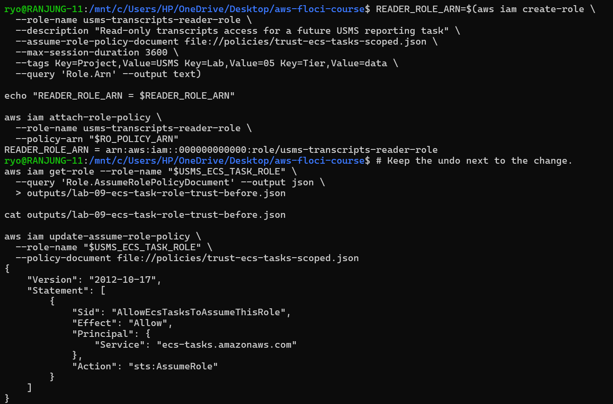

The check confirmed:

- The new role has `MaxSession 3600`, the scoped trust, and the permission **`USMSStudentDataReadOnly`**.
- On `usms-ecs-task-role`, the principal is the same, but "has condition" went from **False** to **True**.

> **SAME PRINCIPAL, NEW CONDITION**

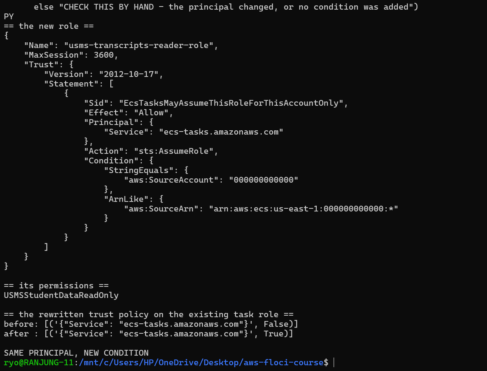

### Step 8: Scope `iam:PassRole` and add a ceiling

**Part 1:** I wrote `policies/usms-permissions-boundary.json`. It allows only what USMS deploys need (EC2 describe, ECS, ELB, Application Auto Scaling, logs, CloudWatch, S3 read plus `PutObject`, `iam:PassRole`, IAM read and `sts:GetCallerIdentity`). It has an explicit **Deny** on every identity change (`iam:CreateUser`, `iam:CreateAccessKey`, `iam:AttachRolePolicy`, `iam:PutRolePolicy`, `iam:DeleteRolePermissionsBoundary`, `iam:UpdateAssumeRolePolicy`, `iam:CreatePolicyVersion`, and others). Valid JSON.

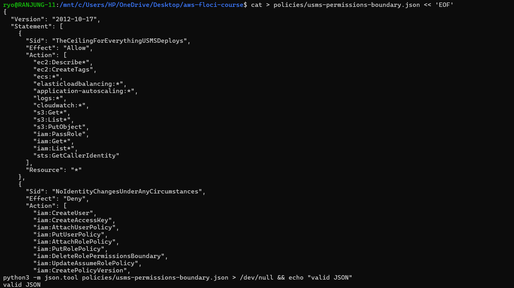

I created it as **`USMSPermissionsBoundary`**, with the description "A CEILING, not a grant. Used only as a --permissions-boundary. Never attach this."

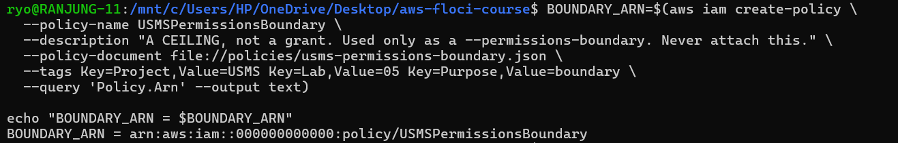

**Part 2:** I wrote `policies/usms-deploy-policy.json` and created **`USMSDeployBase`**:

- `DeployTheContainerPlatform`: the ECS deploy actions plus read-only ELB, autoscaling and logs
- `PassOnlyTheseThreeRolesAndOnlyToTheseServices`: `iam:PassRole` **only** on `usms-ecs-exec-role`, `usms-ecs-task-role` and `usms-transcripts-reader-role`, and only when `iam:PassedToService = ecs-tasks.amazonaws.com`
- `NeverPassAnythingToEC2`: an explicit **Deny** of `iam:PassRole` to `ec2.amazonaws.com`

The output shows **valid JSON**, `$` count **0**, and `DEPLOY_POLICY_ARN = arn:aws:iam::000000000000:policy/USMSDeployBase`.

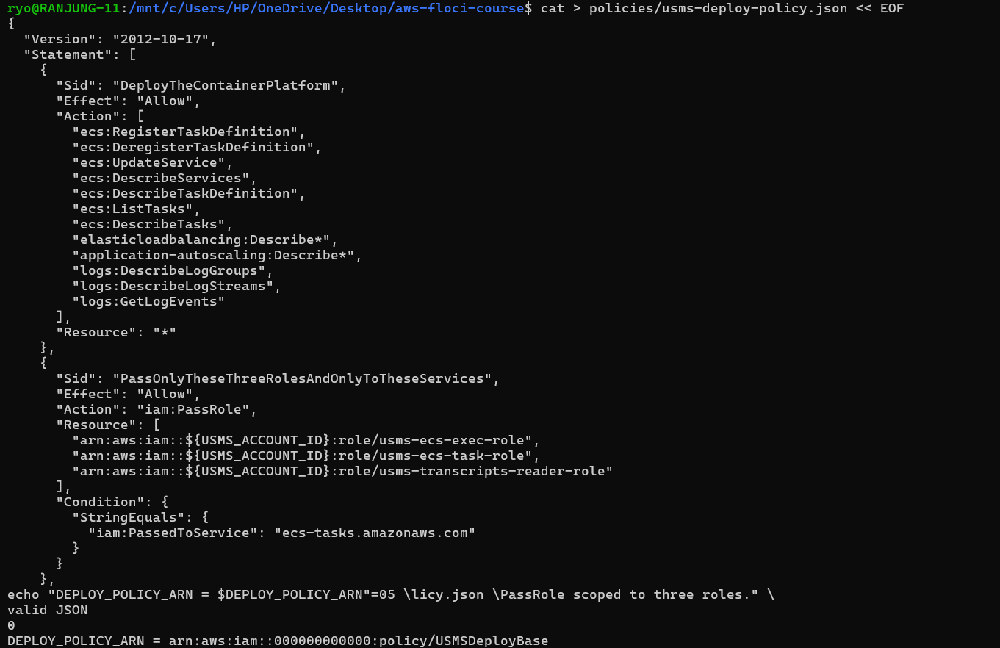

**Part 3:** I created **`usms-deploy-role`** with `policies/trust-deploy.json` (only the user `usms-admin-01` may assume it), a 3600-second session, and `--permissions-boundary USMSPermissionsBoundary`. The checks show:

- The principal is `arn:aws:iam::000000000000:user/usms-admin-01`.
- The PassRole statements name the **three** roles and only the ECS tasks service, and EC2 is denied.
- The boundary policy is attached to **no** roles, users or groups, which is correct for a ceiling.
- However, **`"Boundary": null`**. My Floci build accepted `--permissions-boundary` but did not store it. The lab lists this as a known, benign Floci failure. On real AWS the boundary ARN would appear here.

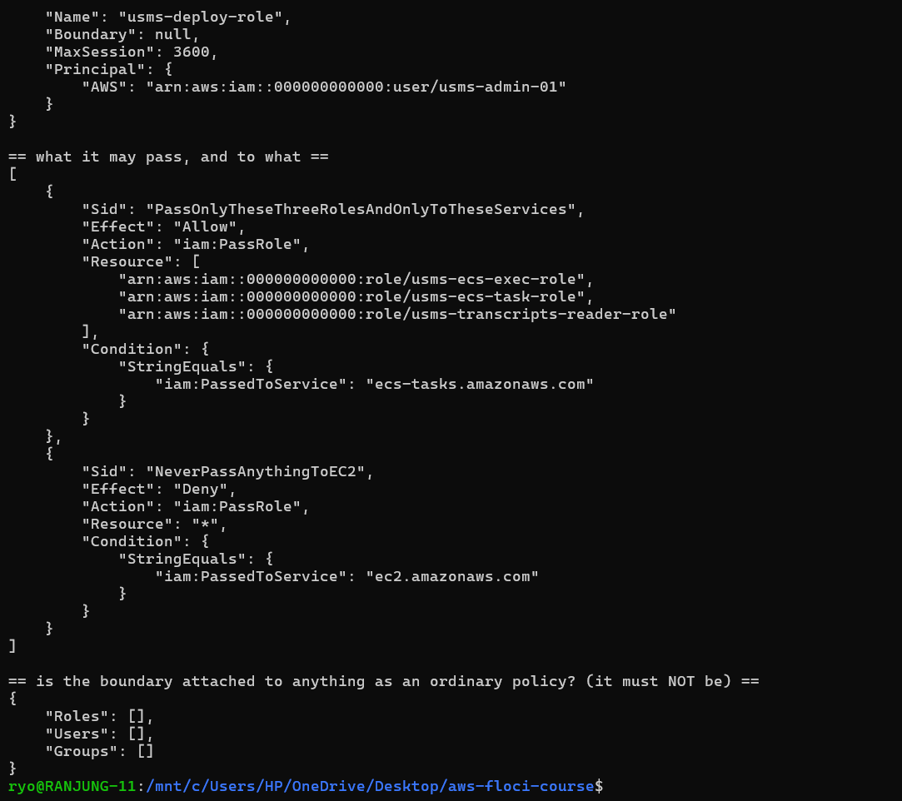

### Step 9: Scope down a session and compute the intersection

I wrote `outputs/lab-09-session-policy.json` (`ThisSessionMayOnlyLook`), which allows only `ec2:DescribeVpcs`, `ec2:DescribeSubnets`, `ec2:DescribeSecurityGroups` and `sts:GetCallerIdentity`.

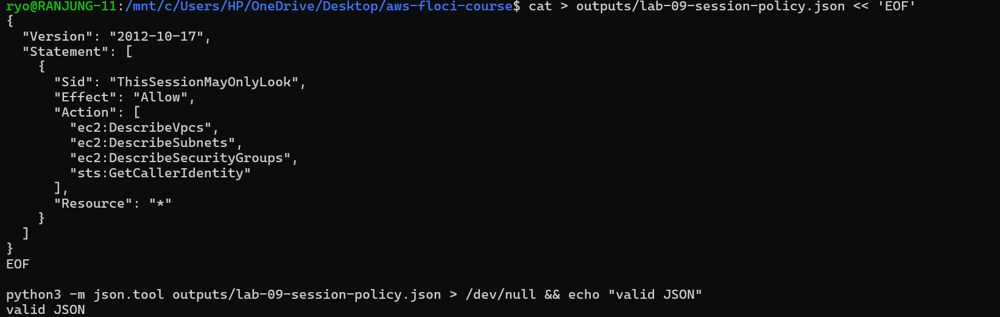

I assumed `usms-developer-role` with this session policy for **900 seconds** using the `usms-dev` profile. It worked: `get-caller-identity` returned `assumed-role/usms-developer-role/floci-session`, and `describe-vpcs` returned **1**. Floci used its own session name (`floci-session`) instead of the one I asked for (`lab05-scoped-review`), and it **does not enforce** session policies. So I could not prove the restriction by calling a blocked action, and I computed it by hand instead.

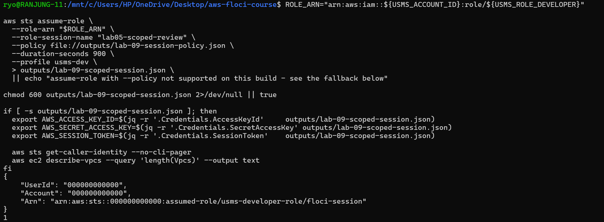

The script lists the developer role's identity policy (`cloudwatch:Describe*`, many `ec2:` actions, `iam:Get*`, `iam:List*`, `logs:`, `s3:List*`, `sts:GetCallerIdentity`) and the session policy. An action is **effective only if it matches both** and matches no Deny. All four session actions are **ALLOWED**, because the developer role already allows all of them. If the session policy had asked for something the role does not have (for example `s3:PutObject`), it would be denied, because **a session policy can only take away, never add**.

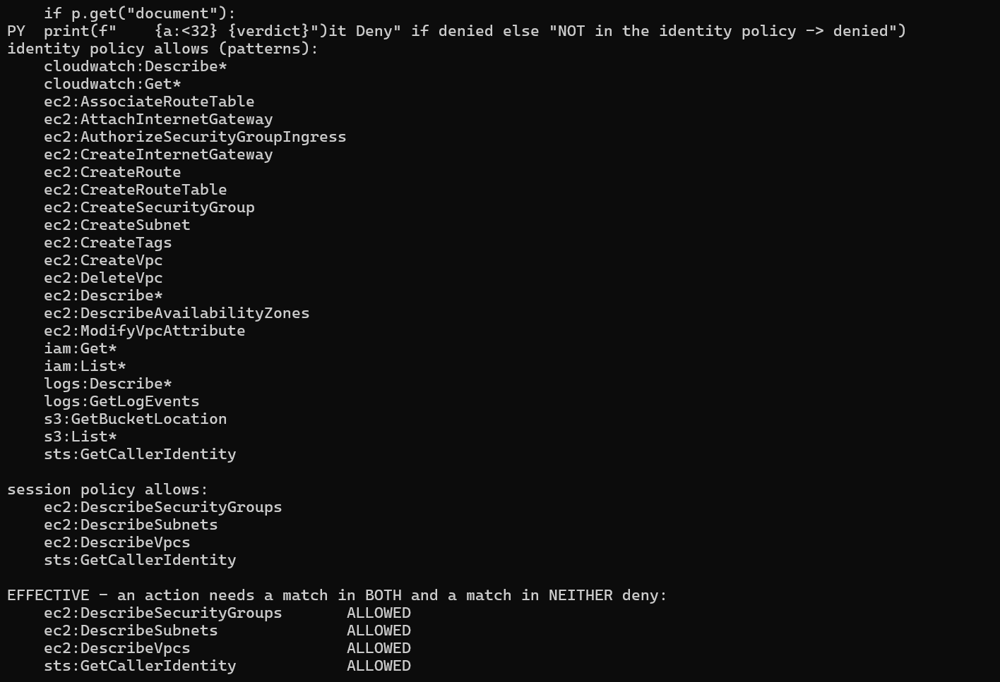

### Step 10: Rotate the access key with no window in which nothing works

The safe order for a rotation is: **create** the new key, **switch** the profile to it, **deactivate** the old key, check that everything still works, and only then **delete** the old key. At no point is there a moment with no working key.

**Before:** `usms-dev-01` already had **two** keys. The old one, `AKIA1OG3656F6OXLPOM3` (created 2026-08-21), was **Inactive**. A new one, `AKIAXT8UDRKUFWEY4KQG` (created 2026-11-02 14:21:24), was **Active**. This was left over from my first attempt at this step. `get-access-key-last-used` printed **N/A / None** for both keys, so Floci does not track last use.

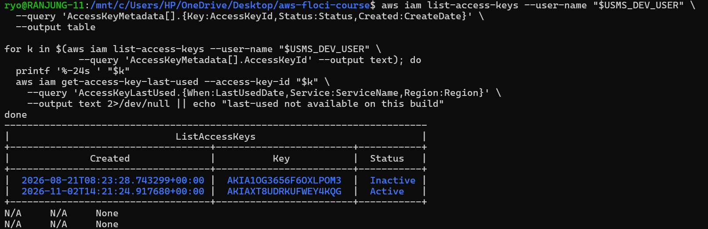

**Create:** Running `create-access-key` again failed:

```
LimitExceeded: Cannot exceed quota for AccessKeysPerUser: 2
```

IAM allows **at most two keys per user**, and that limit is what makes a no-downtime rotation possible: one old key and one new key. Because the command failed, the redirect left **`outputs/usms-dev-01-access-key-new.json` empty**, and `new key id` printed blank. `git check-ignore` confirmed that the file is protected by **`.gitignore:35:outputs/*`**. `OLD_KEY_ID` was still worked out correctly as `AKIA1OG3656F6OXLPOM3`.

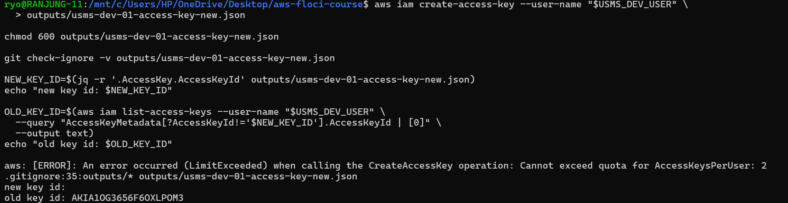

**Switch and deactivate:** I set the `usms-dev` profile's key from the key file and set the old key to **Inactive**. Afterwards `AKIA1OG3656F6OXLPOM3` was Inactive and `AKIAXT8UDRKUFWEY4KQG` Active. The AWS CLI warned that `~/.aws/credentials` is **readable by other users** and should be `chmod 600`.

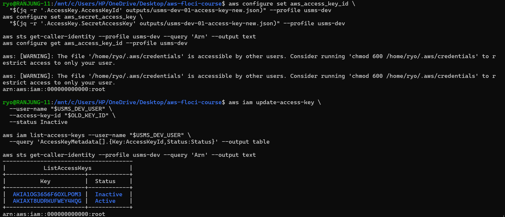

**Delete:** I deleted the old key. **Exactly one key is left**: `AKIAXT8UDRKUFWEY4KQG`, **Active**. The old key file `outputs/usms-dev-01-access-key.json` was removed.

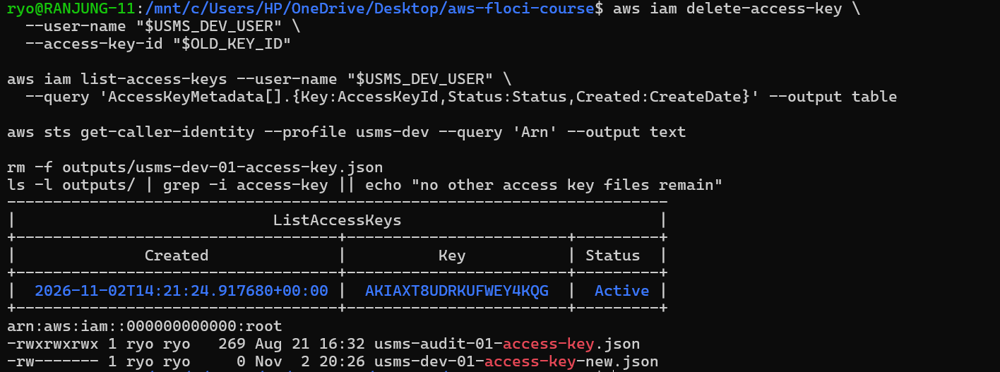

**What went wrong, honestly:** because the second `create-access-key` failed, the key file I used to set the profile was **empty (0 bytes)**, so the `usms-dev` profile was most likely set with empty values. `get-caller-identity` still answered (as `root`) only because **Floci does not check credentials**. On real AWS the profile would now fail, and the secret of the active key would have to be recovered from my first attempt, or the key replaced with a fresh one. I also noticed that `outputs/usms-audit-01-access-key.json` has permissions **`-rwxrwxrwx`**. It should be `chmod 600` like the other key files.

### Step 11: Require IMDSv2 on the web instance

Before: `usms-web-01` had **`HttpTokens: optional`** and hop limit **1**, so IMDSv1 (no token) was still allowed. I ran `modify-instance-metadata-options` with `--http-tokens required --http-endpoint enabled --http-put-response-hop-limit 1`. Floci returned `Tokens: required, Hops: 1`.

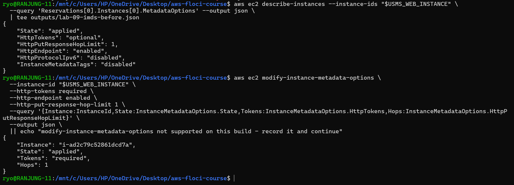

After: **`HttpTokens: optional -> required`**, **HopLimit 1 -> 1**.

> **IMDSv2 REQUIRED, HOP LIMIT 1**

With IMDSv2, a stolen request (for example through an SSRF bug) cannot read the role's credentials without first getting a token with a `PUT`. The hop limit of 1 also means a container on the host cannot reach the metadata service. Floci did apply and store this change.

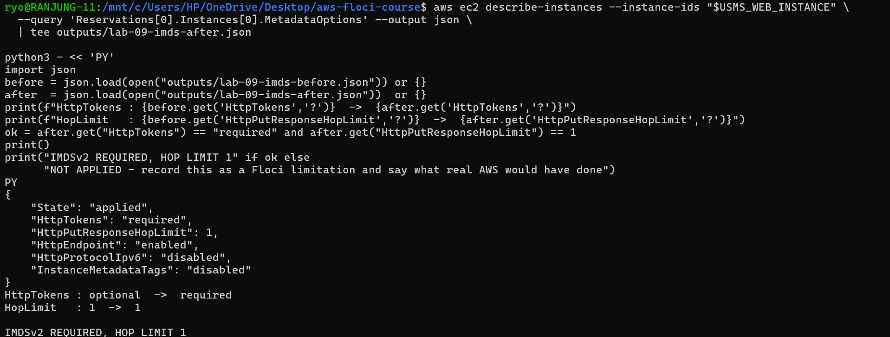

### Step 12: Build the security group audit script

`scripts/utilities/usms-sg-audit.sh` reads every group in the VPC and reports ingress, egress and attachment findings. The result was **HIGH=5 MED=11 LOW=6 groups=8** (saved to `outputs/lab-09-sg-findings-before.txt`). Examples:

- **`usms-db-sg`** (2 interfaces): ingress `tcp/5432 from <none>`. The source group did not come back from Floci. Egress was the **default allow-all** (MED).
- **`usms-eks-cluster-sg`**: ingress tcp/443 from the **whole VPC range** `10.0.0.0/16` (MED: "could this be a group reference?"), default egress, and attached to no network interface (LOW).
- **`usms-enrolment-sg`**: ingress tcp/80 from `sg:usms-alb-sg` (good), default egress (MED), no interface (LOW).
- **`usms-exam-sg`**: tcp/443 from `10.10.0.0/16`, default egress, no interface.

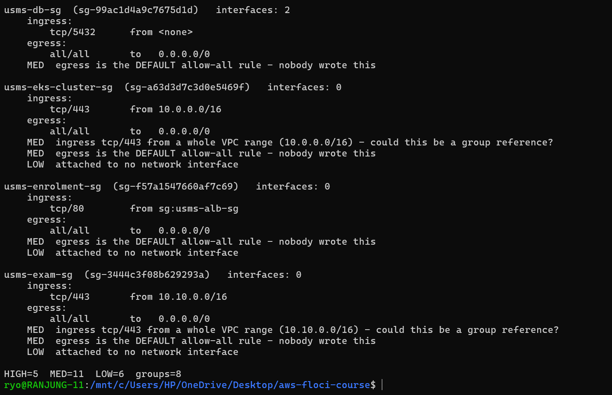

### Step 13: Write the egress rules for the enrolment tasks

I looked up the S3 prefix list: **`pl-63a5400a`** (from `describe-prefix-lists`).

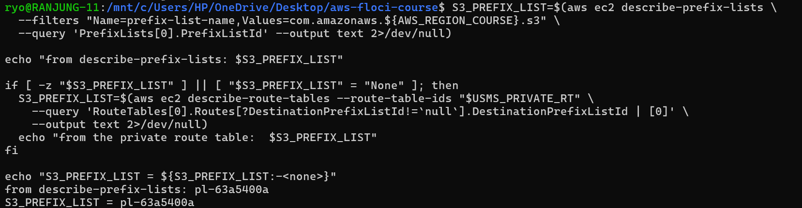

I wrote `policies/usms-enrolment-sg-egress.json` with two rules:

- tcp/443 to **`pl-63a5400a`**: "S3 via the Lab 02 gateway endpoint – transcripts, and nothing leaves the AWS network"
- tcp/443 to `0.0.0.0/0`: "HTTPS out for the container image pull and the awslogs driver – narrow this to interface endpoints on real AWS"

Valid JSON, `$` count 0.

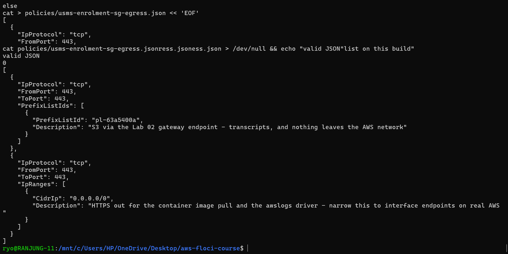

Then I wrote the **undo document** `policies/usms-egress-allow-all.json` (the AWS default allow-all rule), and changed the rules in the **safe order**: **first authorise** the new rules (`sgr-2576c58054e66b4cf`, `sgr-351cc4afe515fc6f1`), **then revoke** the default. The revoke returned **True**. If I had revoked first, there would have been a window with no egress at all.

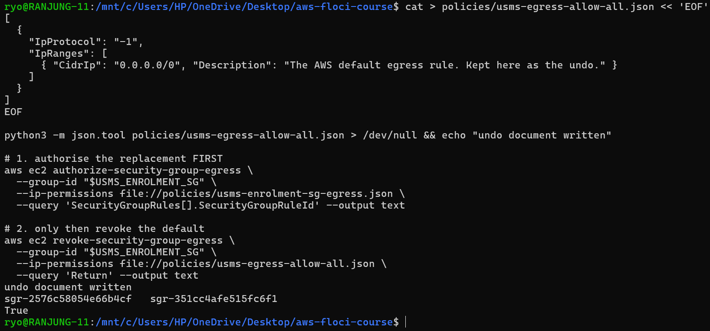

`describe-security-group-rules` shows the two new tcp/443 rules, but **the old allow-all rule `sgr-6d50fd780201683d2` (protocol `-1`, `0.0.0.0/0`) is still listed**, even though the revoke returned True. Ingress is unchanged: port 80 only from `sg-2915aadd30cc4c1a8` (`usms-alb-sg`).

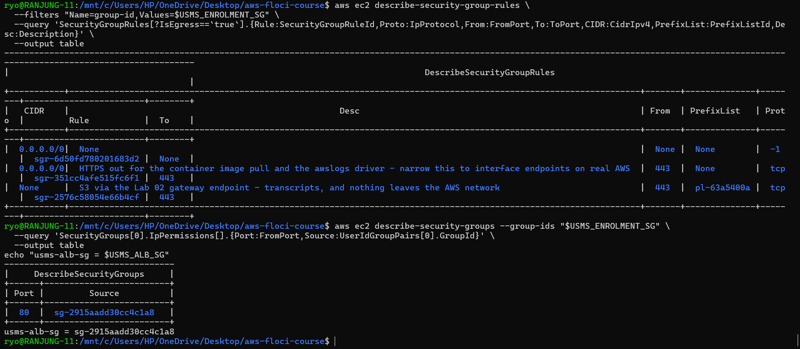

### Step 14: ALB egress to a security group

I wrote `policies/usms-alb-sg-egress.json`: tcp/80 to **`usms-enrolment-sg` by group ID** ("HTTP to the enrolment tasks – the ONLY thing this load balancer may initiate"). I authorised it (`sgr-f975863ff670d9dd7`), then revoked the default (**True**).

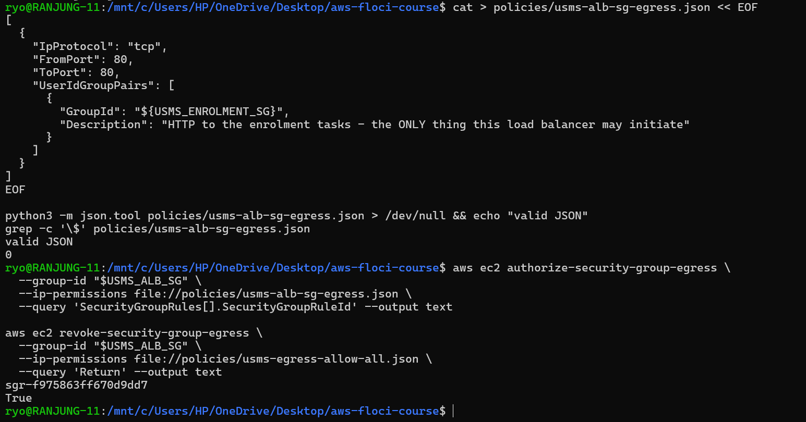

`describe-security-groups` now shows:

- **In:** port 80 and port 443 from `0.0.0.0/0` (the ALB is internet-facing, unchanged)
- **Out:** only **port 80 to `sg-f57a1547660af7c69`**, with **CIDR null**

The destination is a **group**, not an address range. So if the enrolment tasks get new IPs, the rule still works, and the ALB cannot send traffic anywhere else.

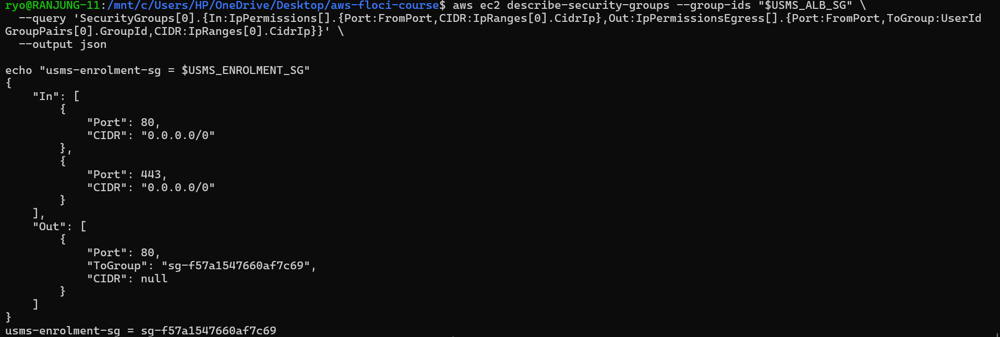

### Step 15: Data tier egress

I wrote `policies/usms-db-sg-egress.json`: only **tcp/443 to `0.0.0.0/0`**, "HTTPS out through usms-nat for operating system updates – the ONLY reason Lab 02 gave this tier outbound access". I authorised it (`sgr-aeeee2597a0c9ecbb`) and revoked the default (**True**). DNS is deliberately left out for Exercise 1.

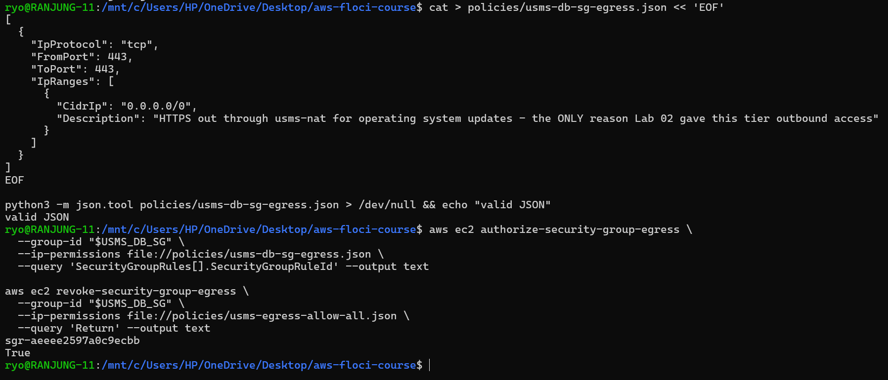

The check loop that counts the remaining allow-all rules failed for all three groups:

```
aws: [ERROR]: In function length(), invalid type for value: None ... received: "null"
```

The query `length(IpPermissionsEgress[?IpProtocol=='-1'])` is missing the `SecurityGroups[0].` prefix, so it looked for `IpPermissionsEgress` at the top of the response, found nothing (null), and `length()` cannot count null. The count was never printed. The correct query would be `length(SecurityGroups[0].IpPermissionsEgress[?IpProtocol=='-1'])`.

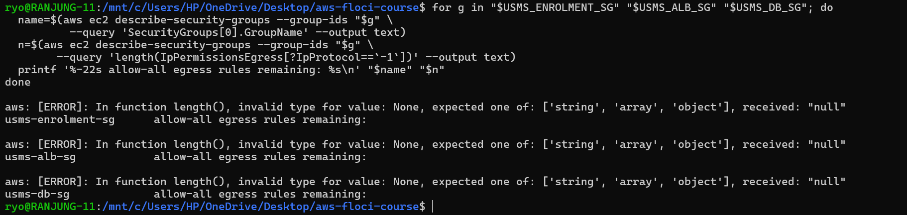

### Step 16: Narrow SSH to the bastion group

**Part 1:** I looked up `usms-bastion-sg`, but the lookup returned nothing, so the script tried to create it and got:

```
InvalidGroup.Duplicate: The security group 'usms-bastion-sg' already exists
InvalidGroup.NotFound: The security group '' does not exist
```

So the group **does exist** (from my first attempt), but `BASTION_SG` stayed **empty**. The cause is the lookup query `SecurityGroups[0].GroupId | [0]`: `GroupId` is a string, and applying `[0]` to a string gives null, which became "None". The check then thought the group did not exist.

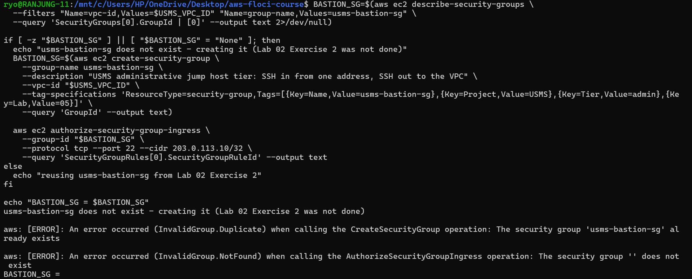

**Part 2:** I wrote `policies/usms-app-sg-ssh-bastion.json` (tcp/22 from the bastion group) and authorised it on `usms-app-sg` as **`sgr-3c6f04d0329bb3468`**. Because `BASTION_SG` was empty, the file was written with **`"GroupId": ""`**. Floci accepted it, so the new rule has **no source group**.

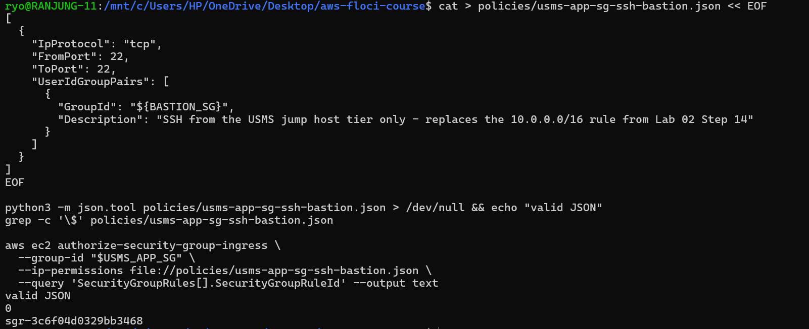

**Part 3:** I found the old rule, tcp/22 from `10.0.0.0/16` (**`sgr-1f8d10c6f14f19ffa`**), and revoked it by rule ID. The revoke returned **True**. But the table afterwards still shows:

| Rule | Port | Source |
|---|---|---|
| `sgr-b571c4cd8ac39686b` | 80 | 0.0.0.0/0 |
| `sgr-3c6f04d0329bb3468` | 22 | **(empty group)**, "SSH from the USMS jump host tier only" |
| `sgr-1f8d10c6f14f19ffa` | 22 | **10.0.0.0/16** (still there) |
| `sgr-c718579b717203aa4` | 443 | 0.0.0.0/0, "HTTPS from the internet" |
| `sgr-5e111e6849d27e69d` | 22 | none |
| `sgr-cafdcbf56f0a05ef2` | 80 | 0.0.0.0/0 |

`usms-bastion-sg =` printed empty again. **The SSH cutover is not finished.** The fix is to look the group up with `--query 'SecurityGroups[0].GroupId'` (without `| [0]`), rewrite the JSON with the real ID, authorise it, and then revoke the old rules.

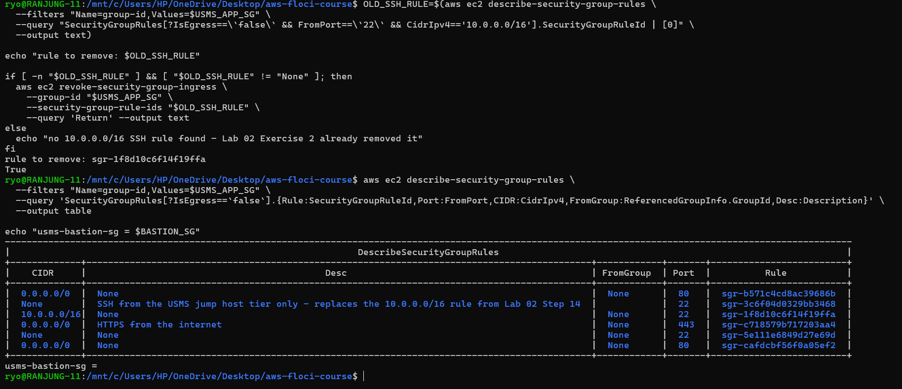

### Step 17: Reachability matrix and the negative proof

**Part 1:** `scripts/utilities/usms-reachability-matrix.sh` builds a "who can reach whom" matrix from the rules only. It is saved to `outputs/lab-09-reachability.txt`:

- **Ingress:** `usms-app-sg` has tcp/80 and tcp/443 from **THE INTERNET**, tcp/22 from `10.0.0.0/16` and tcp/22 from an empty `group`. `usms-bastion-sg` has tcp/22 from **`203.0.113.10/32`** (one documentation address). `usms-db-sg` shows **no** ingress source. `usms-enrolment-sg` accepts tcp/80 only from `usms-alb-sg`.
- **Egress:** `usms-alb-sg` **tcp/80 → usms-enrolment-sg**, `usms-db-sg` **tcp/443 → 0.0.0.0/0**, `usms-enrolment-sg` **tcp/443 → pl-63a5400a and tcp/443 → 0.0.0.0/0**. So `describe-security-groups` does show my egress changes from Steps 13–15. `usms-app-sg`, `usms-bastion-sg`, `usms-eks-cluster-sg`, `usms-exam-sg` and `default` still have all/all.
- **Instances:** `usms-db-01`, `usms-web-01` and `usms-web-02` show `public=127.0.0.1` (Floci's loopback, not a real public IP). `usms-db-02` (`10.0.4.10`) has **no** public address.
- **Single point of control:** `usms-bastion-sg`, `usms-eks-cluster-sg`, `usms-enrolment-sg` and `usms-exam-sg` are each protected by **exactly one** ingress rule. One mistake in that one rule is the whole of the protection.

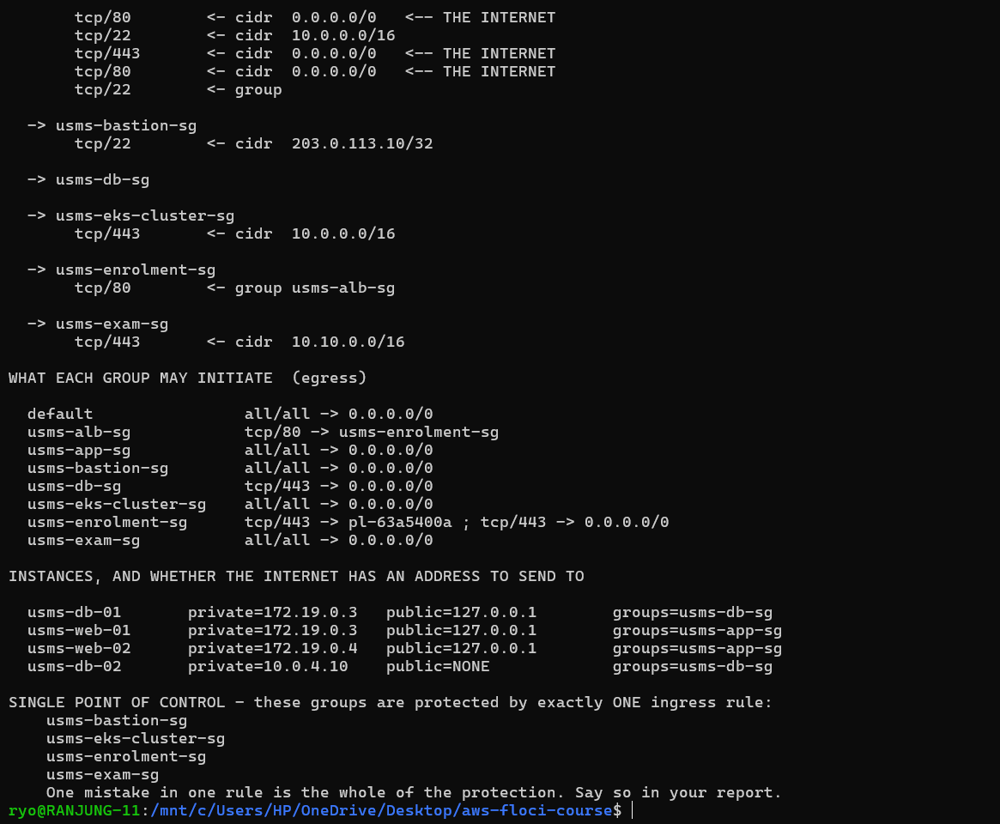

**Part 2:** The negative proof (`outputs/lab-09-negative-proof.txt`) checks the claim "**`usms-db-01` is not reachable from the internet**" through five independent controls:

| Control | Result | Holds? |
|---|---|---|
| 1. No public address | `127.0.0.1` | **No** on Floci (the loopback counts as an address). On real AWS a private-subnet instance would show none. |
| 2. Subnet does not auto-assign one | `False` | **Yes** |
| 3. Route table has no internet gateway route | `None  nat-7389029bfe126d7cf` | **Yes**. `0.0.0.0/0` goes to a **NAT gateway**, not an IGW. |
| 4. Security group admits one group, no CIDR | `None  None  5432` | **Partly**. There is no CIDR, but the source group is missing as well. |
| 5. NACL is not the default one | `acl-2c99f841c56b14d14  True` | **No**. Private subnet A is on the **default** NACL, so `usms-private-nacl` is not associated with it. |

Controls 2 and 3 still hold, and either one alone stops inbound internet traffic. The data tier is still protected, but by fewer independent layers than the design wants.

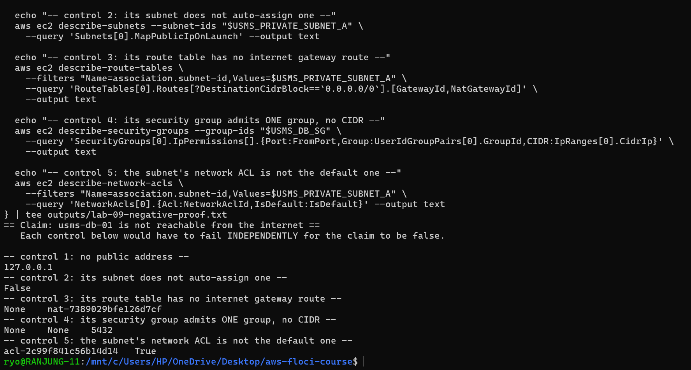

### Step 18: Prove the posture survives a restart, and that nothing broke

**Part 1:** I saved nine control values to `outputs/lab-09-pre-restart.txt`. Four queries (the three allow-all egress counts and the app-sg SSH CIDR count) failed with the same `length()` null error as Step 15, so they recorded nothing. The values that were recorded:

| Control | Value |
|---|---|
| Conditions on the `usms-ecs-task-role` trust | **2** |
| `usms-deploy-role` boundary | **None** |
| Reader role / its policy | **usms-transcripts-reader-role / USMSStudentDataReadOnly** |
| `usms-dev-01` access keys | **1** |
| `usms-web-01` HttpTokens | **required** |

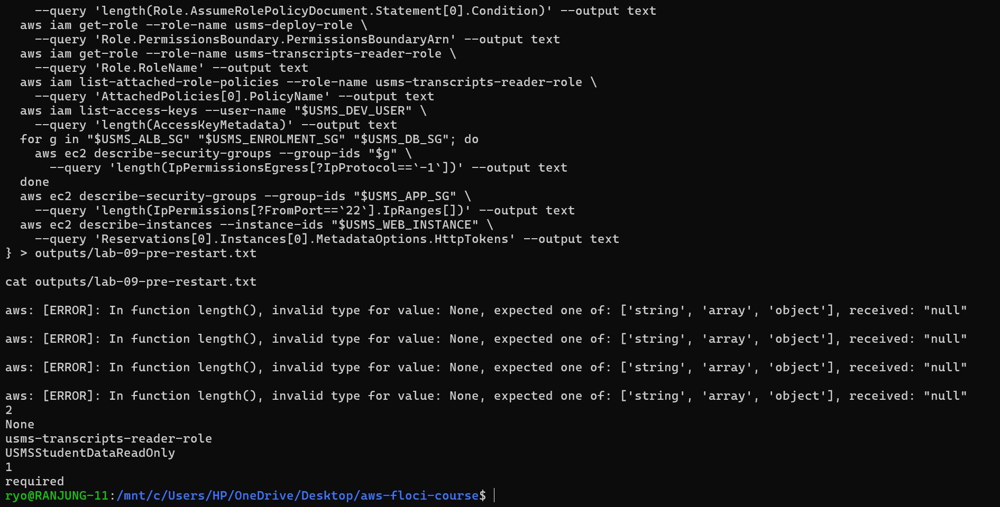

I stopped Floci (`floci-down.sh`: "State preserved in /home/ryo/floci-data"), started it again in **hybrid** mode, and sourced the env files again.

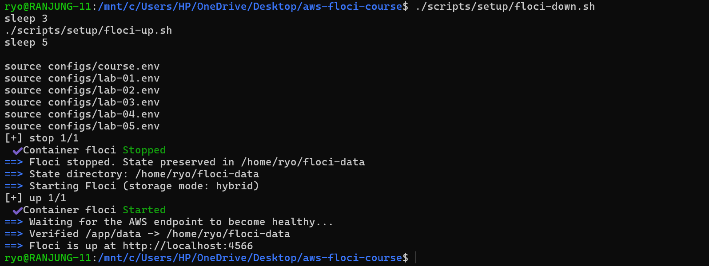

After the restart, the group and instance IDs were re-derived (`sg-2915aadd30cc4c1a8`, `sg-f57a1547660af7c69`, `sg-99ac1d4a9c7675d1d`, `sg-ae9ad9330a620147c`, `i-ad2c79c52861dcd7a`), and the diff printed:

> **PERSISTENCE PROVEN**: the trust condition, the permissions boundary, the read-only role and its policy, the single access key, three written egress rules, the absence of a CIDR SSH source, and the IMDSv2 requirement are all unchanged.

The pre- and post-restart files are identical. But the egress and SSH lines were empty in **both** files, so for those controls the diff only proves "empty = empty". It does not prove the rules persisted.

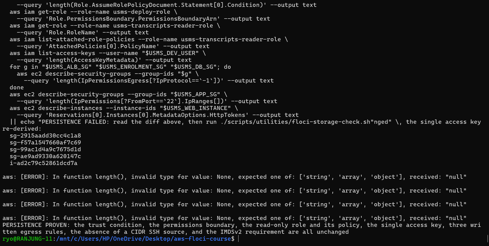

**Part 2:** I ran the Lab 02–06 verify scripts again at **2026-11-02T14:40:35Z** and diffed them with the Step 2 baseline. The numbers are exactly the same (lab-02 31/2, lab-03 35/2, lab-04 39/0, and the same lab-05 and lab-06 lines):

> **NOTHING BROKE: all five verification scripts report exactly what they reported before this lab**

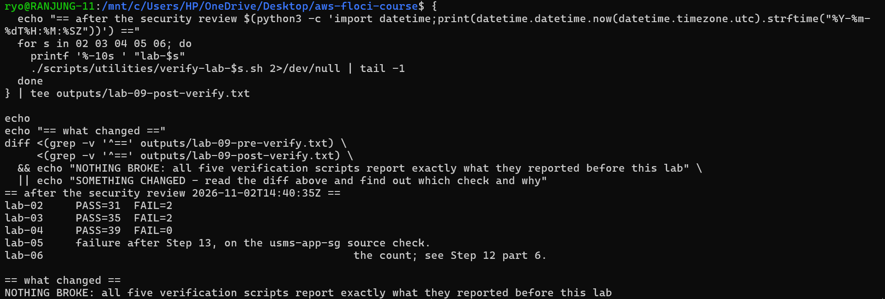

### Step 19: Write `configs/lab-09.env`

The check `grep -n 'export .*=$\|=None$' configs/lab-09.env || echo "all values populated"` printed **"all values populated"**. But when I sourced the file, **every value printed empty**, and `grep -c '^export'` returned **0**. The file on disk is **0 bytes**: the heredoc that should have written it did not run. The "all values populated" message was a false pass. grep found no empty exports only because there were **no exports at all**.

**`configs/lab-09.env` still has to be written** with the policy ARNs, role ARNs, the bastion group ID, `pl-63a5400a`, `required`, the active key ID `AKIAXT8UDRKUFWEY4KQG`, the allow-all count and the review date.

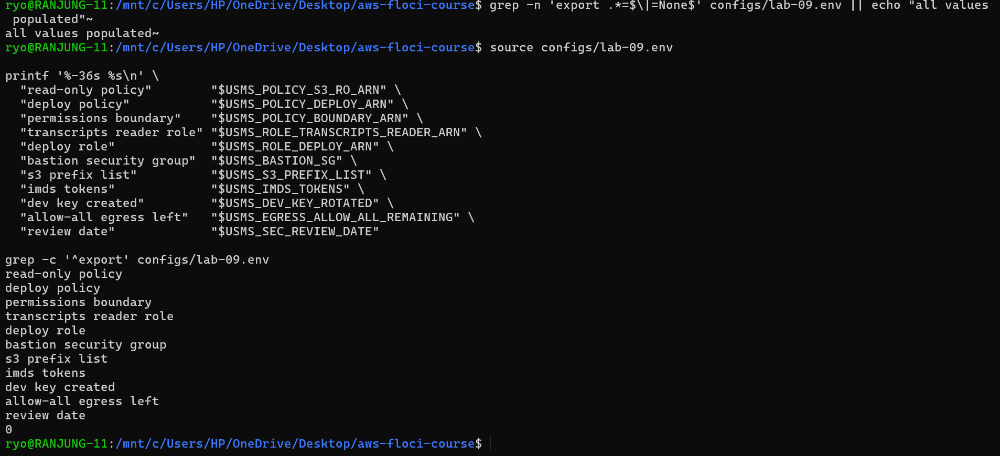

### Step 20: Commit

**Part 1:** `git status --short` shows the Lab 09 files as untracked: `configs/lab-09.env`, `labs/lab-09-security/`, the ten new `policies/` documents and the three audit scripts. Some Lab 01/02 files are also modified. **No file under `outputs/` is listed**. `git check-ignore` shows the new key file and the identity inventory are protected by **`.gitignore:35:outputs/*`**.

The "no unexpanded variable" check flagged **`policies/usms-self-manage-credentials.json`**. The `$` in that file is **`${aws:username}`**, an **IAM policy variable** that AWS fills in when it evaluates the policy. It must stay as it is. This is a false positive in the check, not a mistake in the file.

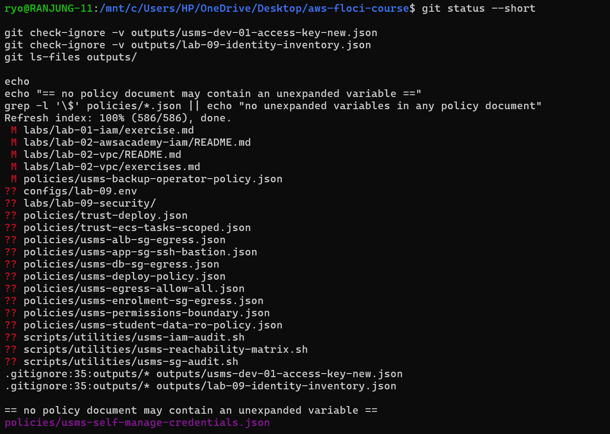

**Part 2:** `git status` and `git log` show that nothing was staged yet. The last commit is still **`3a10ad7 chore: lab8`**. The Lab 09 commit still has to be made.

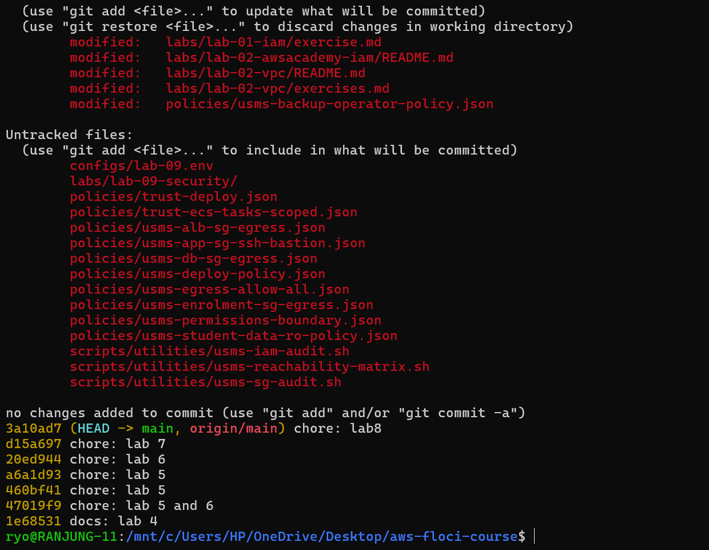

## 6. Verification

`scripts/utilities/verify-lab-09.sh` checks the environment, the Lab 01–06 dependencies, the read-only split, the confused-deputy fix, PassRole and the boundary, credentials and metadata, ingress, egress, the SSH cutover, the negatives and Git hygiene.

The result was **PASS=38 FAIL=12**. The screenshot shows the lower half of the output. Eleven of the twelve failures are visible in it, and the twelfth is in the part above it, which I did not capture. Every failure comes from a Floci limitation or from a mistake I recorded in the steps above:

| FAIL | Reason |
|---|---|
| `usms-deploy-role` HAS a permissions boundary | Floci accepted `--permissions-boundary` but stored `null` (Step 8, known benign) |
| `usms-db-sg` still admits tcp/5432 from `usms-app-sg` | Floci returns the rule with **no source group** (`from <none>` in Step 12). This was not changed in this lab. |
| `usms-alb-sg` / `usms-enrolment-sg` / `usms-db-sg` have NO allow-all egress rule | `revoke-security-group-egress` returned True, and `describe-security-groups` shows the default gone, but `describe-security-group-rules` **still lists** it (Step 13). The two Floci APIs disagree. |
| `usms-enrolment-sg` / `usms-db-sg` egress is tcp/443 only | Same cause: the leftover `-1` rule is still counted |
| `usms-app-sg` admits tcp/22 from a GROUP | The new rule has an **empty GroupId** (Step 16 lookup bug) |
| `usms-app-sg` has NO CIDR source on tcp/22 | The `10.0.0.0/16` rule is still listed after the revoke (Step 16) |
| `usms-db-01` has NO public address | Floci reports `127.0.0.1` (Step 17) |
| No `policies/` document contains an unexpanded variable | False positive on the IAM policy variable `${aws:username}` (Step 20) |

The checks that **passed** include: `usms-deploy-role` trusts a **user**, not a service; `usms-dev-01` has **exactly one** access key and it is **Active**; `usms-web-01` **requires IMDSv2**; `usms-alb-sg` still admits tcp/80 from the internet and its egress goes to a **group, not a CIDR**; `usms-enrolment-sg` still admits tcp/80 from `usms-alb-sg`; `usms-bastion-sg` exists; the private subnet does not auto-assign public IPs; the private route table has **no IGW route**; every policy document is valid JSON; the three audit scripts are executable; and **no secret is tracked by git**.

"`configs/lab-09.env` exists / has no empty values" passed, but only because the file is empty (Step 19).

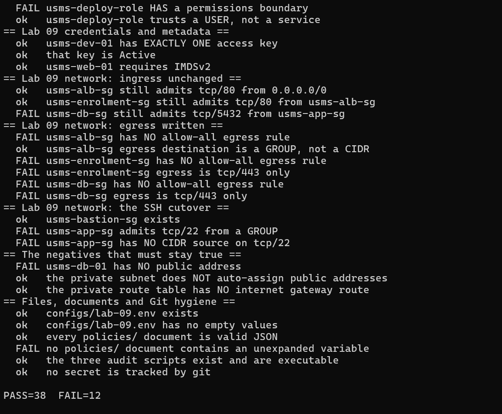

## 7. Analysis and Discussion

### 7.1 What was achieved

I inventoried all 9 roles, 5 users and 11 customer-managed policies, and built two audit scripts that found **HIGH=7 MED=31** IAM findings and **HIGH=5 MED=11 LOW=6** security group findings. I created a **read-only transcripts policy and role** with an explicit Deny on writes, and added **`aws:SourceAccount` / `aws:SourceArn`** conditions to the `usms-ecs-task-role` trust without removing any permission Lab 10 needs. I created a **deploy role** that can pass only three named roles, only to ECS, never to EC2, with a permissions boundary as a ceiling. I computed a **session policy intersection**, **rotated** the developer's access key down to one active key, and required **IMDSv2** on the web instance.

On the network side I wrote **group-referenced egress** for the ALB and **tcp/443-only egress** for the enrolment tasks and the database. I built a reachability matrix and a five-control negative proof. The configuration survived a restart, and the Lab 02–06 verify results are **identical** to the baseline.

### 7.2 Observed, recorded and conceptual

| Type | Items |
|---|---|
| **Observed / stored correctly** | Identity inventory; IAM and SG audit findings; `USMSStudentDataReadOnly` and `usms-transcripts-reader-role`; the scoped trust on `usms-ecs-task-role` (False → True); `USMSDeployBase` and its PassRole scope; access key limit of 2 and the final single active key; **IMDSv2 required, hop limit 1**; ALB egress to a group (in `describe-security-groups`); persistence after restart; **NOTHING BROKE** |
| **Recorded only** (Floci stores but does not enforce) | Every IAM policy, trust condition and session policy; every security group rule; the explicit Denies |
| **Not working on my Floci build** | The permissions boundary is stored as `null`; the session name is ignored; key last-used is not tracked; revoked rules still appear in `describe-security-group-rules`; group sources missing on `usms-db-sg`; instances report `127.0.0.1` as a public IP |
| **My own mistakes still to fix** | The empty `BASTION_SG` (so the SSH rule has no source and the 10.0.0.0/16 rule remains), the `length()` queries without `SecurityGroups[0].`, the empty key file in Step 10, and the empty `configs/lab-09.env` |
| **Conceptual** (real AWS only) | A real `AccessDenied` from a boundary or session policy; ECS refusing to assume a role from another account; packets actually dropped by egress rules |

### 7.3 Observations

- **Adding is safer than replacing.** I fixed the task role by adding a condition, not by removing the read-write policy, so Lab 10 still works. The "before" trust file is the undo.
- **Order matters for no-downtime changes.** For the egress rules I authorised first and revoked second. For the key I created, switched and deactivated before deleting. In both cases there is never a moment with nothing working.
- **The limit of 2 keys per user is a feature.** It is exactly enough for one old and one new key during a rotation, and it stopped my second `create-access-key`.
- **A ceiling grants nothing.** The boundary is attached to no one as an ordinary policy, and the session intersection showed that a session policy can only remove permissions.
- **Group references are better than address ranges.** The ALB's egress to `usms-enrolment-sg` keeps working when task IPs change, and allows nothing else.
- **Single points of control are a risk.** Four groups are protected by exactly one ingress rule. For the database, defence in depth comes from the route table (NAT, not IGW) and the subnet setting, not only from the security group.
- **On an emulator, "True" does not mean "done".** Floci returned True for revokes that still appear in one API, and returned a working identity for an empty profile. I learned to read the state back with more than one API.
- **Checks can pass for the wrong reason.** "all values populated" passed on an empty file, and "PERSISTENCE PROVEN" compared empty lines with empty lines. A check is only as good as the query behind it.

## 8. Reflection

### What I learned about securing a cloud application

Before this lab I thought of security as "add a policy". Now I see it as two separate questions that must both be answered: can this identity **call** the API, and can this host **reach** the other host? An IAM fix does nothing for an open security group, and the other way round. I also learned that a role has **two** policies: the trust policy decides who can become the role, and the identity policy decides what the role can do. The confused-deputy problem is in the **trust** policy, which I had never looked at before.

The most useful idea was **least privilege by splitting**: instead of giving the reporting job the read-write policy "because it works", I made a read-only one with an explicit Deny. I also liked the idea that a permissions boundary is a ceiling that grants nothing. It lets an admin hand out the power to deploy without handing out the power to create new admins.

## 9. Conclusion

In this lab I reviewed the security of the whole USMS application on both axes. On the **IAM** side I built an identity inventory and an audit script, created `USMSStudentDataReadOnly` and `usms-transcripts-reader-role`, added confused-deputy conditions to `usms-ecs-task-role` ("SAME PRINCIPAL, NEW CONDITION"), created `USMSDeployBase` with `iam:PassRole` scoped to three roles and the ECS service only, created the `USMSPermissionsBoundary` ceiling and `usms-deploy-role`, computed a session policy intersection, rotated `usms-dev-01` down to one active key, and required **IMDSv2 with hop limit 1** on `usms-web-01`.

On the **network** side I built a security group audit and a reachability matrix, wrote tcp/443-only egress for the enrolment tasks and the database and **group-referenced egress** for the ALB, and showed that the database's private subnet routes through a **NAT gateway**, not an internet gateway. The configuration survived a Floci restart, and the Lab 02–06 verify scripts gave **exactly the same results** as before the lab. The final verification gave **PASS=38 FAIL=12**. The failures come from Floci limitations (boundary stored as null, revoked rules still listed, missing group sources, a loopback "public" IP) and from mistakes I recorded honestly: the empty bastion group ID, the broken `length()` queries, the empty key file and the empty `configs/lab-09.env`. These are the items to fix before Lab 10.
