# Lab 09 - Exercises

I did all five exercises against Floci (`http://localhost:4566`, storage mode `hybrid`) from WSL. Before starting, I sourced the course env files and checked that the security group and VPC values were all filled in.

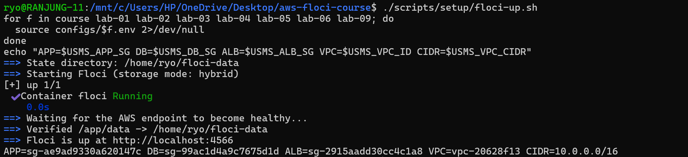

| Value | ID |
| --- | --- |
| `usms-app-sg` (web tier) | `sg-ae9ad9330a620147c` |
| `usms-db-sg` | `sg-99ac1d4a9c7675d1d` |
| `usms-alb-sg` | `sg-2915aadd30cc4c1a8` |
| VPC / CIDR | `vpc-20628f13` / `10.0.0.0/16` |

> **Known problem carried in from the main lab:** `configs/lab-09.env` was still 0 bytes, because Step 19's heredoc never ran. It matters again in Exercise 5.

---

## Exercise 1 - Finish the egress work on the web tier

**Goal:** replace the default allow-all egress on `usms-app-sg` with written rules. The web server must still reach S3, AWS endpoints (including STS), the enrolment API, PostgreSQL and DNS, and the ingress rules must stay unchanged.

### Working out the values instead of typing them

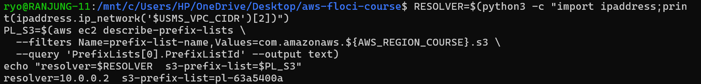

```
resolver=10.0.0.2  s3-prefix-list=pl-63a5400a
```

- **The resolver** was computed with Python's `ipaddress` module as the VPC network address **+2**. Lab 02 showed the five addresses AWS reserves in every subnet: `.0` network, `.1` router, **`.2` DNS**, `.3` reserved for future use, and the last address (broadcast). So the destination for DNS is `10.0.0.2/32`, a single host, not a range.
- **The S3 prefix list** was looked up by its service name (`com.amazonaws.us-east-1.s3`) rather than copied from Lab 02.

### State before the change

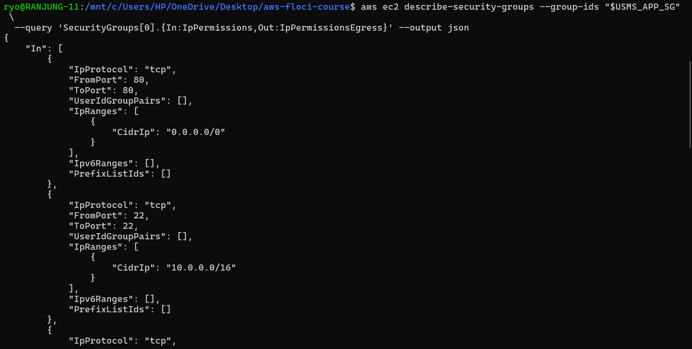

Ingress: tcp/80 from `0.0.0.0/0`, tcp/22 from `10.0.0.0/16`, tcp/443 … (unchanged by this exercise). Egress: the AWS default `-1 → 0.0.0.0/0`.

### The rules document: `policies/usms-app-sg-egress.json`

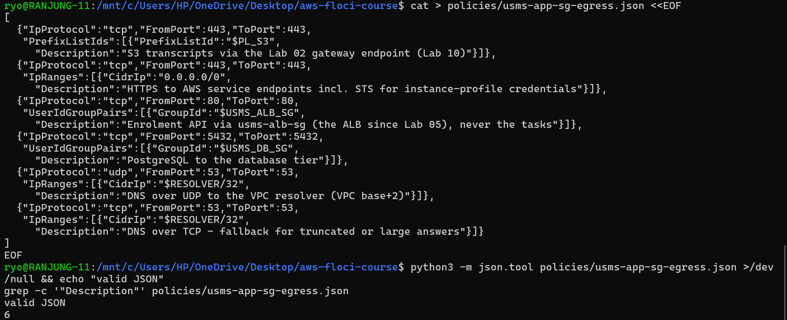

| # | Requirement | Rule | Destination |
| --- | --- | --- | --- |
| 1 | S3 transcripts through the Lab 02 gateway endpoint | tcp/443 | prefix list `pl-63a5400a` |
| 2 | AWS service endpoints over HTTPS, including STS | tcp/443 | `0.0.0.0/0` |
| 3 | Enrolment API, which since Lab 05 is the **load balancer** | tcp/80 | **group** `usms-alb-sg` |
| 4 | Database tier on PostgreSQL | tcp/5432 | **group** `usms-db-sg` |
| 5a | DNS (normal queries) | **udp**/53 | `10.0.0.2/32` |
| 5b | DNS (fallback) | **tcp**/53 | `10.0.0.2/32` |

`python3 -m json.tool` printed **valid JSON**, and `grep -c '"Description"'` returned **6**, so every rule has a description.

**Heredoc quoting: I used `<<EOF` (unquoted).** The document needs `$PL_S3`, `$USMS_ALB_SG`, `$USMS_DB_SG` and `$RESOLVER` replaced by their real values. A quoted `<<'EOF'` would have written the literal text `$USMS_ALB_SG` into the file, and AWS would reject it as an invalid group ID. Unquoted is safe here because the JSON contains no other `$` or backticks.

**Requirement 3 is a group reference to `usms-alb-sg`**, not `usms-enrolment-sg`. Since Lab 05, clients reach enrolment through the load balancer, and the tasks only accept traffic from the ALB group. A rule to the enrolment group would grant a path that the enrolment side refuses anyway, and it would bypass the load balancer.

**Requirement 5 needs two rules.** DNS normally uses UDP 53, but when an answer is too large for one UDP packet (for example many records, or DNSSEC), the server marks it truncated and the client retries over **TCP 53**. Without the TCP rule, those lookups would fail intermittently.

### Authorize first, then revoke

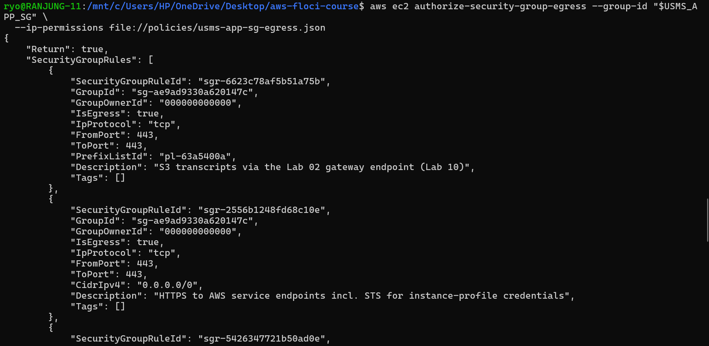

`authorize-security-group-egress` returned `"Return": true` and six new rule IDs (`sgr-6623c78af5b51a75b` …), each with its description.

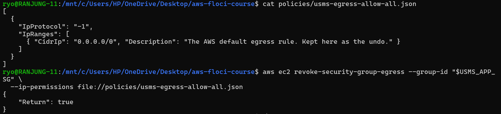

`revoke-security-group-egress` with `policies/usms-egress-allow-all.json` (the `-1 / 0.0.0.0/0` rule, kept in the repo as the undo) returned `"Return": true`.

**Why this order matters:** if I revoked the default first, the instance would have **no egress at all** until the new rules arrived. During that gap, DNS lookups, STS credential refreshes and open database connections would all fail. If the authorize had then failed (a typo or a bad group ID), the web tier would stay cut off. Authorizing first means there's never a moment when the server has less egress than it needs.

### Proof

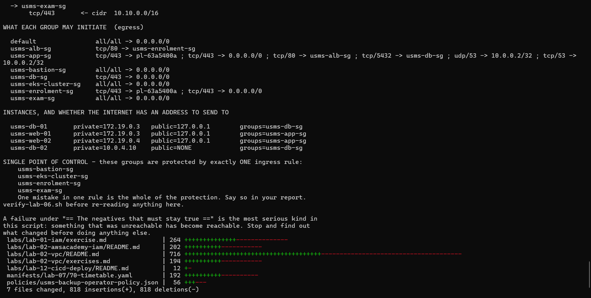

The matrix's **"WHAT EACH GROUP MAY INITIATE"** section now shows:

```
usms-app-sg   tcp/443 -> pl-63a5400a ; tcp/443 -> 0.0.0.0/0 ; tcp/80 -> usms-alb-sg ;
              tcp/5432 -> usms-db-sg ; udp/53 -> 10.0.0.2/32 ; tcp/53 -> 10.0.0.2/32
```

There's **no `all/all -> 0.0.0.0/0`** for `usms-app-sg` any more. Compare it with `default`, `usms-bastion-sg`, `usms-eks-cluster-sg` and `usms-exam-sg`, which still have the AWS default. The ingress side is unchanged. The `git diff --stat` at the bottom only lists documentation and unrelated files, and no security group document.

> **Not captured:** the final `PASS=… FAIL=…` line of `verify-lab-09.sh` scrolled off the screenshot. My baseline from the main lab was `PASS=38 FAIL=12`, so the claim to check is that no new failure appeared.

### Notes

- **Why `169.254.169.254` needs no rule:** the instance metadata service lives at a link-local address that the hypervisor (Nitro) answers on the host itself. The traffic never leaves through the network interface, which is where security groups are enforced, so a security group can neither allow nor block it. That's why Step 11 protected it with **IMDSv2 and hop limit 1** instead.
- **Rule 1 vs rule 2:** while rule 2 (443 to anywhere) exists, rule 1 (443 to S3) is technically redundant. I kept it because it documents the S3 dependency, and it keeps working on its own once rule 2 is narrowed to interface endpoints on real AWS.

### Question: the bastion's egress

`usms-bastion-sg` is an **administration hop**, not an application tier. Its only reason to start a connection is to SSH into the hosts it manages, so its egress is about *who it can administer*, not about *which services it depends on*. Its destination should therefore be a single rule, **tcp/22 to the `usms-app-sg` group**, with no CIDR and no internet. In the matrix it still has `all/all -> 0.0.0.0/0`, so a compromised bastion can currently reach anything.

**Result:** six written egress rules with descriptions, default rule revoked, ingress untouched.

---

## Exercise 2 - The break-glass role and the open trust findings

### Part A: `usms-breakglass-role`

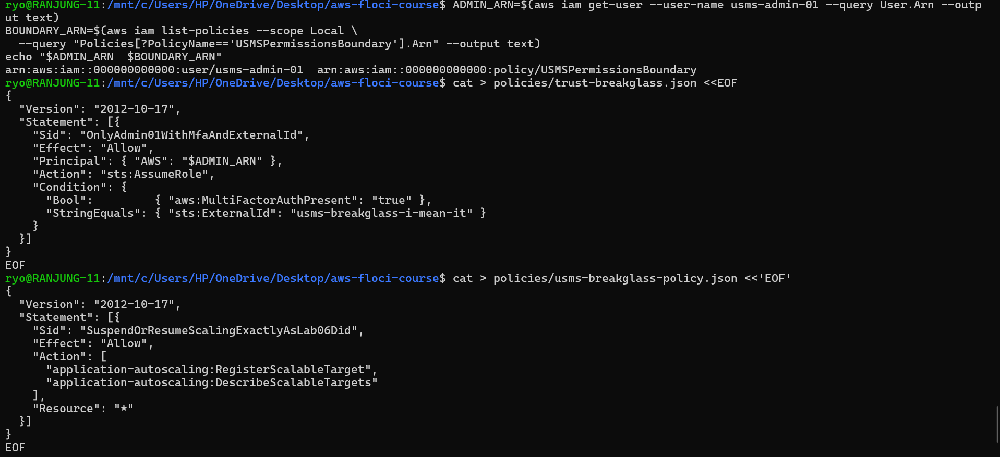

The admin user and boundary ARNs were looked up, not typed: `arn:aws:iam::000000000000:user/usms-admin-01` and `arn:aws:iam::000000000000:policy/USMSPermissionsBoundary`.

**Trust policy** (`policies/trust-breakglass.json`):

```json
"Principal": { "AWS": "arn:aws:iam::000000000000:user/usms-admin-01" },
"Action": "sts:AssumeRole",
"Condition": {
  "Bool":         { "aws:MultiFactorAuthPresent": "true" },
  "StringEquals": { "sts:ExternalId": "usms-breakglass-i-mean-it" }
}
```

**Permissions** (`policies/usms-breakglass-policy.json`, managed policy `USMSBreakGlassScaling`):

```json
"Action": [
  "application-autoscaling:RegisterScalableTarget",
  "application-autoscaling:DescribeScalableTargets"
]
```

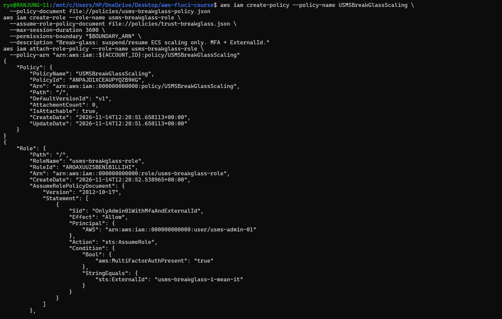

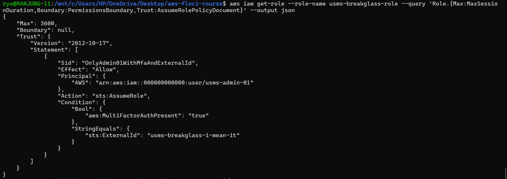

| Requirement | How it's met | Evidence |
| --- | --- | --- |
| Only `usms-admin-01` may assume it | `Principal.AWS` is that one user's ARN | trust policy as stored |
| MFA required | `Bool aws:MultiFactorAuthPresent = true` | trust policy |
| Deliberate assumption | `StringEquals sts:ExternalId` | trust policy |
| Shortest session | `--max-session-duration 3600` | `"Max": 3600` |
| Permissions boundary | `--permissions-boundary USMSPermissionsBoundary` | see the Floci note below |
| Exactly Lab 06's calls | Lab 06 Step 13 suspended scale-in with `register-scalable-target --suspended-state`, which is **`RegisterScalableTarget`**, and checked the result with **`DescribeScalableTargets`** | permission policy: two actions, no wildcards |

- **Why 3600:** IAM accepts a `MaxSessionDuration` from 1 to 12 hours, so **3600 seconds (1 hour)** is the shortest possible.
- **AND, not OR:** both conditions sit in **one** `Condition` block under **different keys**. IAM combines different condition keys with **AND**, so the caller must have MFA **and** give the ExternalId. (Several values listed under the *same* key would be OR.)
- **`Resource: "*"`:** a scalable target has no ARN I can write in advance here, so the two-action list plus the boundary are the limit. The audit reports this as MED, which is expected.
- **Floci limitations:**
  - `get-role` returns **`"Boundary": null`** even though `create-role` was called with `--permissions-boundary`. This is the same Floci limitation the main lab hit ("boundary stored as null"), so the audit also shows `permissions boundary : NONE` for this role.
  - Floci doesn't evaluate trust conditions, so I can show the stored configuration but not a refused assume-role.

### Question: what `sts:ExternalId` protects

**Across accounts**, ExternalId stops the **confused deputy**. A third-party service that assumes roles for many customers could be tricked by one customer into using *another* customer's role ARN. A secret ExternalId that's unique per customer stops it from acting on the wrong account. **Inside one account** it isn't a secret, because anyone allowed `iam:GetRole` can read it. What it buys is a **deliberate act**: nobody can assume the role by accident from a copied profile or script. It also leaves an easy marker in CloudTrail, where the `externalId` appears in every break-glass `AssumeRole` call and is simple to alert on.

### Part B: the three unconditioned trust findings

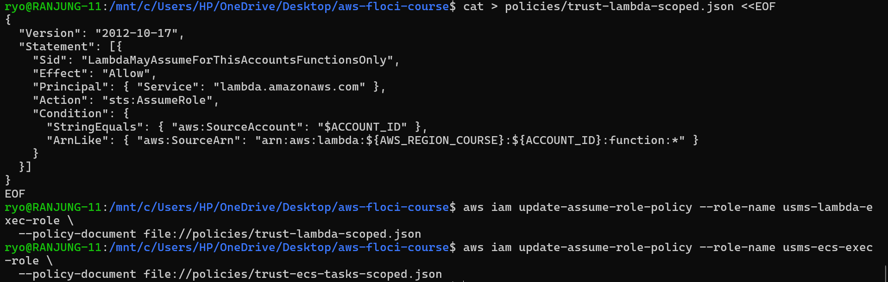

| Role | Decision | What I did |
| --- | --- | --- |
| `usms-lambda-exec-role` | **Fixed** | New trust `policies/trust-lambda-scoped.json`: `aws:SourceAccount = 000000000000` **and** `aws:SourceArn` like `arn:aws:lambda:us-east-1:000000000000:function:*` |
| `usms-ecs-exec-role` | **Fixed** | Reused `policies/trust-ecs-tasks-scoped.json` from Step 7 (the same conditions as the task role) |
| `usms-ec2-app-role` | **Accepted** | EC2 doesn't support `aws:SourceArn`/`aws:SourceAccount` when it assumes an instance-profile role, so the condition can't be written. Recorded in `policies/usms-accepted-findings.json` with a compensating control |

The accepted-findings file is **committed** and each entry needs a reason **and** a control.

The compensating control works because this role's credentials can only be stolen through the metadata service. Step 11 locked that service down (IMDSv2, hop limit 1), and `USMSDeployBase` stops anyone from passing roles to EC2.

### Changing the audit so it records decisions

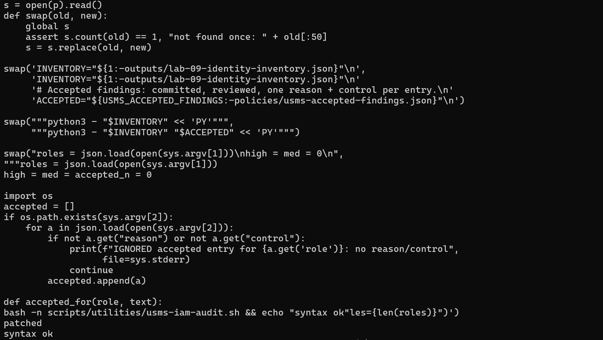

I patched `scripts/utilities/usms-iam-audit.sh` with a Python script that **checks each pattern appears exactly once** before replacing it, then confirmed `bash -n` passed (**syntax ok**). The changes:

- The audit reads the accepted list from `policies/usms-accepted-findings.json`, or from `$USMS_ACCEPTED_FINDINGS` if that's set. **Nothing is hard-coded.**
- An entry with no `reason` or `control` is **ignored**, with an `IGNORED …` warning. Without reasons it would just be a suppression list.
- A matching finding is printed as `ACCEPTED (HIGH)` with its reason and control. It doesn't count towards `HIGH`.
- The summary line gains `ACCEPTED=n`, and the exit code is still `1 if high else 0`.

The audit reads the inventory file, not live IAM, so I **rebuilt the inventory** after the trust changes:

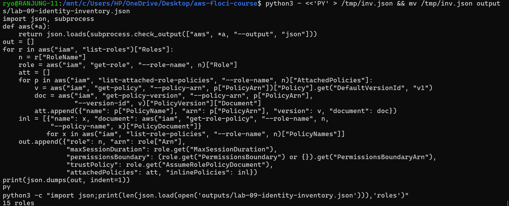

It now holds **15 roles** (it was 9 in Step 4), including `usms-transcripts-reader-role`, `usms-deploy-role` and `usms-breakglass-role`.

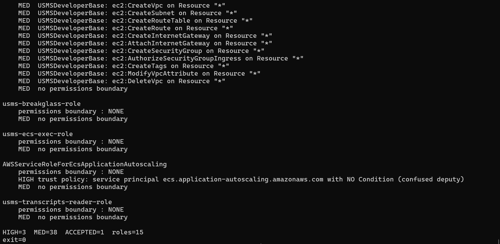

```
usms-ec2-app-role
    ACCEPTED (HIGH) trust policy: service principal ec2.amazonaws.com with NO Condition (confused deputy)
        reason : EC2 does not support aws:SourceArn/aws:SourceAccount ...
        control: IMDSv2 required with hop limit 1 on usms-web-01 (Step 11); ...
usms-lambda-exec-role      MED  no permissions boundary        <- HIGH gone
usms-ecs-exec-role         MED  no permissions boundary        <- HIGH gone
...
HIGH=3  MED=38  ACCEPTED=1  roles=15
```

| | Step 5 (before) | Now |
| --- | --- | --- |
| HIGH | 7 | **3** |
| ACCEPTED | - | **1** |

The three HIGH findings left (`usms-eks-node-role`, `usms-eks-cluster-role` and the `AWSServiceRoleForEcsApplicationAutoscaling` service-linked role) are **neither fixed nor accepted**. So the audit still fails, which is exactly the rule: *it still exits 1 for any HIGH that isn't accepted.*

> **A mistake in my evidence:** the screenshot ends with `exit=0`. That is **`tee`'s** exit status, not the audit's, because I ran `audit | tee file; echo "exit=$?"`. The audit's own result comes from `sys.exit(1 if high else 0)`, and with `HIGH=3` it returns **1**. The correct check is `bash scripts/utilities/usms-iam-audit.sh > /dev/null; echo $?`, or `echo ${PIPESTATUS[0]}` after a pipe.

**Result:** a break-glass role that's hard to assume casually, a two-action policy you can read in ten seconds, two trust findings fixed, one accepted with a written reason and control, and an audit that records decisions instead of hiding them.

---

## Exercise 3 - The exposure report

**Goal:** `scripts/utilities/usms-exposure-report.sh` classifies every network interface in `usms-vpc`. The verdict is **computed** from the route table, the public address and the security group ingress rules, and never from names, tags or descriptions.

### First attempt: the file was corrupted

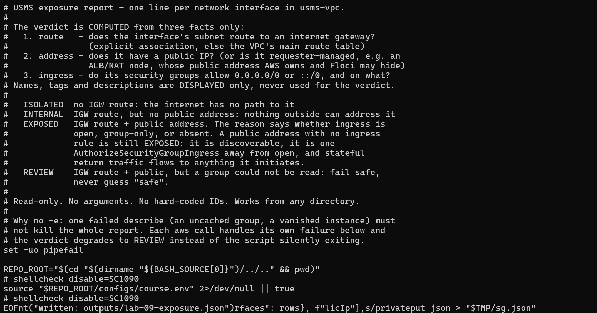

I first created the script by pasting a long `cat > … <<'EOF'` block into the terminal. The terminal mangled it: the last line shows fragments of several different lines run together (`EOFnt("written: …")rfaces": rows}, f"licIp"],s/privateput json …`). Running it failed with `syntax error near unexpected token '('` at line 37, where `if [ -z "$VPC" ] || [ "$VPC` had been cut in half. I replaced the file with a clean copy and checked it with `bash -n` before running it again.

### How the verdict is computed

| Verdict | Condition |
| --- | --- |
| `ISOLATED` | the subnet's route table (explicit association, otherwise the VPC's **main** table) has **no route to an `igw-`** |
| `INTERNAL` | IGW route, but the interface has **no public address** |
| `REVIEW` | IGW route and public address, but a security group **couldn't be read**. Fail safe: never guess "safe" |
| `EXPOSED` | IGW route + public address. The reason says whether ingress is open to `0.0.0.0/0` (and on which ports), group-only, or absent |

Names are shown in the `INTERFACE` column only to make it readable.

**Decision on a public interface with no ingress rule at all (the NAT row in the brief): `EXPOSED`.** The interface has an address on the internet, so it can be found by anyone scanning, and it's **one** `AuthorizeSecurityGroupIngress` away from being open. Security groups are also stateful, so anything it starts gets replies. "No rule today" is a property of the configuration, not of the network position, and the report is about network position.

### Required behaviours

| Requirement | How the script does it |
| --- | --- |
| Run from any directory | `REPO_ROOT` from `${BASH_SOURCE[0]}`; `configs/` sourced from there; output path printed relative (`outputs/lab-09-exposure.json`) so stdout doesn't depend on the current directory |
| No arguments, no hard-coded IDs | VPC from `configs/lab-02.env`; every ID comes from `describe-*` |
| SG not cached | reported as `SG not cached: sg-…`; verdict `REVIEW` if the interface is public |
| No description | shown as `[no description]` |
| Subnet with no explicit route table | falls back to the **main** route table and says so |
| Leftover interface | `Status = available` → `[unattached leftover]`; attached to a terminated or missing instance → `[instance terminated/gone]` |
| `set -uo pipefail`, no `-e` | justified in the header: one failed `describe` (an uncached group, a vanished instance) must not end the whole report, so each call handles its own failure and the verdict becomes `REVIEW` |
| Where shell stops and Python starts | shell collects four JSON documents (`describe-network-interfaces`, `-route-tables`, `-security-groups`, `-instances`, all filtered by `vpc-id`); Python joins them, because a four-way join isn't a job for `jq`/`awk` |
| Also writes JSON | `outputs/lab-09-exposure.json` |

### Result

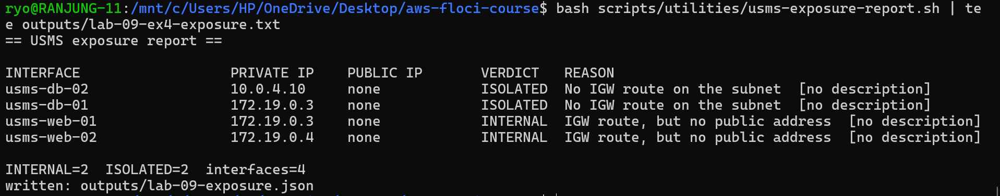

**Reading the result honestly:**
- **The databases are `ISOLATED` for the right reason.** Their subnets route to the NAT gateway, not an internet gateway, as shown in Step 16.
- **The web servers show `INTERNAL` only because of Floci.** On real AWS, `usms-web-01` would be **`EXPOSED`**: it's in a public subnet, and its group allows 80 and 443 from `0.0.0.0/0`. Floci leaves the interface's public address empty and reports `127.0.0.1` on the *instance* instead (Exercise 4, `ex4.2.png`). The script reads the interface, which is the right source on AWS.
- **Two interfaces share `172.19.0.3`.** These are Floci's Docker addresses, not VPC addresses, which is another sign the network data is emulated.
- **Only four interfaces.** Floci doesn't model ALB, NAT or task interfaces as network interfaces, so the brief's ALB and NAT rows can't appear.
- **Exercise 1 didn't change the verdicts.** The script never reads egress rules, so tightening `usms-app-sg`'s egress can't affect them.

> **Not captured:** the side-by-side run from `~` and from `labs/lab-09-security/` with `diff`. The output can't differ, because it contains no absolute paths, timestamps or anything else that depends on the current directory. It's still worth a screenshot.

---

## Exercise 4 - Security review for the information security officer

*Written to be acted on by someone who wasn't in the lab. Each section is under a page.*

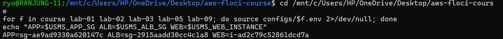

### 4.1 The second front door

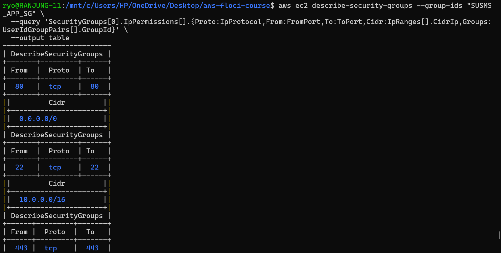

**What `usms-app-sg`'s ingress is for.** It was written in Lab 02 Step 14, **before any load balancer existed**, when the web server was the only way into USMS:

| Rule | Source | Purpose then |
| --- | --- | --- |
| tcp/80 | `0.0.0.0/0` | public web |
| tcp/443 | `0.0.0.0/0` | public web over TLS |
| tcp/22 | `10.0.0.0/16` | admin from inside the VPC |

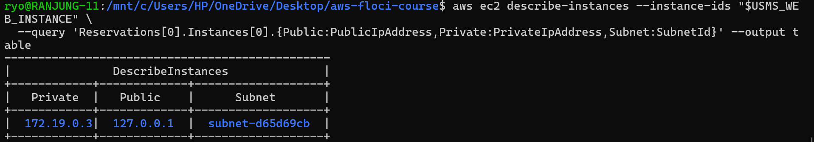

The instance has its own public address (`127.0.0.1` in Floci; a real public IPv4 on AWS) in subnet `subnet-d65d69cb`.

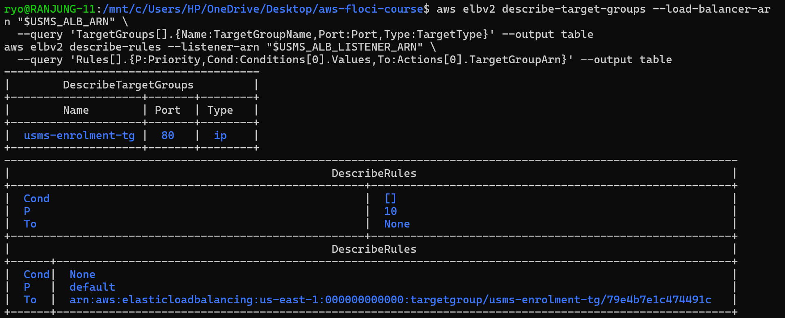

**What changed since then.** Lab 05 added `usms-enrolment-alb`, but its only target group is `usms-enrolment-tg` (type `ip`, the enrolment tasks). One listener rule (priority 10) and the default action both forward to enrolment. **The ALB never sends traffic to the web server.** So USMS now has **two front doors**: the ALB for enrolment, and the web server's own public address. An attacker who finds the web server's IP skips everything that sits in front of the ALB.

**Should the web server still be reachable directly? No.** Moving it behind the load balancer involves:

1. **Target group:** `usms-web-tg`, HTTP/80, target type `instance`, health check `/`.
2. **Listener rule:** `/portal/*` (or a host header) on the existing listener → `usms-web-tg`.
3. **Security group changes:**
   - The ALB may start connections to the web tier (`usms-alb-sg` egress tcp/80 → `usms-app-sg`). Today it can only reach the enrolment tasks.
   - The web tier accepts port 80 **only from `usms-alb-sg`**.
   - The `0.0.0.0/0` rules are revoked.
4. **Public address removed.**

**What would break:**
- anything that uses the web server's public IP: bookmarks, DNS records pointing at it, monitoring checks;
- TLS on the server itself, which would move to the ALB listener;
- any admin path that relies on the public address. Admin should go through the bastion or Session Manager.

**The opposing view.** For a small portal with modest traffic, putting it behind the ALB adds a dependency, another rule to maintain, and roughly the ALB's hourly cost, for a server that already serves only 80/443. Leaving it directly reachable is defensible **if** it has its own TLS, current patches and nothing listening except the web server, but that's a judgement, not a default.

### 4.2 What egress control bought

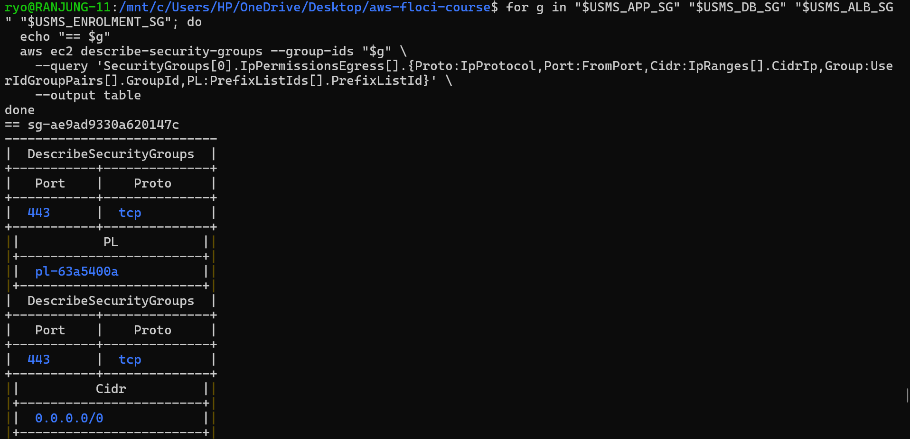

**Three attacker behaviours that Steps 13–15 (and Exercise 1) now prevent:**

1. **A compromised enrolment task or database calling home on an arbitrary port.** Reverse shells and command-and-control usually use high ports such as 4444 or 8080. Those tiers may now only open tcp/443 (plus DNS on the web tier).
2. **Moving sideways inside the VPC on unexpected ports.** For example, a compromised task can no longer SSH to the web server or connect to Postgres directly. Each group may only start the connections it was written for.
3. **The load balancer being used to reach anything except the enrolment tasks.** Its only egress is tcp/80 to `usms-enrolment-sg`.

**Two (actually three) it does not prevent, and what would:**

| Attacker behaviour still possible | Why | Control | Rough cost |
| --- | --- | --- | --- |
| **Copying data out over HTTPS to a server the attacker controls** | every tier still allows tcp/443 → `0.0.0.0/0` (`ex4.5.png`) | AWS Network Firewall with a domain allow-list, or interface VPC endpoints so 443 can be narrowed | ≈ $0.395 per endpoint-hour + $0.065 per GB processed ([aws.amazon.com/network-firewall/pricing](https://aws.amazon.com/network-firewall/pricing/)) |
| **Smuggling data out inside DNS queries** | the web tier may query `10.0.0.2`, which resolves any public name | Route 53 Resolver DNS Firewall with a block/allow list | ≈ $0.60 per million queries + per-domain-list charge ([aws.amazon.com/route53/pricing](https://aws.amazon.com/route53/pricing/)) |
| **Copying transcripts into the attacker's *own* S3 bucket** | the prefix-list rule allows any S3 bucket in the region, not just ours | VPC endpoint policy with `aws:ResourceAccount` = our account | no extra charge |

Egress control limits *where* a compromised host can connect. It doesn't stop a host that is allowed out on 443 from sending the wrong data there.

### 4.3 The transcripts access list

Generated by `scripts/utilities/usms-transcripts-access.sh` from `outputs/lab-09-identity-inventory.json` (15 roles) and the `policies/` folder. The bucket ARN comes from `policies/usms-student-data-rw-policy.json`.

| Principal | How it gets access | Read / write | Granting document |
| --- | --- | --- | --- |
| `usms-ec2-app-role` | EC2 instance profile → `USMSStudentDataReadWrite` | **read + write** (Get/Put/DeleteObject, List) | `policies/usms-student-data-rw-policy.json` |
| `usms-ecs-task-role` | ECS tasks → `USMSStudentDataReadWrite` | **read + write** | `policies/usms-student-data-rw-policy.json` |
| `usms-eks-node-role` | EC2 (EKS nodes) → `USMSStudentDataReadWrite` | **read + write** | `policies/usms-student-data-rw-policy.json` |
| `usms-transcripts-reader-role` | ECS tasks → `USMSStudentDataReadOnly` | **read** (writes explicitly denied) | `policies/usms-student-data-ro-policy.json` |
| `usms-lambda-exec-role` | Lambda → `USMSLambdaBasic` | **read** (`GetObject` on `/*`) | `policies/usms-lambda-basic-policy.json` |
| `usms-analytics-partner-role` | assumed by `usms-audit-01` → `USMSAnalyticsPartner` | **read**, `reports/*` only | `policies/usms-analytics-partner-policy.json` |
| `usms-developer-role` | assumed by `usms-dev-01` → `USMSDeveloperBase` | **list only** (`s3:List*`, no object read) | `policies/usms-developer-base-policy-v3-draft.json` (the live version matches the v3 file) |
| groups `usms-developers`, `usms-admins`, `usms-qa` | `USMSDeveloperBase` attached to the groups | **list only** | same as above |
| members of group **`usms-auditors`** | AWS-managed **`ReadOnlyAccess`** (includes `s3:Get*`, `s3:List*`) | **read** | AWS-managed policy (not in `policies/`) |
| account root | always | everything | - |

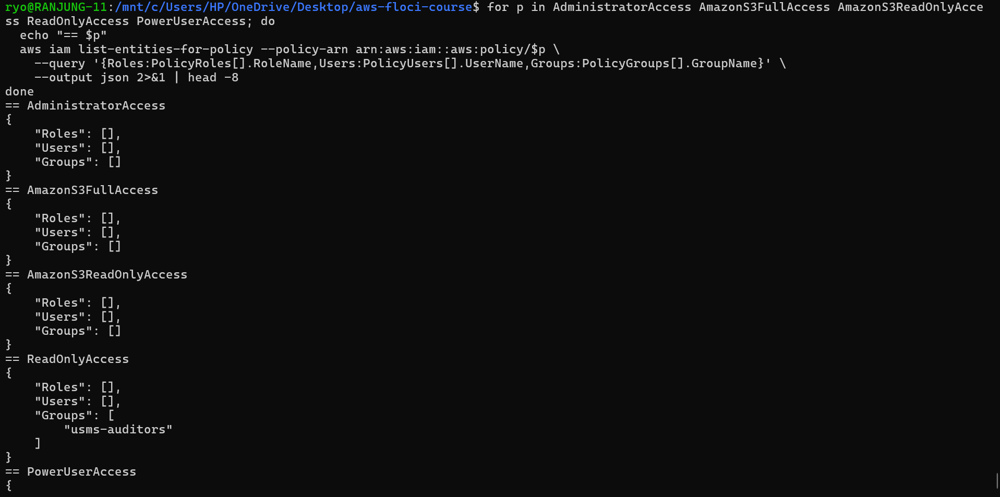

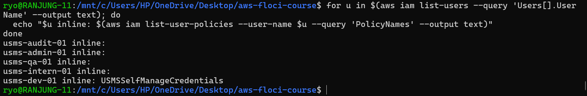

**Findings worth acting on:**
- **Three** roles can write transcripts, not two. `usms-eks-node-role` picked up `USMSStudentDataReadWrite` in Lab 07, so **every pod on every EKS node** can write and delete transcripts. That should move to IRSA on `usms-enrolment-sa` (Lab 10).
- `usms-auditors` can read every transcript through `ReadOnlyAccess`, which is broader than an auditor needs.

**How I know the list is complete.** I checked every path through which an identity can get S3 permissions:

1. Every role's attached **and** inline policies, scanned for any `s3:` action on the bucket ARN, the bucket's `/*`, or `*`. The script does this over the 15-role inventory.
2. Every customer-managed policy and who it's attached to (roles, users, groups) with `list-entities-for-policy`. This is the Exercise 5 script, which found 9 policies.
3. The broad AWS-managed policies (`AdministratorAccess`, `AmazonS3FullAccess`, `AmazonS3ReadOnlyAccess`, `ReadOnlyAccess`, `PowerUserAccess`). Only `ReadOnlyAccess` is attached, to `usms-auditors`.
4. Every user's inline policies. Only `usms-dev-01` has one (`USMSSelfManageCredentials`), and it has no S3 actions.
5. Resource policies: the bucket has **none** yet (Exercise 5 drafts the first one), so there's no grant from the resource side.

**The real-AWS API that answers this from the resource side** is **IAM Access Analyzer**: an analyzer on the account and its findings (`ListFindings` / `list-findings-v2`). Its external-access findings list who outside the account can reach the bucket, and its internal-access analysis covers principals inside the account. It works by automated reasoning over *all* policies at once, rather than a list someone wrote. **This course can't run it**, because Floci doesn't run Access Analyzer's reasoning engine. **Instead** I did the five-part scan above, which gives the same answer but only because I listed every grant path by hand.

### 4.4 Detection

**Preventive vs detective** (as in Section 11):
- **Preventive** controls stop the action: security groups, IAM policies, permissions boundaries, the trust conditions from Exercise 2.
- **Detective** controls tell you it happened: the services below.

None of them stops an attacker by itself.

| Event to catch | Service | Free? | Source |
| --- | --- | --- | --- |
| Security group changed (`AuthorizeSecurityGroupIngress/Egress`, `Revoke*`) | **CloudTrail** management events | **Free**: 90-day event history and one trail copy of management events | [aws.amazon.com/cloudtrail/pricing](https://aws.amazon.com/cloudtrail/pricing/) |
| Policy attached (`AttachRolePolicy`, `PutRolePolicy`, `CreatePolicyVersion`) | **CloudTrail**, with an **EventBridge** rule → SNS email | **Free**: AWS service events on the default bus | [aws.amazon.com/eventbridge/pricing](https://aws.amazon.com/eventbridge/pricing/) |
| Unusual `AssumeRole` (new source IP, odd time, stolen instance credentials used outside AWS) | **GuardDuty** | 30-day free trial, then priced per volume of CloudTrail events and flow/DNS logs analysed | [aws.amazon.com/guardduty/pricing](https://aws.amazon.com/guardduty/pricing/) |
| What a security group looked like at any point in time | **AWS Config** | Paid: about $0.003 per configuration item recorded | [aws.amazon.com/config/pricing](https://aws.amazon.com/config/pricing/) |
| A policy change that newly grants outside access to the bucket | **IAM Access Analyzer** (external access) | **Free** | [aws.amazon.com/iam/access-analyzer/pricing](https://aws.amazon.com/iam/access-analyzer/pricing/) |
| Where a server actually sent traffic | **VPC Flow Logs** | Paid: log delivery and storage (CloudWatch Logs or S3) | [aws.amazon.com/cloudwatch/pricing](https://aws.amazon.com/cloudwatch/pricing/) |

**What I'd put in place first, for no extra cost:** CloudTrail (already on, with 90-day history), EventBridge rules for the IAM and security group calls above that email the team, and Access Analyzer for external access. **Then, paid:** GuardDuty after the trial, and Config on security groups only, to keep the item count low.

**What I'd read first the morning after an incident, in order:**

1. **CloudTrail** for the incident window, filtered by the suspect principal: `AssumeRole`, `CreateAccessKey`, `Attach*`/`Put*Policy`, `Authorize*`. This shows *who did what*.
2. **GuardDuty findings** for the same window. These show what AWS thought was unusual.
3. **IAM credential report** and each access key's *last used* date. Were any keys used that shouldn't have been?
4. **Config timeline of `usms-app-sg`** (and the other groups). Was a door opened, and when?
5. **VPC Flow Logs** for the web and enrolment interfaces. Where did data actually go?
6. **S3 data events / server access logs** on the transcripts bucket. Was anything read or deleted?

> Prices are from AWS's public pricing pages for `us-east-1`. Check them on the day this review is submitted.

---

## Exercise 5 - The bucket policy draft for the S3 configuration lab

**Goal:** draft the transcripts bucket's **resource policy**, with principals **computed** from IAM, not typed.

### The script: `scripts/utilities/usms-bucket-policy-draft.sh`

| Requirement | How it's met |
| --- | --- |
| Reads the inventory and the transcripts policies | Scans **every** customer-managed policy in IAM (default version), then `list-entities-for-policy` once per policy and merges the results; cross-checks the role list against `outputs/lab-09-identity-inventory.json` |
| Bucket name from a policy document | Reads the first non-`/` S3 ARN in **`USMSStudentDataReadWrite`** (Lab 01's policy). `grep -n "usms-student-data"` on the script finds **nothing** |
| Shell parameter expansion, with a reason | `BUCKET="${BUCKET_ARN##*:::}"`: strips everything up to `:::` to turn the ARN into the bucket name. Pure shell, so it works whether or not the bucket exists and needs no extra AWS call |
| Works whether or not the bucket exists; applies nothing | `head-bucket` is only reported (`yes`/`no`); the script never calls `put-bucket-policy` |
| No access keys | Uses the existing profile only; `grep -niE "access.?key\|AKIA"` finds **nothing** |
| `python3` for the JSON | All policy parsing and generation is in Python |

> **First attempt:** I pasted the script as a long heredoc and the file was never created. The commands after it printed "bucket name NOT typed" and "no access keys referenced", but only because `grep` couldn't find the file, so those were **false passes**. I recreated the file and re-ran every check.

### Run

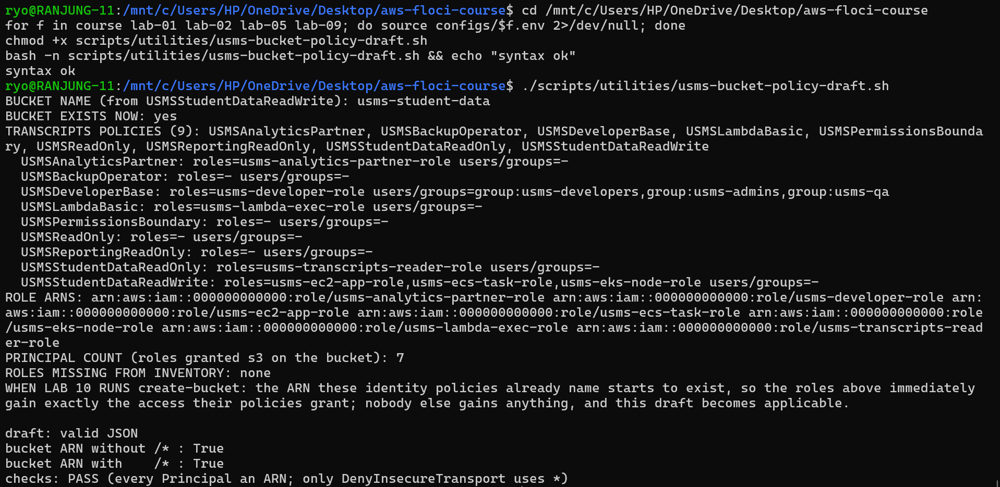

**More than three policies.** The brief expects three transcripts policies. Because the script scans everything instead of trusting a list, it found **nine** that name the bucket, of which **five** are actually attached to a role:

| Policy | Attached to | Grants |
| --- | --- | --- |
| `USMSStudentDataReadWrite` | `usms-ec2-app-role`, `usms-ecs-task-role`, `usms-eks-node-role` | read + write |
| `USMSStudentDataReadOnly` | `usms-transcripts-reader-role` | read |
| `USMSLambdaBasic` | `usms-lambda-exec-role` | read |
| `USMSAnalyticsPartner` | `usms-analytics-partner-role` | read `reports/*` |
| `USMSDeveloperBase` | `usms-developer-role` + 3 groups | list |
| `USMSBackupOperator`, `USMSReadOnly`, `USMSReportingReadOnly` | nothing | - |
| `USMSPermissionsBoundary` | nothing (used as a boundary, never attached) | - |

**Seven** role ARNs are granted some `s3:` action on the bucket, so the draft has seven principals.

### The draft: `outputs/lab-09-bucket-policy-draft.json`

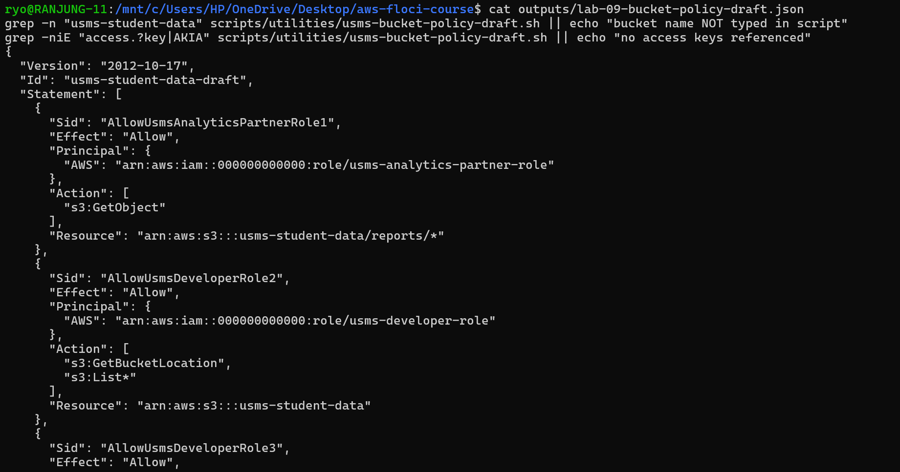

14 statements:

| Statements | What they do |
| --- | --- |
| 12 × `Allow` | one per role and resource, each with **only the actions that role already has** (e.g. `usms-analytics-partner-role`: `s3:GetObject` on `…/reports/*` only) |
| `DenyInsecureTransport` | `Principal: "*"`, `Deny s3:*` when `aws:SecureTransport` is `false`, on the bucket **and** `/*` |
| `DenyEveryoneExceptKnownRolesAndRoot` | `NotPrincipal`: the 7 role ARNs + `arn:aws:iam::000000000000:root`, `Deny s3:*` on the bucket **and** `/*` |

**The mechanical checks passed:**
- every `Principal` is an IAM ARN, except the insecure-transport Deny, which uses `"*"` on purpose;
- the bucket ARN appears both with and without `/*`.

> **Note for the S3 configuration lab:** a `NotPrincipal` Deny that lists a **role** ARN doesn't exempt that role's **sessions** (`arn:aws:sts::…:assumed-role/<role>/<session>`), so as written it could deny the very roles it means to allow. When the policy is applied for real, the last statement should become `Principal: "*"` with `Condition: ArnNotLike aws:PrincipalArn [role ARNs, root]`. The exercise's "every Principal is an ARN" rule is why the draft uses `NotPrincipal`.

### Readiness file and env file

`outputs/lab-09-lab10-readiness.txt` has one labelled line each for the bucket name (read from Lab 01's policy), the policy names, the role ARNs, the principal count, and what changes in Lab 10:

> *When Lab 10 runs `create-bucket`, the ARN these identity policies already name starts to exist, so the roles above immediately gain exactly the access their policies grant. Nobody else gains anything, and this draft becomes applicable.*

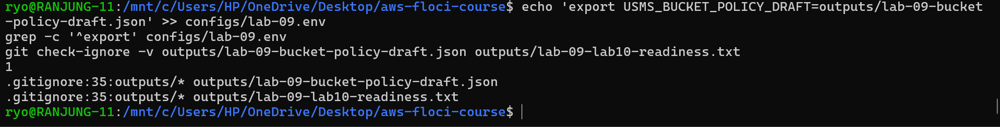

- Both outputs are **git-ignored**. The **script** is committed.
- The export count is **1**, because `configs/lab-09.env` was empty before this. Once Step 19 writes the file properly, `USMS_BUCKET_POLICY_DRAFT` will be one export among the others, so **the Step 19 values still have to be written before Lab 10**.

### Requirement 5: the two Denies

The `Deny` in `USMSStudentDataReadOnly` is part of an **identity** policy, so it only stops the role it's attached to (`usms-transcripts-reader-role`), and it does so even if another policy on that role allowed writes. The `Deny` statements in this **bucket** policy are evaluated for **every request to the bucket, whoever sends it**, so they can stop principals whose identity policies we never see. Only the bucket-policy Deny applies to a principal in **another account**, because AWS never consults our account's identity policies for a foreign principal, but always consults the bucket's resource policy.

---

## Summary

| Exercise | Result |
| --- | --- |
| 1 - Web tier egress | Six described rules (S3 prefix list, 443, ALB group on 80, DB group on 5432, DNS UDP+TCP to `10.0.0.2`), authorized before revoking the default; matrix shows no allow-all on `usms-app-sg` |
| 2 - Break-glass + findings | `usms-breakglass-role`: admin-only, MFA AND ExternalId, 3600 s, two actions; lambda and ecs-exec trust fixed; ec2-app-role accepted with reason + control; audit reads a committed accepted-findings file: `HIGH 7 → 3`, `ACCEPTED=1` |
| 3 - Exposure report | Verdict computed from route + address + ingress; handles every listed edge case; DBs `ISOLATED`; web `INTERNAL` only because Floci hides the public address |
| 4 - Security review | Second front door explained with a costed 11-step plan; egress limits stated honestly; transcripts access list of 7 roles + 4 groups + root, including `usms-eks-node-role` (write) and `usms-auditors` (read); detection split into preventive and detective |
| 5 - Bucket policy draft | Principals computed (7 roles from 9 policies), bucket name never typed, checks PASS, outputs git-ignored |

**What I learned:**
- **Order matters for security group changes.** Authorize before you revoke, or the server is briefly cut off.
- **Some traffic doesn't pass through security groups at all.** Link-local addresses such as the metadata service never cross the network interface, so you protect them a different way (IMDSv2, hop limit).
- **An audit that can be silenced needs reasons.** An accepted finding without a reason and a compensating control is just a hidden one.
- **"Who can read this bucket?" needs every path.** Role policies, group policies, AWS-managed policies, inline policies and resource policies all count. Scanning everything found two more readers and a third writer that the brief didn't expect.
- **Check what a check is really testing.** Three of my "passes" were false: `exit=0` from `tee`, and the two grep messages on a file that didn't exist.
