# Lab 10 Practical Report: Edge Functions with AWS Lambda and Lambda@Edge

## 1. Aim / Objective

The aim of this lab is to protect and speed up the delivery of student transcripts by running small pieces of code **at the edge** (Lambda@Edge, in front of CloudFront) and in a **region** (a normal Lambda triggered by S3). I wrote three functions, invoked them with realistic events, checked them against the Lambda@Edge rules, attached them to a CloudFront distribution, and wired an S3 bucket notification. Everything was done with the AWS CLI on the local emulator Floci.

The specific objectives were to:

- Give the Lab 01 role `usms-lambda-exec-role` a second trusted principal, **`edgelambda.amazonaws.com`**, so CloudFront can run the functions at the edge.
- Write and deploy a **viewer-request** function that normalises the URI and **denies** transcript requests that have no student header.
- Write and deploy an **origin-response** function that adds **security headers** and a **cache-control** header to every transcript response.
- **Publish numbered versions** and check both functions against the Lambda@Edge restrictions (no environment variables, 128 MB, 5 s timeout, no VPC).
- **Associate** both versions with a CloudFront distribution and run the whole edge chain end to end with a simulator script.
- Build a regional **transcript notifier**, give it a `live` alias, let **S3 invoke it** through a resource policy, and filter the notification to `transcripts/*.json`.
- Prove everything survives a **Floci restart**, save the values to `configs/lab-10.env`, and check the lab with `verify-lab-10.sh`.

## 2. Introduction

**Lambda@Edge** runs a Lambda function inside CloudFront, close to the user. CloudFront has **four trigger points** around its cache:

| Trigger point | When it runs | What I used it for |
|---|---|---|
| **viewer-request** | On every request, **before** the cache is checked | Auth gate and URI normalisation |
| origin-request | Only on a cache miss, before going to the origin | Not used |
| **origin-response** | After the origin replies, **before** the object is cached | Security and cache headers |
| viewer-response | On every response, before it goes back to the viewer | Not used |

The main ideas of this lab:

| Concept | Simple meaning |
|---|---|
| **Edge vs regional function** | An edge function runs in CloudFront locations worldwide. A regional function runs in one region (here `us-east-1`) and is triggered by services like S3. |
| **Two trusted principals** | An edge function's role must trust both `lambda.amazonaws.com` and **`edgelambda.amazonaws.com`**. |
| **Version-qualified ARN** | CloudFront only accepts a **numbered version** (`...:1`). It refuses `$LATEST` and aliases, because the code copied to the edge must never change. |
| **Edge restrictions** | No environment variables, max **128 MB** memory and **5 s** timeout on viewer triggers, no VPC, Node.js or Python only. |
| **Request vs response object** | A viewer-request function returns the **request** to let it continue, or a **response** (like a 403) to stop it. A stopped request never reaches the origin. |
| **Header format** | CloudFront headers are a map of lower-case names to **arrays** of `{key, value}` objects. |
| **Resource policy** | A policy **on the function** that says who may invoke it (here S3). It is the opposite of the role, which says what the function may do. |
| **Alias** | A named pointer (`live`) to a numbered version, so S3 always calls a fixed version. |

The most important limitation: **Floci does not run CloudFront's edge network.** It stores the distribution and its associations, but no real request goes through it. So I tested the edge chain by invoking the functions directly and with a simulator script.

## 3. Use Case

**USMS use case:** students download their transcripts from `transcripts.usms.example.edu`, which is served by CloudFront from the `usms-student-data` bucket. The university asked for:

- **No anonymous transcript downloads.** A request to `/transcripts/` without the `X-USMS-Student` header must be rejected **at the edge** with a 403, so the bucket is never contacted.
- **One cache entry per transcript.** `/transcripts/2026/STU-00417.json` and `/transcripts/2026/stu-00417.json` must be the same object, so the URI is lower-cased.
- **Safe browser behaviour.** Every transcript response gets HSTS, `nosniff`, `X-Frame-Options: DENY` and a referrer policy, plus a cache-control of 5 minutes in the browser and 1 hour in CloudFront.
- **A notification when a new transcript is uploaded.** Only `.json` files under `transcripts/` should trigger it, not notes or text files. For now it prints a `USMS_NOTIFY` line; in the SNS lab it will become a real publish.

## 4. System Architecture / Design

**How it works in simple words:**

1. **Edge path (download):** the student's request reaches CloudFront → **`usms-edge-viewer-request:1`** lower-cases the URI and checks the `x-usms-student` header. With no header it returns a **403** and stops. With the header it stamps `x-usms-edge: viewer-request-allow;student=...` and lets the request continue → CloudFront fetches the object from **`usms-student-data`** → **`usms-edge-origin-response:1`** adds four security headers, a cache-control header and the chain marker `x-usms-edge-chain` → the response is cached and returned.
2. **Regional path (upload):** a file is uploaded to `usms-student-data` → if the key starts with **`transcripts/`** and ends with **`.json`**, the bucket notification `usms-transcript-upload` invokes **`usms-transcript-notifier:live`** (version 1) → the function prints a `USMS_NOTIFY` line to CloudWatch Logs.
3. **Permissions:** all three functions use **`usms-lambda-exec-role`** (policy `USMSLambdaBasic`, trusting `lambda` and `edgelambda`). S3 may invoke the notifier only because of a **resource policy** scoped to the `usms-student-data` bucket.

| Function | Runtime | Memory | Timeout | Trigger |
|---|---|---|---|---|
| `usms-edge-viewer-request` | nodejs20.x | 128 MB | 5 s | CloudFront viewer-request (version 1) |
| `usms-edge-origin-response` | nodejs20.x | 128 MB | 5 s | CloudFront origin-response (version 1) |
| `usms-transcript-notifier` | python3.12 | 256 MB | 30 s | S3 ObjectCreated, alias `live` → version 1 |

## 5. Implementation Procedure

### Step 1: Start the environment

I ran `floci-up.sh` and `floci-storage-check.sh`. Floci started in **hybrid** storage mode (durable), `/app/data` is a **bind mount** to `/home/ryo/floci-data` (5.6M), and Floci is up at `http://localhost:4566`. All storage checks were **[ok]**.

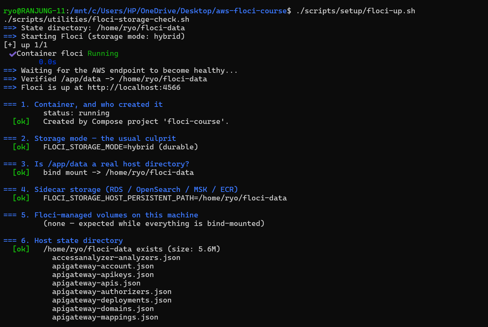

### Step 2: Source the lab environment files and confirm my identity

I sourced `course.env` and the env files for Labs 01–09. All nine were **sourced**, none absent. `whoami.sh` showed profile `floci`, endpoint `http://localhost:4566`, region `us-east-1` and account **000000000000**, so this is Floci, not real AWS.

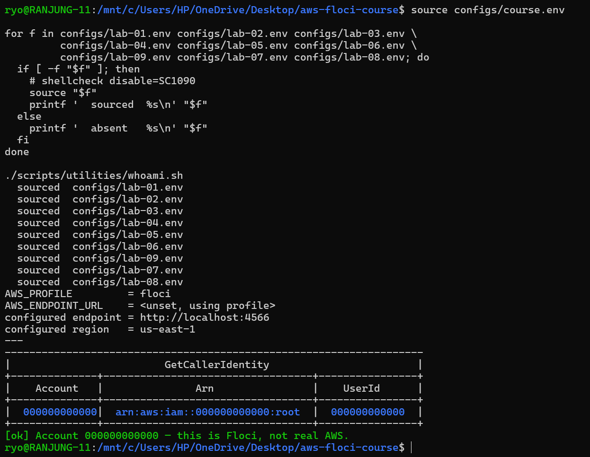

The three values this lab depends on were all set:

| Value | Result |
|---|---|
| bucket name | `usms-student-data` |
| lambda role | `arn:aws:iam::000000000000:role/usms-lambda-exec-role` |
| account id | `000000000000` |

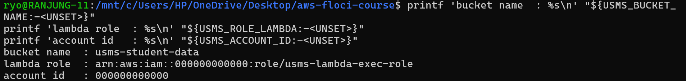

### Step 3: Create this lab's directories

I created `edge-viewer-request/`, `edge-origin-response/` and `transcript-notifier/` under `labs/lab-10-lambda-edge/`. My first `ls -d` broke because of a line wrap (`-d: command not found`), so I ran it again on one line, and it listed the folders correctly.

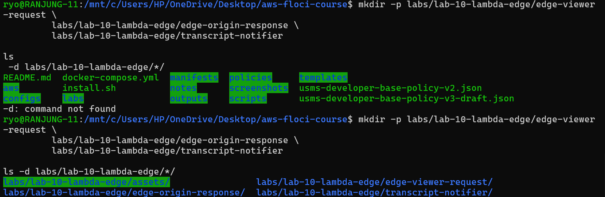

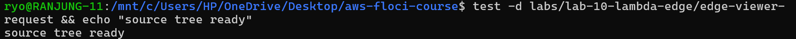

### Step 4: Find out what this Floci build supports

A `probe()` function tried one command per service and saved the result to `outputs/lab-10-support-probe.txt` at **2026-11-12T04:47:21Z**:

| Service | Result |
|---|---|
| lambda (`list-functions`, `list-layers`) | SUPPORTED |
| s3 (`list-buckets`) | SUPPORTED |
| logs (`describe-log-groups`) | SUPPORTED |
| cloudfront (`list-distributions`) | SUPPORTED |
| iam (`get-role`) | **UNSUPPORTED** |

`get-role` showed UNSUPPORTED only because the probe passed `$USMS_ROLE_LAMBDA`, which holds the **full ARN**, as the role name. With the plain name it works (Step 6).

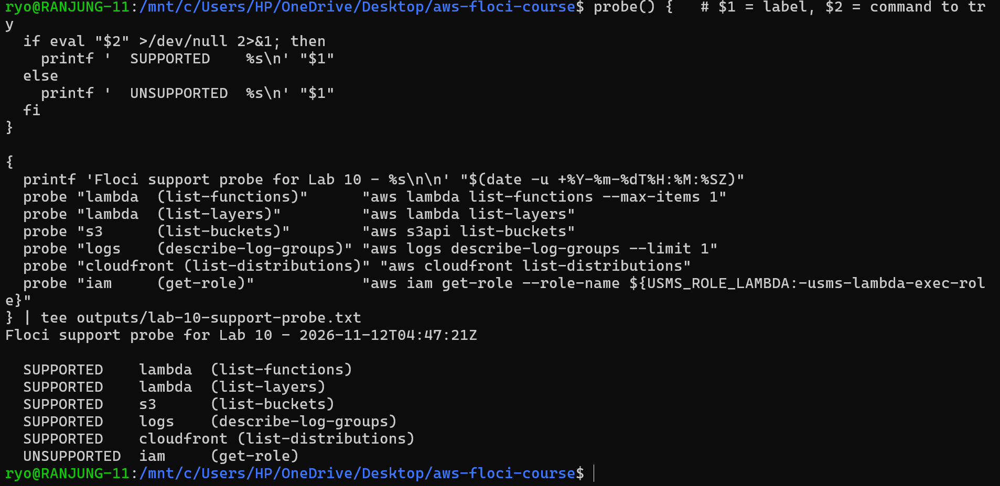

### Step 5: Create the origin bucket

I used the bucket from Lab 01, `usms-student-data`, with "create only if missing", and tagged it `Project=USMS`, `Tier=data`, `Lab=06`. `head-bucket` returned **exit 0** in region `us-east-1`. The `USMSStudentDataReadWrite` policy covers `arn:aws:s3:::usms-student-data` and `arn:aws:s3:::usms-student-data/*`, so the policy now points at a bucket that really exists.

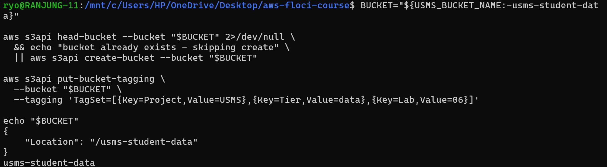

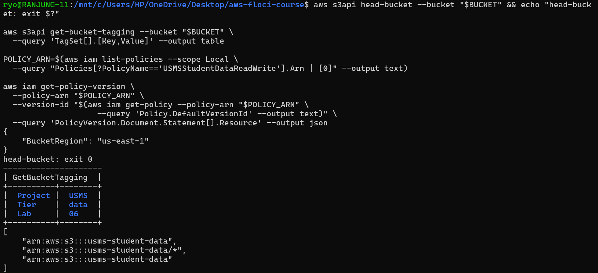

### Step 6: Read the execution role back, and give it the edge principal

**Part 1:** My first `get-role` failed with **`NoSuchEntity`**: "The role with name **arn:aws:iam::000000000000:role/usms-lambda-exec-role** cannot be found." The role existed, but `USMS_ROLE_LAMBDA` from `configs/lab-01.env` holds the **ARN**, and `--role-name` needs the plain name. I fixed it with `ROLE_NAME="${USMS_ROLE_LAMBDA##*/}"`, which strips everything up to the last `/`. After that, the role read back correctly:

| Field | Value |
|---|---|
| Name | `usms-lambda-exec-role` |
| Created | 2026-08-21 (Lab 01) |
| MaxSession | 3600 |
| Trusted service | `lambda.amazonaws.com` only |
| Attached policy | `USMSLambdaBasic` |

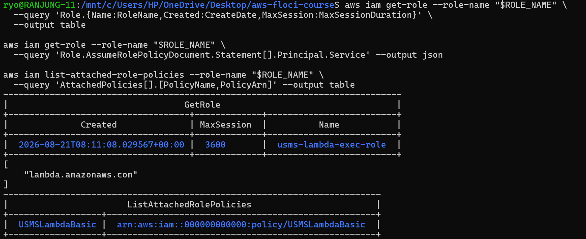

**Part 2:** I wrote `policies/trust-lambda-edge.json` with **two** service principals, `lambda.amazonaws.com` and `edgelambda.amazonaws.com`. It is valid JSON.

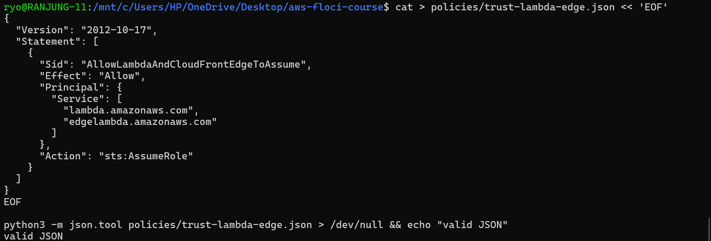

**Part 3:** I replaced the trust policy with `update-assume-role-policy` and saved the ARN in `EDGE_ROLE_ARN`.

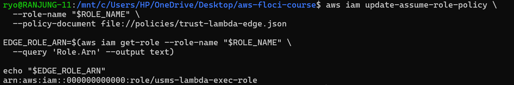

**Verify:** the trust policy now has **2** services, and one of them is **`edgelambda.amazonaws.com`**. The permissions (`USMSLambdaBasic`) did not change. Only the list of who may assume the role changed.

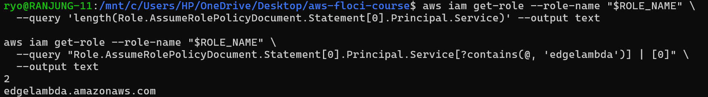

### Step 7: Write the viewer-request handler

I wrote `edge-viewer-request/index.mjs`. It does four things:

1. Lower-cases `request.uri`.
2. Lets anything outside `/transcripts/` pass untouched.
3. Returns a **403 response** with `cache-control: no-store` and `x-usms-edge: viewer-request-deny` when the `x-usms-student` header is missing.
4. Otherwise stamps `x-usms-edge: viewer-request-allow;student=<id>` and returns the request.

When I pasted the heredoc, the terminal redrew it badly and printed `node not installed locally - syntax will be checked by the first invoke` (this message is expected, because Node.js is not installed in my WSL). I checked the file on disk and it was complete.

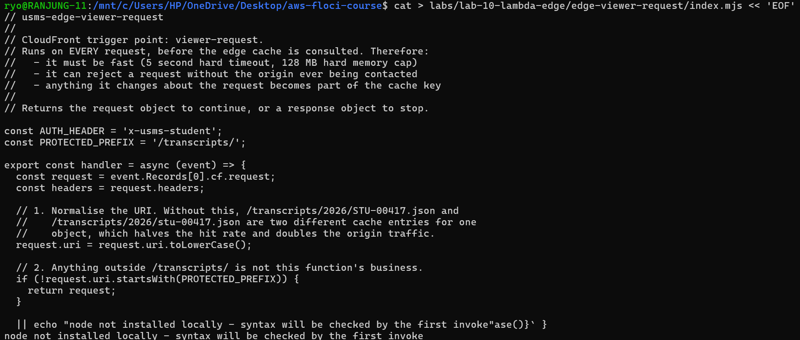

**Verify:** the file has **55** lines, `studentId` appears **3** times, and line 51 still contains `${studentId.toLowerCase()}`, so the quoted heredoc kept the JavaScript template literal and bash did not expand it.

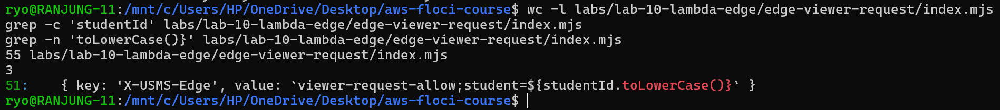

### Step 8: Package the function and create it

**Part 1:** My first zip went to the wrong place. `COURSE_ROOT` was set to `/home/ryo/aws-floci-course` (another copy of the course in my WSL home), so `outputs/usms-edge-viewer-request.zip` was "not found" in my working folder. I exported `COURSE_ROOT=/mnt/c/Users/HP/OneDrive/Desktop/aws-floci-course` and built it again. The archive contains `index.mjs` (**2112** bytes).

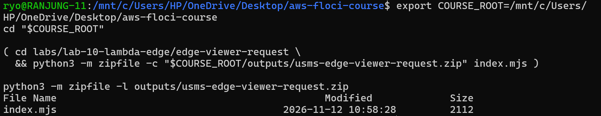

**Part 2:** I created `usms-edge-viewer-request` with runtime **nodejs20.x**, handler `index.handler`, the edge role, **timeout 5**, **memory 128** and `x86_64`.

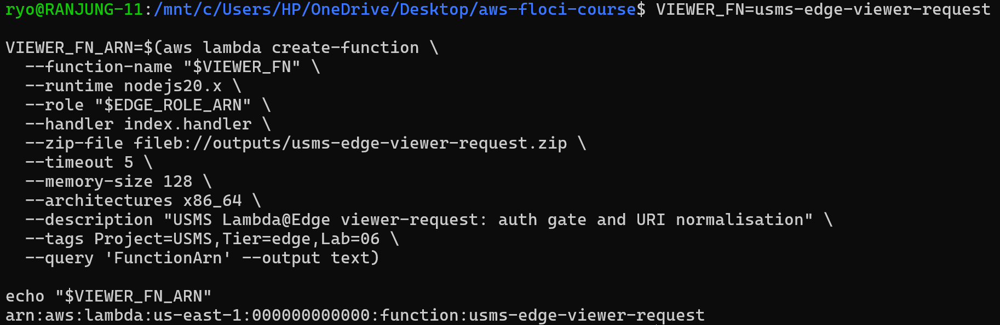

**Verify:** the function is **Active**, version **$LATEST**, with the role `usms-lambda-exec-role`.

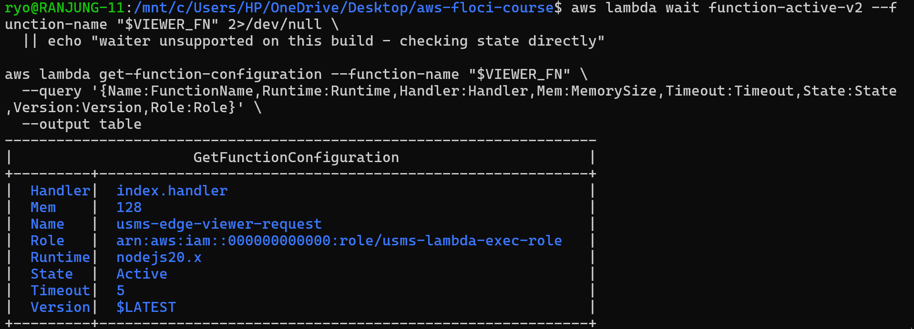

### Step 9: Invoke the function with a real CloudFront event

**Part 1:** I wrote `templates/lab-10-viewer-request-event.json`, a CloudFront viewer-request event for `GET /transcripts/2026/STU-00417.json` with `X-USMS-Student: STU-00417` and request ID `lab06-allow-0001`.

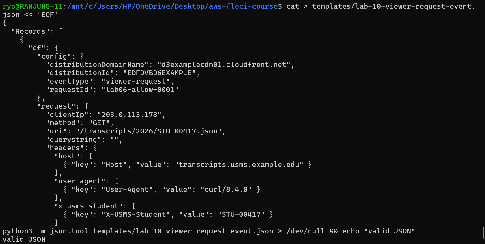

**Part 2:** The invoke returned **Status 200**, **Error None**, executed version **$LATEST**. The output is a **request** object: the URI was lower-cased to `/transcripts/2026/stu-00417.json` and a new header `x-usms-edge: viewer-request-allow;student=stu-00417` was added.

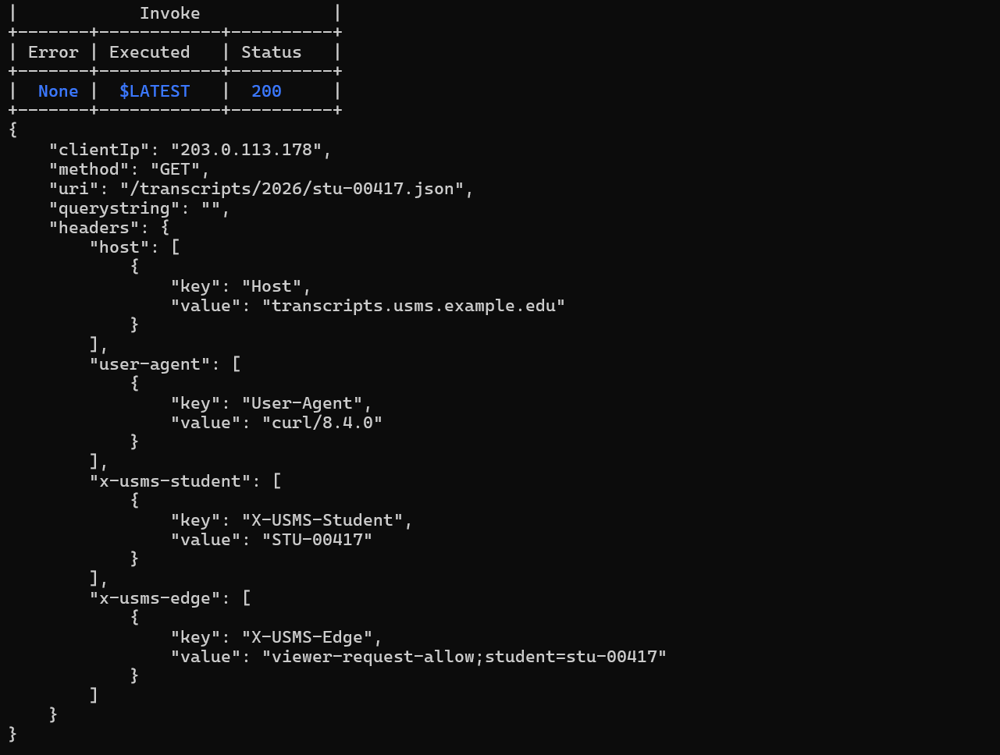

**Verify:** a Python check confirmed both changes and printed **"viewer-request allow path: correct"**.

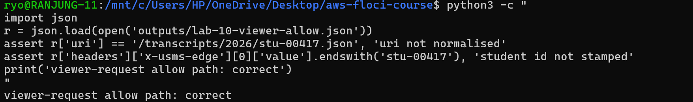

### Your turn: prove the deny path

I created `templates/lab-10-viewer-request-denied.json`: the same event **without** the `x-usms-student` header, with request ID `lab06-deny-0001`.

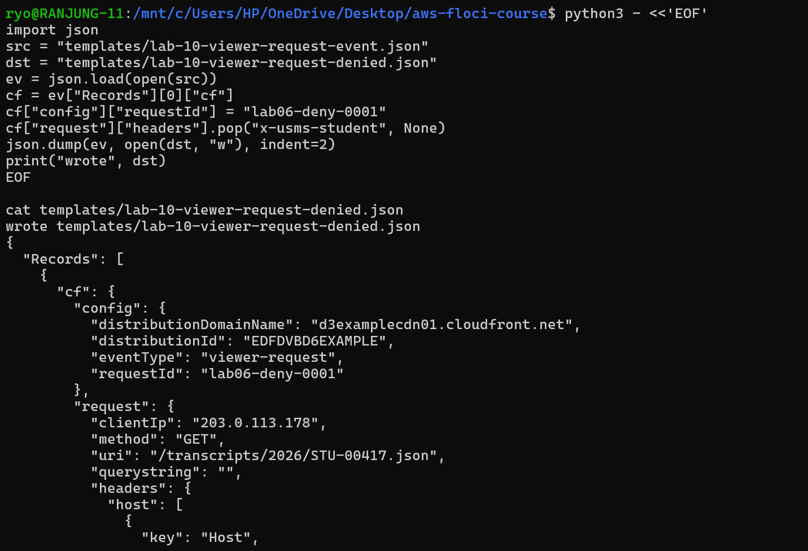

I invoked the function with it. The result was **Status 200, Error None**: the function did not fail, it **made a decision**.

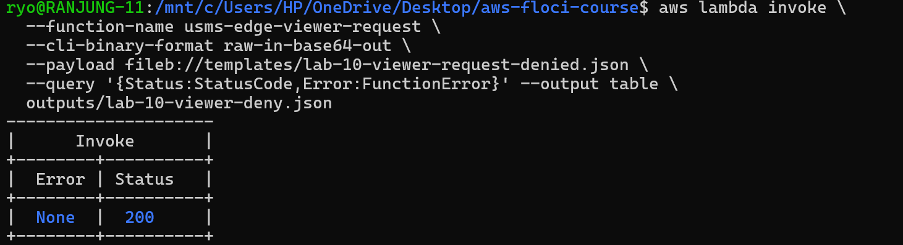

`outputs/lab-10-viewer-deny.json` is a **response** object, not a request:

| Expected | My result |
|---|---|
| `status` | `"403"` |
| `statusDescription` | `"Forbidden"` |
| `x-usms-edge` header | `viewer-request-deny` |
| JSON `body` | `{"message":"transcript access requires an authenticated session"}` |
| `"uri"` key | not present (`grep -c '"uri"'` = **0**) |

So a request without the header is stopped at the edge and never reaches the bucket.

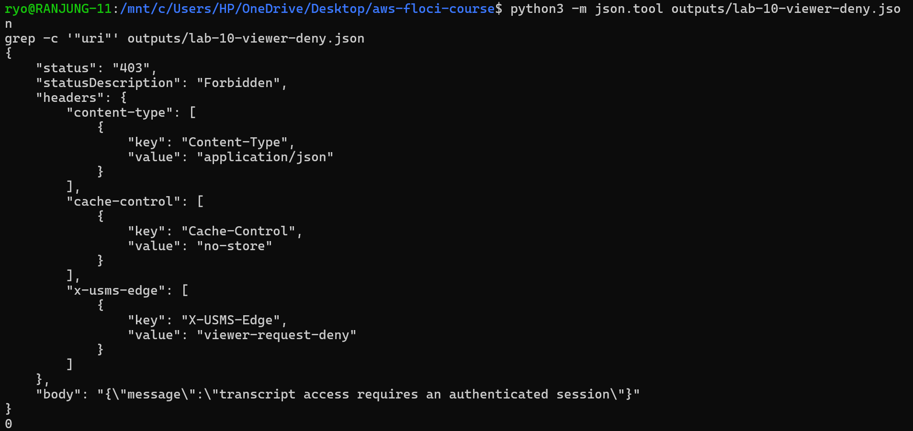

### Step 10: Read the function's logs

The lab expects `--log-type Tail` to return START / END / REPORT lines. On Floci, **`LogResult` came back as `None`**. When I first piped it into `openssl base64 -d -A`, I got garbage characters (`6��r`), because the word "None" was decoded as base64. Without the decode, the command just printed `None`. So Floci does not support tail logs.

I then checked the durable route. `describe-log-groups` shows the log group `/aws/lambda/usms-edge-viewer-request` exists, but `aws logs tail` printed nothing.

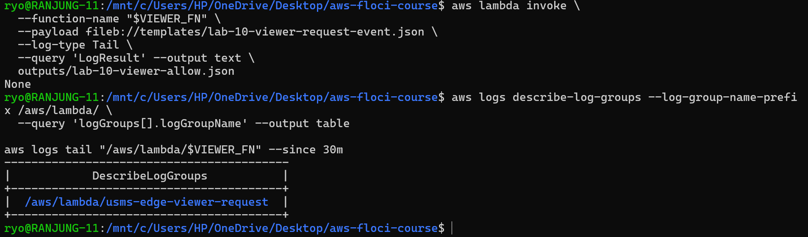

**Verify:** the log group has **storedBytes = 0**. Floci creates the group but does not write the viewer-request function's log lines into it.

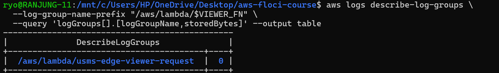

### Step 11: Publish a version

I published **version 1** with the description "Lab 10 - initial edge release". The qualified ARN is `arn:aws:lambda:us-east-1:000000000000:function:usms-edge-viewer-request:1`.

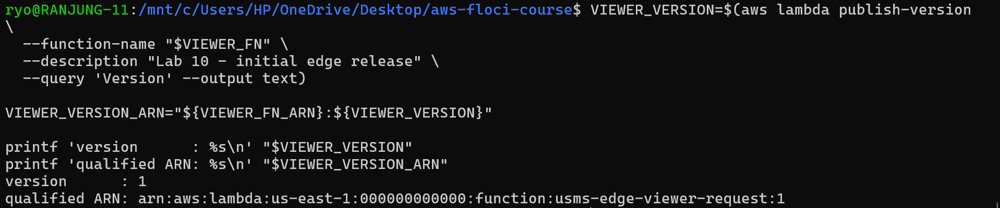

**Verify:** `list-versions-by-function` shows `$LATEST` and `1`, both with code size **1110**. The check printed **"ARN is version-qualified - the edge would accept this"**. CloudFront needs a number because the code it copies to every edge location must be frozen. `$LATEST` can change at any time.

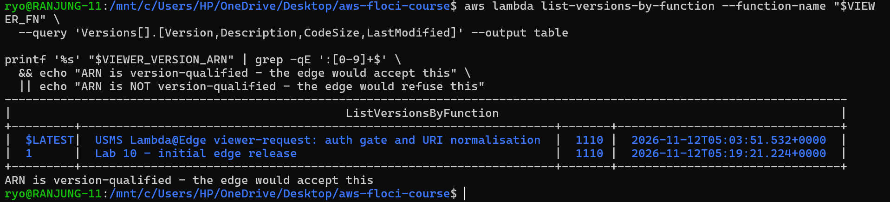

### Step 12: Write and deploy the origin-response function

**Part 1:** I wrote `edge-origin-response/index.mjs`. It overwrites four security headers (`Strict-Transport-Security`, `X-Content-Type-Options`, `X-Frame-Options`, `Referrer-Policy`), sets `cache-control: public, max-age=300, s-maxage=3600` on transcripts, and adds the chain marker `x-usms-edge-chain`. It overwrites the headers on purpose, because a header set by whoever uploaded the object is not a security decision we want to inherit.

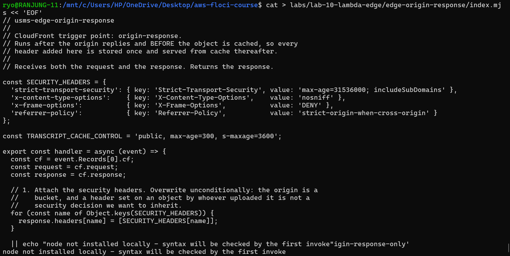

**Part 2:** I packaged it and created `usms-edge-origin-response` with the same edge-safe settings.

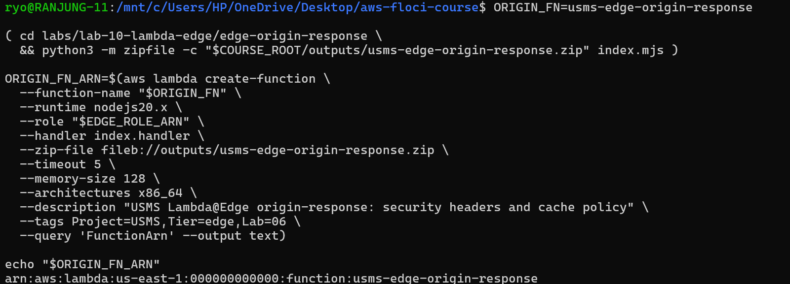

**Verify:** `index.handler`, **128** MB, **nodejs20.x**, **Active**, timeout **5**.

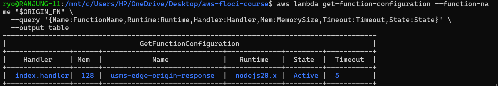

### Step 13: Invoke the origin-response function and publish its version

**Part 1:** I wrote `templates/lab-10-origin-response-event.json`, an event that contains both the request (already stamped by the viewer-request function) and the S3 response.

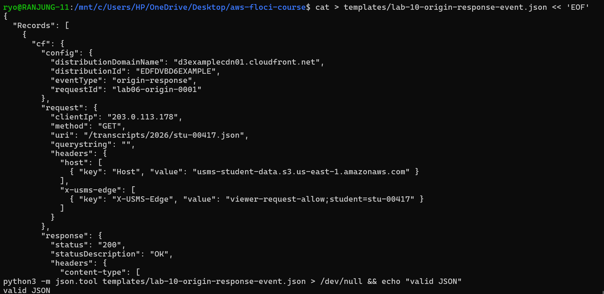

**Part 2:** The invoke returned **Status 200, Error None**, and the response came back as `200 OK` with the new headers. I published **version 1** of this function too.

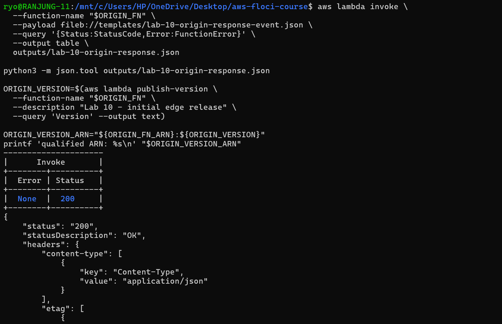

**Verify:** the Python check printed **"origin-response: 4 security headers + cache-control + chain marker"**. The chain header reads `viewer-request-allow;student=stu-00417;origin-response`, so it shows both functions ran in order.

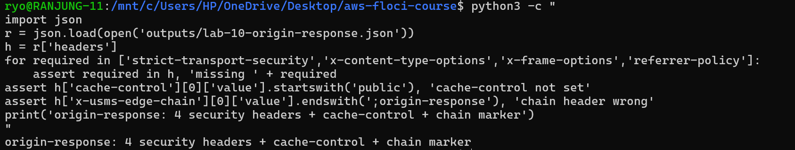

### Step 14: Check both functions against the Lambda@Edge restrictions

**Part 1 (the mistake on purpose):** I added environment variables `USMS_STAGE=lab06` and `USMS_AUTH_HEADER=x-usms-student` to the viewer-request function. **Floci accepted it**, but real CloudFront would refuse to associate a function with environment variables. This is a mistake the emulator does not catch.

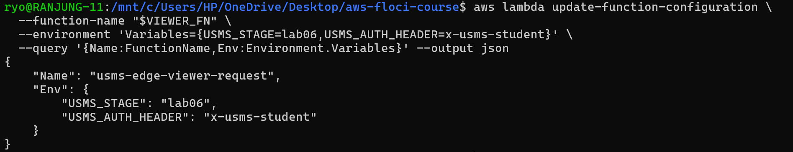

**Part 2:** I removed the variables again (the update returned `null` for the environment) and ran an eligibility check on both functions, saved to `outputs/lab-10-function-inventory.json` at **2026-11-12T05:23:56Z**. Both functions got **ok** on all six checks: no environment variables, memory 128 MB (cap 128), timeout 5 s, runtime nodejs20.x, no VPC, and 1 published version.

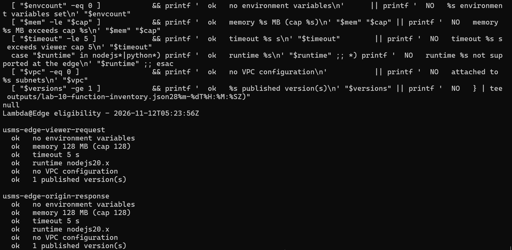

**Verify:** `grep -c ' NO '` returned **0**: "0 failures - both functions are edge-eligible".

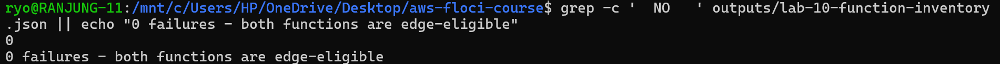

### Step 15: Associate both functions with a CloudFront distribution

**Part 1:** I wrote `templates/lab-10-distribution-config.json`, with one S3 origin (`usms-student-data`) and two Lambda function associations that use the **version-qualified** ARNs.

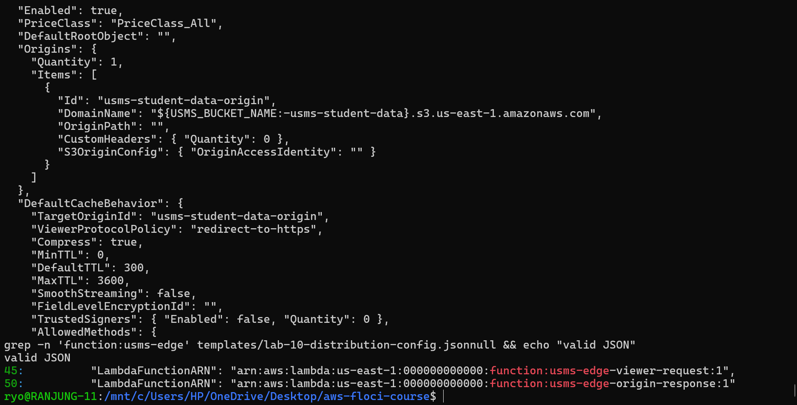

**Path A:** Floci supports CloudFront, so `create-distribution` worked. The distribution is **`EHPVYOGADVTSYD`** with domain **`EHPVYOGADVTSYD.cloudfront.net`**.

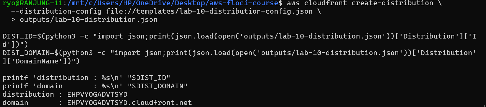

**Verify (Path A):** the distribution is **Enabled** and **Deployed**, and its associations are:

| Event type | Function ARN |
|---|---|
| viewer-request | `...:function:usms-edge-viewer-request:1` |
| origin-response | `...:function:usms-edge-origin-response:1` |

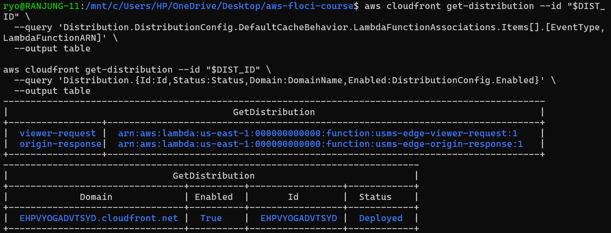

**Path B:** I also ran the structural validation. All **11** checks were **ok** and `errors` was empty, including: one origin, origin is the USMS bucket, two trigger points, every ARN version-qualified, `IncludeBody` only on a request trigger, viewer protocol not `allow-all`, no cookies forwarded and exactly one header in the cache key.

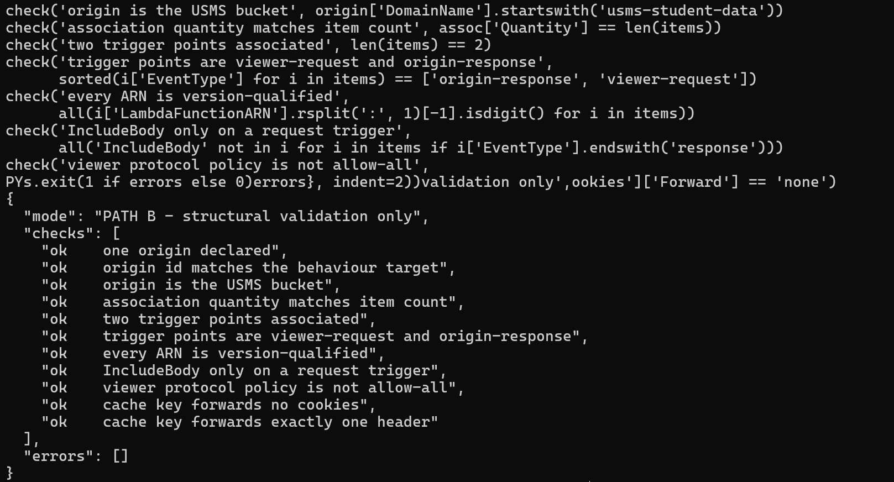

### Step 16: Run the edge chain end to end, without CloudFront

**Part 1:** I wrote `scripts/utilities/usms-edge-simulate.sh`. It invokes the viewer-request function, and only if the result is a request, it fakes the S3 origin and invokes the origin-response function. It writes the trace to `outputs/lab-10-edge-trace.json`.

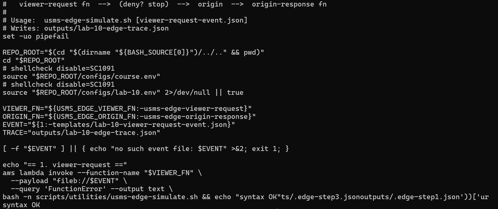

**Part 2:** I ran it both ways:

| Run | Chain | Decision | Status | Key header |
|---|---|---|---|---|
| With student header | viewer-request → origin → origin-response | **allow** | **200** | `x-usms-edge-chain: viewer-request-allow;student=stu-00417;origin-response` |
| Without header | viewer-request only | **deny** | **403** | `x-usms-edge: viewer-request-deny` |

In the deny run, the script printed **"DENY - the origin is never contacted"**. This is the main proof of the lab: the bucket is never called for an anonymous request.

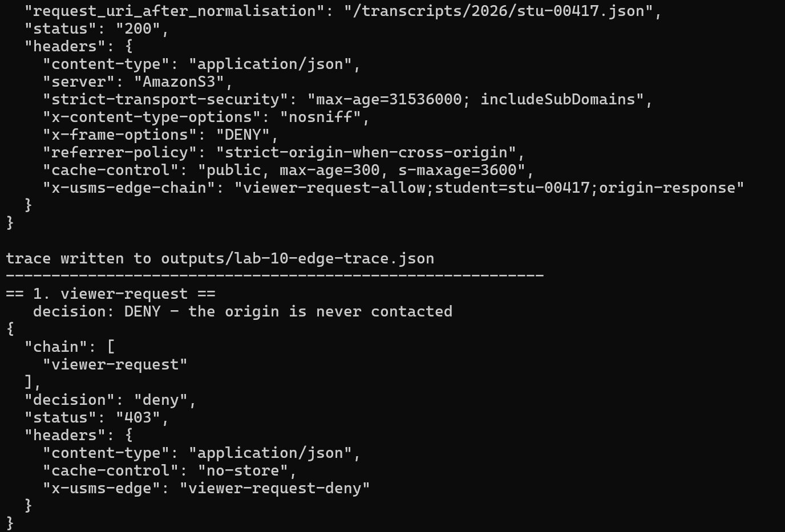

**Verify:** the last trace written was the deny run: `chain: viewer-request`, `decision: deny`.

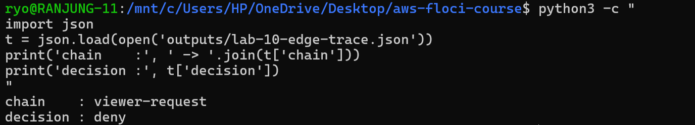

### Step 17: Write the regional notifier

I wrote `transcript-notifier/notifier.py`. For every S3 record it reads the event name, bucket, key (decoded with `unquote_plus`) and size. It skips keys that do not start with `transcripts/`, tries a `head_object` to prove `s3:GetObject` works, and prints a `USMS_NOTIFY` line.

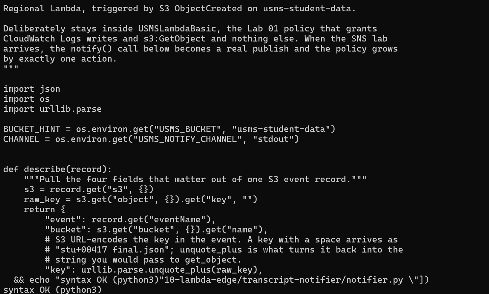

**Verify:** the function reads two environment variables, `USMS_BUCKET` (line 15) and `USMS_NOTIFY_CHANNEL` (line 16). This is allowed because it is a **regional** function, not an edge one.

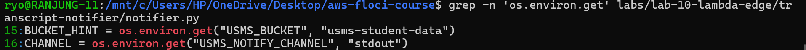

### Step 18: Create the notifier, publish it, and give it an alias

**Part 1:** I created `usms-transcript-notifier` with runtime **python3.12**, handler `notifier.handler`, **timeout 30**, **memory 256** and the two environment variables. None of these would be allowed at the edge.

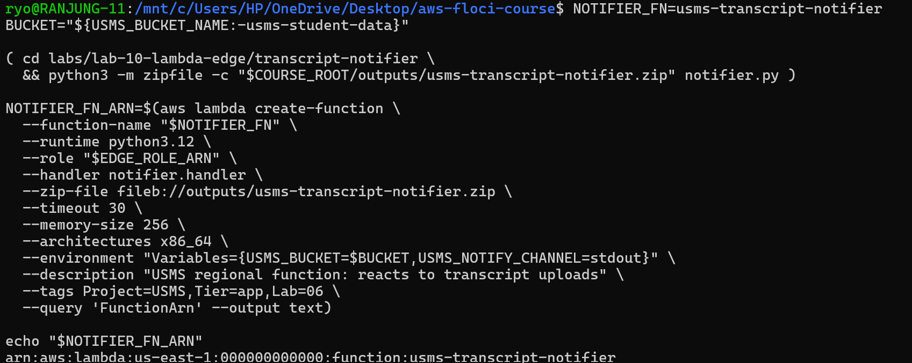

**Part 2:** I published **version 1** and created the alias **`live`** pointing at it: `arn:aws:lambda:us-east-1:000000000000:function:usms-transcript-notifier:live`.

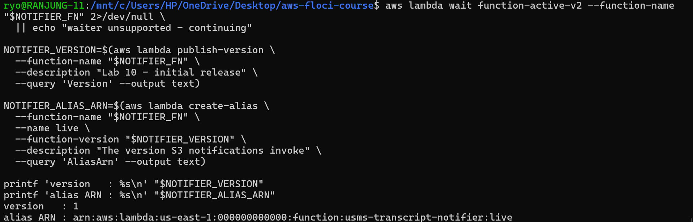

**Verify:** `list-aliases` shows `live → 1` ("The version S3 notifications invoke"), and the configuration through the alias shows version 1, python3.12 and both environment variables.

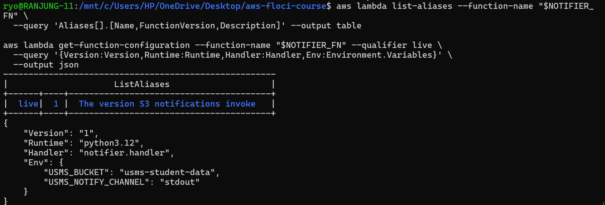

### Step 19: Let S3 invoke the function

I added a **resource policy** statement `usms-s3-transcript-upload` on the `live` alias. It allows principal **`s3.amazonaws.com`** to call `lambda:InvokeFunction`, with the condition **`AWS:SourceArn` = `arn:aws:s3:::usms-student-data`**. Without this condition, any bucket in any account could trigger my function (the confused-deputy problem from Lab 09).

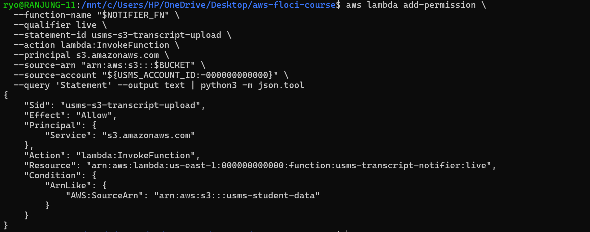

**Verify:** `get-policy --qualifier live` returned the same statement, and the check printed **"resource policy: scoped to one bucket in one account"**.

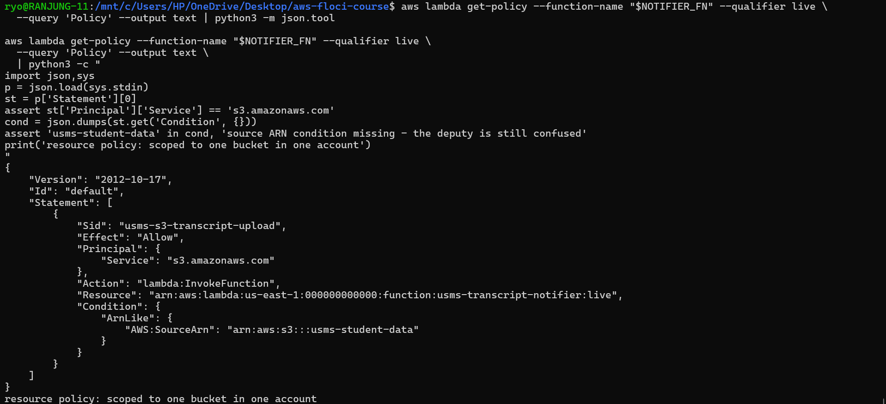

### Step 20: Wire the bucket notification and fire it

**Part 1:** I wrote `templates/lab-10-bucket-notification.json`. It has the ID `usms-transcript-upload`, events `s3:ObjectCreated:*`, target the `live` alias, and two filter rules: prefix **`transcripts/`** and suffix **`.json`**. It is valid JSON, and `put-bucket-notification-configuration` applied it.

**Part 2:** I uploaded `outputs/lab-10-edge-trace.json` as `transcripts/evidence/lab-10-edge-trace.json`. S3 returned an ETag, so the upload worked.

### Step 21: Prove the notifier ran

**Part 1:** I checked `/aws/lambda/usms-transcript-notifier` with `filter-log-events --filter-pattern USMS_NOTIFY`. At that moment it printed nothing.

**Part 2 (fallback):** I wrote a synthetic S3 event, `templates/lab-10-s3-event.json`, for the key `transcripts/evidence/synthetic-probe.json` and invoked the `live` alias directly. It returned **`{"processed": 1, "keys": ["transcripts/evidence/synthetic-probe.json"]}`**. The `6��` before the JSON is again the decoded `None` from `--log-type Tail`.

### Your turn: prove the notification filter

I uploaded two objects that should **not** trigger the notifier:

- `notes/ignore-me.json`: inside the bucket, **wrong prefix**.
- `transcripts/evidence/ignore-me.txt`: right prefix, **wrong suffix**.

Both uploads returned an ETag. `list-objects-v2` shows all **three** objects in the bucket:

| Key | Size | Uploaded |
|---|---|---|
| `notes/ignore-me.json` | 24 | 05:35:57 |
| `transcripts/evidence/ignore-me.txt` | 13 | 05:35:59 |
| `transcripts/evidence/lab-10-edge-trace.json` | 217 | 05:33:14 |

Then I looked at the logs again. There are `USMS_NOTIFY` lines for `synthetic-probe.json` (my Step 21 invokes, with `readable: false` because that object does not exist) and for **`transcripts/evidence/lab-10-edge-trace.json`** with `"event": "ObjectCreated:Put"`, `"readable": true`, `"size": 217`. So Floci **did deliver the real S3 event** for the Step 20 upload. There is **no `USMS_NOTIFY` line for either `ignore-me` object**.

Which rule excluded each object:

- **`notes/ignore-me.json`** was excluded by the **prefix rule**: it ends in `.json`, but it starts with `notes/`, not `transcripts/`.
- **`transcripts/evidence/ignore-me.txt`** was excluded by the **suffix rule**: it starts with `transcripts/`, but it ends in `.txt`, not `.json`.

S3 combines filter rules with **AND**, so an object must match both rules. The code's own `startswith("transcripts/")` check would also catch the first object, but **only the suffix rule** stops the second one.

### Step 22: Restart Floci and read everything back

**Part 1:** I wrote an `inventory()` function and saved its output to `outputs/lab-10-pre-restart.txt`: the three functions with runtime and memory, viewer-request version `1`, alias `live 1`, the three object keys and the notification `usms-transcript-upload`.

**Part 2:** I ran `floci-down.sh` ("State preserved in /home/ryo/floci-data"), `floci-up.sh` and `whoami.sh`. Floci came back in hybrid mode with account 000000000000.

**Part 3:** I ran the inventory again into `outputs/lab-10-post-restart.txt` and compared the two files. `diff` printed **"IDENTICAL - every Lab 10 artefact survived the restart"**.

**Verify (stronger check):** reading the configuration back is not enough, so I ran `usms-edge-simulate.sh` again after the restart. The functions still **execute**: allow chain, status 200, all security headers and `x-usms-edge-chain: viewer-request-allow;student=stu-00417;origin-response`.

### Step 23: Write `configs/lab-10.env`

I wrote `configs/lab-10.env` with the bucket ARN, the two edge functions (names, ARNs, version `1` and version ARNs), the runtime, the role ARN, the trace file, the notifier (name, ARN, runtime, alias `live`, alias ARN, version, log group), the notification ID, prefix and suffix, and the CloudFront values (`USMS_CLOUDFRONT_SUPPORTED=yes`, `EHPVYOGADVTSYD`). The file contains names, ARNs and IDs only. **No secrets.**

**Verify:** **25** exports, **"all values populated"** and **"sources cleanly"**.

### Step 24: Check what Git sees, and commit

**Part 1:** `git status --short` shows the new Lab 10 files as untracked: `configs/lab-10.env`, `labs/lab-10-lambda-edge/`, `policies/trust-lambda-edge.json`, `scripts/utilities/usms-edge-simulate.sh` and six `templates/lab-10-*.json` files. `git check-ignore` shows the zip archive and the edge trace are protected by **`.gitignore:35:outputs/*`**, so no `outputs/` file is tracked.

**Part 2:** The commit command **failed** with `fatal: pathspec 'scripts/utilities/verify-lab-10.sh' did not match any files`, because I ran it before the verify script was in place. Nothing was staged.

**Verify:** `git log` shows the last commit is still **`3144a6b chore: lab9`**. The Lab 10 commit still has to be made, now that `verify-lab-10.sh` exists.

## 6. Verification

`scripts/utilities/verify-lab-10.sh` checks the role, the two edge functions, the notifier, the S3 notification, the CloudFront configuration, and source, scripts and Git hygiene.

The result was **PASS=45 FAIL=6**. The screenshot shows the lower half of the output.

Checks that **passed** include:

- **Notifier:** handler is `notifier.handler`, it has environment variables (legal for a regional function), the `live` alias exists and points at a numbered version, not `$LATEST`.
- **S3 notification:** `usms-transcript-upload` exists, targets the `live` alias and is filtered to `transcripts/`.
- **CloudFront:** the config is valid JSON, it declares exactly two associations (viewer-request and origin-response), every ARN is version-qualified, and no cookies are forwarded.
- **Source and Git:** all three handler sources exist, the viewer handler kept its template literal, `usms-edge-simulate.sh` is executable and valid bash, the trace records the full three-stage chain, `configs/lab-10.env` has 25 exports and no empty values, and **no secret or deployment archive is tracked**.

Two failures are visible in the screenshot:

| FAIL | Reason |
|---|---|
| resource policy allows `s3.amazonaws.com` | In Step 19, `get-policy --qualifier live` returned exactly this statement and my own check passed. The verify script most likely reads the policy **without** the `live` qualifier, where Floci has no policy, because I attached it to the alias. |
| resource policy is scoped to this bucket | Same cause as above: the `AWS:SourceArn` condition is on the alias policy. |

The other four failures are in the upper part of the output, which I did not capture.

## 7. Analysis and Discussion

### 7.1 What was achieved

I gave `usms-lambda-exec-role` the **edge principal** without changing its permissions. I built a **viewer-request** function that lower-cases the URI and returns a **403 at the edge** for anonymous transcript requests, and an **origin-response** function that adds four security headers, a cache-control header and a chain marker. Both passed all six **Lambda@Edge eligibility** checks, were published as **version 1**, and were associated with the CloudFront distribution **`EHPVYOGADVTSYD`** using version-qualified ARNs. The simulator proved both paths: **allow → 200** through all three stages, and **deny → 403** with the origin never contacted.

On the regional side, I built the **transcript notifier** with a `live` alias, a **resource policy scoped to one bucket**, and an S3 notification filtered to `transcripts/*.json`. A real upload produced a `USMS_NOTIFY` line, and the two wrong-prefix and wrong-suffix uploads did not. Everything was **identical after a Floci restart**, and the functions still executed.

### 7.2 Observed, recorded and conceptual

| Type | Items |
|---|---|
| **Observed / working** | Two-principal trust policy; both edge functions invoked with real CloudFront events (allow, deny, origin-response); version 1 of each; eligibility checks; CloudFront distribution Deployed with two associations; simulator allow and deny chains; notifier, alias and resource policy; **real S3 event delivered** for the `.json` upload and filtered out for the other two; persistence after restart |
| **Recorded only** (Floci stores, but does not run) | The CloudFront distribution and its edge associations. No real request goes through an edge location. |
| **Not working on my Floci build** | `--log-type Tail` returns `None`; the viewer-request log group has 0 stored bytes; Floci accepted environment variables on an edge function that real CloudFront would refuse |
| **My own mistakes** | Passing the role **ARN** as `--role-name` (Step 6); `COURSE_ROOT` pointing at a different copy of the course (Step 8); the commit run before `verify-lab-10.sh` existed (Step 24) |
| **Conceptual** (real AWS only) | Code being copied to edge locations worldwide; CloudFront refusing `$LATEST`, aliases and environment variables; logs appearing in the region nearest the viewer |

### 7.3 Observations

- **Deny early, deny cheap.** The viewer-request function runs before the cache and before the origin, so an anonymous request costs one small function call and never touches the bucket.
- **Normalising the URI is a performance fix.** Without lower-casing, one transcript could be cached twice under two spellings, which halves the hit rate.
- **Headers set at origin-response are paid for once.** They are added before the object is cached, so every later cache hit gets them for free.
- **The edge wants frozen code.** A numbered version cannot change, so every edge location runs the same thing. That is why `$LATEST` and aliases are refused.
- **Edge and regional functions have different rules.** The notifier can use environment variables, 256 MB and 30 s; the edge functions cannot. Comparing them side by side made the restrictions clear.
- **Two kinds of policy.** The role says what the function may **do**; the resource policy says who may **invoke** it. S3 needed the resource policy, and the `SourceArn` condition stops other buckets from using it.
- **An emulator can accept things the real service would refuse.** Floci took the environment variables in Step 14 without complaint, so my own eligibility check was the only thing that caught it.
- **Read values carefully.** Two of my problems came from variables holding something different from what I expected (an ARN instead of a name, and a different `COURSE_ROOT`). Printing the variable first would have saved time.

## 8. Reflection

### What I learned about edge functions

Before this lab I thought of Lambda as "code that runs in a region". Now I see that the same service can run in two very different places. At the edge, the function sits in the path of every request, so it has to be tiny, fast and frozen, and it cannot have environment variables or a VPC. In a region, it reacts to events and can be bigger and slower. Choosing the trigger point is the real design decision: viewer-request for "should this request happen at all", origin-response for "what should be stored in the cache".

The most useful idea was that a viewer-request function **decides** by what it returns: a request means "continue", a response means "stop here". The 403 test showed this clearly, because the invoke itself succeeded (Status 200) even though the student got a 403.

## 9. Conclusion

In this lab I added edge processing to the USMS transcript service. I gave `usms-lambda-exec-role` the `edgelambda.amazonaws.com` principal, then built and deployed **`usms-edge-viewer-request`** (URI normalisation and an auth gate that returns 403 at the edge) and **`usms-edge-origin-response`** (four security headers, cache-control and a chain marker). Both passed the Lambda@Edge restrictions, were published as **version 1**, and were associated with the CloudFront distribution **`EHPVYOGADVTSYD`**. The simulator proved the allow chain (200, three stages) and the deny chain (403, origin never contacted).

I also built the regional **`usms-transcript-notifier`** with a `live` alias, a bucket-scoped resource policy and an S3 notification filtered to `transcripts/*.json`. A real upload triggered it, and the wrong-prefix and wrong-suffix uploads did not. Everything survived a Floci restart, and `configs/lab-10.env` holds all 25 values. The final verification gave **PASS=45 FAIL=6**. The visible failures come from the verify script reading the resource policy without the `live` qualifier. Floci limitations (no tail logs, empty log groups, environment variables accepted on edge functions) are recorded above. The Lab 10 commit still has to be made.
