# Lab 10 Independent Lab Exercises: Edge Functions with AWS Lambda

All commands were run from the repository root in WSL, against Floci (account `000000000000`, region `us-east-1`), after sourcing `configs/course.env`, `configs/lab-01.env` and `configs/lab-10.env`.

| # | Exercise | Level | Result |
|---|---|---|---|
| 1 | Extend the security header set | Basic | Done. Version 2 of `usms-edge-origin-response` adds a CSP header. |
| 2 | Dedicated edge execution role | Intermediate | Done. `usms-edge-exec-role` with `USMSEdgeBasic` (logs only). |
| 3 | Edge-readiness report | Problem solving | Done. `scripts/utilities/usms-edge-report.sh` |
| 4 | Transcript delivery policy design | Challenge | Design in `notes/lab-10-edge-design.md` |
| 5 | Hand the S3 lab a starting bucket | Integration | Done. `outputs/lab-10-s3-readiness.txt` |

---

## Exercise 1: Extend the security header set

**Goal:** add `Content-Security-Policy: default-src 'self'` to the origin-response function and publish it as version 2, without touching version 1.

### 1.1 Add the header to `SECURITY_HEADERS`

I added one entry to the existing `SECURITY_HEADERS` object. I did not add a second block of code. The loop that already writes every entry in that object now writes five headers instead of four.

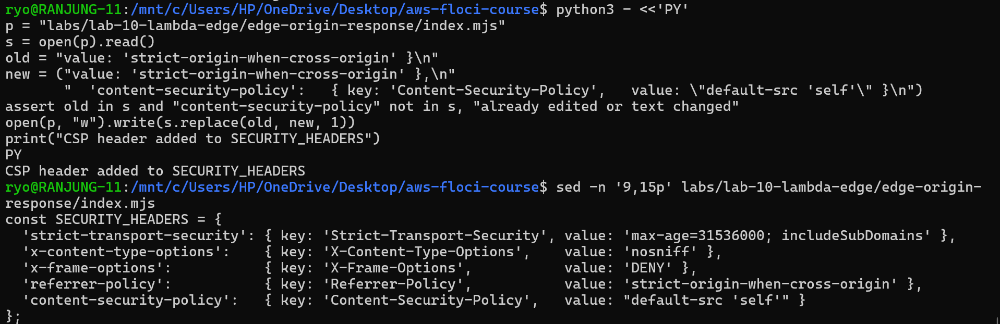

### 1.2 Rebuild the package and deploy it to `$LATEST`

`zip` is not installed in my WSL, so I built the archive with Python's `zipfile` module. It contains one entry, `index.mjs`, at the root of the archive. `update-function-code` replaced the code of `$LATEST` only.

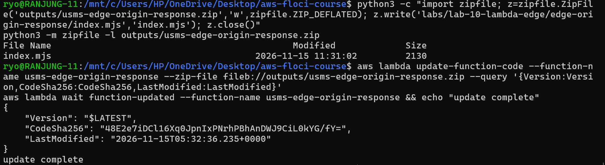

### 1.3 Publish version 2

`publish-version` with the description `Ex1: + Content-Security-Policy` created **version 2**. `list-versions-by-function` now shows `$LATEST`, `1` and `2`.

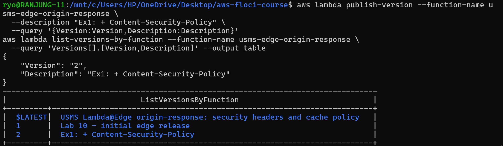

### 1.4 Prove version 1 is unchanged

I invoked `$LATEST`, `2` and `1` with the same origin-response event and counted the security headers.

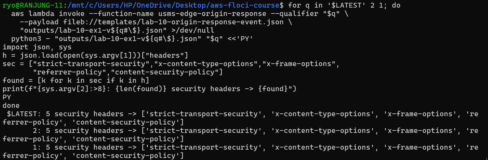

**Floci limitation:** all three invokes returned five headers, including for `--qualifier 1`. The invoke response reports `ExecutedVersion: $LATEST` even when I ask for version 1. On this build, Floci accepts `--qualifier` on `invoke` but always runs the latest code. Real AWS would run version 1 and return four headers.

So I proved it from what Floci does record per version: the code hash, and the source that version 1 was built from.

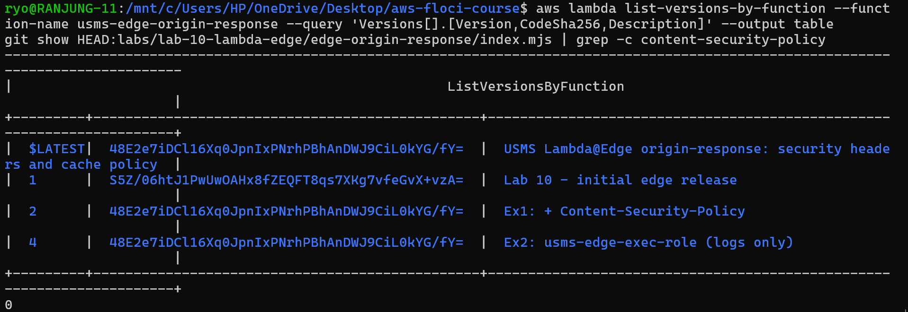

| Version | CodeSha256 | CSP in code |
|---|---|---|
| 1 | `S5Z/06htJ1PwUwOAHx8fZEQFT8qs7XKg7vfeGvX+vzA=` | no (`git show HEAD:...index.mjs` has 0 CSP lines) |
| 2 | `48E2e7iDCl16Xq0JpnIxPNrhPBhAnDWJ9CiL0kYG/fY=` | yes |
| `$LATEST` | `48E2e7iDCl16Xq0JpnIxPNrhPBhAnDWJ9CiL0kYG/fY=` | yes |

Version 1 has a different hash from version 2 and `$LATEST`, so its code was not overwritten. Publishing a version freezes a copy of the code, and later updates only change `$LATEST`.

### 1.5 Point the distribution at version 2

In `templates/lab-10-distribution-config.json`, the origin-response association now ends in `:2`. The file is still valid JSON. The viewer-request association stays on `:1`.

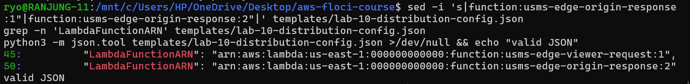

---

## Exercise 2: Dedicated edge execution role

**Goal:** the edge functions must never read the bucket. They get their own role, which can only write logs.

### 2.1 The policy: `policies/usms-edge-basic-policy.json`

```json
{
  "Version": "2012-10-17",
  "Statement": [{
    "Sid": "EdgeFunctionsWriteOwnLogsOnly",
    "Effect": "Allow",
    "Action": ["logs:CreateLogGroup", "logs:CreateLogStream", "logs:PutLogEvents"],
    "Resource": [
      "arn:aws:logs:*:000000000000:log-group:/aws/lambda/usms-edge-*",
      "arn:aws:logs:*:000000000000:log-group:/aws/lambda/usms-edge-*:*"
    ]
  }]
}
```

- Logs are scoped to `/aws/lambda/usms-edge-*`, not `*`. The trailing `:*` covers the log streams inside each group.
- There is no `s3:*` action, so these functions cannot read transcripts.
- The region is `*` on purpose. Lambda@Edge writes its logs in the region **nearest the viewer**, not only in us-east-1. Restricting the region to `us-east-1` would make logging fail at every other edge location.

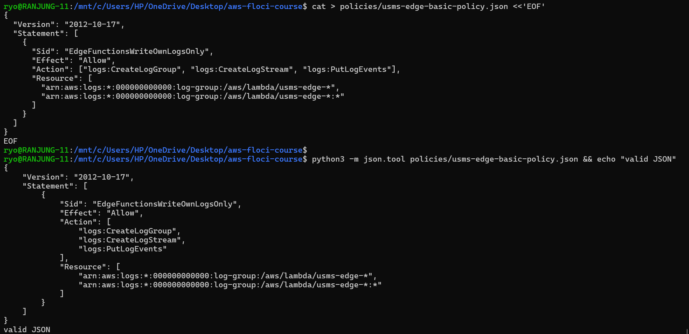

### 2.2 Create the role and the policy, and attach it

- I created `usms-edge-exec-role` from `policies/trust-lambda-edge.json`, unchanged. It trusts both `lambda.amazonaws.com` and `edgelambda.amazonaws.com`.
- I created the customer managed policy `USMSEdgeBasic` and attached it to the role.

The role and policy already existed from an earlier attempt, so I read their ARNs back instead of creating them again. I checked that the policy's default version matches the file, then attached it.

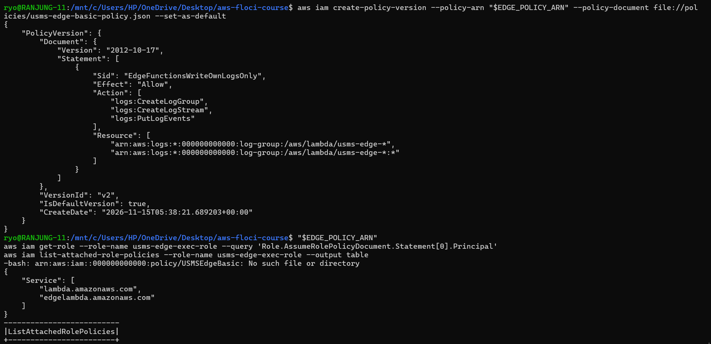

### 2.3 Point both edge functions at the new role and publish

My first attempt failed because a line wrap left `--role` without a value. The publish step still ran, which created viewer v2 and origin v3 **with the old role**. I deleted those two wrong versions with `delete-function --qualifier`. Nothing referenced them, because the distribution config uses viewer `:1` and origin `:2`.

I redid it with `update-function-configuration ... && wait && publish-version`, so a failed update stops the publish:

| Function | New version | Role |
|---|---|---|
| `usms-edge-origin-response` | **4** | `usms-edge-exec-role` |
| `usms-edge-viewer-request` | **3** | `usms-edge-exec-role` |

Floci does not reuse a deleted version number, the same as real AWS. That is why the new numbers skip 3 for origin and 2 for viewer.

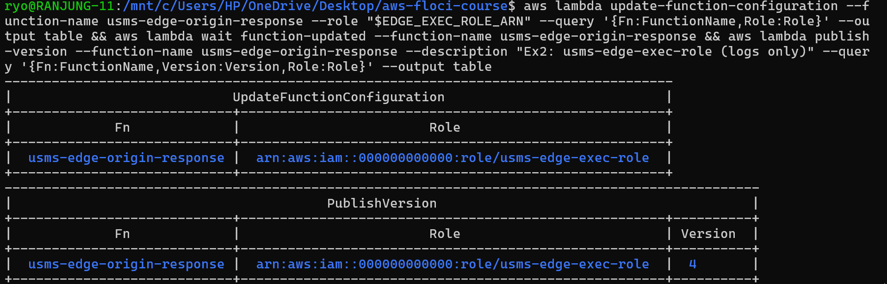
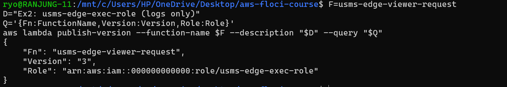

### 2.4 What happened to version 1's role, and why

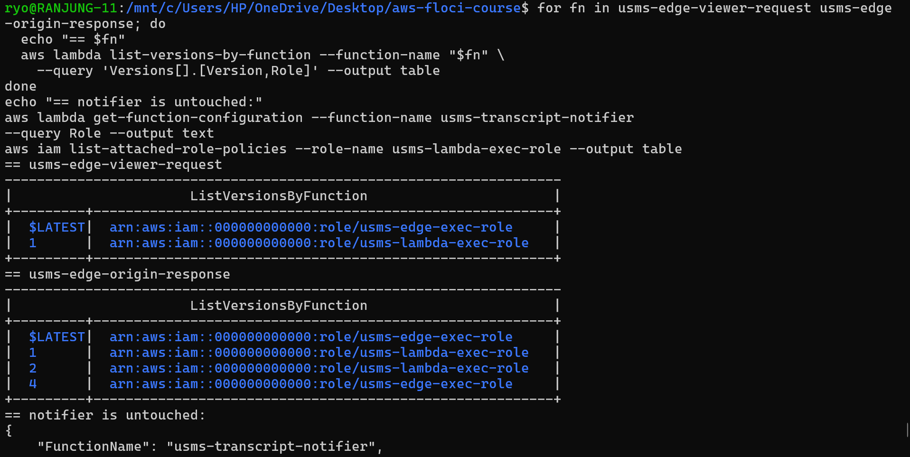

| Function | Version | Role |
|---|---|---|
| viewer-request | 1 | `usms-lambda-exec-role` |
| viewer-request | 3, `$LATEST` | `usms-edge-exec-role` |
| origin-response | 1, 2 | `usms-lambda-exec-role` |
| origin-response | 4, `$LATEST` | `usms-edge-exec-role` |

**Explanation:** a published Lambda version is an **immutable snapshot of both the code and the configuration**, and the execution role is part of the configuration. `update-function-configuration --role` only changes `$LATEST`. Version 1 was published while the function used `usms-lambda-exec-role`, so version 1 will **always** run as that role, which still has `s3:GetObject` on `usms-student-data/*`.

This means **rolling back is not only a code rollback**. If the distribution is pointed back at `:1`, the edge also gets the old, broader role back. The least-privilege change only takes effect when CloudFront is associated with the new versions (viewer `:3`, origin `:4`).

**Trade-off I'm leaving visible:** Exercise 1 requires the distribution config to name origin-response `:2`. Version 2 was published before the role change, so it still runs as `usms-lambda-exec-role`. Before production, I would move the config to viewer `:3` and origin `:4`, which keeps the CSP header and uses the logs-only role.

The notifier still uses `usms-lambda-exec-role`, and nothing on that role was modified or detached. It still has `USMSLambdaBasic`.

---

## Exercise 3: Edge-readiness report

**Goal:** a machine-readable report saying which `usms-` functions could run at the edge.

### 3.1 The script: `scripts/utilities/usms-edge-report.sh`

How the script meets each requirement:

- **No hard-coded function list:** one `list-functions` call with `starts_with(FunctionName, 'usms-')` finds every function.
- **Runs from any directory:** it finds the repository root from `${BASH_SOURCE[0]}` and sources `configs/course.env` from there.
- **JSON only on stdout:** the JSON is built in `python3` with `json.dumps`, not by joining strings in bash. Each function's reasons are printed to **stderr**.
- **Safe under `set -u`:** `(f.get("Environment") or {}).get("Variables") or {}` returns an empty dict when a function has no `Environment` key, so nothing fails.
- **`edge_eligible` rules:** Node or Python runtime, no environment variables, no VPC, at least one published version, and the size limits. Functions with `viewer` in the name must have memory ≤ 128 and timeout ≤ 5. All other functions must have memory ≤ 10240 and timeout ≤ 30.

My first version of the script was broken by a line wrap when I pasted the heredoc, and Python failed with `IndentationError`. I rewrote the file and checked it with `bash -n`.

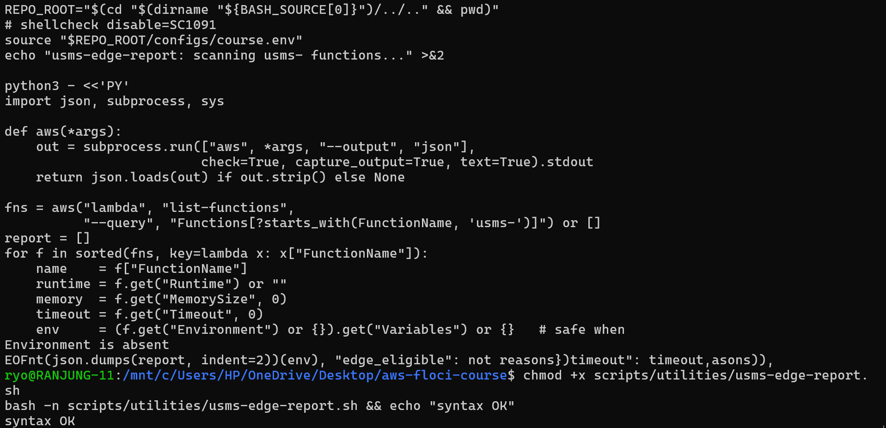

### 3.2 Run it from `/tmp` and save the output

The output is saved to `outputs/lab-10-edge-report.json`. It is valid JSON with three objects.

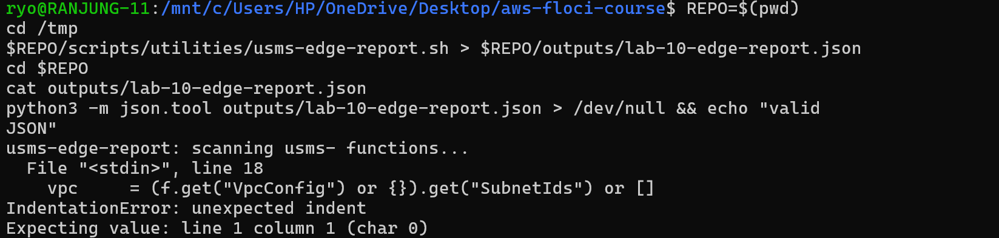

### 3.3 stdout is pure JSON

`usms-edge-report.sh 2>/dev/null | python3 -m json.tool` succeeds, which shows that the diagnostics only go to stderr.

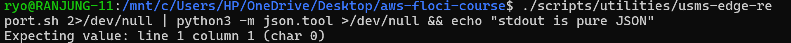

### Why the notifier is not edge-eligible

1. **It has environment variables** (`USMS_BUCKET`, `USMS_NOTIFY_CHANNEL`). Lambda@Edge refuses any function that has environment variables.
2. **Its timeout is exactly at the limit.** It is 30 s, which is the maximum for origin-side triggers, so it passes only just. By the stated rules on this build, the environment variables are the only failing check.

There is also a design reason. The notifier is invoked through an **alias** (`live`) by an **S3 event**, while CloudFront only accepts a numbered version ARN and sends a CloudFront event. It is a regional function by design, and the report shows that this is correct.

---

## Exercise 4: Transcript delivery policy design

This is a design document with no commands, written in [`notes/lab-10-edge-design.md`](../../notes/lab-10-edge-design.md). It covers:

1. Which logic runs where: a CloudFront Function, Lambda@Edge, or a regional function.
2. The cache key, and what is deliberately left out of it.
3. How the five-minute correction window and the no-unnecessary-re-fetch requirement are both met.
4. Where the refusal-by-faculty report comes from, given that edge logs land in many regions.
5. One requirement an edge function is the wrong tool for.

---

## Exercise 5: Hand the S3 lab a starting bucket

### 5.1 and 5.2 Locate and validate the Lab 09 draft

`outputs/lab-09-bucket-policy-draft.json` already existed. I wrote `scripts/utilities/usms-validate-bucket-policy.sh`, which **only reports** and never edits the draft. It checks three things:

- Every resource ARN is `usms-student-data` or an object path under it.
- Every principal is an existing role. It calls `iam get-role` for each one. The account root is allowed.
- Every role that carries `USMSStudentDataReadWrite` is granted `s3:GetObject` on `usms-student-data/*`. It finds those roles with `iam list-entities-for-policy`.

Result: **`VALIDATION RESULT: PASS - 0 mismatch(es)`**. All 3 resources and all 8 principals resolve. The three `USMSStudentDataReadWrite` carriers (`usms-ec2-app-role`, `usms-ecs-task-role`, `usms-eks-node-role`) are all granted `s3:GetObject`.

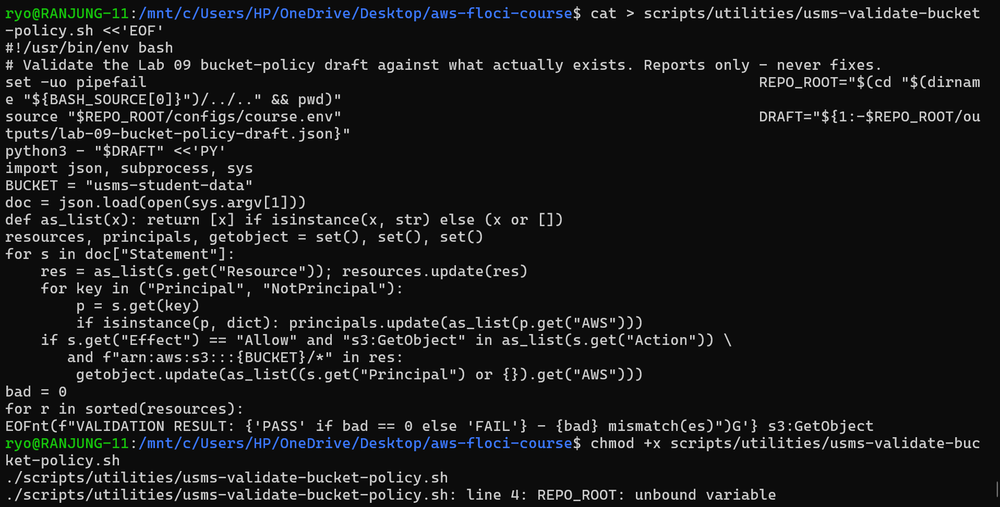


### 5.3 The draft is NOT applied

`aws s3api get-bucket-policy --bucket usms-student-data` fails with **`NoSuchBucketPolicy`**, which is correct. Applying the policy is the S3 lab's job.

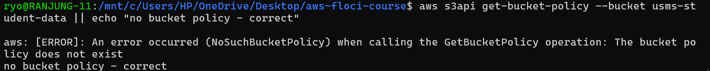

### 5.4 Upload the allow trace and confirm the notifier saw it

I uploaded `outputs/lab-10-edge-trace.json` to `s3://usms-student-data/transcripts/evidence/lab-10-edge-trace.json`. The notifier log has a `USMS_NOTIFY` line for that key with `"event": "ObjectCreated:Put"` and `"readable": true`. There are **2 objects** under `transcripts/`.

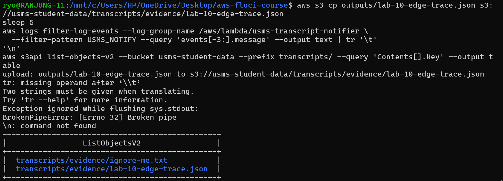

### 5.5 The readiness file, generated by a script

`scripts/utilities/usms-s3-readiness.sh` regenerates `outputs/lab-10-s3-readiness.txt` every time it runs. Nothing in the file is written by hand. It contains:

- **Bucket:** `usms-student-data`, `arn:aws:s3:::usms-student-data`
- **Objects under `transcripts/`:** 2
- **Notification:** `usms-transcript-upload` → `...:usms-transcript-notifier:live`, `s3:ObjectCreated:*`, prefix `transcripts/`, suffix `.json`
- **Published versions:** viewer-request `1 3`, origin-response `1 2 4`, notifier `1`
- **CloudFront supported on this build:** yes (`EHPVYOGADVTSYD`)
- **Bucket policy:** none applied (correct)
- **Point 2 validation:** PASS, 0 mismatches

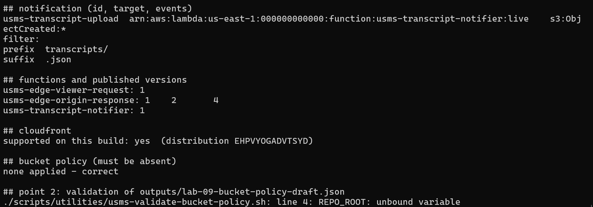

### 5.6 The readiness file stays out of Git

`git check-ignore -v` shows `.gitignore:35:outputs/*`, and `git ls-files outputs/` lists only `.gitkeep`.

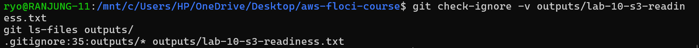

---

## Final state

- `verify-lab-10.sh` reports **PASS=51 FAIL=0** after all five exercises.
- The notifier alias `live` still points at version **1**.
- I am keeping these, as Section 15 says: origin-response version 2 (Exercise 1), and `usms-edge-exec-role` with `USMSEdgeBasic` (Exercise 2).

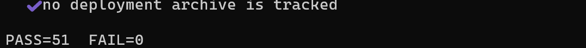

## What I learned

- **Versions freeze configuration as well as code.** The execution role moves with the version, so a rollback is also a permissions rollback.
- **The emulator is not proof.** Floci accepted `--qualifier 1` but ran `$LATEST`. A command that returns successfully is not evidence that it did what I meant, so I checked the per-version `CodeSha256` instead.
- **Chaining with `&&` prevents half-done changes.** When the role update failed, the unchained `publish-version` still ran and created versions with the wrong role.
