# Lab 11 Practical Report: CI/CD with AWS CodeBuild and AWS CodePipeline

## 1. Aim / Objective

The aim of this lab is to turn the USMS enrolment service into something that is **built by a machine, not by hand**. I wrote the service's source tree and its build instructions (`buildspec.yml`), created a **CodeBuild** project that builds it, and joined everything into a two-stage **CodePipeline** that takes a versioned source zip from S3 and produces a tested build artifact. Everything was done with the AWS CLI on the local emulator Floci.

The specific objectives were to:

- Create a **versioned, private S3 artifact bucket** (`usms-pipeline-artifacts`) and prove that versioning really works.
- Write the enrolment service **source tree**: a page with build placeholders, a health file, a service configuration and a **smoke test** with seven checks.
- Write a **`buildspec.yml`** with the four CodeBuild phases (`install`, `pre_build`, `build`, `post_build`) and an `artifacts` section rooted at `dist/`.
- Create **two least-privilege service roles**: `usms-codebuild-role` (its own logs and the artifact bucket only) and `usms-codepipeline-role` (the artifact store, one build project and one scoped `iam:PassRole`).
- Create the **CodeBuild project** `usms-enrolment-build`, package and upload the source, and run a build.
- Write a **local buildspec runner** so the same buildspec can be run on my own machine.
- Create the **pipeline** `usms-enrolment-pipeline` (Source → Build), hand the build project to it, and run it end to end.
- **Break the build on purpose**, diagnose it, and fix it.
- Save the values to `configs/lab-11.env`, check the lab with `verify-lab-11.sh`, and commit.

## 2. Introduction

**CI/CD** (Continuous Integration / Continuous Delivery) means that every change to the source goes through the same automatic steps: fetch the source, build it, test it, and produce an artifact that can be deployed. In AWS, three services share this work:

| Service | Its job in this lab |
|---|---|
| **Amazon S3** | Stores the versioned source zip and every artifact the pipeline produces |
| **AWS CodeBuild** | Runs the commands in `buildspec.yml` inside a build container and uploads the result |
| **AWS CodePipeline** | Joins the stages together: when the source changes, it fetches it and hands it to CodeBuild |

The main ideas of this lab:

| Concept | Simple meaning |
|---|---|
| **buildspec.yml** | The build instructions, kept **inside the source tree**. Changing the build is a normal, reviewable, versioned source change. |
| **Four phases** | `install` (tools) → `pre_build` (checks that must pass first) → `build` (produce) → `post_build` (test and report). A failure names its phase. |
| **Artifact** | The files the build keeps. `base-directory: dist` makes `dist/` the root of the zip, so there is no `dist/` prefix inside it. |
| **Versioned source** | S3 versioning keeps every upload of the same key. Old releases stay retrievable, and CodePipeline requires it for an S3 source. |
| **Service role** | The identity a service uses when it acts. CodeBuild and CodePipeline each get their own role with only what they need. |
| **`iam:PassRole`** | Permission to hand a role to a service. The pipeline may pass **only** `usms-codebuild-role`, and **only** to `codebuild.amazonaws.com`. |
| **Stage / action / artifact name** | A pipeline is ordered stages; each stage has actions; actions pass named artifacts (`SourceOutput`, `BuildOutput`) to each other. |
| **Quoted vs unquoted heredoc** | `<< 'EOF'` writes the text literally; `<< EOF` runs every `$(...)` first and writes the result. |

The most important limitation: **Floci accepts CodeBuild and CodePipeline, but it cannot run a real build.** The build container `aws/codebuild/standard` cannot be pulled, so every build ends with `FAULT` after `DOWNLOAD_SOURCE`. I recorded this and produced the artifact with the **local runner** instead. The lab calls this Path B.

## 3. Use Case

**USMS use case:** the enrolment service is currently built by hand, so nobody can say exactly what is running or how it was made. The university asked for:

- **A repeatable build.** The same source must always produce the same artifact, using commands stored next to the code.
- **Checks before building.** A missing `VERSION` file, invalid JSON, or the wrong container name in `config/service.json` must stop the build **before** anything is produced. I also added a check that the port is `80`.
- **A tested artifact.** The release marker and build time must be stamped into the page, and seven smoke tests must pass before the artifact is accepted.
- **Traceability.** The artifact must record its release (`r3`, `r4`, `r5`), build time, build ID and source version, and every earlier source upload must still be retrievable.
- **Least privilege.** The build may write only its own logs and the artifact bucket, and the pipeline may start only this one build project.

## 4. System Architecture / Design

**How it works in simple words:**

1. **Source:** I pack `labs/lab-11-cicd/app/` into `usms-enrolment-src.zip`, with `buildspec.yml` at the root, and upload it to `s3://usms-pipeline-artifacts/source/usms-enrolment-src.zip`. Every upload creates a **new version**.
2. **Pipeline stage 1, Source:** the `FetchSource` action (provider **S3**) reads the latest version and stores it as the artifact **`SourceOutput`**.
3. **Pipeline stage 2, Build:** the `BuildArtifact` action starts CodeBuild project **`usms-enrolment-build`** with `SourceOutput` as input. CodeBuild runs the four phases from `buildspec.yml` and uploads `dist/` as **`BuildOutput`**.
4. **Permissions:** CodePipeline acts as **`usms-codepipeline-role`** (policy `USMSCodePipelineBase`), and CodeBuild acts as **`usms-codebuild-role`** (policy `USMSCodeBuildBase`).
5. **On Floci:** stage 1 succeeds, and stage 2 fails because the build image cannot be pulled. The **local runner** `usms-buildspec-run.sh` runs the same four phases on my machine and produces the same `dist/` artifact.

| Resource | Name | Key settings |
|---|---|---|
| S3 bucket | `usms-pipeline-artifacts` | Versioning **Enabled**, public access blocked, tags `Project=USMS`, `Tier=pipeline`, `Lab=11` |
| CodeBuild project | `usms-enrolment-build` | Image `aws/codebuild/standard:7.0`, `BUILD_GENERAL1_SMALL`, timeout 15 min, source finally `CODEPIPELINE` |
| CodeBuild role | `usms-codebuild-role` | Trusts `codebuild.amazonaws.com`, policy `USMSCodeBuildBase` |
| Pipeline | `usms-enrolment-pipeline` | 2 stages, artifact store `usms-pipeline-artifacts` |
| Pipeline role | `usms-codepipeline-role` | Trusts `codepipeline.amazonaws.com`, policy `USMSCodePipelineBase` (v1) |

## 5. Implementation Procedure

### Step 1: Start Floci and confirm where I am

I started Floci and ran the storage check. The host state directory `/home/ryo/floci-data` exists (5.8M). `whoami.sh` showed profile `floci`, endpoint `http://localhost:4566`, region `us-east-1` and account **000000000000**, with the message **"this is Floci, not real AWS"**.

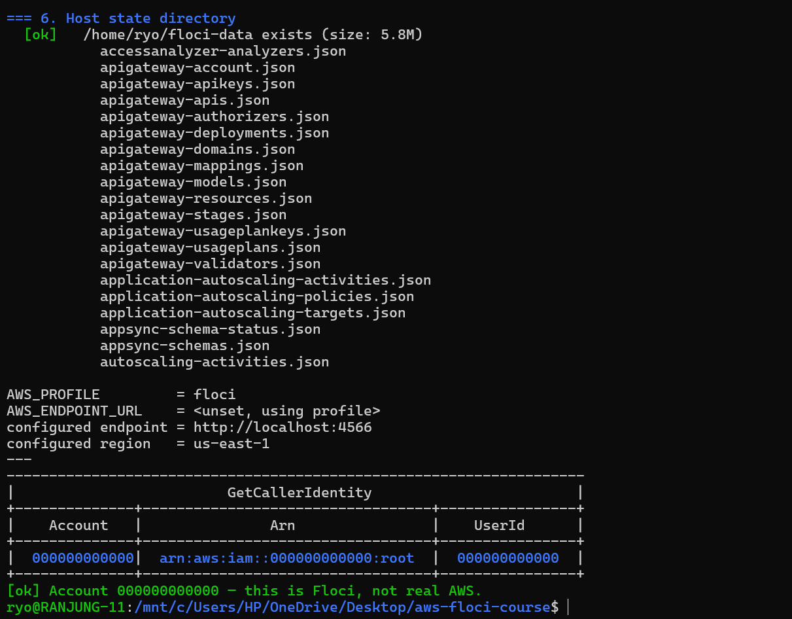

### Step 2: Source every earlier lab's environment

I sourced the env files for Labs 01–10. All ten were **sourced**, none absent, and my identity was still account `000000000000`.

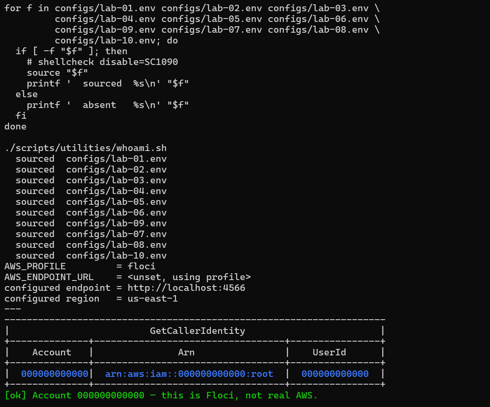

The values this lab inherits from earlier labs were all set:

| Value | Result |
|---|---|
| cluster | `usms-ecs-cluster` |
| service | `usms-enrolment-svc` |
| container | `enrolment-api` |
| target group | `arn:aws:elasticloadbalancing:us-east-1:000000000000:targetgroup/usms-enrolment-tg/79e4b7e1c474491c` |
| exec role | `arn:aws:iam::000000000000:role/usms-ecs-exec-role` |

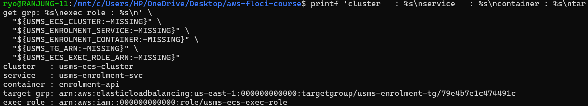

### Step 3: Probe CI/CD support and choose my path

I wrote `scripts/utilities/cicd-support-probe.sh` (syntax OK) and ran it. Every check passed:

| Area | Result |
|---|---|
| CodeBuild | `list-projects` answers, `create-project` accepted, probe project deleted |
| CodePipeline | `list-pipelines` answers |
| Deploy targets (Lab 12) | `ecr describe-repositories` and `codedeploy list-applications` answer |

The probe chose **PATH A - CodeBuild and CodePipeline both present** and saved it to `outputs/lab-11-support-probe.txt`. Later steps showed that the APIs answer but a build cannot actually run, so in practice parts of this lab followed Path B.

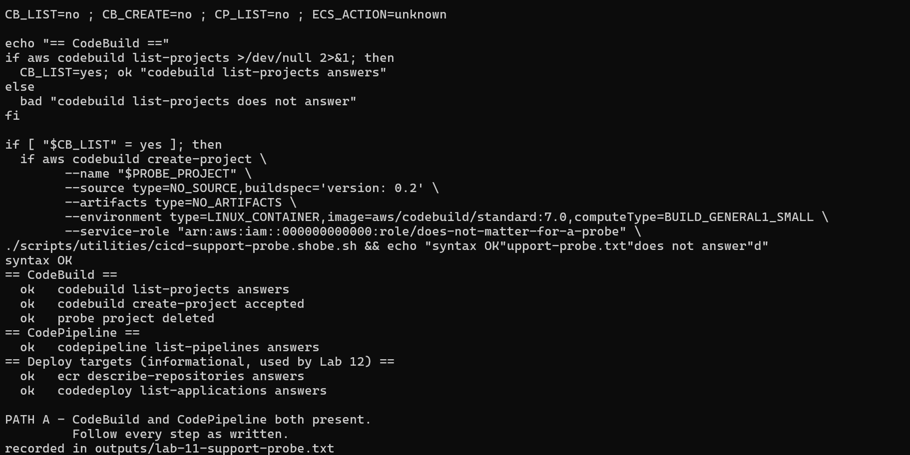

### Step 4: Create this lab's directories

I created `labs/lab-11-cicd/app/{src,config,tests}` and the shared `policies`, `templates`, `scripts/utilities`, `scripts/cleanup`, `outputs` and `notes` folders. `ls -d` listed `config`, `src` and `tests`.

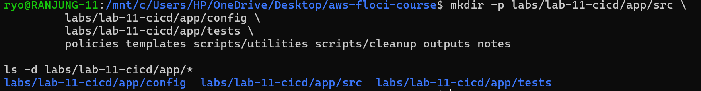

### Step 5: Create the pipeline artifact bucket

I created `usms-pipeline-artifacts`, tagged it, turned on **versioning** and **blocked all public access**. The bucket was created at `/usms-pipeline-artifacts`.

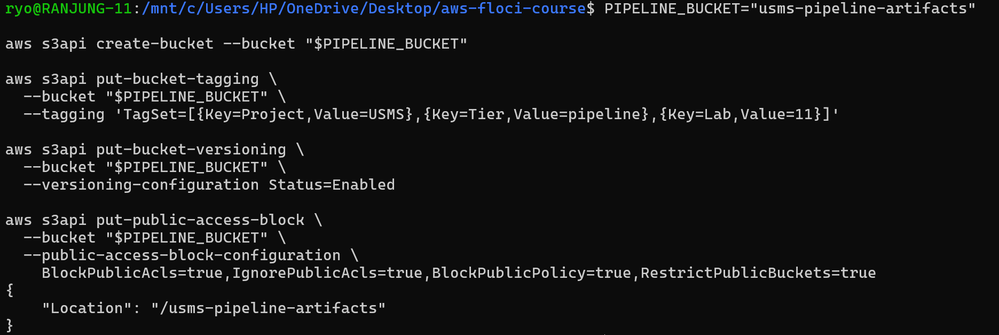

**Verify:** versioning **Status = Enabled**, and the tags are `Project=USMS`, `Tier=pipeline`, `Lab=11`.

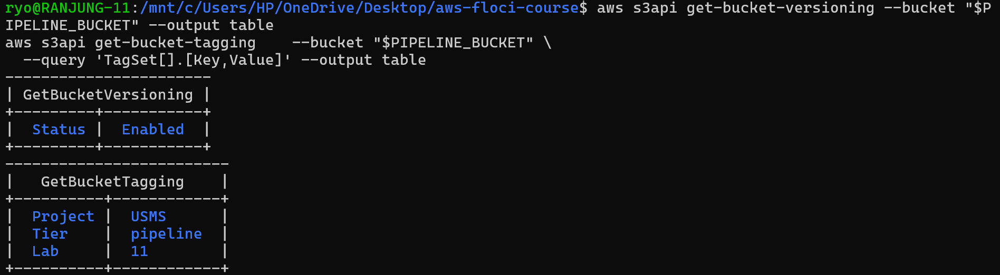

### Step 6: Prove versioning is on

I wrote two different objects (`first`, then `second`) to the same key `probe/versioning.txt`. `list-object-versions` showed **two versions**, exactly one marked latest:

| Latest | Size | Version |
|---|---|---|
| True | 7 | `da40994c-41f6-42e2-b516-ee3adad59b44` |
| False | 6 | `7f86abe0-3408-470c-8efc-5c45b561cce6` |

The old object was not overwritten. It is still there as an older version.

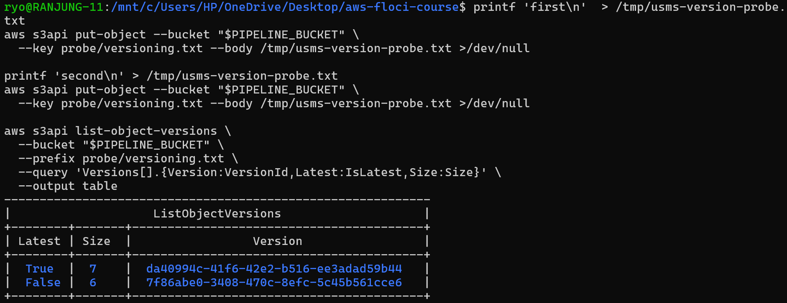

I then deleted both probe versions by version ID. The final count under `probe/` was **0**.

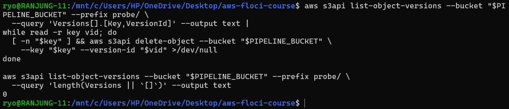

### Step 7: Write the enrolment service source tree

**Part 1, the application:** `VERSION` holds `r3`. `src/index.html` contains two placeholders, `__RELEASE__` and `__BUILT_AT__`, which the build must replace. `src/healthz.html` contains only `ok`.

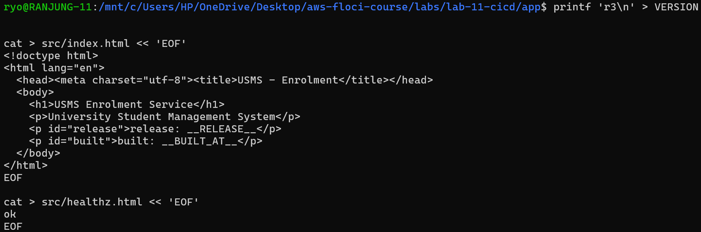

**Part 2, the configuration:** `config/service.json` names the service `enrolment`, project `USMS`, container **`enrolment-api`**, port **80**, health path `/healthz.html`, cluster `usms-ecs-cluster` and ECS service `usms-enrolment-svc`. It is **valid JSON**.

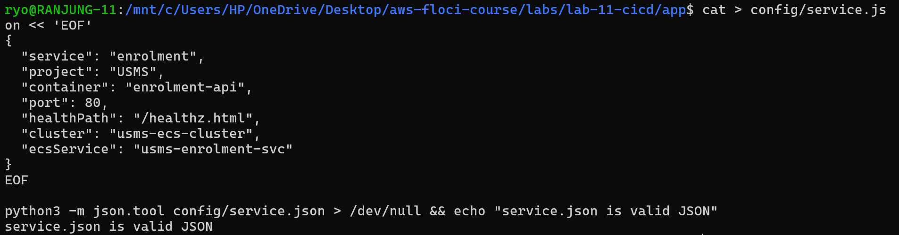

**Part 3, the test:** `tests/smoke.sh` has **seven checks**: both files exist, both placeholders were replaced, the health file says `ok`, the build metadata is valid JSON, and the container name matches the task definition. It does not use `set -e`, so every result prints. `bash -n` said **syntax OK**.

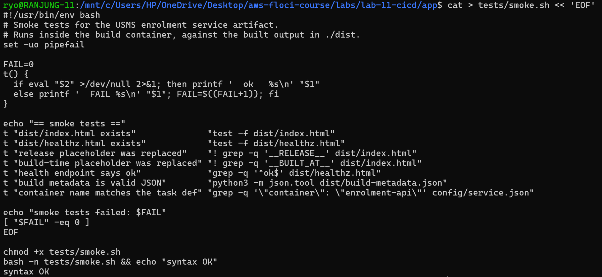

**Verify:** `find` lists the five source files.

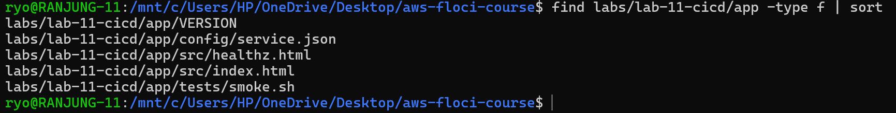

### Step 8: Write `buildspec.yml`

I wrote `labs/lab-11-cicd/app/buildspec.yml` with `version: 0.2`, the variables `SERVICE_NAME=enrolment` and `ARTIFACT_DIR=dist`, the four phases, `artifacts.base-directory: dist` with `files: ['**/*']`, and an empty cache. The outer heredoc was quoted (`<< 'BUILDSPEC'`), so `$USMS_RELEASE` and `${CODEBUILD_BUILD_ID:-local}` reached the file literally, for CodeBuild to expand at build time.

**Verify:** `version` (line 1), `phases` (line 8), `artifacts` (line 63) and `base-directory: dist` (line 64) each appear **exactly once**, so the file was not pasted twice. The file has 69 lines after my Your-turn addition.

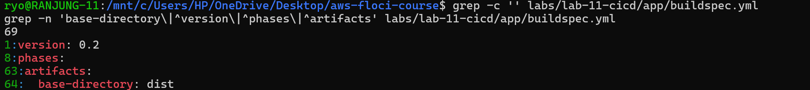

### Your turn: fail the build if the port is not 80

I added a second check to `pre_build`, after the container check:

```yaml
      - |
        grep -q '"port": 80,' config/service.json || {
          echo "config/service.json must set \"port\": 80 (the container listens on 80) - fix the port value and re-run"
          exit 1
        }
```

The grep pattern contains `": "`, so it has to be a `- |` literal block. As a plain list item, YAML would read it as a mapping and the file would not parse. The trailing comma stops the pattern from also matching `8080`.

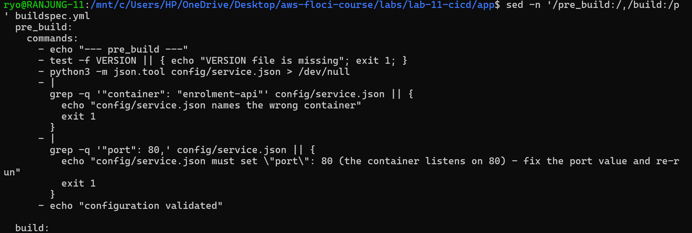

**Result:**

| Test | Result |
|---|---|
| `buildspec.yml` still parses, all four phases present | yes, **6** `pre_build` commands (was 5) |
| port `80` | **port check PASSED** |
| port changed to `8080` | prints my message and **exit code: 1**, so the build stops in `pre_build` |
| port restored | `"port": 80,` |

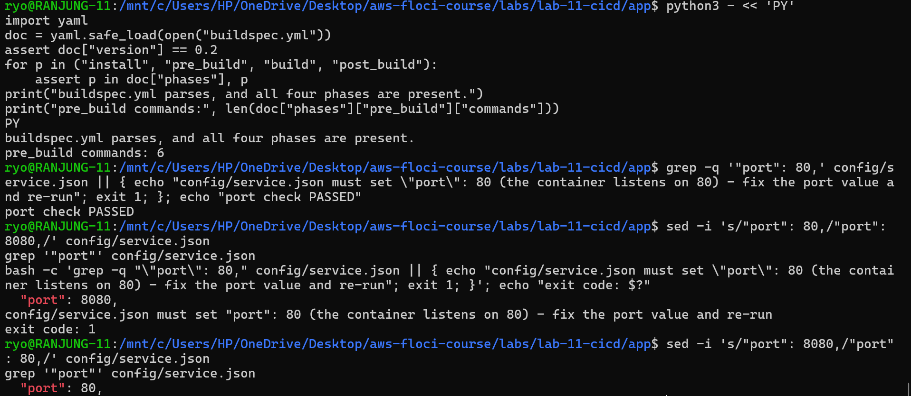

### Step 9: Create the CodeBuild service role and its policy

**Part 1, the trust policy:** `policies/trust-codebuild.json` lets only **`codebuild.amazonaws.com`** assume the role, with a condition `aws:SourceAccount = 000000000000`. It is valid JSON.

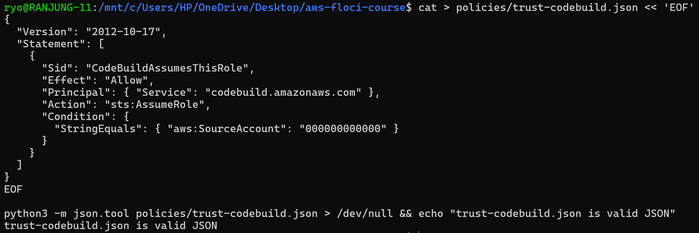

**Part 2, the permissions policy:** `policies/usms-codebuild-policy.json` has two statements:

| Sid | Allows | On |
|---|---|---|
| `WriteItsOwnBuildLogs` | `logs:CreateLogGroup`, `CreateLogStream`, `PutLogEvents` | only `/aws/codebuild/usms-enrolment-build` |
| `ReadSourceAndWriteArtifacts` | `s3:GetObject`, `GetObjectVersion`, `PutObject`, `GetBucketAcl`, `GetBucketLocation` | only `usms-pipeline-artifacts` |

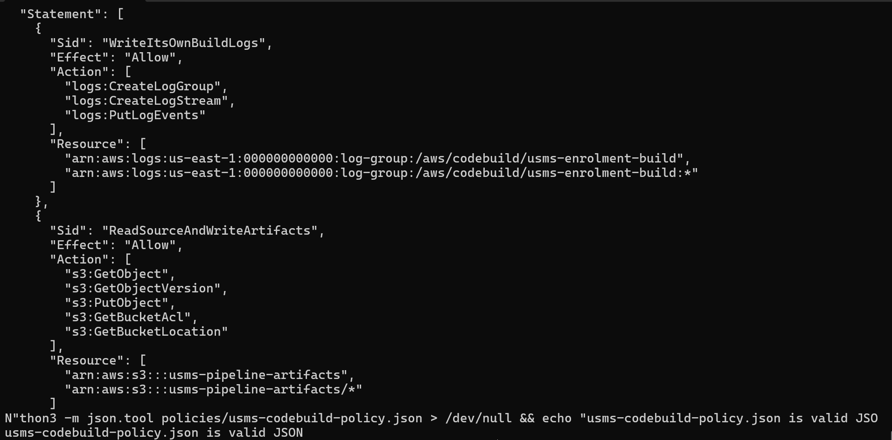

**Part 3:** I created `usms-codebuild-role`, created the policy `USMSCodeBuildBase` and attached it. The role ARN is `arn:aws:iam::000000000000:role/usms-codebuild-role`.

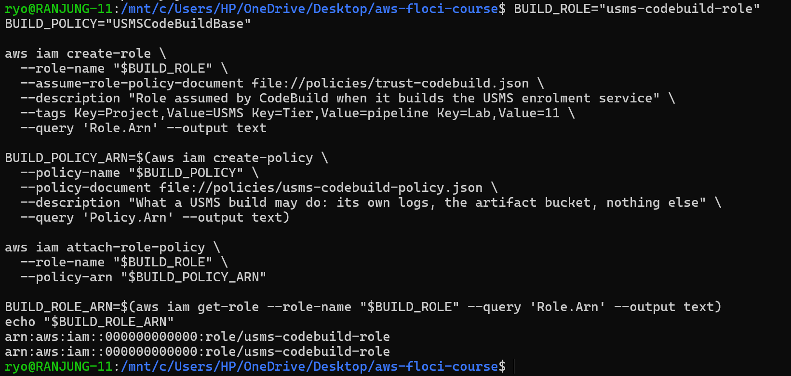

**Verify:** the only attached policy is `USMSCodeBuildBase`, and the trusted principal is `{"Service": "codebuild.amazonaws.com"}`.

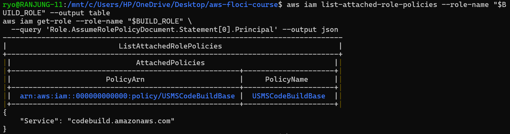

### Step 10: Create the CodeBuild project

I wrote `templates/lab-11-codebuild-project.json`: source **S3** at `usms-pipeline-artifacts/source/usms-enrolment-src.zip`, artifacts to `build/usms-enrolment-build.zip` (ZIP), image `aws/codebuild/standard:7.0`, `BUILD_GENERAL1_SMALL`, privileged mode off, two plaintext variables (`USMS_PROJECT`, `USMS_SERVICE`), timeout 15 and queued timeout 30 minutes. The template is valid JSON, and `grep -c '\$'` returned **0**, so the role ARN was expanded.

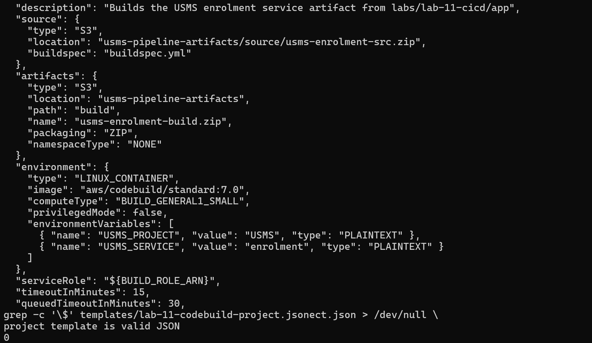

**Create:** the project was created with Name `usms-enrolment-build`, Role `usms-codebuild-role`, Image `aws/codebuild/standard:7.0`, Source `S3`.

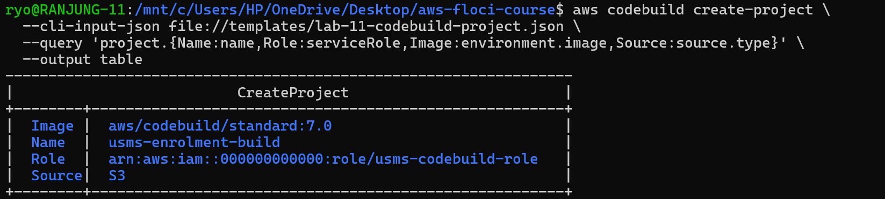

**Verify:** `batch-get-projects` read it back with Artifacts `S3`, the correct source location and Timeout **15**.

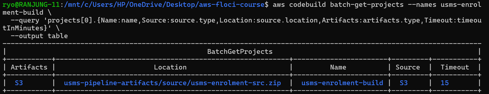

### Step 11: Package and upload the source

**Part 1, the packer:** `scripts/utilities/usms-pack-source.sh` zips a directory so that its **contents** are the zip root, skips `*.bak` and `dist/`, and falls back to Python's `zipfile` when `zip` is not installed. Syntax OK.

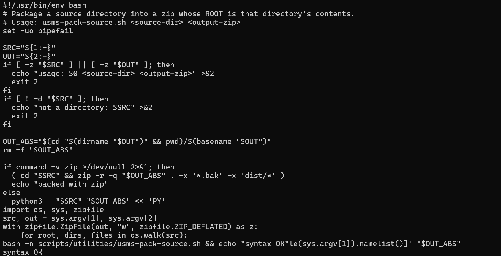

**Part 2, pack and upload:** `zip` was not installed in my WSL, so the script **packed with python3 zipfile**. The archive has **6 files** at the top level (`VERSION`, `buildspec.yml`, `config/service.json`, `src/healthz.html`, `src/index.html`, `tests/smoke.sh`). The upload returned the first source version **`b65be70b-9ad2-4379-af6a-2b8682b5bde1`**.

At first I ran this from `~/aws-floci-course` (a second copy of the course in my WSL home), where `labs/lab-11-cicd/app` does not exist. The packer said `not a directory`, and `put-object` failed with *Blob values must be a path to a file*. I switched to `/mnt/c/Users/HP/OneDrive/Desktop/aws-floci-course` and used it for the rest of the lab.

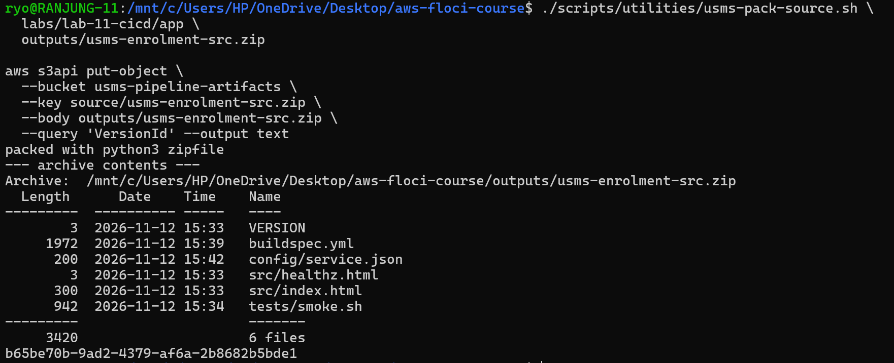

### Step 12: Run the build on its own

`start-build` returned the build ID **`usms-enrolment-build:1`**.

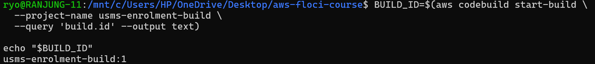

**Verify:** the polling loop stopped at the first check with **status=FAULT, phase=COMPLETED**.

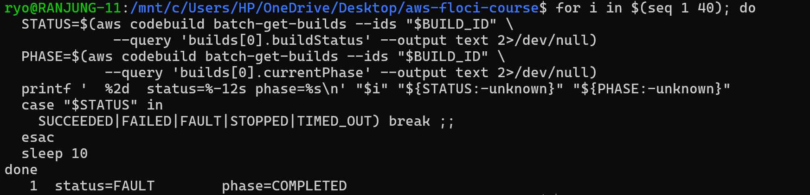

### Step 13: Read the build output and the logs

The phase table shows where the build stopped:

| Phase | Seconds | Status |
|---|---|---|
| SUBMITTED | 0 | SUCCEEDED |
| QUEUED | 0 | SUCCEEDED |
| PROVISIONING | 0 | SUCCEEDED |
| DOWNLOAD_SOURCE | 0 | SUCCEEDED |
| COMPLETED | 0 | **FAILED** |

None of my four phases (`INSTALL` to `POST_BUILD`) ran. I asked for the phase contexts, and the reason was:

> `Status 404: {"message":"pull access denied for aws/codebuild/standard, repository does not exist or may require 'docker login'"}`

So the source was fine (`DOWNLOAD_SOURCE` succeeded, and `unzip -l` showed `buildspec.yml` at the zip root), but Floci could not pull the build image. I recorded this in `notes/lab-11-notes.md` and saved the full build record to `outputs/lab-11-build-1794488662.json`.

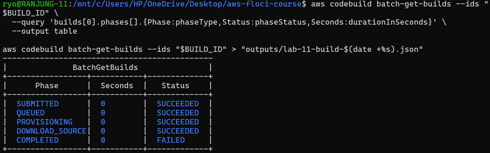

**The log:** the log group is `/aws/codebuild/usms-enrolment-build` and the stream is `2026/11/12/usms-enrolment-build/1`, but the stream has **no events**, because the build container never started.

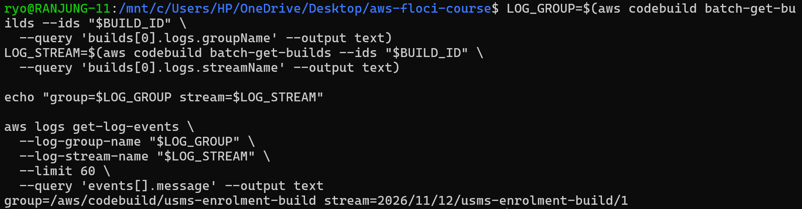

### Step 14: The local buildspec runner

I wrote `scripts/utilities/usms-buildspec-run.sh`. It parses `buildspec.yml` with PyYAML, turns the four phases into one bash script, and runs it in the app directory. It stops at the first failure, and because there are no `CODEBUILD_*` variables, the buildspec's `:-local` defaults are used.

The local build ran all four phases:

- `install`: Python 3.12.3, GNU sed 4.9
- `pre_build`: **configuration validated**
- `build`: **release=r3 builtAt=2026-11-12T13:14:36Z**
- `post_build`: **all 7 smoke tests ok**, `smoke tests failed: 0`
- `dist/` contains `build-metadata.json`, `healthz.html`, `index.html`, `service.json`
- **`=== all phases completed ===`**, local build exit status **0**

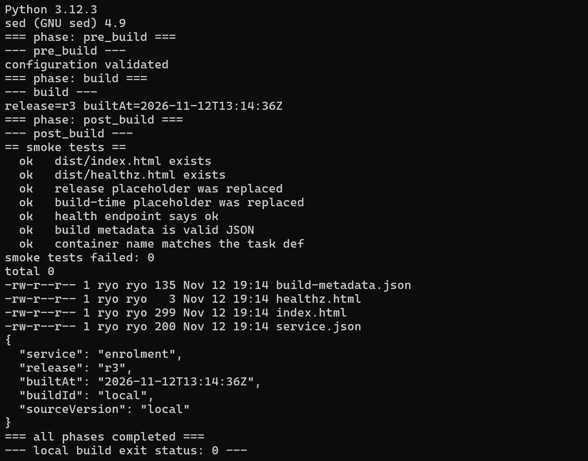

**Verify:** `build-metadata.json` shows release `r3`, `buildId: local` and `sourceVersion: local`, and line 7 of `dist/index.html` is now `release: r3`, so the placeholder was replaced.

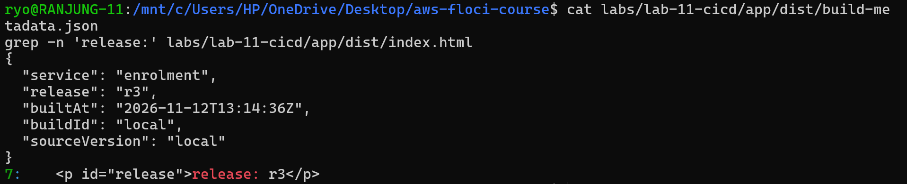

I added `labs/lab-11-cicd/app/dist/` to `.gitignore`. `git check-ignore` confirmed that **line 36** of `.gitignore` ignores the build output, so a build product can never be committed by mistake.

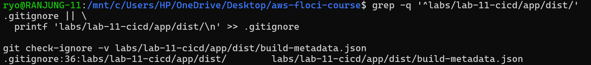

### Step 15: Create the CodePipeline service role and its policy

**Part 1, the documents:** `policies/trust-codepipeline.json` trusts only **`codepipeline.amazonaws.com`** (same account condition). `policies/usms-codepipeline-policy.json` has three statements:

| Sid | Allows |
|---|---|
| `ReadAndWriteTheArtifactStore` | Get/put objects and versions, `GetBucketVersioning`, `GetBucketLocation` on `usms-pipeline-artifacts` only |
| `StartAndWatchTheEnrolmentBuildOnly` | `codebuild:StartBuild`, `BatchGetBuilds`, `StopBuild` on **one project ARN**, not `project/*` |
| `PassTheBuildRoleAndOnlyToCodeBuild` | `iam:PassRole` on `usms-codebuild-role` only, with `iam:PassedToService = codebuild.amazonaws.com` |

Both files are valid JSON.

My first attempt failed: the policy file was **empty (0 bytes)**, so `python3 -m json.tool` printed `Expecting value: line 1 column 1`, `create-policy` failed with *Invalid length for parameter PolicyDocument, value: 0*, and `PIPELINE_POLICY_ARN` stayed empty. I rewrote the file with the lab's content.

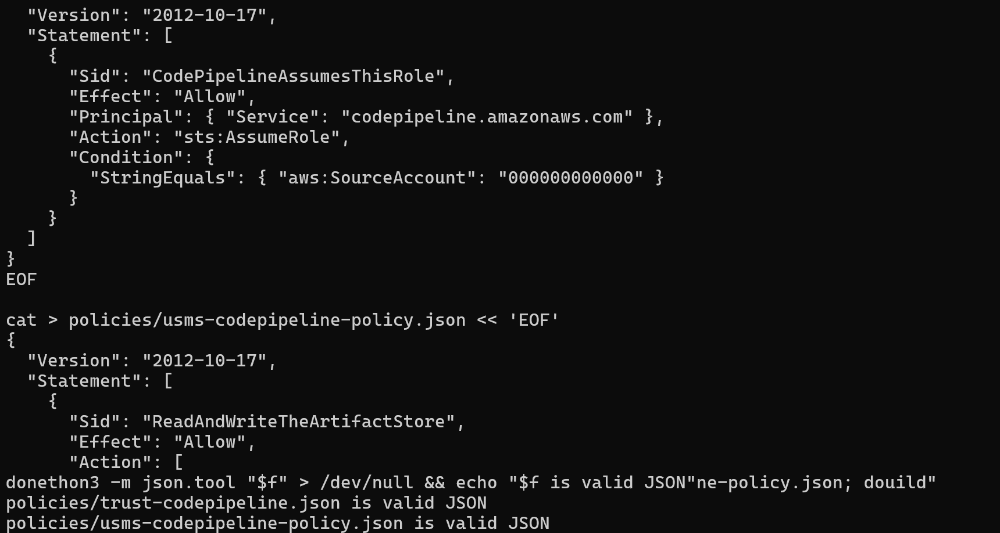

**Part 2, create and attach:** the role `usms-codepipeline-role` had already been created by the first attempt, and the policy now reported `EntityAlreadyExists`. So I set `PIPELINE_POLICY_ARN=arn:aws:iam::000000000000:policy/USMSCodePipelineBase` directly, attached it, and read back the role ARN `arn:aws:iam::000000000000:role/usms-codepipeline-role`.

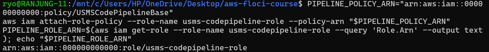

**Verify:** `USMSCodePipelineBase` has Default **v1** and Attached **1**.

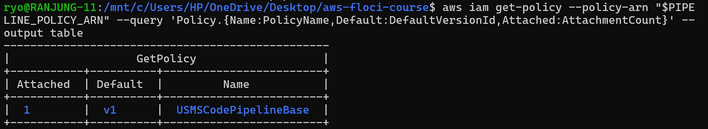

### Step 16: Write the pipeline definition

I wrote `templates/lab-11-pipeline.json` with an unquoted heredoc, so `${PIPELINE_ROLE_ARN}` was expanded. It defines the pipeline `usms-enrolment-pipeline`, the S3 artifact store, a **Source** stage (`FetchSource`, provider S3, key `source/usms-enrolment-src.zip`, `PollForSourceChanges: "false"` as a string) and a **Build** stage (`BuildArtifact`, provider CodeBuild, project `usms-enrolment-build`). It is valid JSON, and `grep -c '\$'` returned **0**.

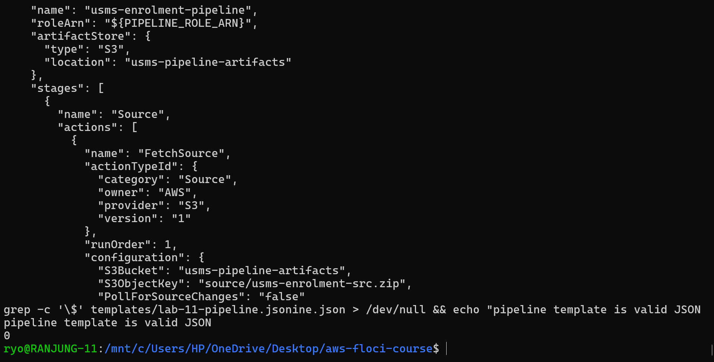

### Step 17: Create the pipeline

`create-pipeline` returned Name `usms-enrolment-pipeline`, Role `usms-codepipeline-role` and **Stages 2**.

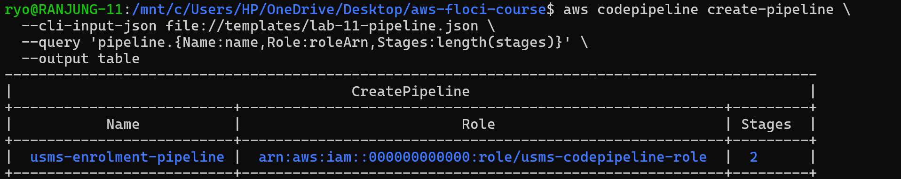

**Verify:** `get-pipeline-state` showed both stages (`Source/FetchSource` and `Build/BuildArtifact`), but every status was **`None`**. On real AWS, creating a pipeline starts an execution immediately. Here, Floci stored the pipeline but did not start that automatic execution. The lab lists this as a Floci limitation.

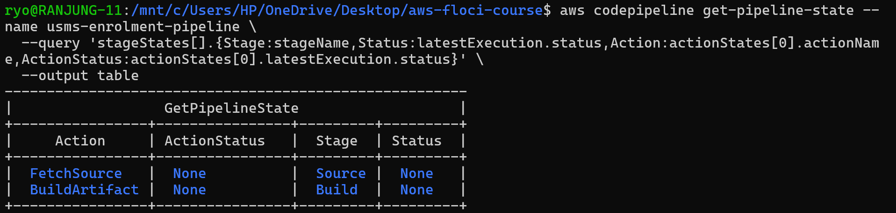

### Step 18: Hand the project to the pipeline

I changed the project's source and artifacts to **`CODEPIPELINE`**, so the Build stage can only build what the Source stage hands it.

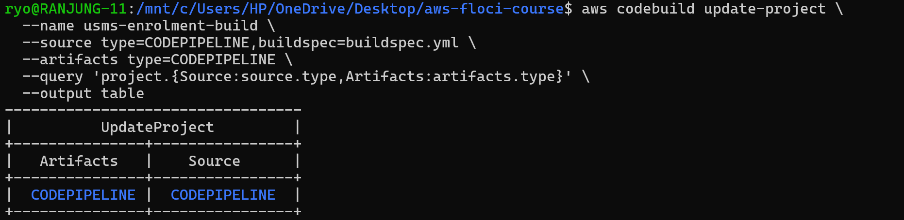

**Verify, the escape hatch and the cost:** a plain `start-build` was still accepted by Floci (`usms-enrolment-build:2`). On real AWS it would be refused, because a `CODEPIPELINE` project has no source of its own. The one-off escape hatch, `--source-type-override S3 --source-location-override ...`, started `usms-enrolment-build:3`.

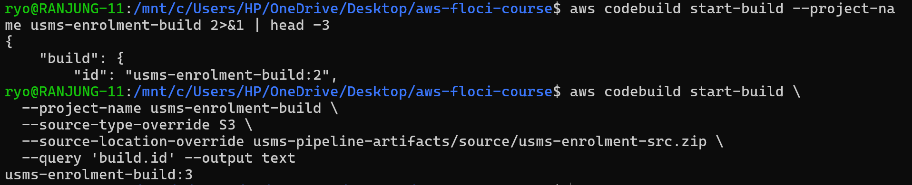

### Step 19: Run the pipeline end to end, and prove it consumed my source

**Part 1, perturb:** I changed `VERSION` to **r4** and uploaded the source again. The upload created a second version **`ab7fecc5-f047-4157-bbb6-568d8a221036`**, and `list-object-versions` now shows **two versions, one Latest**.

The packer line in this screenshot broke across two lines when I pasted it (`usage: ... <source-dir> <output-zip>` and `labs/lab-11-cicd/app: Is a directory`). So the zip was **not rebuilt**, and the r4 upload actually contained the same files as r3. I noticed this later and repacked correctly in the Your-turn step below.

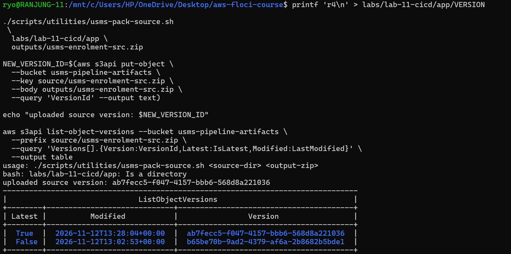

**Part 2, run:** `start-pipeline-execution` returned execution **`84c5e3f0-130d-40c1-b8d0-02b6bd3c5226`**. This time Floci **did** execute it:

| Poll | Source | Build | Execution |
|---|---|---|---|
| 1 | Succeeded | InProgress | InProgress |
| 2 | Succeeded | **Failed** | **Failed** |

**Source = Succeeded** proves that the bucket is versioned, the object exists at the key, and the pipeline role can read it. The Build stage failed for the same image-pull reason as Step 13.

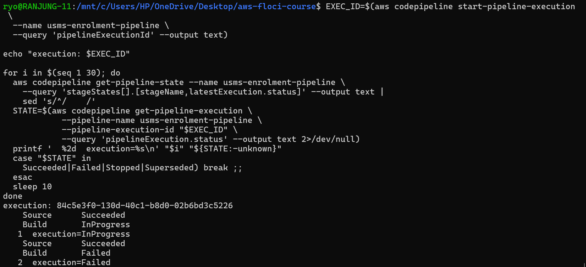

**Part 3, read back:** `list-objects-v2 --prefix usms-enrolment-pipeline/BuildOutput/` returned nothing (`sort_by(): invalid type for value: None`), because CodeBuild never uploaded an artifact. Following Path B, I ran the local runner and zipped `dist/` with Python (`zip` is not installed) into `outputs/lab-11-buildoutput.zip` (863 bytes). The lab's own reader then showed:

| Field | Value |
|---|---|
| artifact contents | `build-metadata.json`, `healthz.html`, `index.html`, `service.json`, no `dist/` prefix |
| release | **r4** |
| builtAt | `2026-11-12T13:30:09Z` |
| buildId | `local` |
| srcVersion | `local` |

`release: r4` proves the build consumed the changed `VERSION` file. `buildId: local` is the correct Path B result: the artifact came from my machine, not from CodeBuild.

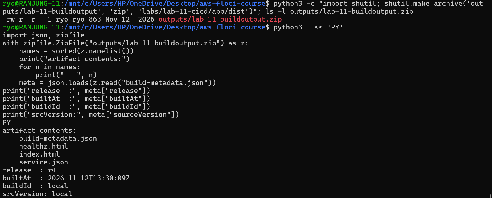

### Your turn: roll the release forward to r5

I set `VERSION` to **r5**, packed the source on one line (this time the packer ran correctly: 6 files, with `VERSION` dated 19:32), uploaded it as version **`72e9dc90-8ff8-4a08-8e5b-6641d3528b50`**, and started execution **`27761f00-ef0b-44a2-baa4-b7281f0135c6`** (Source **Succeeded**, Build InProgress).

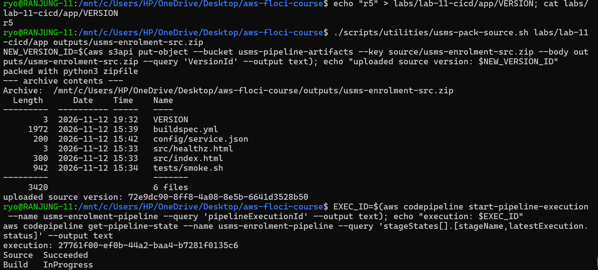

The local runner built **release r5** (`builtAt 2026-11-12T13:32:43Z`, all smoke tests passed, exit 0). The evidence from the commands:

| Count | Command | Result |
|---|---|---|
| Versions of `source/usms-enrolment-src.zip` | `list-object-versions` | **3** (r3 `b65be70b…`, r4 `ab7fecc5…`, r5 `72e9dc90…` Latest) |
| Objects under `usms-enrolment-pipeline/BuildOutput/` | `list-objects-v2` | **0** |

**Why the two numbers are not equal:** a source version is created by **every `put-object`** to the versioned bucket, whether or not a pipeline runs. A `BuildOutput` object is written only when an execution **completes its Build stage**, because that is when CodeBuild uploads the artifact. So the BuildOutput count equals the number of successful executions (including the automatic one at Step 17), not the number of uploads. On real AWS I would expect up to 3 BuildOutput objects. On Floci every Build stage failed at the image pull, so the count is 0, while the source count is 3.

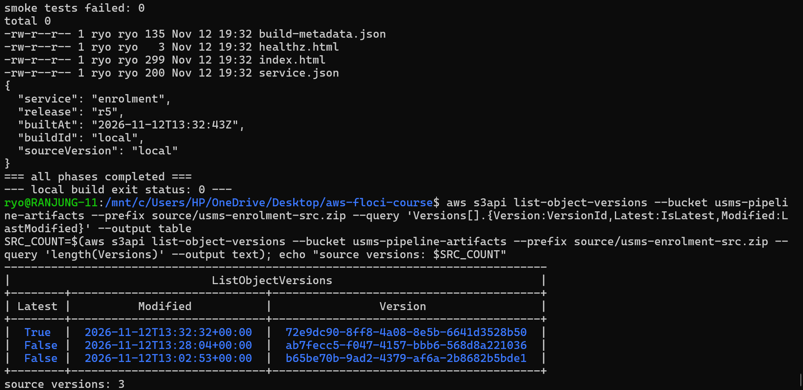

### Step 20: Make the build fail on purpose, then fix it

**Part 1, break it:** I changed the container in `config/service.json` to **`enrolment-api-v2`** (deliberately wrong), uploaded the source (version `c94c2a2c-d5b7-41d4-819e-ddb8dab8a261`) and started execution **`070a96b7-65a3-439a-83b9-26491e073555`**.

The packer line broke across two lines again (`usage:` / `Is a directory`), so this upload reused the **previous** zip, and the wrong container never actually reached S3. On real AWS this would have hidden the deliberate failure. On Floci it made no difference, because the build fails before `pre_build` either way.

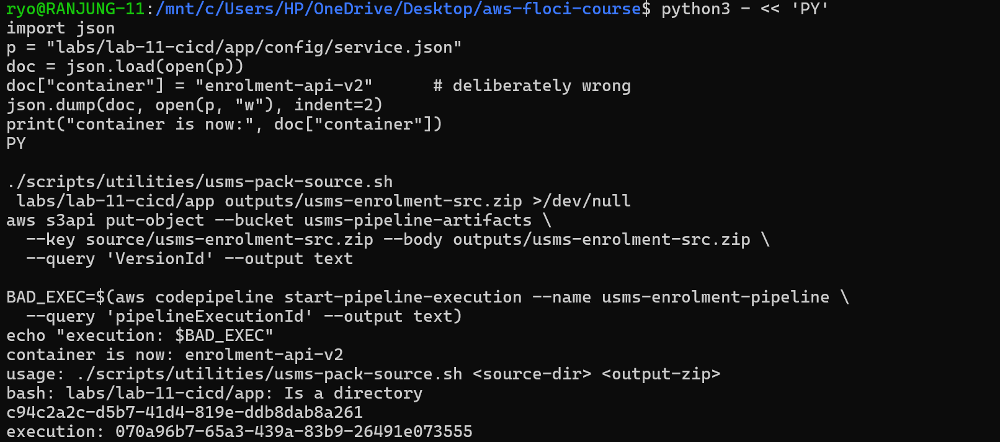

**Part 2, diagnose it:** after 20 seconds, `get-pipeline-state` (saved to `outputs/lab-11-pipeline-state.json`) showed:

| Stage | Status | Summary |
|---|---|---|
| Source | Succeeded | Action completed. |
| Build | **Failed** | CodeBuild build `usms-enrolment-build:6` finished with **FAULT** |

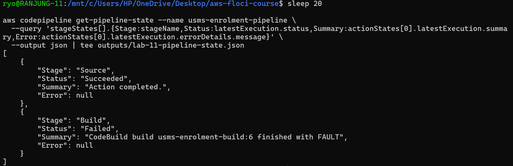

Reading the failed phase of the last build gave the real cause: phase **COMPLETED / FAILED** with *pull access denied for aws/codebuild/standard*. On real AWS the failure would be in **`PRE_BUILD`**, with my message *config/service.json names the wrong container*. Here the image pull fails first, which is an important lesson: **read the failing phase and its message, not just "Failed"**.

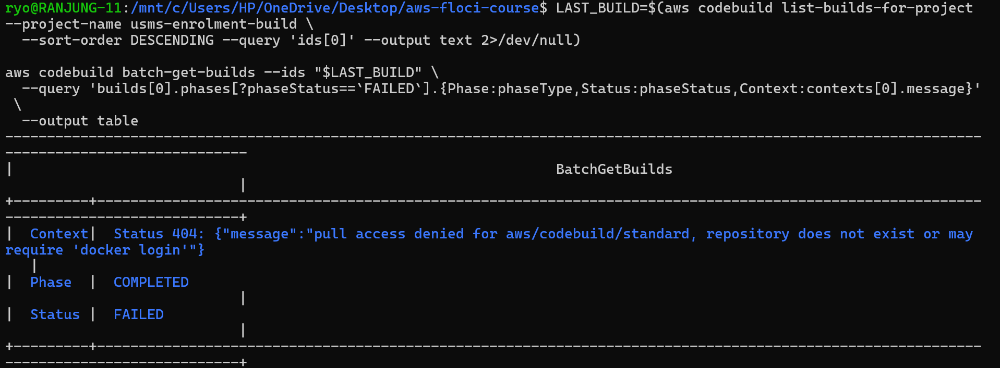

**Part 3, fix it:** I set the container back to **`enrolment-api`**, and the local runner printed **"local build passes again"**. I repacked (correctly this time), uploaded version **`8574841b-f69d-420e-9a2c-e2141079ae0b`**, and started execution `ecae055d-f902-4b5a-a6f2-8cf3c8076e3b`.

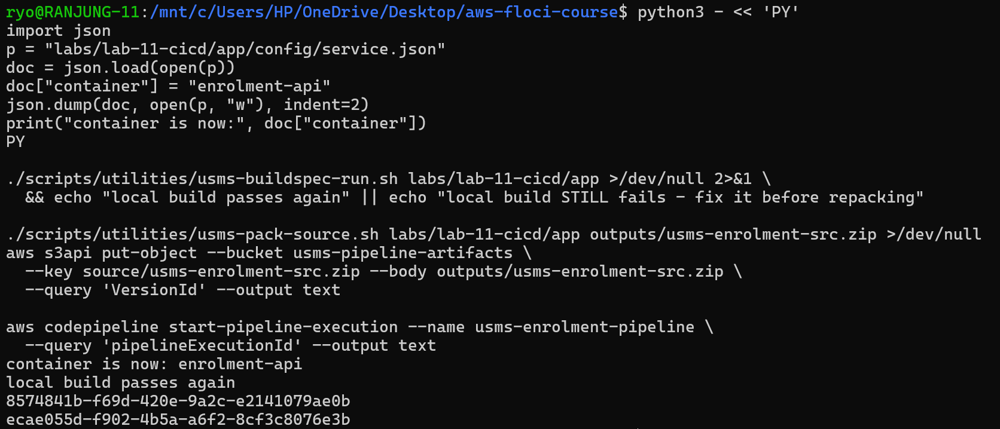

### Step 21: Record this lab's outputs, and commit

I wrote `configs/lab-11.env`. My first version had two problems: it had been saved from a Windows editor, so it had **CRLF line endings** (`$'\r': command not found`), and its `$(...)` commands had been saved as text instead of being run. I regenerated it in WSL with an unquoted heredoc, so every value is now real, for example `USMS_PIPELINE_BUCKET_VERSIONING=Enabled`, `USMS_BUILD_SOURCE_TYPE=CODEPIPELINE`, `USMS_PIPELINE_STAGE_COUNT=2` and `USMS_RELEASE_TAG=r5`.

**Verify:** **all values populated**, and **26** `export` lines.

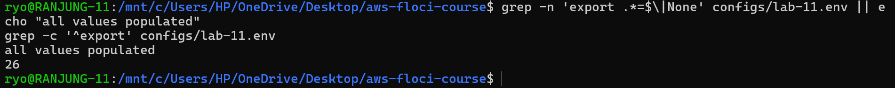

**Commit:** `git status --short` showed the new Lab 11 files: the env file, the lab folder, the notes, four policy documents, three scripts and two templates.


I committed them as `77b8954 Lab 11: source tree, buildspec, CodeBuild project and two-stage pipeline`.


## 6. Verification

`scripts/utilities/verify-lab-11.sh` checks the bucket, both roles and policies, the CodeBuild project, the pipeline, the source tree and scripts, and Git hygiene.

The result was **PASS=46 FAIL=0**, the full Path A score. The script's header expected PASS=38 FAIL=8 on Path B, but its CodeBuild and CodePipeline checks read the stored **configuration**, which Floci keeps correctly. Floci only fails when it tries to **run** a build.

Checks that passed include:

- **Pipeline policy:** `iam:PassRole` is scoped to the build role.
- **CodeBuild:** project `usms-enrolment-build` exists, its source type is `CODEPIPELINE`, it runs as `usms-codebuild-role`, and its image is `standard:7.0`.
- **CodePipeline:** `usms-enrolment-pipeline` exists with **2 stages**, stage 1's provider is S3, and stage 2 builds `usms-enrolment-build`.
- **Source tree and scripts:** `buildspec.yml` is present, declares version 0.2, has all four phases, and has `base-directory: dist`; the smoke test is valid bash; both utility scripts are executable and valid.
- **Files and Git hygiene:** `configs/lab-11.env` is present with no empty or `None` values; both templates and all four policy documents are valid JSON with no unexpanded variables; **no secret is tracked**; and `dist/` is git-ignored.


## 7. Analysis and Discussion

### 7.1 What was achieved

I built a complete CI/CD definition for the USMS enrolment service. The source tree carries its own build instructions (`buildspec.yml`) with validation in `pre_build`, including my extra port-80 check, and a seven-check smoke test in `post_build`. The artifact bucket is **versioned and private**, and I proved versioning by keeping two versions of a probe object and three versions of the source (r3, r4, r5). Two **least-privilege roles** separate what the pipeline may do from what the build may do. The CodeBuild project and the two-stage pipeline were created and verified, and the pipeline's **Source stage succeeded** on every execution.

The build itself could not run on Floci, so I produced every artifact with the **local runner**: r3, r4 and r5 all passed all four phases and all seven smoke tests, and the artifact has the correct root (no `dist/` prefix). The final verification gave **PASS=46 FAIL=0**.

### 7.2 Observed, recorded and conceptual

| Type | Items |
|---|---|
| **Observed / working** | Versioned bucket (2 probe versions, then 3+ source versions); both roles and policies; CodeBuild project create, read and update; pipeline create with 2 stages; **Source stage Succeeded** in every execution; local runner (all phases, 7/7 smoke tests); Your-turn port check failing with exit 1; `verify-lab-11.sh` PASS=46 |
| **Recorded only** (Floci stores, but does not run) | The build container, so builds end in `FAULT` after `DOWNLOAD_SOURCE` with *pull access denied for aws/codebuild/standard*; no `BuildOutput` artifact; empty build log streams; no automatic execution after `create-pipeline` |
| **Floci differences from real AWS** | `start-build` on a `CODEPIPELINE` project was still accepted (Step 18); the deliberate failure in Step 20 shows up as an image-pull fault instead of a `PRE_BUILD` failure |
| **My own mistakes** | Running from the WSL-home copy of the course (Step 11); an empty pipeline policy file (Step 15); the packer command breaking across lines, so two uploads reused an old zip (Steps 19 and 20); `configs/lab-11.env` saved with CRLF and unexpanded `$(...)` (Step 21) |
| **Conceptual** (real AWS only) | CodeBuild running the phases in `aws/codebuild/standard:7.0`; `BuildOutput` objects appearing per execution; `buildId` and `sourceVersion` holding real CodeBuild values instead of `local` |

### 7.3 Observations

- **The build belongs in the source.** Because `buildspec.yml` lives next to the code, changing the build is a normal, versioned change. My port-80 check is now part of every future build.
- **Fail early, with a useful message.** `pre_build` checks configuration before anything is produced. A message like *"must set "port": 80 … fix the port value and re-run"* tells a tired person exactly what to do.
- **Phases make failures easy to locate.** The phase table told me at once that the problem was before `INSTALL`, so it was not my code but the environment (the image pull).
- **Versioning is what makes rollback cheap.** Every source upload is kept, so "deploy the previous release" means picking an older version, not rebuilding from memory.
- **Least privilege can be precise.** The pipeline may start one project and pass one role to one service. If its credentials leaked, they could not start other builds or hand the role to EC2 or Lambda.
- **A local runner is worth having.** It ran the same buildspec in about two seconds and let me finish the lab when the emulator could not run builds. But "the build passed locally" and "the build passed" are different claims, and I report which one I have.
- **Heredoc quoting matters.** `<< 'BUILDSPEC'` kept `$VARIABLES` for CodeBuild to expand later. `<< EOF` in Step 21 ran the commands now. Getting this backwards gives no error message, just a wrong file.
- **Check that each command really ran.** Twice a line break made the packer print its usage message, and the next command uploaded an old zip without any error. Reading the full output, not just the last line, is what caught it.

## 8. Reflection

### What I learned about CI/CD

Before this lab I thought of "the build" as something a developer does on their own laptop. Now I see it as a **chain of evidence**: a versioned source object, a build that records which source version it used, tests that must pass, and an artifact that says which release it contains. If any link is missing, nobody can say for sure what is running in production.

The most useful lesson came from things going wrong. The Floci image-pull fault taught me to read the **failing phase and its context message** instead of just "Failed". The broken packer line taught me that a pipeline can succeed while building the **wrong input**, which is exactly why the lab checks `release` inside the artifact instead of trusting the pipeline status. Working in WSL on files in a Windows folder also taught me to watch for CRLF line endings and to keep everything in one copy of the project.

## 9. Conclusion

In this lab I built the CI/CD foundation for the USMS enrolment service. I created the versioned, private artifact bucket **`usms-pipeline-artifacts`**, wrote the source tree with a four-phase **`buildspec.yml`** (with my added port-80 check) and a seven-check smoke test, and created two least-privilege roles, **`usms-codebuild-role`** and **`usms-codepipeline-role`**. I created the CodeBuild project **`usms-enrolment-build`** and the two-stage pipeline **`usms-enrolment-pipeline`**, and handed the project to the pipeline with source type `CODEPIPELINE`.

The pipeline's Source stage succeeded every time, which proves the bucket, the key and the pipeline role are correct. The Build stage could not run on Floci, because the `aws/codebuild/standard` image cannot be pulled. I recorded this and produced the r3, r4 and r5 artifacts with the local runner, which passed all phases and all smoke tests each time. I also broke and fixed the build on purpose. `configs/lab-11.env` holds all 26 values, the final verification gave **PASS=46 FAIL=0**, and the lab was committed as `77b8954`.
