# Lab 11 Independent Exercises

All exercises were done with the AWS CLI on Floci, from `/mnt/c/Users/HP/OneDrive/Desktop/aws-floci-course` in WSL. On this Floci build, CodeBuild **accepts** projects and builds, but every build ends with `FAULT` because the build image `aws/codebuild/standard` cannot be pulled. So, as in the main lab (Path B), I proved the build logic with the local runner `scripts/utilities/usms-buildspec-run.sh`. Wherever a result is "local" and not "from CodeBuild", I say so.

| Exercise | Result |
|---|---|
| 1. Second build project (results service) | Project created with the shared role. Standalone build = `FAULT` (Floci). Local build passed, and its artifact was uploaded to `build/` |
| 2. `finally` block and build summary | Summary written on both a passing and a deliberately failing build, and present in the artifact |
| 3. Robust config check and tighter trust policy | JSON-parsing check is indifferent to formatting and names both values. Trust policy now has two conditions |
| 4. EventBridge trigger without polling | Rule, target and role created. No event-driven execution happened, because Floci has no S3 → CloudTrail → EventBridge delivery |
| 5. `imagedefinitions.json` for Lab 12 | Written in the build phase, checked by an 8th smoke assertion, at the artifact root, and recorded in the readiness file |

---

## Exercise 1 - Basic: a second build project for the results service

**What I did.** I created a separate source tree at `labs/lab-11-cicd/app-results/` with its own `VERSION` (`r1`), one page `src/index.html` (with `__RELEASE__` and `__BUILT_AT__` placeholders), and a `buildspec.yml` whose `SERVICE_NAME` is **`results`**.

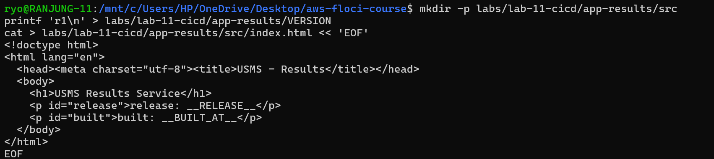

The buildspec has the same four phases as the enrolment one: it checks that `VERSION` and `src/index.html` exist, stamps the release and build time, writes `build-metadata.json`, and checks that the placeholders were replaced. I also added `app-results/dist/` to `.gitignore`. `find` lists the 3 files.

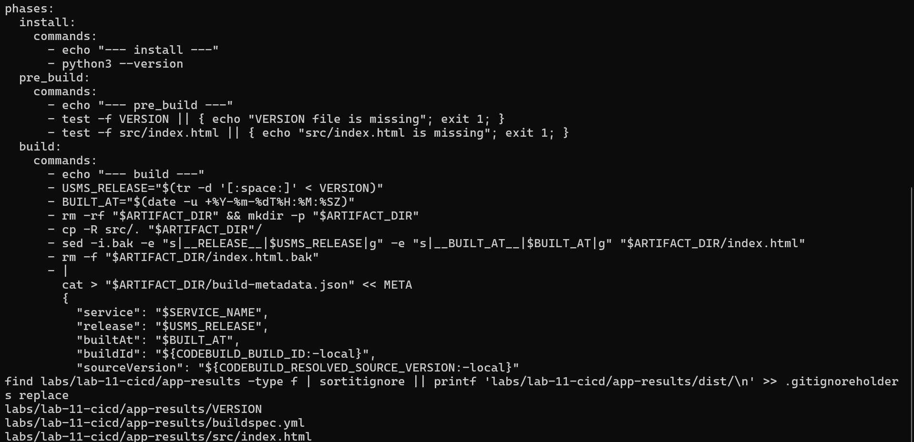

**The project template.** I built `templates/lab-11-codebuild-results-project.json` from Step 10's template, changing only the **name** (`usms-results-build`), the **description**, **`source.location`** (`usms-pipeline-artifacts/source/usms-results-src.zip`) and **`artifacts.name`** (`usms-results-build.zip`). The role is still **`usms-codebuild-role`**. The template is valid JSON.

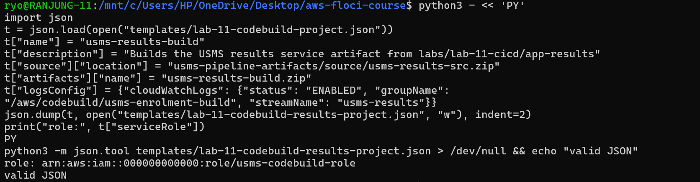

**Create, pack and upload.** The project was created with Source **S3** and Role `usms-codebuild-role`, so no second role was made. The source zip has 3 files at its root and was uploaded to `source/usms-results-src.zip` (version `1971a4bc-85f8-4d23-b31b-6e873e8d0a94`).

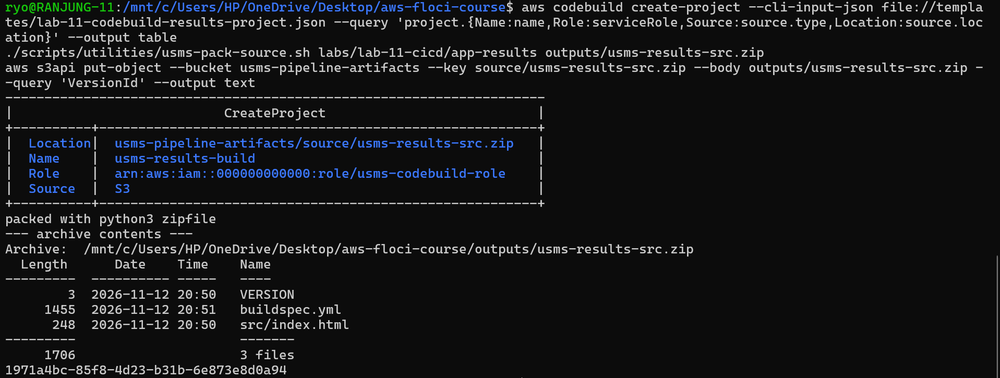

**Standalone build.** `start-build` returned `usms-results-build:2`, which ended with **status FAULT, phase COMPLETED**: *"pull access denied for aws/codebuild/standard"*. This is the same Floci limitation as in the main lab, not a problem with the project.

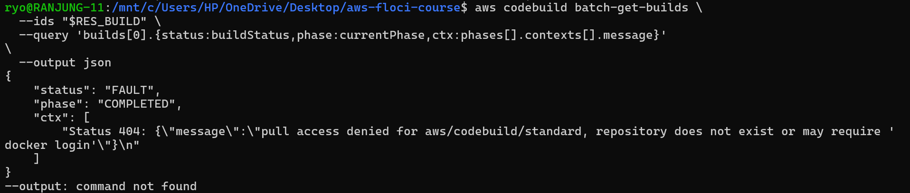

**Local build and artifact under `build/`.** The local runner passed all four phases. I zipped `dist/` and uploaded it to **`build/usms-results-build.zip`** (502 bytes, version `bfdd95dc-cf5a-4438-9f7f-e8bfed1620ca`). Its `build-metadata.json` is `{'service': 'results', 'release': 'r1', ...}`. The **`service: results`** field is what tells it apart from the enrolment artifact (`service: enrolment`).

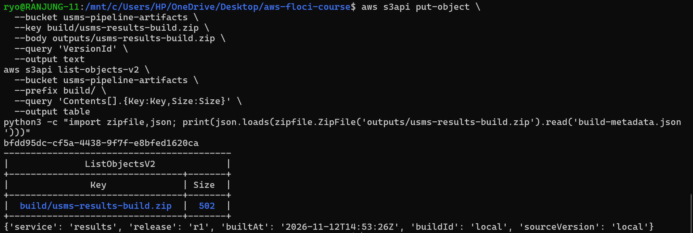

**Does `USMSCodeBuildBase` already permit this build?** Only partly: it allows the S3 part, because its S3 statement covers `usms-pipeline-artifacts/*`, which includes `source/usms-results-src.zip` and `build/`. It does not allow the logs part, because its logs statement names only `/aws/codebuild/usms-enrolment-build`. That's why I set the project's `logsConfig` to write to that same log group under a separate stream, `usms-results`, instead of changing the policy or creating a new role.

---

## Exercise 2 - Intermediate: a `finally` block and a build report

**What I changed in `post_build`.** The smoke test result is now saved before the phase decides whether to fail, and a `finally` block (a sibling of `commands`, at the same indentation) writes the summary:

```yaml
  post_build:
    commands:
      - echo "--- post_build ---"
      - bash tests/smoke.sh && SMOKE_RC=0 || SMOKE_RC=$?
      - echo "$SMOKE_RC" > "${TMPDIR:-/tmp}/usms-smoke-rc"
      - ls -l "$ARTIFACT_DIR"
      - cat "$ARTIFACT_DIR/build-metadata.json"
      - test "$SMOKE_RC" -eq 0          # the phase still FAILS if the tests failed
    finally:
      - |
        SMOKE_RC="$(cat "${TMPDIR:-/tmp}/usms-smoke-rc" 2>/dev/null || echo not-run)"
        if [ "$SMOKE_RC" = "0" ]; then RESULT=PASSED; else RESULT=FAILED; fi
        mkdir -p "$ARTIFACT_DIR"
        echo "release=$(tr -d '[:space:]' < VERSION) tests=$RESULT smoke_exit=$SMOKE_RC at=$(date -u +%Y-%m-%dT%H:%M:%SZ)" > "$ARTIFACT_DIR/build-summary.txt"
        cat "$ARTIFACT_DIR/build-summary.txt"
```

The test's exit status is saved to a file because `finally` may not see the variables from `commands`. The last command, `test "$SMOKE_RC" -eq 0`, keeps the failure: **`finally` does not rescue a failed build, it only runs.**

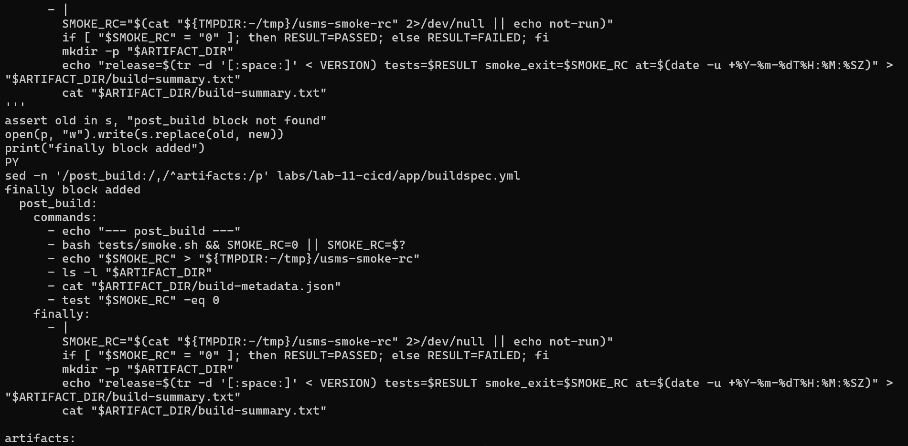

**How I tested it.** The Step 14 runner only reads `commands` and ignores `finally`. So I wrote `scripts/utilities/usms-run-finally.sh`, which reads `post_build.finally` from the buildspec with PyYAML and runs it in the app directory **after** the runner has finished, whether the runner passed or failed.

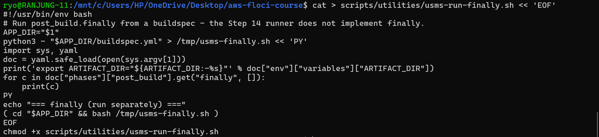

**Passing build:** local build exit status **0**, then the `finally` step wrote `release=r5 tests=PASSED smoke_exit=0 at=2026-11-12T14:55:57Z`.

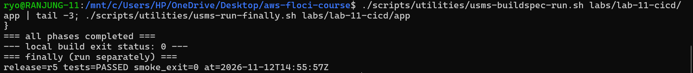

**Deliberately broken test:** I changed `src/healthz.html` to `broken`. The smoke tests reported **1 failure**, and the local build **stopped with exit status 1**. The `finally` step still wrote:

```
release=r5 tests=FAILED smoke_exit=1 at=2026-11-12T14:56:24Z
```

The zipped artifact contains `['build-metadata.json', 'build-summary.txt', 'healthz.html', 'index.html', 'service.json']`, so **`build-summary.txt` is in the artifact and says the tests failed**.

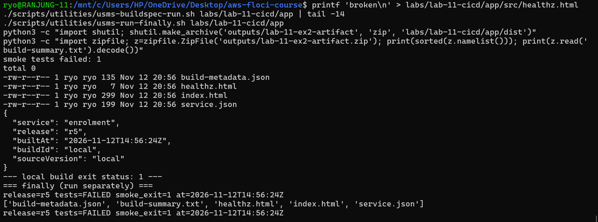

I then restored `healthz.html` to `ok`, and the build passed again (exit 0).

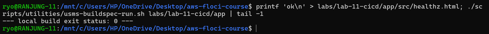

**What this means for my claim.** I proved that the summary **logic** is correct for both a pass and a fail, and that the file ends up in the artifact. I did not watch **CodeBuild itself** run `finally` after a failed `post_build` and then upload the artifact, because I had to run `finally` as a separate step. That part relies on CodeBuild's documented behaviour. So my claim is "the summary is produced correctly when `finally` runs", not "CodeBuild produced it".

---

## Exercise 3 - Problem solving: a robust configuration check

**The new check.** I replaced `grep -q '"container": "enrolment-api"'` with a parse that uses only Python's standard library:

```yaml
      - |
        python3 -c 'import json, sys
        want = "enrolment-api"
        got = json.load(open("config/service.json")).get("container")
        sys.exit(0 if got == want else "config/service.json names the wrong container: expected %s, actual %s" % (want, got))'
```

`sys.exit("message")` prints the message and exits with code 1, which fails `pre_build`. When I first pasted this, the long line was split and broke the YAML, so the check is written over four short lines.

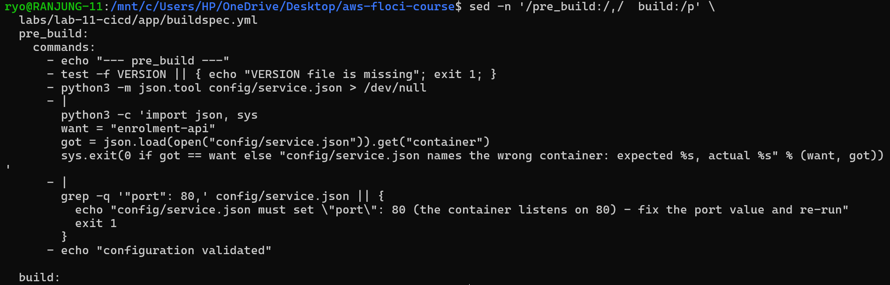

**Proof 1: indifferent to formatting.** I rewrote `config/service.json` with **four-space** indentation. The build printed **configuration validated** and finished with exit status **0**.

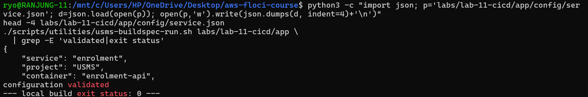

**Proof 2: specific about errors.** I changed the container to `enrolment-api-v9`. The build stopped in `pre_build` with exit status **1** and this message:

```
config/service.json names the wrong container: expected enrolment-api, actual enrolment-api-v9
```

The message names **both** values.

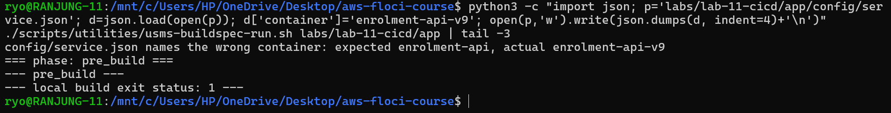

I restored the container and 2-space formatting, and the build passed again.

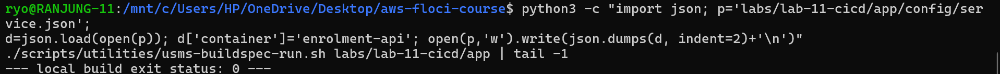

**Tighter trust policy.** `policies/trust-codebuild.json` now has **two conditions**. The `aws:SourceArn` list names both projects, because Exercise 1's `usms-results-build` uses the same role. I applied it with `update-assume-role-policy` and read it back:

```json
"Condition": {
  "StringEquals": { "aws:SourceAccount": "000000000000" },
  "ArnLike": {
    "aws:SourceArn": [
      "arn:aws:codebuild:us-east-1:000000000000:project/usms-enrolment-build",
      "arn:aws:codebuild:us-east-1:000000000000:project/usms-results-build"
    ]
  }
}
```

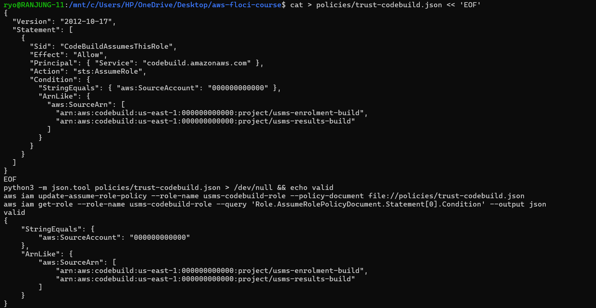

**What attack this closes** (also written in `notes/lab-11-notes.md`): `aws:SourceAccount` only checks that the calling CodeBuild project is in **our account**. Any project in the account, including one created later by someone else, could run as `usms-codebuild-role` and use its S3 and logs permissions. This is a confused-deputy or "borrowed role" attack. `aws:SourceArn` names the exact project ARNs, so only `usms-enrolment-build` and `usms-results-build` can make CodeBuild assume the role. A new project in the same account is refused, even though it passes the account check.

---

## Exercise 4 - Challenge: trigger the pipeline without polling

**The design (event-driven, no polling):**

```
PutObject source/usms-enrolment-src.zip
   → CloudTrail trail with S3 data events (records the API call)
   → EventBridge rule usms-enrolment-source-changed (matches that ONE key)
   → target: codepipeline:StartPipelineExecution on usms-enrolment-pipeline
             (EventBridge assumes usms-eventbridge-pipeline-role)
```

**Document 1, the rule's event pattern** (`templates/lab-11-eventbridge-rule.json`). It matches **one object key**, not the whole bucket:

```json
{
  "source": ["aws.s3"],
  "detail-type": ["AWS API Call via CloudTrail"],
  "detail": {
    "eventSource": ["s3.amazonaws.com"],
    "eventName": ["PutObject", "CompleteMultipartUpload", "CopyObject"],
    "requestParameters": {
      "bucketName": ["usms-pipeline-artifacts"],
      "key": ["source/usms-enrolment-src.zip"]
    }
  }
}
```

**Document 2, the target** (`templates/lab-11-eventbridge-target.json`): rule `usms-enrolment-source-changed`, target ARN `arn:aws:codepipeline:us-east-1:000000000000:usms-enrolment-pipeline`, role `usms-eventbridge-pipeline-role`.

I also wrote `policies/trust-eventbridge.json` and `policies/usms-eventbridge-start-pipeline-policy.json`. In the screenshot, the validation loop at the end hit a paste error (`syntax error near unexpected token`), so I validated the four files again afterwards: **all four are valid JSON**.

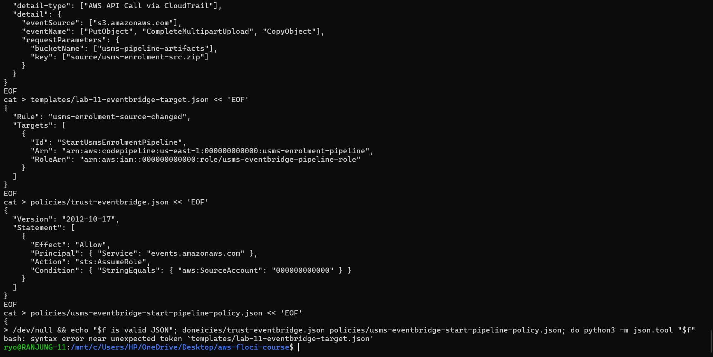

**Created on Floci:** the role `usms-eventbridge-pipeline-role` and its inline policy (**policy attached**), the rule `arn:aws:events:us-east-1:000000000000:rule/usms-enrolment-source-changed` (State **ENABLED**), and the target (`FailedEntryCount: 0`). `list-targets-by-rule` shows the pipeline ARN with Id `StartUsmsEnrolmentPipeline`.

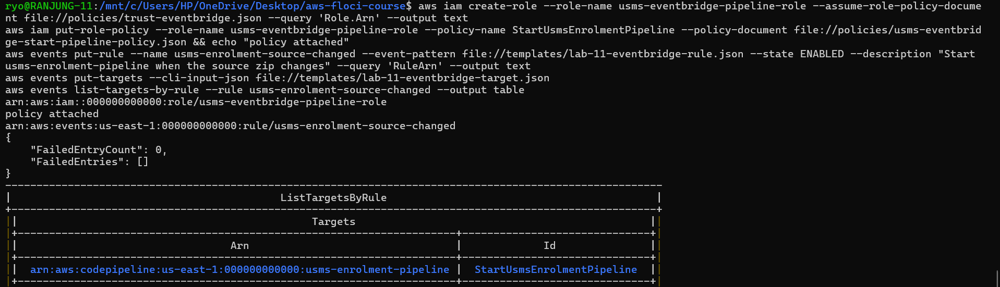

**Which permissions the target role needs, and why not the pipeline role:** EventBridge makes the call, not CodePipeline. So the role must trust **`events.amazonaws.com`**, and it needs only **`codepipeline:StartPipelineExecution` on this one pipeline**. The pipeline role trusts `codepipeline.amazonaws.com` and holds S3, CodeBuild and `iam:PassRole` permissions. EventBridge never needs those, and giving them to it would break least privilege.

**The CloudTrail dependency.** A rule with `detail-type: "AWS API Call via CloudTrail"` only fires if a **CloudTrail trail is logging S3 data events** (object-level `PutObject`) for that bucket. Without the trail, no event exists for the rule to match. CloudTrail management events do not include object-level calls. The other route is the bucket's own **EventBridge notification setting**, which sends `Object Created` events (matched on `detail.bucket.name` and `detail.object.key`) without CloudTrail. The two routes are not equivalent: they use different detail-types and different field names, so a rule written for one never matches the other.

**What ran and what did not:**

| Part | Result |
|---|---|
| Two JSON documents (rule and target) | Written and validated |
| Target role and its permission | Created on Floci |
| EventBridge rule and target | Created on Floci, rule ENABLED |
| CloudTrail trail `usms-s3-data-events` | `create-trail` was **accepted**, but the trail has **no event selectors** (`EventSelectors: []`), so S3 data events were never turned on |
| Upload → automatic pipeline start | **Did not happen.** See the test below. |

My first test upload didn't run, because the `put-object` line was split when I pasted it (`--quer` / `y`). The screenshot also shows the pipeline had **4 executions** before the test (the 5th came from Exercise 5's manual start).

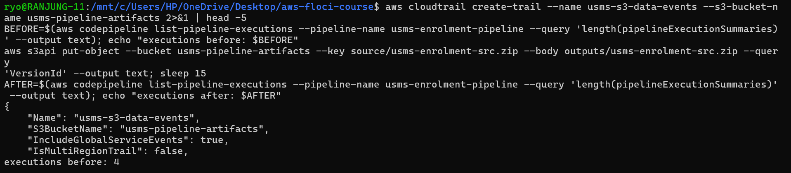

I repeated the test with a working upload. `put-object` created a new version of the key, **`55d9fb6a-15e0-450a-b019-dd0a954e148a`**. After waiting 15 seconds, `list-pipeline-executions` still showed the **same 5 executions**, and **every one has trigger type `StartPipelineExecution`**, meaning I started all of them by hand. The upload started **no new execution**, and none came from EventBridge.

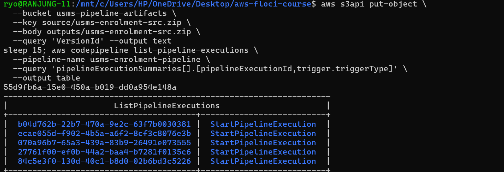

**Honest statement:** the rule, target and role exist, but I could not show the event-driven start. On Floci there is no delivery path from an S3 `PutObject` through CloudTrail to EventBridge. On real AWS, the missing piece is a trail with an S3 data-event selector for `arn:aws:s3:::usms-pipeline-artifacts/source/usms-enrolment-src.zip`.

---

## Exercise 5 - Integration: the deployment contract for Lab 12

**The build phase now writes `imagedefinitions.json`.** The container name is read from `config/service.json`, so it is not hard-coded a second time, and the image comes from `IMAGE_URI`, with the Lab 04 placeholder image as the default:

```yaml
      - IMAGE_URI="${IMAGE_URI:-public.ecr.aws/nginx/nginx:stable-alpine}"
      - |
        python3 -c 'import json, sys; c = json.load(open("config/service.json"))["container"]; json.dump([{"name": c, "imageUri": sys.argv[2]}], open(sys.argv[1], "w"))' "$ARTIFACT_DIR/imagedefinitions.json" "$IMAGE_URI"
      - cat "$ARTIFACT_DIR/imagedefinitions.json"
```

The value is written as a **JSON array** (`[{...}]`), even with one entry, because Lab 12 fails on an object. I also added an **8th assertion** to `tests/smoke.sh`: the file must be a list with exactly one entry, whose `name` equals the container in `config/service.json` and whose `imageUri` is not empty. `smoke.sh` syntax OK.

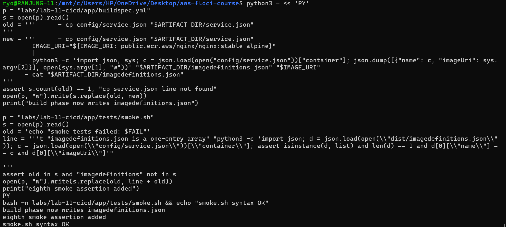

**Build result:** all **8 smoke tests ok** (`smoke tests failed: 0`), `dist/` now contains `imagedefinitions.json` (83 bytes), and the local build exit status is **0**. The override also works: with `IMAGE_URI=example.com/usms/enrolment:r5`, the file contained `[{"name": "enrolment-api", "imageUri": "example.com/usms/enrolment:r5"}]`. (The `To: command not found` line is a heading line from my instructions that I pasted by mistake. It is harmless.)

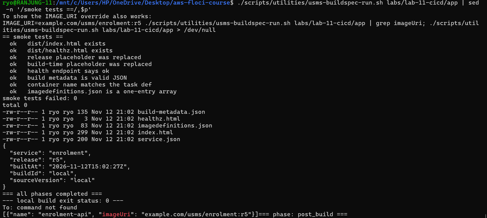

**Running the pipeline.** I packed the new source (6 files; `buildspec.yml` is now 2974 bytes and `smoke.sh` 1222 bytes), uploaded it as version `f724ab5d-fe98-4fca-9db7-f64782ee51df`, and started execution **`b04d762b-22b7-470a-9e2c-63f7b0030381`**. Source **Succeeded**, Build **Failed** (Floci image pull), and the `BuildOutput/` listing returned **None**. So no pipeline artifact exists to download.

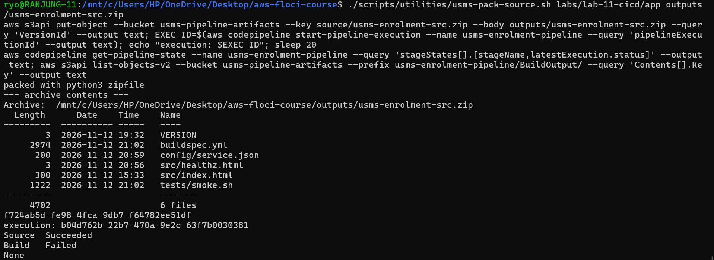

**Artifact root and readiness file.** I zipped the local `dist/` as `outputs/lab-11-buildoutput.zip`. Its contents are `['build-metadata.json', 'healthz.html', 'imagedefinitions.json', 'index.html', 'service.json']`, so **`imagedefinitions.json` is at the root**, with no `dist/` prefix. Its content:

```json
[{"name": "enrolment-api", "imageUri": "public.ecr.aws/nginx/nginx:stable-alpine"}]
```

I recorded this in **`outputs/lab-11-lab08b-readiness.txt`** for Lab 12 Step 1:

```
PIPELINE_ARTIFACT_KEY=not-created
LOCAL_ARTIFACT=outputs/lab-11-buildoutput.zip
PIPELINE_EXECUTION=b04d762b-22b7-470a-9e2c-63f7b0030381
SUPPORT_PATH=B (CodeBuild image cannot be pulled on Floci; artifact built with usms-buildspec-run.sh)
CONTAINER_NAME=enrolment-api
IMAGEDEFINITIONS=[{"name": "enrolment-api", "imageUri": "public.ecr.aws/nginx/nginx:stable-alpine"}]
```

`PIPELINE_ARTIFACT_KEY=not-created` is the honest value: the pipeline never produced a `BuildOutput` object on Floci, so Lab 12 should use the local artifact.

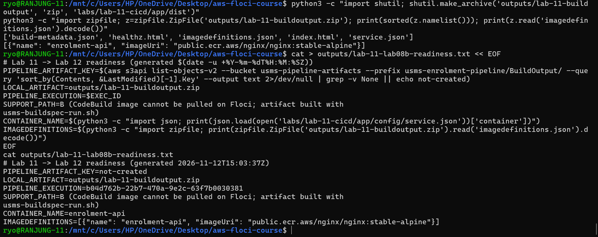

**Final check:** after all five exercises, the main lab still verifies with **PASS=46 FAIL=0**.

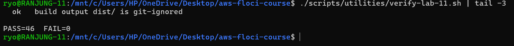

---

## Summary

The exercises made the build **more general** (a second service sharing one role), **more informative** (a summary written even when tests fail), **more robust** (a JSON-parsing check with a clear message, and a trust policy limited to two named projects), **more automatic** (an event-driven trigger design) and **ready for Lab 12** (`imagedefinitions.json` at the artifact root). The main limitation throughout was Floci: it stores CodeBuild, CodePipeline, EventBridge and CloudTrail resources, but it cannot pull the build image or deliver S3 events through CloudTrail. So the build logic was proved locally, and the event-driven start was designed and created but not observed.
