# Lab 12 Practical Report: Deploying to Amazon ECS from the Pipeline

## 1. Aim / Objective

The aim of this lab is to finish the CI/CD chain that Lab 11 started. In Lab 11 the pipeline stopped at a tested folder of files. In this lab I packed the enrolment service into a **container image**, stored it in a private **Amazon ECR** repository, created a new ECS **task definition revision** that uses that image, and added a third **Deploy** stage to the pipeline. Everything was done with the AWS CLI on Floci.

The specific objectives were to:

- Create a private ECR repository, log Docker in to it safely, and **push an image**.
- Write a **Dockerfile**, build the image, and prove it is in the registry by pulling it back **by digest**.
- Create a new task definition revision by **changing only the image**, and deploy it.
- Update both pipeline policies to **version 2** with the new permissions they need.
- Let CodeBuild run Docker and extend the buildspec to push the image and write **`imagedefinitions.json`**.
- Add an **ECS Deploy stage**, run the pipeline, and do a **rollback drill**.
- Design a **blue/green** deployment on paper, save values to `configs/lab-12.env`, and check the lab with a verification script.

## 2. Introduction

A running ECS service cannot use a folder of files. It needs an **image** in a registry and a **task definition** that names that image. This lab adds the pieces that join a build to a running service:

| Service | Its job in this lab |
|---|---|
| **Amazon ECR** | A private Docker registry that stores the `usms-enrolment` image |
| **Amazon ECS** | Runs the image. A new task definition revision + `update-service` moves the service to the new image |
| **CodePipeline Deploy stage** | Reads `imagedefinitions.json`, registers a new revision and updates the service |
| **AWS CodeDeploy** (on paper) | Blue/green deployments: run the new version beside the old one, then move traffic |

Key ideas:

| Concept | Simple meaning |
|---|---|
| **Tag vs digest** | A tag (`r6`) is a label that can be moved. A digest (`sha256:…`) is the fingerprint of the exact content and never changes. |
| **Registry login** | `get-login-password` gives a short-lived token, piped into `docker login --password-stdin`, so it never appears on screen. |
| **Task definition revision** | Task definitions are never edited. You copy the old one, change one field, and register a new revision. |
| **`imagedefinitions.json`** | A tiny file `[{"name": "enrolment-api", "imageUri": "…:r6"}]`. The container **name** links the build to the task definition. |
| **Policy versions** | A policy keeps up to five versions. A new default version changes permissions; the old one stays for rollback. |
| **Rolling update / circuit breaker** | ECS replaces tasks a few at a time, and rolls back if the new tasks keep failing. |
| **Blue/green** | Two full copies (blue = current, green = new). Traffic moves only when green is healthy. |

**Limitation (same as Lab 11):** Floci cannot pull the CodeBuild image, so every pipeline build ends with `FAULT` and the Deploy stage never runs. I built, pushed and deployed the image **by hand**, and I report clearly what the pipeline did and what I did.

## 3. Use Case

**USMS use case:** after Lab 11 USMS has a tested build, but someone still has to copy it to the servers by hand. The university wanted:

- **One private place for release images**, with scan-on-push and encryption.
- **Proof of what is running**: the task definition names the exact image and the digest is recorded.
- **No hand-editing**: a new revision changes **only the image**; CPU, memory, roles and logging stay the same.
- **Automatic deploy** after a successful build, allowed to touch only `usms-enrolment-svc`.
- **A quick way back** to the last good revision if a release is bad.

**Other real-world uses:**

- Companies deploying many times a day with no manual steps.
- Rolling out a new version slowly and rolling back automatically if errors rise.
- Blue/green releases for banking or shopping sites that cannot have downtime.

## 4. System Architecture / Design

**How it works in simple words:**

1. **Source:** I zip the app (now with a `Dockerfile`) and upload it to the versioned bucket.
2. **Stage 1 – Source:** the pipeline stores it as `SourceOutput`.
3. **Stage 2 – Build:** CodeBuild builds `dist/`, runs `docker build` and `docker push` to ECR, and writes `dist/imagedefinitions.json` into `BuildOutput`.
4. **Stage 3 – Deploy:** the ECS action reads `imagedefinitions.json`, registers a new task definition revision and updates `usms-enrolment-svc`.
5. **ECS** pulls the image from ECR and rolls its two tasks to the new revision.
6. **On Floci:** stage 2 fails because the build image cannot be downloaded, so I did steps 3–5 by hand.

| Resource | Name | Key settings |
|---|---|---|
| ECR repository | `usms-enrolment` | Scan on push, AES256 |
| Image | `usms-enrolment:r6` | `FROM nginx:1.27-alpine`, `COPY dist/`, port 80 |
| Task definition | `usms-enrolment:3` | Same as revision 2, only the image changed |
| Pipeline | `usms-enrolment-pipeline` | Source → Build → Deploy |
| Policies | `USMSCodeBuildBase` v2, `USMSCodePipelineBase` v2 | ECR push; ECS deploy |

## 5. Implementation Procedure

### Step 1: Start Floci and check Lab 04

`verify-lab-04.sh` gave **PASS=39 FAIL=0**: the cluster and service are ACTIVE.


### Step 2: Load earlier labs' env files

All eleven env files loaded, and the cluster, service, container, pipeline, project and exec role were set.

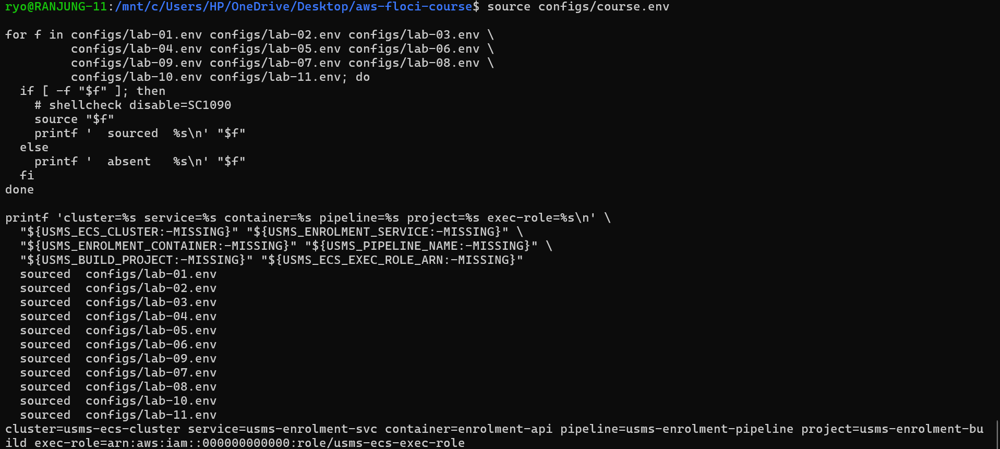

### Step 3: Probe the deployment services

Docker, ECR, ECS and CodeDeploy all answered, so the probe chose **Path A**.


### Step 4: Publish the ECR ports

Before changing anything, the service was on **`usms-enrolment:2`**. I tried to publish ports 5100–5104 for ECR.


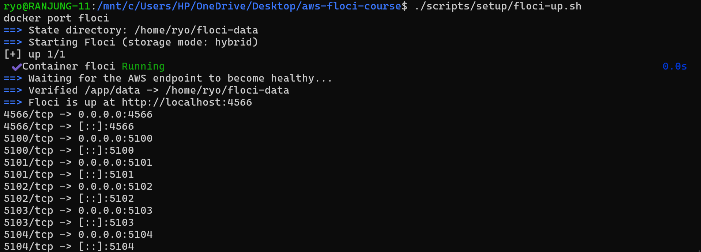


This caused a **port conflict**, because on this Floci build ECR runs in its **own sidecar container** that already uses port 5100. I undid the change and restarted Floci, and after that login, push and pull all worked.

### Step 5: Create the ECR repository

I created **`usms-enrolment`** with scan-on-push and AES256 encryption, and **read the URI from the API** instead of typing it.

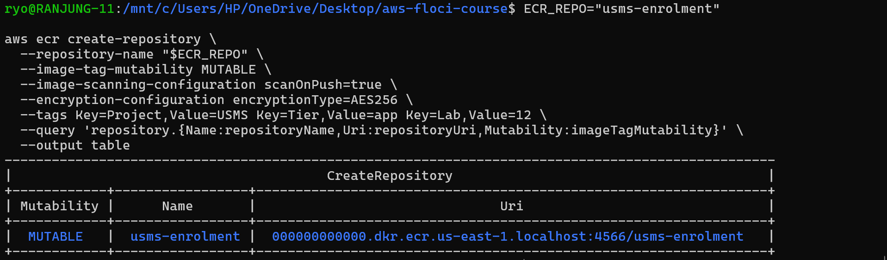


### Step 6: Log Docker in to ECR

```bash
aws ecr get-login-password --region "$AWS_REGION_COURSE" \
  | docker login --username AWS --password-stdin "$ECR_REGISTRY"
```

**Login Succeeded.** The token goes through the pipe and never appears in the shell history.

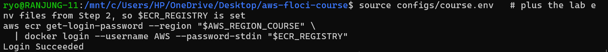

### Step 7: Write the Dockerfile

```dockerfile
FROM nginx:1.27-alpine
COPY dist/ /usr/share/nginx/html/
EXPOSE 80
```

The image copies the **built output** `dist/`, so the release number stamped by the build goes into the image. I also wrote a `.dockerignore` to keep source and tests out.

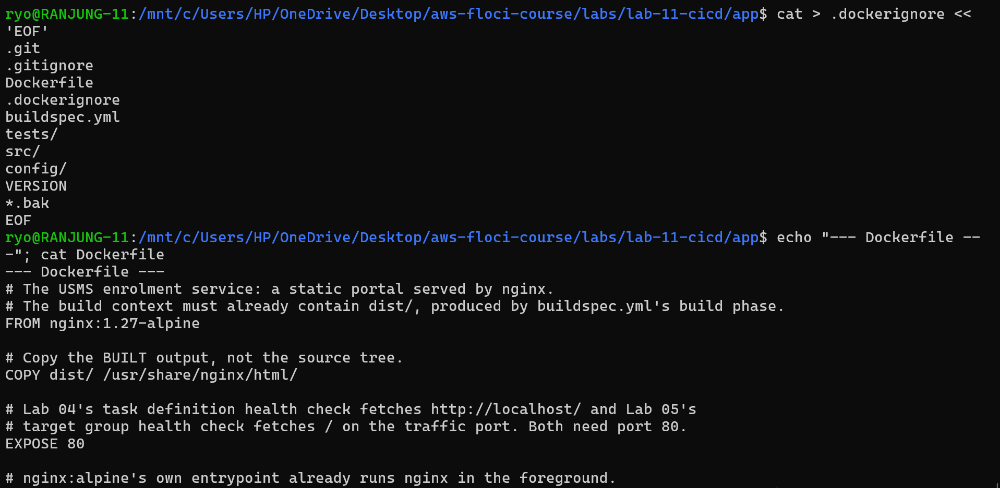


### Step 8: Build and push the image by hand

I set `VERSION` to **r6**, rebuilt `dist/`, built the image and pushed it. ECR returned the digest `sha256:ae55d902…`.

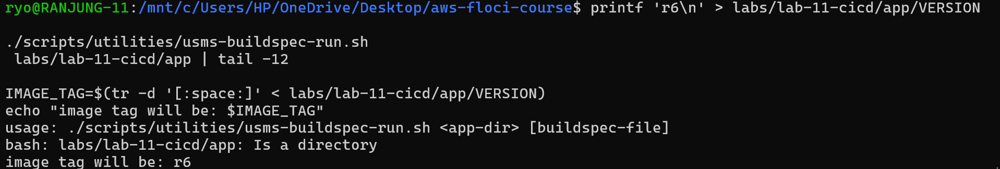
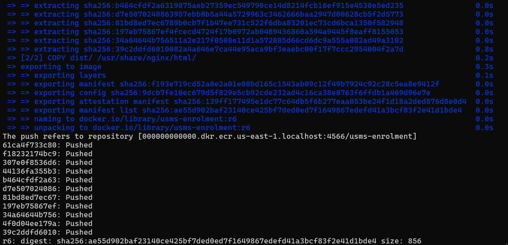

### Step 9: Prove the image is in the registry

`describe-images` listed **r6** with the same digest.


I deleted every local copy, then pulled the image back **by digest**. It downloaded again, which proves ECR really holds exactly what I built.


### Step 10: Register a new task definition revision

I described the current task definition, removed the read-only fields, found the container **by name** (`enrolment-api`) and changed **only the image** to `…/usms-enrolment:r6`.


Registering it returned **`usms-enrolment:3`** with CPU 256 and memory 1024, as before.


### Step 11: Deploy revision 3 by hand

I wrote `usms-ecs-watch.sh`, which waits until the service has one deployment with running = desired. After `update-service`, it showed **`usms-enrolment:3`, Desired 2, Running 2, Rollout COMPLETED**.


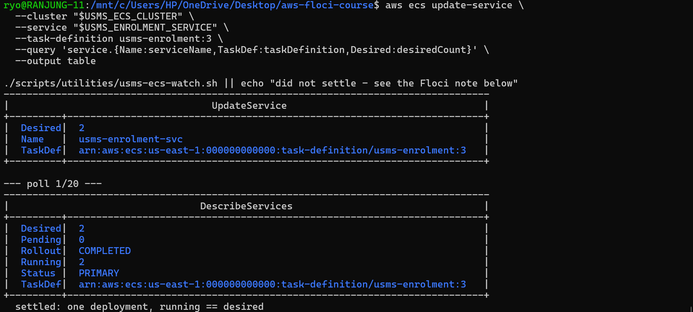

### Step 12: Version 2 of the CodeBuild policy

The build now pushes to ECR, so I added ECR permissions **limited to the `usms-enrolment` repository**. Only `ecr:GetAuthorizationToken` uses `"*"`, because it cannot be limited.

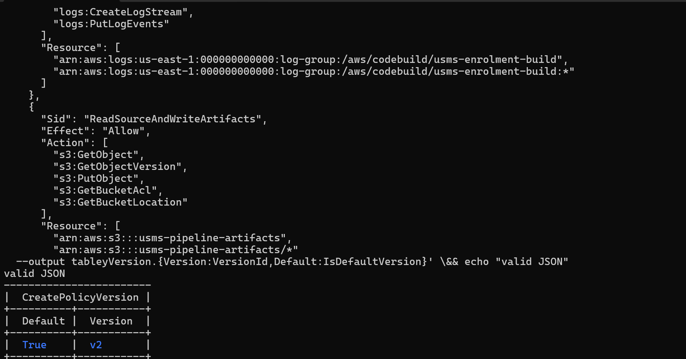

**v2** is now default, and **v1** is kept for rollback.


### Step 13: Let the build run Docker

I updated the project with **`privilegedMode=true`** (so it can run Docker) and the `IMAGE_REPO_URI` variable. The source is still `CODEPIPELINE`.

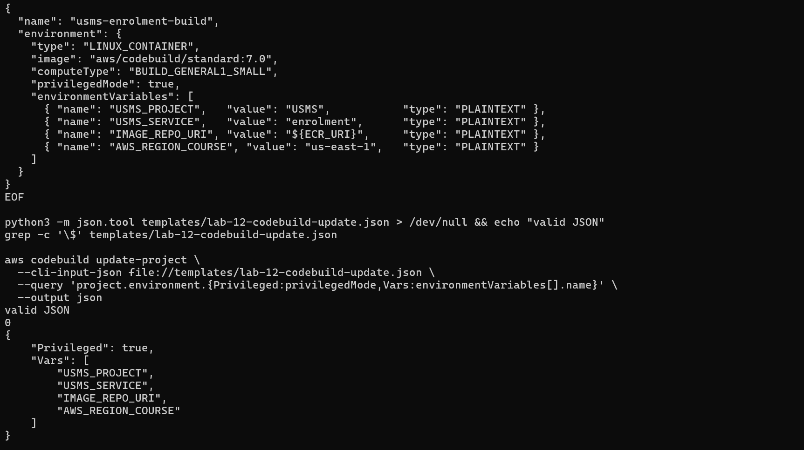
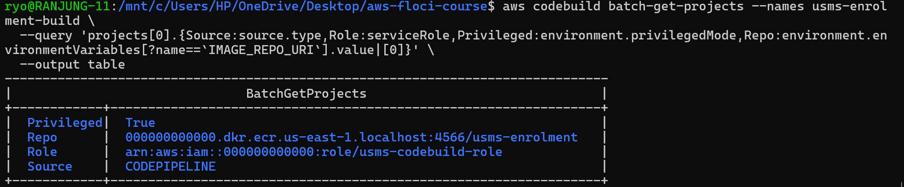

### Step 14: Extend the buildspec

The new buildspec logs in to ECR, runs `docker build` and `docker push`, and writes `dist/imagedefinitions.json` from `config/service.json`, so the container name is never typed twice.

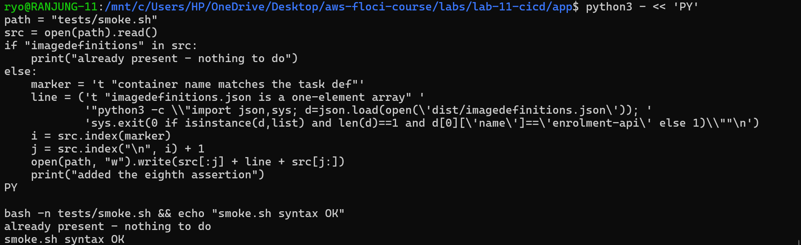

The local runner passed all phases and **all 8 smoke tests**, and `imagedefinitions.json` was correct.

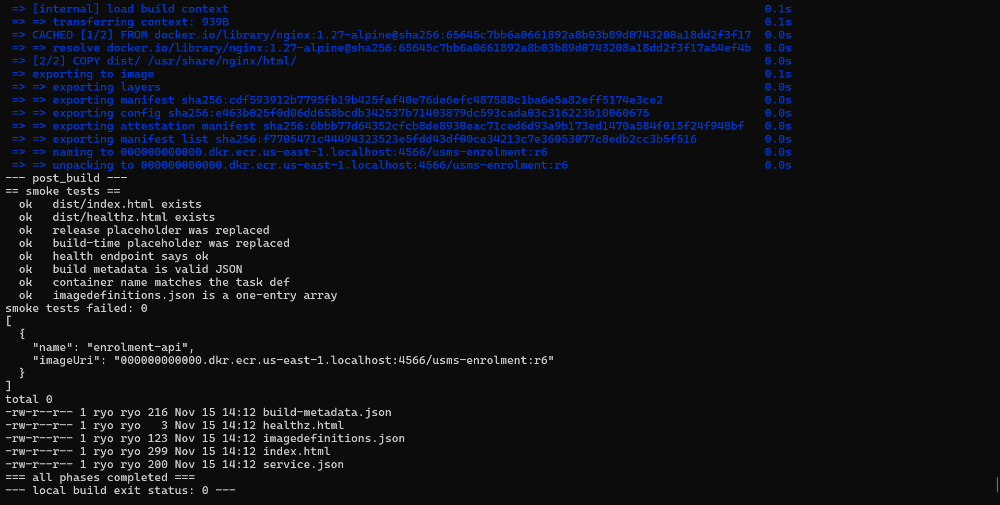

I packed and uploaded the source. (A broken paste once emptied `buildspec.yml`, so I restored it from Git.)

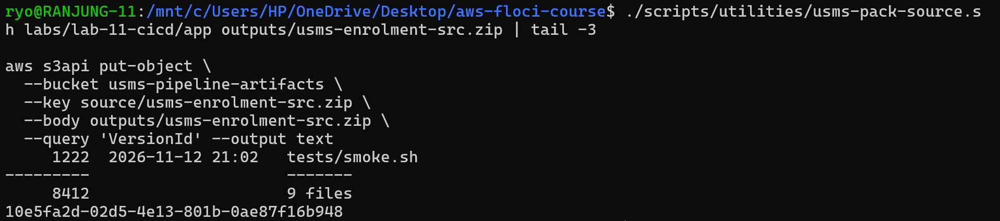

#### Your turn: what if Deploy read SourceOutput?

The ECS deploy action looks for `imagedefinitions.json` at the root of its input. That file is **created by the build**, so it is in `BuildOutput`, not in `SourceOutput`. If Deploy read `SourceOutput`, Source and Build would succeed but **Deploy would fail**, and the cause would be just one wrong artifact name.

### Step 15: Version 2 of the CodePipeline policy

#### Your turn: write v2 first

My own draft put `UpdateService` in the same statement as `RegisterTaskDefinition` on `"*"`, which would let the pipeline update **every** service. The lab's version splits them: `UpdateService` only on `usms-enrolment-svc`, and the task definition actions (which cannot be limited) on `"*"`. **Lesson:** keep actions that cannot be limited in their own statement.

#### Applying Step 15

The v2 policy has six statements, including a PassRole for the two ECS roles only to `ecs-tasks.amazonaws.com`. It is now the default.

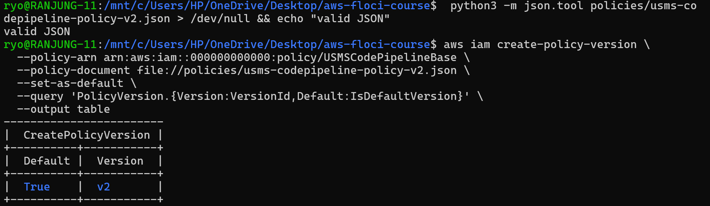


### Step 16: Add the Deploy stage

I used **get → modify → put**: download the pipeline, add the Deploy stage with a Python script, and upload it.


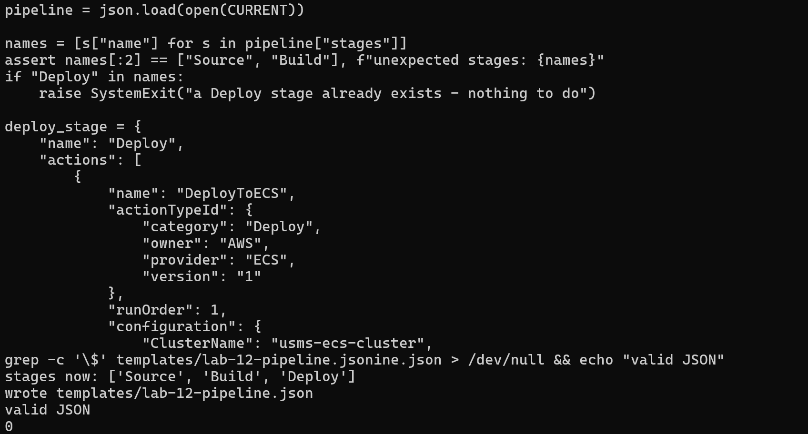


| Stage | Provider | Input |
|---|---|---|
| Source | S3 | – |
| Build | CodeBuild | SourceOutput |
| Deploy | **ECS** | **BuildOutput** |


### Step 17: Run the pipeline end to end

Before: the service was on `usms-enrolment:3`.

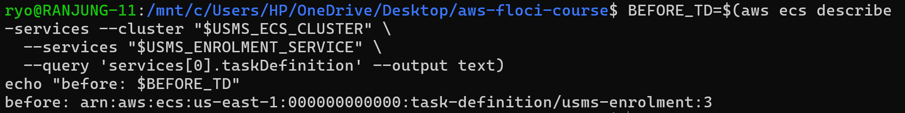

I started the pipeline. **Source succeeded, Build failed**, so Deploy never ran.

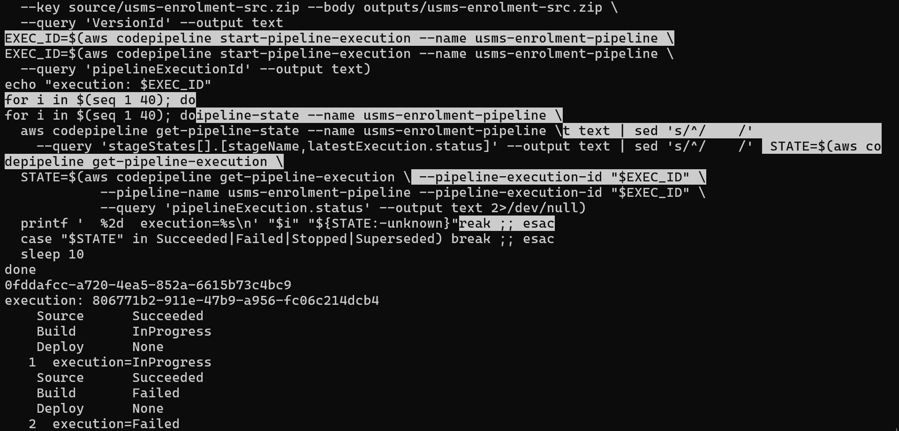

The service **did not move**. The build failed with "pull access denied for aws/codebuild/standard", the same Floci limit as Lab 11. The only deploy in this lab is my manual one in Step 11.

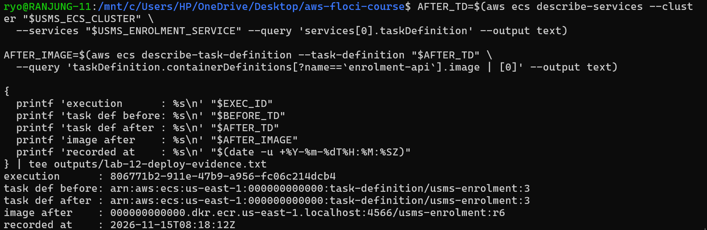

Revision 3 still has CPU 256, memory 1024, both roles and `awslogs`.

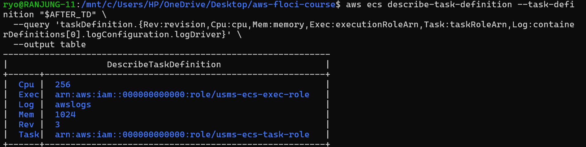

### Step 18: Rollback drill

I uploaded a release with no image in ECR and started the pipeline.


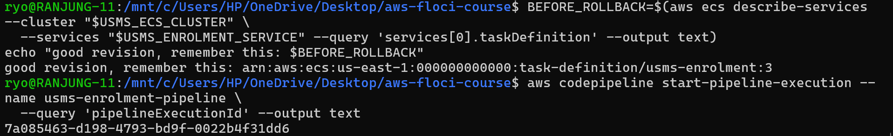

The build failed again, so the bad release was **never deployed** and the service stayed on revision 3.

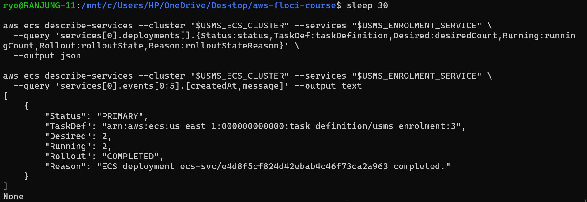

I still ran the manual rollback with `update-service --task-definition usms-enrolment:3`, and it settled.


Finally I set `VERSION` to **r7** and uploaded it.


On real AWS, the new tasks would fail with `CannotPullContainerError`, and the **circuit breaker** would roll back to revision 3 automatically.

### Step 19: Blue/green with CodeDeploy, on paper

I wrote and validated two files without creating anything:

- A **deployment group** using `BLUE_GREEN`, moving 10% of traffic every minute between a blue and a green target group, with automatic rollback on failure.
- An **appspec** for container `enrolment-api` on port 80.

I did not run a real blue/green deployment, because it would need a second target group and listener and would break the Lab 06 auto scaling.

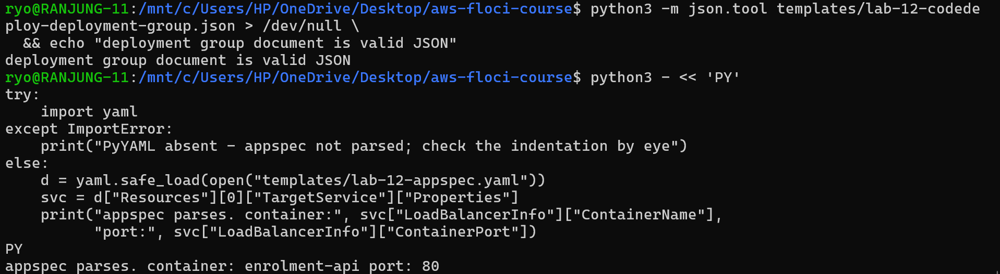

### Step 20: Save values

I wrote `configs/lab-12.env` with **26 exports**. The digest is `not-pushed` because no `r7` image exists.

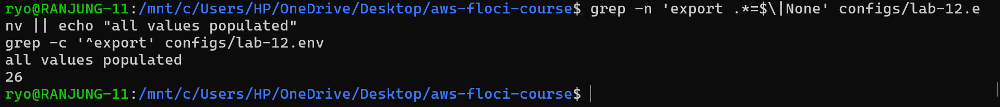


### Step 21: Commit

`git status` showed the Lab 12 files and three compose backups. I added the backups to `.gitignore` and committed as `c7bc1b5`.

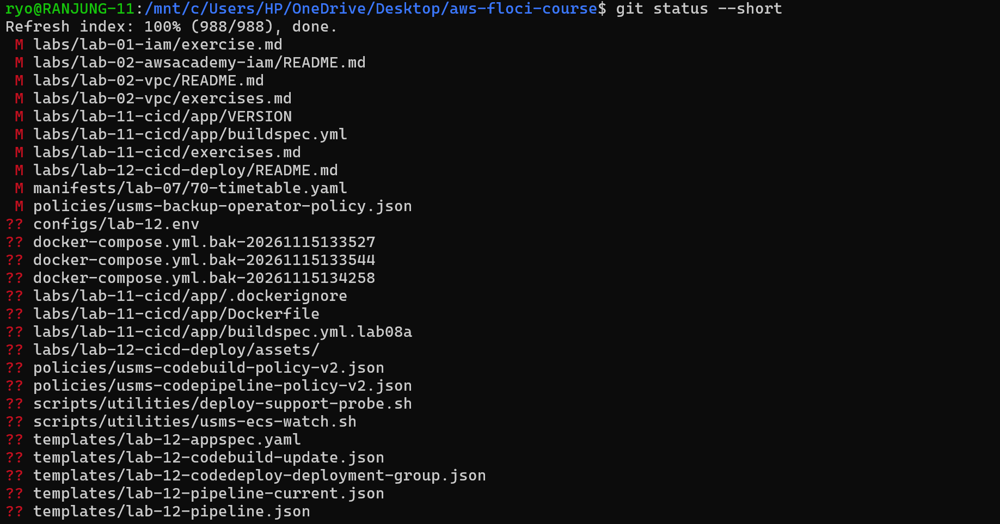

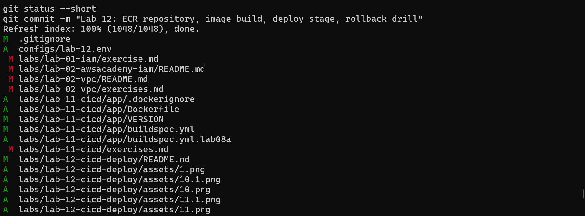

## 6. Verification

I ran `scripts/utilities/verify-lab-12.sh`, which checks ECR, the source tree, the task definition, both policy versions, the CodeBuild project, the pipeline and Git hygiene. The result was **PASS=44, FAIL=1**. The only failure is "tag r7 is present": ECR only has `r6`, because the pipeline builds failed on Floci and I did not push r7 by hand.

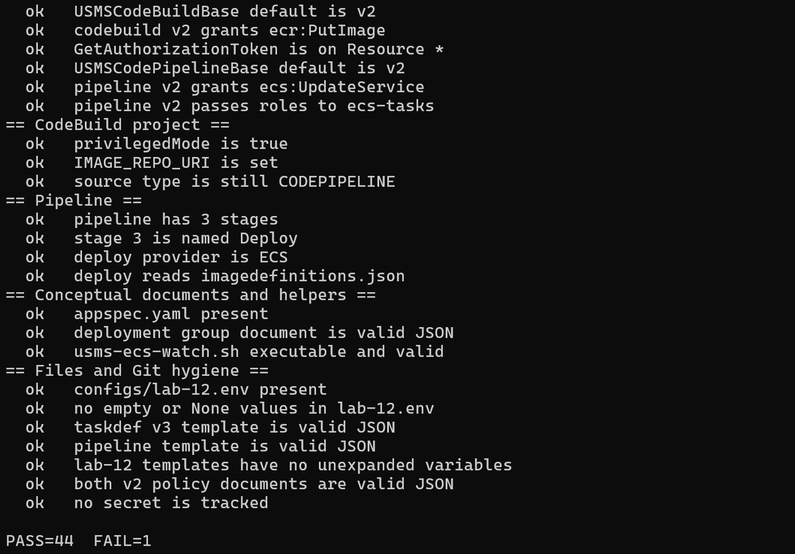

## 7. Analysis and Discussion

### 7.1 What was achieved

- The private ECR repository `usms-enrolment` was created and the **r6** image was pushed.
- The image was proven to be in ECR by **pulling it back by digest**.
- Task definition **revision 3** was created by changing only the image, and deployed by hand (2/2 running).
- Both pipeline policies are on **v2** with tightly limited new permissions.
- The build can run Docker, the buildspec writes `imagedefinitions.json`, and the pipeline has a **Deploy** stage.
- Blue/green was designed and validated on paper, and the verification passed **44 of 45** checks.

### 7.2 Observations

- **A digest is proof, a tag is a promise.** A tag can be moved; a digest cannot.
- **Never edit a task definition; copy it.** Changing one field kept everything else the same.
- **The container name is the link.** `enrolment-api` connects the config, task definition and `imagedefinitions.json`.
- **Keep unlimited actions separate.** Otherwise they widen the actions that can be limited.
- **A failure shows where it is detected, not where it is caused.** Tracing which artifact feeds which stage is the best way to debug a pipeline.
- **Check the result, not the colour.** Comparing the service revision before and after showed honestly that the pipeline did not deploy.
- **Floci limits.** Pipeline builds cannot run, so Deploy never runs automatically.

## 8. Reflection

### What I learned about continuous deployment

Before this lab I thought deployment meant "copy the new files to the server". Now I see it as **moving a pointer**: the service points at a task definition revision, the revision points at an image digest, and the digest points at exact content in the registry. Deploying moves the pointer forward, and rolling back moves it back to a revision already known to be good. That is why my rollback was a single `update-service` command.

### Challenges I faced

The ECR port conflict taught me to check which container owns a port before changing the compose file. Many problems came from pasted commands breaking across lines; the worst one silently emptied `buildspec.yml`, and I had to restore it from Git. I learned to write long files with an editor or script and check them with `wc -l`. I also learned to separate what **I** proved (an image pushed and running as revision 3) from what the **pipeline** proved (Source succeeded and the stages and permissions are correct).

## 9. Conclusion

In this lab I extended the USMS CI/CD chain from a build artifact to a running container. I created the ECR repository, built and pushed the `r6` image, proved it by pulling by digest, created task definition revision 3 by changing only the image, and deployed it to the ECS service. I also updated both policies to v2, let CodeBuild run Docker, extended the buildspec, added an ECS Deploy stage, ran a rollback drill and designed blue/green on paper. On Floci the pipeline build cannot run, so the automatic deploy did not happen, and I recorded this honestly. The verification passed **44 of 45** checks and the lab was committed.

The key concepts I learned are container images, tags vs digests, task definition revisions, `imagedefinitions.json`, policy versions, rolling updates and blue/green deployment. Continuous deployment is important because it makes releases fast, repeatable and easy to roll back.
