# Lab 12 Practical Report: Deploying to Amazon ECS from the Pipeline

## 1. Aim / Objective

The aim of this lab is to finish the CI/CD chain that Lab 11 started. In Lab 11 the pipeline stopped at a tested artifact. In this lab I packed the enrolment service into a **container image**, stored it in a private **Amazon ECR** repository, registered an ECS **task definition revision** that runs that image, and added a third **Deploy** stage to `usms-enrolment-pipeline` so that a release can move from source to a running ECS service. Everything was done with the AWS CLI on the local emulator Floci.

The specific objectives were to:

- Create the private ECR repository **`usms-enrolment`**, log Docker in to it with a token passed on standard input, and push an image, reading the registry host from the API instead of typing it.
- Write a **Dockerfile** and `.dockerignore`, build the image from the build output `dist/`, and prove the image is in the registry by deleting the local copy and pulling it back **by digest**.
- Derive a new task definition revision (**`usms-enrolment:3`**) with *describe → strip → change one field → register*, and deploy it by hand.
- Create **version 2** of both pipeline policies (`USMSCodeBuildBase` and `USMSCodePipelineBase`) and set each as default.
- Turn on **`privilegedMode`** for the build project and extend the **buildspec** so it builds and pushes the image and writes **`imagedefinitions.json`**.
- Add an **ECS Deploy stage** to the pipeline with *get → modify → put*, run the pipeline end to end, and run a **rollback drill**.
- Specify a **blue/green** deployment with CodeDeploy on paper (appspec and deployment group), saying honestly that I did not perform one.
- Save the values to `configs/lab-12.env`, check the lab with `verify-lab-12.sh`, and commit.

## 2. Introduction

In Lab 11 the output of the pipeline was a folder of files. A running ECS service cannot use a folder: it needs an **image** in a registry and a **task definition** that names that image. This lab adds the three AWS pieces that join a build to a running service:

| Service | Its job in this lab |
|---|---|
| **Amazon ECR** | A private Docker registry. Stores the `usms-enrolment` image under a tag (`r6`, `r7`) and a digest |
| **Amazon ECS** | Runs the image. A new task definition revision plus `update-service` makes the service roll to the new image |
| **AWS CodePipeline (Deploy stage)** | The ECS deploy action reads `imagedefinitions.json`, copies the current task definition with the new image, registers it and updates the service |
| **AWS CodeDeploy** (on paper) | Blue/green deployments for ECS: a second task set behind the load balancer, then a traffic shift |

The main ideas of this lab:

| Concept | Simple meaning |
|---|---|
| **Image tag vs digest** | A tag (`r6`) is a label that can be moved. A digest (`sha256:…`) is the fingerprint of the exact content and can never change. Tags are for people, digests are for proof. |
| **Registry login** | `aws ecr get-login-password` prints a short-lived token, and `docker login --username AWS --password-stdin` reads it from the pipe. The username is literally `AWS`. |
| **Task definition revision** | Task definitions are never edited. A change means *describe → remove the read-only fields → change one field → register*, which gives a new revision number. |
| **`imagedefinitions.json`** | A one-entry JSON array `[{"name": "enrolment-api", "imageUri": "…:r6"}]`. The container **name** is the key that joins the build to the task definition. |
| **Policy versions** | A managed policy keeps up to five versions. `create-policy-version --set-as-default` changes what the role can do without detaching anything, and the old version stays available for rollback. |
| **`privilegedMode`** | Gives the CodeBuild container its own Docker daemon so it can run `docker build`. It is a real privilege, which is why the pipeline may start only this one project. |
| **Rolling update and circuit breaker** | ECS replaces tasks a few at a time. The circuit breaker stops a deployment whose new tasks keep failing and rolls back to the last good revision. |
| **Blue/green** | Two full copies of the service (blue = current, green = new) behind the load balancer, and the traffic moves only when green is healthy. |

**The most important limitation (the same as Lab 11):** Floci accepts the CodeBuild project and the three-stage pipeline, but it **cannot pull the build image `aws/codebuild/standard:7.0`**. Every build ends with `FAULT`, so the pipeline never gets past **Build**, and its Deploy stage never runs. I built, pushed and deployed the `r6` image **by hand** (Steps 8–11), and I report which parts the pipeline did and which parts I did.

## 3. Use Case

**USMS use case:** after Lab 11 the university has a repeatable, tested build, but someone still has to copy the result to the servers by hand. That is slow, and nobody can prove which build is running. The university asked for:

- **One private place for release images.** Every release is stored in ECR under its release tag, with scan-on-push turned on and AES256 encryption.
- **Proof of what is running.** The task definition must name the exact image (`usms-enrolment:r6`), and the digest must be recorded, so that "what is in production" can be answered from the API.
- **No hand-editing of task definitions.** A new revision must be a copy of the old one with **only the image changed**: CPU 256, memory 1024, both roles and the `awslogs` driver must stay the same.
- **A deploy step in the pipeline.** After the build passes, the pipeline itself should update the service. It may touch only `usms-enrolment-svc` and may pass only the two ECS roles, and only to `ecs-tasks.amazonaws.com`.
- **A way back.** If a release is bad, the service must be returned to the last good revision (`usms-enrolment:3`) quickly.

## 4. System Architecture / Design

**How it works in simple words:**

1. **Source:** I pack `labs/lab-11-cicd/app/` (now with a `Dockerfile`) into `usms-enrolment-src.zip` and upload it to the versioned bucket `usms-pipeline-artifacts`.
2. **Stage 1, Source:** `FetchSource` (provider S3) stores it as **`SourceOutput`**.
3. **Stage 2, Build:** `BuildArtifact` starts **`usms-enrolment-build`** (now with `privilegedMode=true` and `IMAGE_REPO_URI`). The buildspec builds `dist/`, runs `docker build` and `docker push` to ECR, and writes **`dist/imagedefinitions.json`**. `dist/` becomes **`BuildOutput`**.
4. **Stage 3, Deploy:** `DeployToECS` (provider **ECS**) reads `imagedefinitions.json` from `BuildOutput`, registers a new revision of `usms-enrolment` with the new image, and updates **`usms-enrolment-svc`** in **`usms-ecs-cluster`**.
5. **ECS:** the service pulls the image from ECR using **`usms-ecs-exec-role`** and rolls its two tasks to the new revision.
6. **On Floci:** stages 1 and 3 are configured correctly, but stage 2 faults because the build image cannot be pulled. I therefore did steps 3–5 by hand with the same image and the same task definition logic.

| Resource | Name | Key settings |
|---|---|---|
| ECR repository | `usms-enrolment` | `MUTABLE` tags, `scanOnPush=true`, AES256, tags `Project=USMS`, `Tier=app`, `Lab=12` |
| Image | `usms-enrolment:r6` | `FROM nginx:1.27-alpine`, `COPY dist/`, `EXPOSE 80` |
| Task definition | `usms-enrolment:3` | Copy of revision 2 with only the image changed; CPU 256, memory 1024, both roles, `awslogs` |
| ECS service | `usms-enrolment-svc` | Cluster `usms-ecs-cluster`, desired 2, now on revision 3 |
| CodeBuild project | `usms-enrolment-build` | `privilegedMode=true`, env var `IMAGE_REPO_URI`, source still `CODEPIPELINE` |
| Build policy | `USMSCodeBuildBase` **v2** | Adds ECR push; `ecr:GetAuthorizationToken` on `*` |
| Pipeline policy | `USMSCodePipelineBase` **v2** | Adds ECS deploy calls and a second scoped `iam:PassRole` |
| Pipeline | `usms-enrolment-pipeline` | 3 stages: Source (S3) → Build (CodeBuild) → Deploy (ECS) |
| Blue/green (paper) | `usms-enrolment-app` / `usms-enrolment-dg` | `templates/lab-12-appspec.yaml`, `templates/lab-12-codedeploy-deployment-group.json` |

## 5. Implementation Procedure

### Step 1: Start Floci, and read what Lab 11 left you

I started Floci and ran the prerequisite checks. `verify-lab-04.sh` gave **PASS=39 FAIL=0**: the cluster `usms-ecs-cluster` and service `usms-enrolment-svc` are ACTIVE on Fargate, the service spans two subnets with no public IP, and `usms-enrolment-sg` admits traffic only from `usms-alb-sg`. The two ECS roles are different, and the exec role carries `USMSECSTaskExecution`.

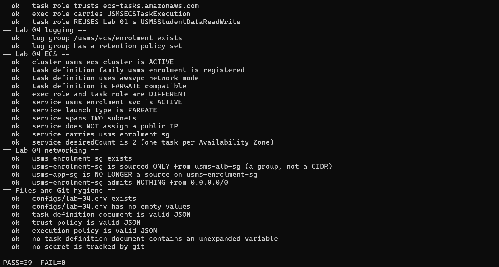

### Step 2: Source every earlier lab's environment

I sourced `course.env` and the env files for Labs 01–11. All eleven were **sourced**, none absent. The values this lab depends on were all set:

| Value | Result |
|---|---|
| cluster | `usms-ecs-cluster` |
| service | `usms-enrolment-svc` |
| container | `enrolment-api` |
| pipeline | `usms-enrolment-pipeline` |
| project | `usms-enrolment-build` |
| exec role | `arn:aws:iam::000000000000:role/usms-ecs-exec-role` |


### Step 3: Probe the deployment surface

I wrote `scripts/utilities/deploy-support-probe.sh` (syntax OK) and ran it. Every check passed:

| Area | Result |
|---|---|
| Docker | daemon reachable |
| ECR | `describe-repositories` answers, `create-repository` accepted, probe URI `000000000000.dkr.ecr.us-east-1.localhost:4566/usms-probe-delete-me`, probe repository deleted |
| ECS | `list-clusters` answers |
| CodeDeploy | `list-applications` answers |

The probe chose **PATH A - build an image, push it to ECR, deploy it through the pipeline** and recorded `USMS_CICD_DEPLOY_PATH=A` and `USMS_CODEDEPLOY_SUPPORTED=yes` in `outputs/lab-12-deploy-probe.txt`.

My first attempt printed nothing at all, because a line break split `bash -n` into a bare `bash` that opened a second shell. I ran the commands again one per line.

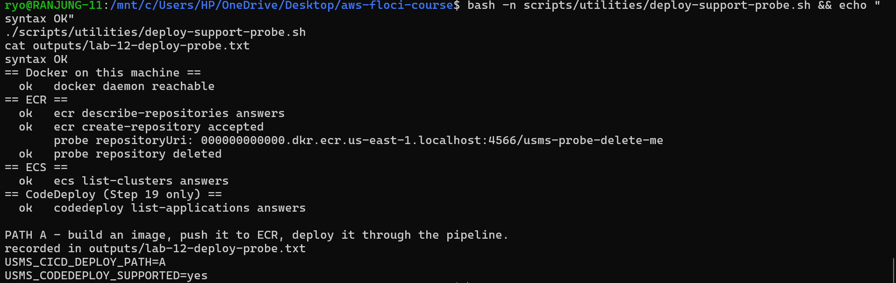

### Step 4: Publish the ECR port range

`docker-compose.yml` had the ECR line `5100-5104` commented out. I backed up the file, removed the `#` with `sed`, and restarted Floci. `docker port floci` then showed 4566 and 5100–5104 published. Before changing anything, the service was still on **`usms-enrolment:2`**, desired 2, ACTIVE.

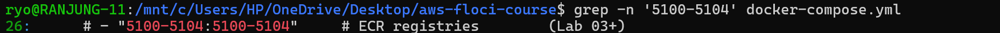
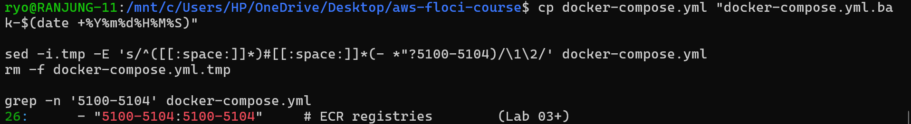

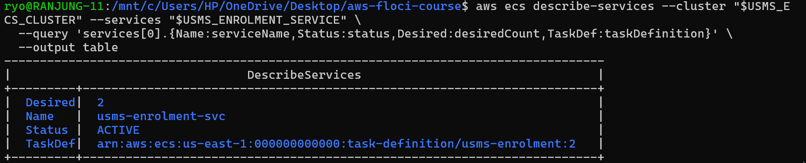

**Problem I hit:** on this Floci build the ECR registry runs in its **own sidecar container**, `floci-floci-course-ecr-registry`, which binds `127.0.0.1:5100`. With the range also published on the `floci` container, the two fought over port 5100. First `floci-up.sh` failed with *"Bind for 127.0.0.1:5100 failed: port is already allocated"*. Then, after I stopped the sidecar, `get-login-password` failed with *"The ECR backing registry is unavailable because no Docker daemon is reachable from Floci"*. I put the `#` back, restarted Floci, and the sidecar came back on `127.0.0.1:5100`. From then on login, push and pull all worked. The three `docker-compose.yml.bak-*` copies are git-ignored (Step 21).

### Step 5: Create the ECR repository

I created **`usms-enrolment`** with `MUTABLE` tags, `scanOnPush=true`, AES256 encryption and the tags `Project=USMS`, `Tier=app`, `Lab=12`. I then **read the URI back from the API** instead of typing the host:

| Value | Result |
|---|---|
| repository URI | `000000000000.dkr.ecr.us-east-1.localhost:4566/usms-enrolment` |
| registry host | `000000000000.dkr.ecr.us-east-1.localhost:4566` (`${ECR_URI%%/*}`) |


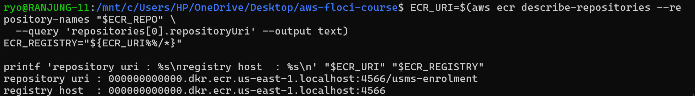

### Step 6: Authenticate Docker against the registry

```bash
aws ecr get-login-password --region "$AWS_REGION_COURSE" \
  | docker login --username AWS --password-stdin "$ECR_REGISTRY"
```

The result was **Login Succeeded**. The token goes through the pipe and never appears on the command line or in the shell history.


### Step 7: Write the Dockerfile

In `labs/lab-11-cicd/app/` I wrote a `.dockerignore` that keeps the source tree, tests, the buildspec and backups out of the build context. I also wrote this `Dockerfile`:

```dockerfile
FROM nginx:1.27-alpine
COPY dist/ /usr/share/nginx/html/
EXPOSE 80
```

The image copies the **built output** `dist/`, not the source, so the release marker and build time stamped by the buildspec go into the image. Port 80 matches Lab 04's container health check and Lab 05's target group. `dist/` was already present, and I rebuilt it with the local runner.


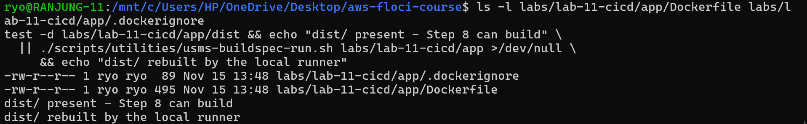

### Step 8: Build the image and push it, by hand

I set `VERSION` to **`r6`**, rebuilt `dist/` with the local runner, built the image and pushed it to ECR. All the layers were **Pushed**, and the registry returned:

```
r6: digest: sha256:ae55d902baf23140ce425bf7ded0ed7f1649867edefd41a3bcf83f2e41d1bde4 size: 856
```

The first runner command printed `usage:` because a line break separated the script from its folder argument. Running it again on one line fixed it.


### Step 9: Prove the image is in the registry

`describe-images` listed one image tagged **`r6`** with the digest above, pushed at `2026-11-15T13:52:22+06:00`. I saved the tag, digest and time in `outputs/lab-12-image-digest.txt`.

To prove the registry really holds the image, I **deleted every local copy** (`docker images | grep -c` gave **0**, *"no local copy remains"*) and pulled it back **by digest**: `docker pull "$ECR_URI@$IMAGE_DIGEST"` ended with *"Downloaded newer image"* for the same `sha256:ae55d902…` (73.6 MB).

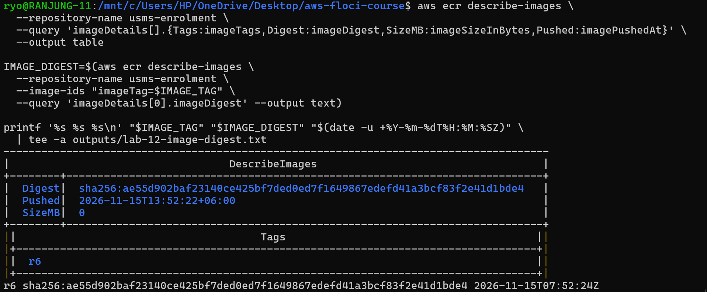
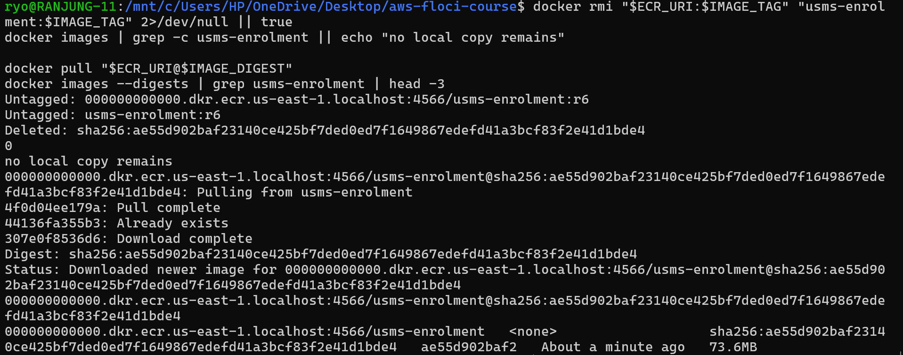

### Step 10: Register a task definition revision that names my image

I described `usms-enrolment` into `templates/lab-12-taskdef-base.json`. A short Python script then removed the eight read-only fields (`taskDefinitionArn`, `revision`, `status`, `requiresAttributes`, `compatibilities`, `registeredAt`, `registeredBy`, `deregisteredAt`), found the container **by name** (`enrolment-api`), and changed only its image:

| | Image |
|---|---|
| old | `public.ecr.aws/nginx/nginx:stable-alpine` |
| new | `000000000000.dkr.ecr.us-east-1.localhost:4566/usms-enrolment:r6` |

The result `templates/lab-12-taskdef-v3.json` was **valid JSON** with **0** unexpanded `$` signs. `register-task-definition` returned **`usms-enrolment:3`**: Family `usms-enrolment`, Revision 3, CPU 256, memory 1024, and the new image. The pasted heredoc broke twice (a bare `python3` opened the interactive prompt), so I ran the same commands from a script file.

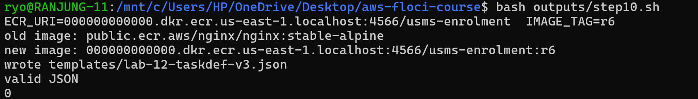
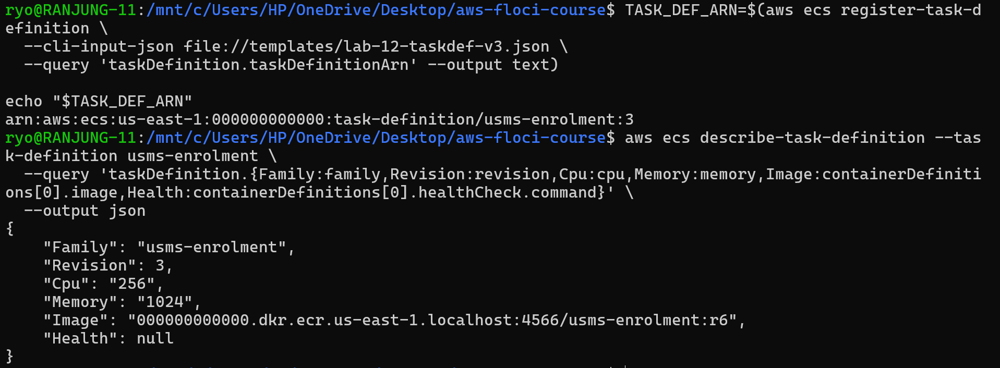

### Step 11: Deploy revision 3 by hand, and watch it

I wrote `scripts/utilities/usms-ecs-watch.sh` (syntax OK), which polls the service's deployments until there is one deployment with running equal to desired. Then I ran:

```bash
aws ecs update-service --cluster "$USMS_ECS_CLUSTER" \
  --service "$USMS_ENROLMENT_SERVICE" --task-definition usms-enrolment:3
```

The watcher reported, on poll 1/20: **PRIMARY, TaskDef `usms-enrolment:3`, Desired 2, Running 2, Pending 0, Rollout COMPLETED**, and *"settled: one deployment, running == desired"*. The service moved from revision 2 to revision 3.

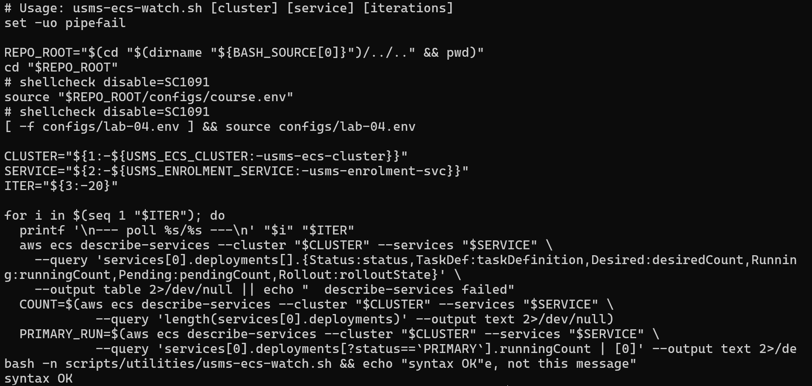


### Step 12: Version 2 of USMSCodeBuildBase

From Step 14 the build pushes to ECR, so the build role needs ECR permissions. I wrote `policies/usms-codebuild-policy-v2.json`, which keeps the logs and artifact-bucket statements and adds:

- `ecr:GetAuthorizationToken` on **`Resource: "*"`**, because this action cannot be limited to one repository;
- the layer upload/download actions, `ecr:PutImage`, `ecr:BatchGetImage` and `ecr:DescribeImages`, limited to `repository/usms-enrolment` only;
- the `BuildsDoNotTouchStudentRecords` statement on `usms-student-data`, kept from v1.

`create-policy-version --set-as-default` returned **v2, Default True**. `list-policy-versions` shows **v1** (2026-11-12, not default) and **v2** (2026-11-15, default), so v1 stays available as a rollback.


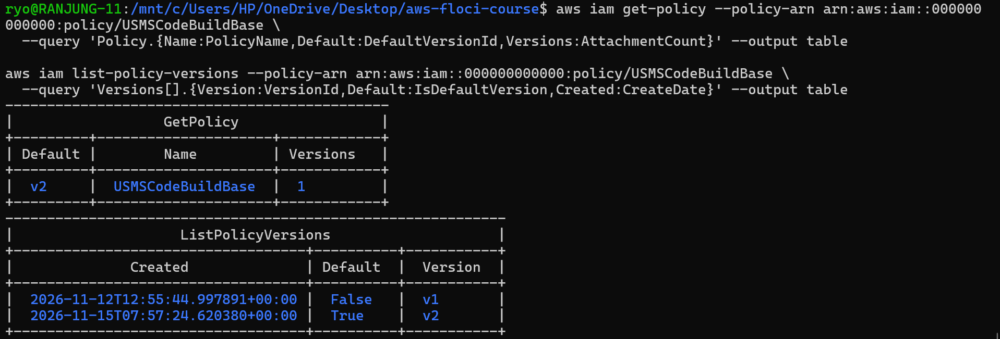

### Step 13: Let the build run Docker

I wrote `templates/lab-12-codebuild-update.json` (valid JSON, 0 unexpanded variables) and applied it with `update-project`. The project kept all four environment variables (`USMS_PROJECT`, `USMS_SERVICE`, `IMAGE_REPO_URI`, `AWS_REGION_COURSE`). `batch-get-projects` confirmed:

| Field | Value |
|---|---|
| Privileged | **True** |
| Repo (`IMAGE_REPO_URI`) | `000000000000.dkr.ecr.us-east-1.localhost:4566/usms-enrolment` |
| Role | `usms-codebuild-role` |
| Source | **`CODEPIPELINE`** (Lab 11 Step 18 not undone) |


### Step 14: Extend the buildspec: build the image, write imagedefinitions.json

I kept the Lab 11 buildspec as `buildspec.yml.lab08a` and wrote the new one. Compared with Lab 11 it:

- sets `IMAGE_REPO_URI` and logs in to ECR in `pre_build` **only if a Docker daemon is reachable**;
- adds `imageUri` to `build-metadata.json`;
- runs `docker build` and `docker push` with the release tag;
- writes `dist/imagedefinitions.json` from `config/service.json`, so the container name is never typed twice.

The smoke test already had its eighth assertion (*"imagedefinitions.json is a one-entry array"*). The local runner passed every phase: the image was built and tagged `…/usms-enrolment:r6`, all **8 smoke tests** passed (*"smoke tests failed: 0"*), and the output was:

```json
[ { "name": "enrolment-api",
    "imageUri": "000000000000.dkr.ecr.us-east-1.localhost:4566/usms-enrolment:r6" } ]
```

`dist/` held `build-metadata.json`, `healthz.html`, `imagedefinitions.json`, `index.html` and `service.json`, with *"local build exit status: 0"*. I packed the source (9 files) and uploaded it, which gave S3 version `10e5fa2d-02d5-4e13-801b-0ae87f16b948`.

**Problem I hit:** a broken paste left a bare `cat` on its own line, so the terminal sat waiting for keyboard input, and both `buildspec.yml` and the backup ended up **empty (0 bytes)**. The runner then crashed with `'NoneType' object has no attribute 'get'`. I restored the backup from Git and wrote the buildspec again.


#### Your turn: Deploy reading SourceOutput instead of BuildOutput

From the pipeline document alone, if `DeployToECS` named `SourceOutput` as its input:

- The ECS deploy action looks for **`imagedefinitions.json` at the root of its input artifact**.
- `SourceOutput` is the committed source tree (`VERSION`, `buildspec.yml`, `Dockerfile`, `config/`, `src/`, `tests/`). `imagedefinitions.json` is **not** in it, because it is generated during the build into `dist/`, which is not committed.
- `BuildOutput` uses `base-directory: dist`, so the contents of `dist/` sit at the root of the zip, which is exactly where the action looks.

So **Source and Build would both succeed** and **Deploy would fail**, because the file is missing from the source archive. The service would stay on its current revision. The failure appears in Deploy even though nothing is wrong with ECS or IAM. The real mistake is one artifact name in the pipeline document, which is what makes it hard to find. (Full answer in `notes/lab-12-notes.md`.)

### Step 15: Version 2 of USMSCodePipelineBase

#### Your turn: write v2 before reading Step 15

Before reading Step 15 I wrote my own version in `notes/lab-12-my-pipeline-policy.json`: the three v1 statements unchanged, plus one statement for all four ECS deploy calls on `"*"`, plus one `iam:PassRole` for the two ECS roles, only to `ecs-tasks.amazonaws.com`. That is **five statements**.

Compared with Step 15, my ECS statement was the one that did not match. `RegisterTaskDefinition` and `DescribeTaskDefinition` **cannot be scoped to a resource**, so they force `"*"`. By putting `UpdateService` in the same statement, I gave the pipeline permission to update **every** service in the account. Step 15 splits the calls into two statements, so it has **six**:

- `DeployToTheEnrolmentServiceOnly`: `DescribeServices` and `UpdateService` on `service/usms-ecs-cluster/usms-enrolment-svc` only;
- `ReadAndRegisterTaskDefinitions`: the task-definition calls (plus `ListTaskDefinitions`) on `"*"`.

The lesson is to keep actions that cannot be scoped in their own statement, so they do not widen the actions that can be.

#### Applying Step 15

`policies/usms-codepipeline-policy-v2.json` was valid JSON, and `create-policy-version --set-as-default` returned **v2, Default True**. The v2 document has the six statements


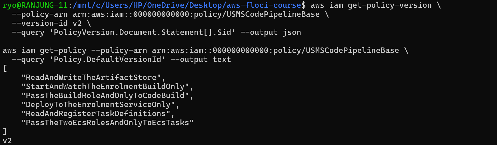

### Step 16: Add the Deploy stage

I used **get → modify → put**. `get-pipeline` saved the current document to `templates/lab-12-pipeline-current.json` (valid JSON; stages `['Source', 'Build']`). A Python script checked that the first two stages were Source and Build, refused to run if a Deploy stage already existed

The output said *"stages now: ['Source', 'Build', 'Deploy']"*, and the file was valid JSON with 0 unexpanded variables. `update-pipeline` returned **3 stages, version 2**. Reading it back gave:

| Stage | Action | Provider | Input |
|---|---|---|---|
| Source | FetchSource | S3 | None |
| Build | BuildArtifact | CodeBuild | SourceOutput |
| Deploy | DeployToECS | **ECS** | **BuildOutput** |

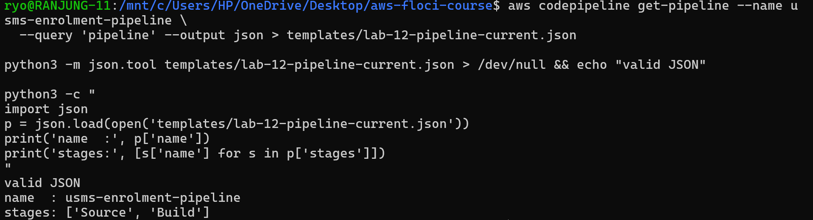

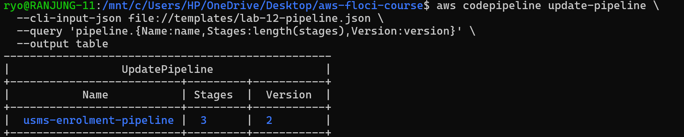
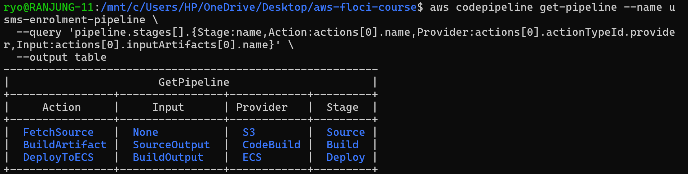

### Step 17: Run it end to end, and prove the service moved

**Before:** the service was on `usms-enrolment:3`.

I packed and uploaded the source (S3 version `0fddafcc-a720-4ea5-852a-6615b73c4bc9`) and started execution **`806771b2-911e-47b9-a956-fc06c214dcb4`**. The polling loop showed:

| Poll | Source | Build | Deploy | Execution |
|---|---|---|---|---|
| 1 | Succeeded | InProgress | None | InProgress |
| 2 | Succeeded | **Failed** | None | **Failed** |

The evidence file `outputs/lab-12-deploy-evidence.txt` therefore shows that **the service did not move**.

The revision 3 check still held: CPU 256, memory 1024, `usms-ecs-exec-role`, `usms-ecs-task-role`, log driver `awslogs`.

**Why the build failed:** CodeBuild build `usms-enrolment-build:9` ended in **`FAULT`** right after `DOWNLOAD_SOURCE`, with *"pull access denied for aws/codebuild/standard, repository does not exist or may require 'docker login'"*. This is the same Floci limit I recorded in Lab 11. Because Build never produced `BuildOutput`, the Deploy stage never ran, and the "after" revision is not a pipeline revision. I do **not** claim that the pipeline deployed anything. The deploy that happened in this lab is my manual deploy in Step 11.


### Step 18: The rollback drill

I recorded the good revision (**`usms-enrolment:3`**), uploaded a source whose release has no image in ECR (`describe-images` listed only **`r6`**, S3 version `d4e7a60b-a8e6-496d-94b4-8338a182891e`), and started execution **`7a085463-d198-4793-bd9f-0022b4f31dd6`**.

After 30 seconds the service had one deployment: **PRIMARY, `usms-enrolment:3`, Desired 2, Running 2, Rollout COMPLETED**. There were no service events. Like Step 17, this execution stopped at Build (`usms-enrolment-build:10`, `FAULT`), so the bad release was **never deployed**. There was nothing for the circuit breaker to catch.

I still ran the manual rollback: `update-service --task-definition usms-enrolment:3`. The watcher reported *"settled: one deployment, running == desired"* on revision 3. Finally I set `VERSION` back to **`r7`** and uploaded the source again (S3 version `dfac5d25-540f-4786-ba39-d0827801828e`).

On real AWS the drill would look different. The deploy action would register a revision that names an image that does not exist, the new tasks would fail with `CannotPullContainerError`, and the circuit breaker (`enable: true, rollback: true`, from Lab 04) would mark the deployment FAILED and return the service to revision 3 without my help.

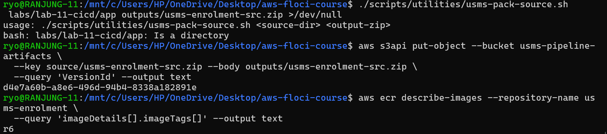


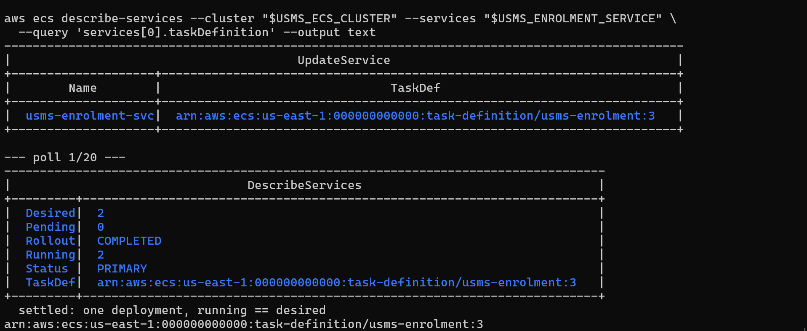
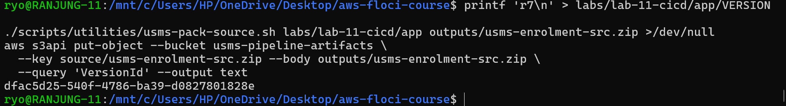

### Step 19: Blue/green with CodeDeploy, on paper

I wrote two documents and validated them **without creating anything**:

- `templates/lab-12-codedeploy-deployment-group.json`: the deployment group `usms-enrolment-dg` for application `usms-enrolment-app`, running as `usms-codedeploy-role`. It uses `BLUE_GREEN` with traffic control and `CodeDeployDefault.ECSLinear10PercentEvery1Minutes`, pairs the target groups `usms-enrolment-tg` (blue) and `usms-enrolment-tg-green`, terminates blue 5 minutes after success, and rolls back automatically on `DEPLOYMENT_FAILURE` or `DEPLOYMENT_STOP_ON_ALARM`. It was **valid JSON**.
- `templates/lab-12-appspec.yaml`: the ECS appspec. It **parses**, with container **`enrolment-api`** on port **80**.

The probe reported that `codedeploy list-applications` answers, but I did not create the application or run a blue/green deployment. A real blue/green setup would also need the green target group and a test listener on the ALB, and the service's deployment controller changed to `CODE_DEPLOY`. The lab warns that this change would strand the Lab 06 scalable target, which is another reason to keep it on paper.


### Step 20: Record this lab's outputs

I wrote `configs/lab-12.env` with **26** exports (*"all values populated"*). Reading it back gave:

| Value | Result |
|---|---|
| repo | `000000000000.dkr.ecr.us-east-1.localhost:4566/usms-enrolment` |
| tag | `r7` |
| digest | **`not-pushed`** (no `r7` image exists; see Step 17) |
| service task def | `usms-enrolment:3` |
| pipeline stages | 3 |
| policy versions | CodeBuild **v2**, CodePipeline **v2** |
| deploy path | **A** |

The first time I sourced it, it did not exist yet (*"No such file or directory"*, all values empty), because the Step 20 block had not run.


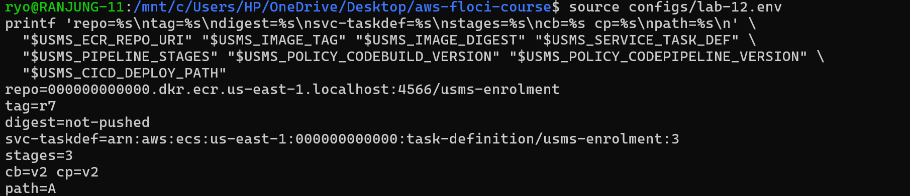

### Step 21: Commit

`git status --short` showed the new Lab 12 files plus the three `docker-compose.yml.bak-*` backups from Step 4. I added `docker-compose.yml.bak-*` to `.gitignore` (`git check-ignore` confirmed line 40) and committed:

```
c7bc1b5 Lab 12: ECR repository, image build, deploy stage, rollback drill
```


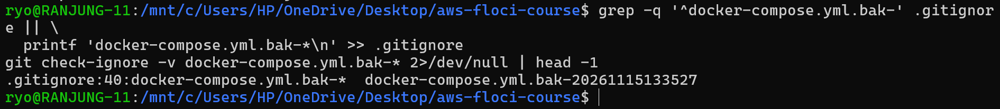


## 6. Verification

`scripts/utilities/verify-lab-12.sh` checks the environment, the Lab 11 dependencies, ECR, the source tree, the task definition, both policy versions, the CodeBuild project, the pipeline, the conceptual documents and Git hygiene.

The result was **PASS=44 FAIL=1**.

| Block | Result |
|---|---|
| Environment | Floci running, storage not in memory mode, CLI reaches Floci, account `000000000000` |
| Lab 11 dependencies | `lab-11.env`, pipeline, build project and ECS service all present |
| ECR | repository exists, `scanOnPush` true, URI has a registry host, at least one image present; **FAIL: tag r7 is present** |
| Source tree | Dockerfile and `.dockerignore` present, buildspec builds an image and writes `imagedefinitions.json`, smoke test has 8 assertions |
| Task definition | revision ≥ 3, names the ECR repo, CPU still 256, memory still 1024 |
| IAM | both policies default to **v2**, `ecr:PutImage` granted, `GetAuthorizationToken` on `*`, pipeline v2 grants `ecs:UpdateService` and passes roles to `ecs-tasks` |
| CodeBuild | `privilegedMode` true, `IMAGE_REPO_URI` set, source still `CODEPIPELINE` |
| Pipeline | 3 stages, stage 3 named Deploy, provider ECS, reads `imagedefinitions.json` |
| Documents and hygiene | appspec present, deployment group valid, watcher valid, `lab-12.env` complete, all templates and both v2 policies valid JSON with no unexpanded variables, no secret tracked |

**The one failure:** ECR holds only **`r6`**. `VERSION` is `r7`, but both pipeline runs faulted at Build, so nothing built or pushed `r7`. The lab's own workaround for a build that cannot push is to push the image by hand, as in Step 8 (`docker build -t "$ECR_URI:r7" .` and `docker push`). That would clear this check and fill `USMS_IMAGE_DIGEST`, but the pipeline still would not have built the image itself.


## 7. Analysis and Discussion

### 7.1 What was achieved

I took the enrolment service from "a folder of built files" to "a container image in a private registry running on ECS". I created the ECR repository `usms-enrolment`, logged Docker in with a token on standard input, built the image from `dist/`, pushed **r6**, and proved it was really in the registry by deleting the local copy and pulling it back **by digest**. I derived task definition **revision 3** by changing exactly one field and deployed it by hand, and the service settled on two running tasks.

I then prepared the pipeline to do the same job automatically. Both service policies are now on **v2** with tightly scoped additions, the build project can run Docker, the buildspec builds and pushes the image and writes `imagedefinitions.json`, and the pipeline has a third **ECS Deploy** stage wired to `BuildOutput`. Blue/green with CodeDeploy is fully specified and validated on paper. The final verification gave **PASS=44 FAIL=1**, and the single failure is explained by the Floci build limitation.

### 7.2 Observed, recorded and conceptual

| Type | Items |
|---|---|
| **Observed / working** | ECR repository create, login, push of r6, describe-images, pull by digest; task definition revision 3 registered; manual `update-service` to revision 3 with Rollout COMPLETED and 2/2 running; both policy v2s created and set as default; `privilegedMode` and env vars on the build project; 3-stage pipeline read back correctly; local runner (all phases, 8/8 smoke tests, `imagedefinitions.json` correct); Source stage Succeeded; appspec and deployment group validated |
| **Recorded only** (Floci stores, but does not run) | CodeBuild builds 9 and 10 ended in `FAULT` (*pull access denied for aws/codebuild/standard*); no `BuildOutput`; the Deploy stage never ran; no pipeline-registered revision 4; no `r7` image, so `USMS_IMAGE_DIGEST=not-pushed` |
| **Floci differences from real AWS** | The ECR registry is a separate sidecar on `127.0.0.1:5100`, so publishing 5100–5104 on the `floci` container broke it; the registry host is `…localhost:4566`; the image size in `describe-images` showed 0 |
| **My own mistakes** | Several pastes split across lines: a bare `bash` (Step 3), a bare `python3` (Step 10), a bare `cat` that emptied `buildspec.yml` and its backup (Step 14), and runner and packer commands missing their folder argument (Steps 8 and 18); `lab-12.env` sourced before Step 20 had run |
| **Conceptual** (real AWS only) | The pipeline building and pushing r7 and registering revision 4 itself; `CannotPullContainerError` and the circuit breaker rolling back in the drill; a CodeDeploy blue/green deployment with a traffic shift |

### 7.3 Observations

- **A digest is proof, a tag is a promise.** `r6` is mutable and could be pushed again with different content. `sha256:ae55d902…` cannot change. Pulling by digest after deleting every local copy is the strongest evidence that the registry holds exactly what I built.
- **Never edit a task definition; derive one.** Describe → strip → change one field → register kept CPU, memory, both roles and the log driver identical, and the Step 17 check confirmed it. Finding the container by **name** instead of by position means the script fails loudly instead of changing the wrong container.
- **The container name is the join key.** `enrolment-api` appears in `config/service.json`, the task definition, `imagedefinitions.json` and the appspec. The buildspec reads it from one file so it cannot drift.
- **Unscopable actions must be isolated.** My own pipeline policy draft put `UpdateService` next to `RegisterTaskDefinition` on `"*"`, which would let the pipeline update any service. Step 15's split keeps `UpdateService` on one service ARN. The same rule explains why `GetAuthorizationToken` sits alone on `"*"` in the build policy.
- **`iam:PassRole` is part of deploying.** The new revision names the exec and task roles, so registering it means passing them. The pipeline may pass exactly those two roles, and only to `ecs-tasks.amazonaws.com`.
- **A failure shows up where it is detected, not where it is caused.** In Steps 17 and 18 the visible failure was in Build, but the cause was the emulator's missing build image. In the SourceOutput exercise the failure would show in Deploy, but the cause is one artifact name. Tracing which artifact feeds which action is the reliable way to debug a pipeline.
- **"Green" is a report; the evidence is the revision.** The lab measures success by comparing the service's task definition before and after, not by the stage colour. That comparison is exactly what showed me honestly that the pipeline did not move the service.
- **Check the output of every pasted command.** Most of my lost time came from line breaks. The worst one silently emptied `buildspec.yml`. Writing long heredoc blocks with an editor or a script file, and checking `wc -l` afterwards, avoided further damage.

## 8. Reflection

### What I learned about continuous deployment

Before this lab I thought deployment meant "copy the new files to the server". Now I see it as **changing one pointer**. The service points at a task definition revision, the revision points at an image digest, and the digest points at exact bytes in a registry. Deploying means moving that pointer forward, and rolling back means moving it back to a revision that is already known to be good. That is why rollback in Step 18 was a single `update-service` call.

The most useful part was again the part that went wrong. The ECR port conflict taught me to read which container actually owns a port before changing compose files. The faulting builds taught me to separate what **I** proved (an image pushed, pulled by digest and running as revision 3) from what the **pipeline** proved (Source succeeded, and the stage layout and permissions are correct). The empty-buildspec accident taught me to keep long file contents out of pasted terminal commands.

## 9. Conclusion

In this lab I extended the USMS CI/CD chain from a build artifact to a running container. I created the private ECR repository **`usms-enrolment`**, wrote a Dockerfile that serves the built `dist/` with nginx on port 80, and pushed **`usms-enrolment:r6`** (digest `sha256:ae55d902…`), proving it was in the registry by pulling it back by digest. I derived task definition **`usms-enrolment:3`** by changing only the image, and deployed it by hand to **`usms-enrolment-svc`**, which settled with two running tasks.

For automation, I created **v2** of `USMSCodeBuildBase` and `USMSCodePipelineBase`, enabled `privilegedMode` on **`usms-enrolment-build`**, extended the buildspec to build, push and write `imagedefinitions.json`, and added an **ECS Deploy** stage, so **`usms-enrolment-pipeline`** is now Source → Build → Deploy. On Floci the Build stage faults because the CodeBuild image cannot be pulled, so the pipeline did not deploy by itself. I recorded this honestly, together with the rollback drill and the blue/green design on paper. `configs/lab-12.env` holds 26 values, the final verification gave **PASS=44 FAIL=1** (only `r7` missing from ECR), and the lab was committed as `c7bc1b5`.
