# Lab 12 Independent Exercises

All exercises were done with the AWS CLI on Floci, from `/mnt/c/Users/HP/OneDrive/Desktop/aws-floci-course` in WSL. As in the main lab, CodeBuild on this Floci build ends every build with `FAULT`, because it cannot pull `aws/codebuild/standard:7.0`. Images were therefore built and pushed with Docker on my machine and with the local runner. Wherever a result was done **by hand** rather than **by the pipeline**, I say so.

| Exercise | Result |
|---|---|
| 1. Second base image | `r7-alt` pushed on `public.ecr.aws/nginx/nginx:stable-alpine`: 24.9 MB vs 20.0 MB compressed, 9 layers each |
| 2. Immutable tags | Overwrite of `r7` **rejected** by ECR; buildspec now tags `<release>-<build number>`; a unique tag pushed while IMMUTABLE; repository set back to MUTABLE |
| 3. Blue/green scaffolding | `usms-enrolment-tg-green` and a test listener on 8080 created; deployment group document has real ARNs and no placeholders |
| 4. Pipeline policy hole | Attack described and confirmed with `simulate-principal-policy`; argued that IAM alone cannot close it, and named the controls that can |
| 5. Release evidence | Full chain for r7 (S3 version → execution → build → digest → revision 4 → service); retagging r7 showed the chain can no longer prove which bytes run |

---

## Preparation: push r7 and re-verify

The main lab ended with **PASS=44 FAIL=1** because no `r7` image existed: both pipeline runs faulted at Build. Step 17 allows pushing the image by hand when the build cannot push, so I did that. The push returned:

```
r7: digest: sha256:ad5475ace14cb308010b36945184c6148bae28ae6eae9519f697d2f0dc2fc8d8 size: 856
```

Only two layers were new (`3b651637e4eb` and `958e278b9384`). All the nginx base layers already existed from r6, because the registry stores each layer once.

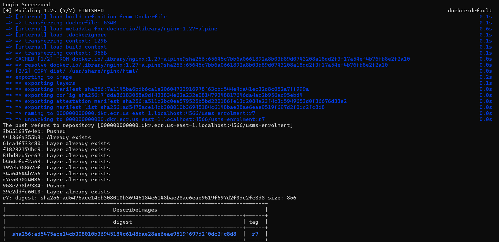

I then regenerated `configs/lab-12.env` (26 values, *"all values populated"*) and re-ran verification, which now gives **PASS=45 FAIL=0**.

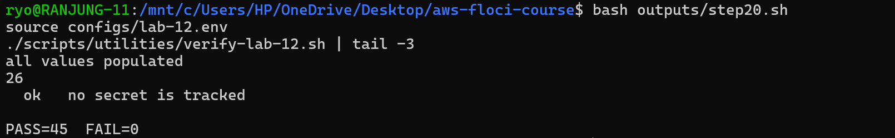

---

## Exercise 1 - Basic: a second base image, and a smaller one

**What I did.** I did not change `VERSION` (it stayed `r7`) or the `Dockerfile`. I piped the Dockerfile through `sed` to swap only the `FROM` line, and built from standard input:

```bash
sed "s|^FROM .*|FROM public.ecr.aws/nginx/nginx:stable-alpine|" $APP/Dockerfile \
  | docker build -f - -t "$ECR_URI:r7-alt" $APP
```

The build resolved `public.ecr.aws/nginx/nginx:stable-alpine@sha256:8cc385b5…` and copied the same `dist/`.

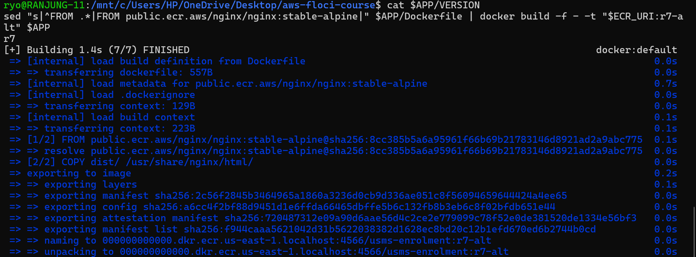

I pushed `r7-alt` (digest `sha256:f944caaa…b0cd`) and did not deploy it. Its base layers were all **Pushed** as new, because this base shares nothing with `nginx:1.27-alpine` except one layer. The repository now holds three tags: `r7`, `r7-alt` and `r6`.

On this Floci build, `describe-images` reports **`imageSizeInBytes = 0`** for every image, so the size the exercise asks for cannot come from that field here. I therefore read the compressed sizes from the registry's own manifest API. That is the data ECR's size field would be calculated from: the sum of the compressed layer sizes. (My first `docker login` line broke on paste, which is the error at the top of the screenshot. The push still worked because Docker was already logged in from the prep step.)

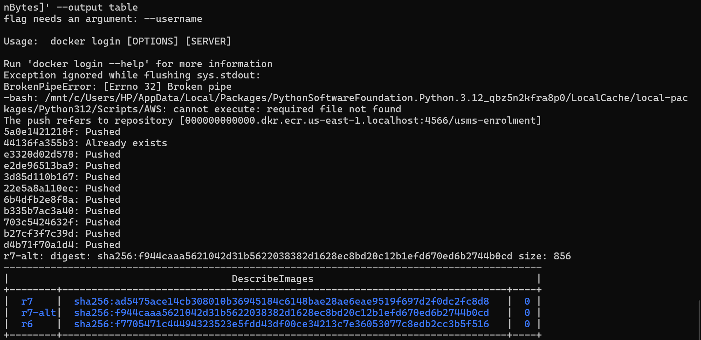

| Image | Base | Registry (compressed) | Local daemon | Layers |
|---|---|---|---|---|
| `r7` | `nginx:1.27-alpine` | **20,961,363 B (20.0 MB)** | 20,975,352 B | 9 |
| `r7-alt` | `public.ecr.aws/nginx/nginx:stable-alpine` | **26,074,250 B (24.9 MB)** | 26,089,743 B | 9 |

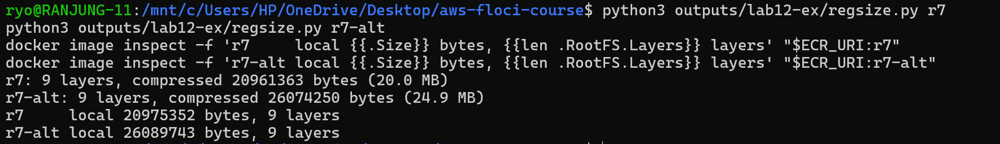

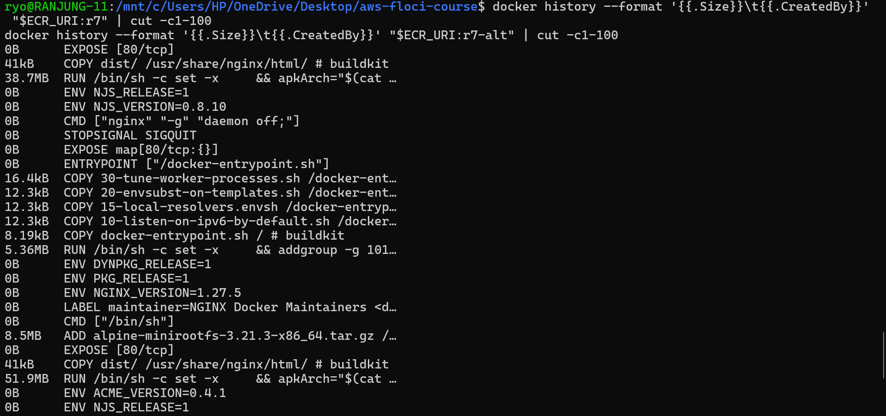

**Note: why the numbers differ.** Both images have the same structure: Alpine, nginx, five entrypoint scripts, and our `COPY dist/` layer of only **41 kB**. So the whole difference is in the **base image**. `docker history` shows the nginx install layer is **38.7 MB** in `r7` (nginx 1.27.5 on Alpine 3.21.3) but **51.9 MB** in `r7-alt`. The `stable-alpine` tag currently points at a newer nginx build, which also includes NJS and the ACME module (`ENV ACME_VERSION=0.4.1`), and on a newer Alpine. So `r7-alt` is about **5.1 MB (24%) bigger compressed**, and the "alternative" base is not the smaller one.

The registry and the local daemon normally disagree by a lot, because the registry stores **gzip-compressed** layers and `docker images` reports the **unpacked** filesystem. Here they are almost equal. Docker Desktop uses the containerd image store, whose `Size` is the size of the stored (compressed) content. The remaining ~14 kB is the image config and manifest, which the local figure includes and the layer sum does not. The lesson is that pinning a version (`1.27-alpine`) gives a predictable size, while a moving tag (`stable-alpine`) can grow without any change in our code.

---

## Exercise 2 - Intermediate: argue for immutable tags, then implement it

**Switch to IMMUTABLE.** I used `put-image-tag-mutability` on the existing repository (not a new one), and `describe-repositories` confirmed `IMMUTABLE`.

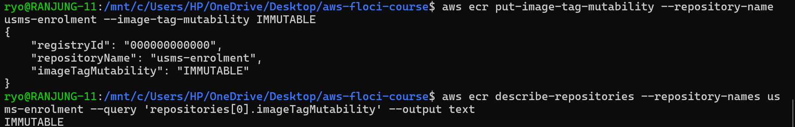

**The rejection.** I rebuilt the image with a new label, so the content and the digest were different (`sha256:cad15294…`), and pushed it as `r7` again. Docker uploaded the one new layer, and then the registry refused the tag:

```
error from registry: The image tag r7 already exists in the usms-enrolment repository
and cannot be overwritten because the tag is immutable.
```

`describe-images` showed `r7` still at **`sha256:ad5475ace14c…c8d8`**, the same digest as before the attempt. So Floci enforced IMMUTABLE exactly as ECR does. (The first `describe-images` line in the screenshot broke on paste and printed the full JSON; it shows the same digest.)

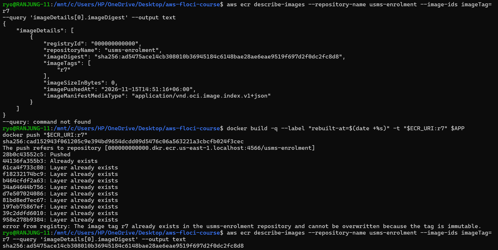

**What had to change in the buildspec.** The buildspec tagged the image with the release only (`:r7`), so every build of the same release reuses the same tag. On an immutable repository the second push is rejected and the deploy would use a stale image. I added one line in the build phase and used `$IMAGE_TAG` in the four places that write the image URI: the build metadata, `docker build`, `docker push` and `imagedefinitions.json`.

`CODEBUILD_BUILD_NUMBER` goes up by one on every build of the project, so two CodeBuild runs can never produce the same tag. I chose it over `CODEBUILD_RESOLVED_SOURCE_VERSION` because retrying a build on the **same** source would reuse that value and collide. The local runner sets neither variable, so the fallback `local<UTC timestamp>` is defined.

`git diff HEAD` against the committed Lab 12 buildspec shows the change: two lines added in the build phase, and the four `:$USMS_RELEASE` image references replaced with `:$IMAGE_TAG`.

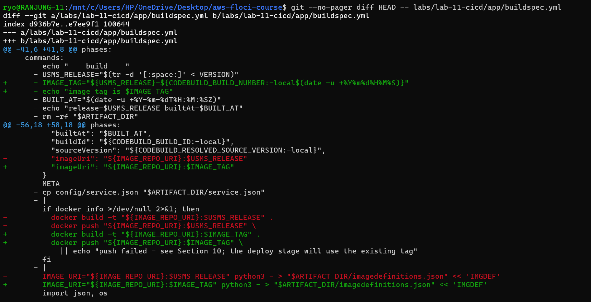

**The new buildspec works on an immutable repository.** With the repository still IMMUTABLE, the local runner printed *"image tag is r7-local20261115085644"*, built and pushed that tag (digest `sha256:e7736abc…`), passed all smoke tests (*"smoke tests failed: 0"*) and exited with status 0. `imagedefinitions.json` is still deployable: one entry, container `enrolment-api`, image `…/usms-enrolment:r7-local20261115085644`.

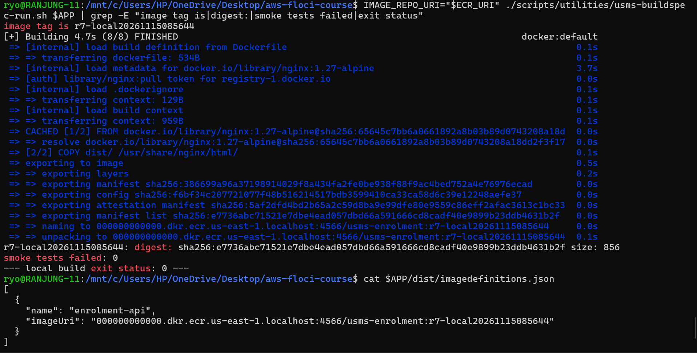

The repository now holds `r7`, `r7-local20261115085644`, `r7-alt` and `r6`.

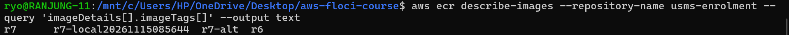

**What immutable tags buy and what they cost.** They buy **trust in the name**. Once `r7` exists it always means the same bytes, so a task definition that names a tag is as reliable as one that names a digest, and nobody can silently replace a release, by accident or on purpose. They cost **convenience**: you cannot re-push a fixed build under the same name, moving tags like `latest` stop working, every build needs a unique tag scheme, and tags pile up, so you need a lifecycle policy to delete old ones.

**Mutability at the end.** I set the repository **back to MUTABLE**. Exercise 5 has to retag `r7`, and `configs/lab-12.env` records `USMS_ECR_TAG_MUTABILITY=MUTABLE`. Section 8's verification does not check this field, so a later lab could otherwise be surprised by it.

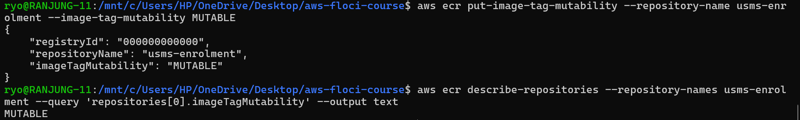

---

## Exercise 3 - Problem solving: build the blue/green scaffolding

**Lab 05's settings, read from the API.** `usms-enrolment-tg` is HTTP:80 in `vpc-20628f13`, target type `ip`, health check on `/`, matcher `200`, interval 30 s, timeout 5 s, healthy threshold 2, unhealthy threshold 2.

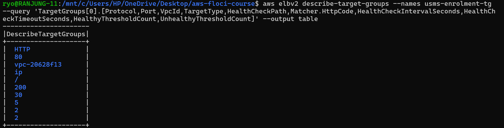

**Green target group.** I created `usms-enrolment-tg-green` with exactly those settings (ARN `…/usms-enrolment-tg-green/5f40c0bcee6b4813`). Its `LoadBalancerArns` was `[]` at that point, because no listener used it yet. Side by side, both groups are `ip`, `80`, `/`, `200`. (The trailing *"command not found"* line is a paste break after the command had already run.)

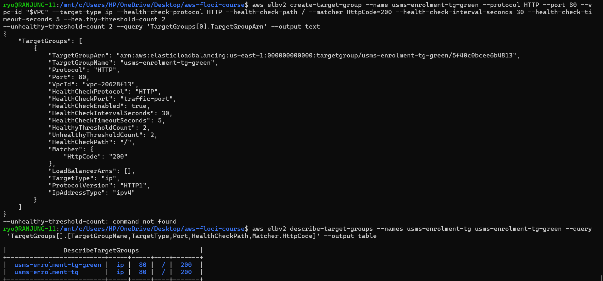

**Test listener.** My first `create-listener` command broke on paste, so the first listing still showed only port 80:

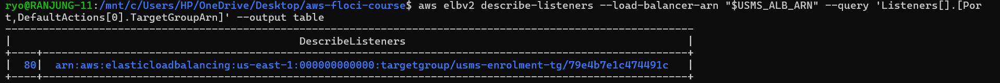

I re-ran it. The ALB now has two listeners: **80 → `usms-enrolment-tg`** (production) and **8080 → `usms-enrolment-tg-green`** (test, listener `…/e6327536b7694bee`).

**Deployment group document.** I queried both listener ARNs from the API rather than copying them, and substituted them for `<PROD_LISTENER_ARN>` and `<TEST_LISTENER_ARN>` with `python3`, as Step 16 did. On the first pass the 8080 listener did not exist yet, so the test ARN came out empty:

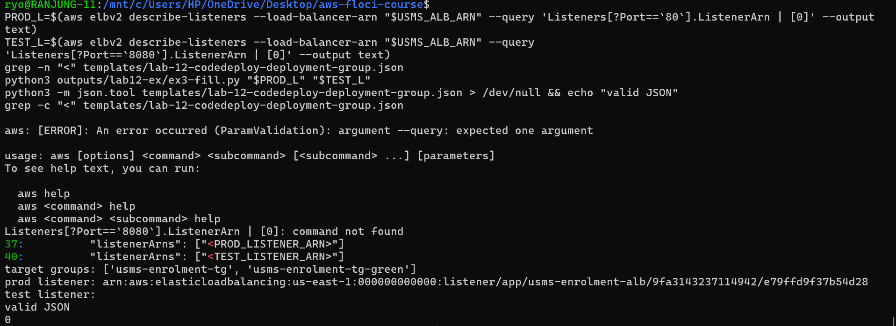

After creating the listener, I restored the template and substituted again. The final document `templates/lab-12-codedeploy-deployment-group.json` has:

| Field | Value |
|---|---|
| Target groups | `usms-enrolment-tg`, `usms-enrolment-tg-green` |
| Production listener | `…/usms-enrolment-alb/9fa3143237114942/e79ffd9f37b54d28` (port 80) |
| Test listener | `…/usms-enrolment-alb/9fa3143237114942/e6327536b7694bee` (port 8080) |

It is valid JSON, and `grep -c "<"` returns **0**. I did **not** change the ECS service's deployment controller, so the Lab 06 scalable target is unaffected.

---

## Exercise 4 - Challenge: close the hole in the pipeline policy

**Evidence.** Policy v2 grants `ecs:RegisterTaskDefinition` (with `DescribeTaskDefinition` and `ListTaskDefinitions`) on **`Resource: "*"`**, `ecs:UpdateService` only on `service/usms-ecs-cluster/usms-enrolment-svc`, and `iam:PassRole` of `usms-ecs-exec-role` and `usms-ecs-task-role`, only to `ecs-tasks.amazonaws.com`.

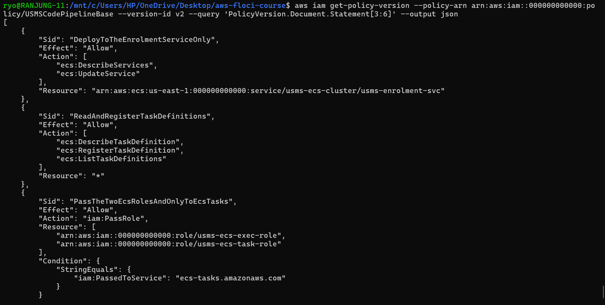

The current task definition shows what the caller of `RegisterTaskDefinition` controls: the **task role** (`usms-ecs-task-role`), the **image**, the **command** (currently `null`, so the image default runs) and the **environment**. The environment includes `USMS_BUCKET=usms-student-data`. From Lab 01, that task role carries `USMSStudentDataReadWrite`, which allows `s3:GetObject`, `s3:PutObject` and `s3:DeleteObject` on the student-data bucket.

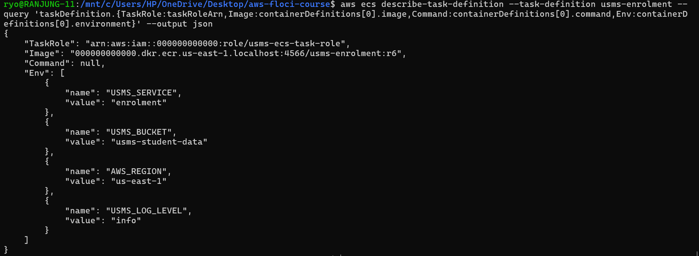

`simulate-principal-policy` for `usms-codepipeline-role` confirms the shape: **`ecs:RegisterTaskDefinition` is `allowed` on `*`**. `ecs:UpdateService` and `iam:PassRole` are `implicitDeny` on `*`, because they are allowed only on the specific service and the two specific roles. So the only unbounded action is registering task definitions.

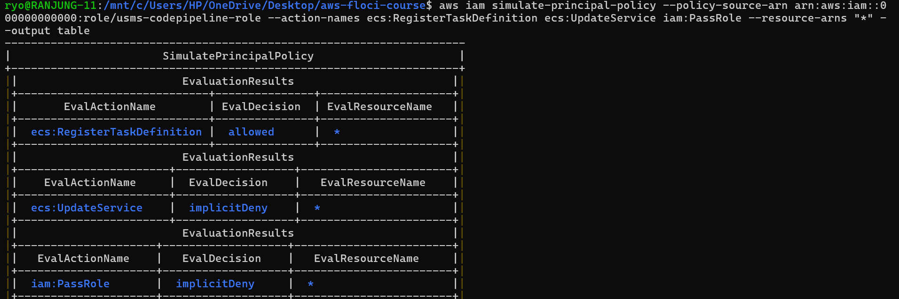

**The attack.** Someone with the pipeline role's credentials registers a new revision of `usms-enrolment` that keeps `taskRoleArn = usms-ecs-task-role` but sets the **command** (or the image) to a script that copies or deletes every object in `usms-student-data`. They then call `UpdateService` on `usms-enrolment-svc`. Every step is allowed by v2, because passing that role to ECS tasks is exactly what the PassRole statement permits. The service then runs the attacker's code **with read, write and delete access to student records**. PassRole limits *which* role can be handed over; it does not limit *what the code holding that role does*.

**Can IAM close it?** Not with this policy alone.
- `RegisterTaskDefinition` does not support resource-level permissions. In the Service Authorization Reference for Amazon ECS (https://docs.aws.amazon.com/service-authorization/latest/reference/list_amazonelasticcontainerservice.html), its condition keys are for **tags** (`aws:RequestTag/${TagKey}`, `aws:TagKeys`), and none of them inspects the image, command, environment or task role inside the definition. So no v3 of this policy can express "only the image may change".
- Narrowing PassRole further would break the deploy, because every new revision must name the task role.
- Removing `RegisterTaskDefinition` would also break it, because the ECS deploy action registers a new revision on every release.

**Where the control belongs instead:**
- **Least privilege on the task role.** The enrolment service does not need `DeleteObject` on student records. Shrinking `USMSStudentDataReadWrite` limits the damage no matter what the pipeline registers.
- **Control what can run.** Allow only images from `usms-enrolment` that the build produced (for example by limiting the exec role's ECR pull actions to that repository and deploying by digest), and add image signing or an admission check.
- **Detection.** An EventBridge rule on CloudTrail `RegisterTaskDefinition` events from `usms-codepipeline-role` that alerts when anything other than `image` differs from the previous revision.
- **Protect the credential itself.** The role is only usable through CodePipeline, which its trust policy and `aws:SourceArn` condition already enforce.

Because I argued that the fix does not belong in this policy and did not write a v3, no pipeline execution was needed to prove that a v3 does not break the pipeline. The policy stays at **v2**.

---

## Exercise 5 - Integration: prove a release end to end, for an auditor

**A revision that names r7.** The pipeline cannot run a build on Floci, so I derived the r7 task definition **by hand**, using the same describe → strip → change-one-field method as Step 10. This is exactly what the ECS deploy action would have done. It changed the image from `…/usms-enrolment:r6` to `…/usms-enrolment:r7` and registered **`usms-enrolment:4`**.

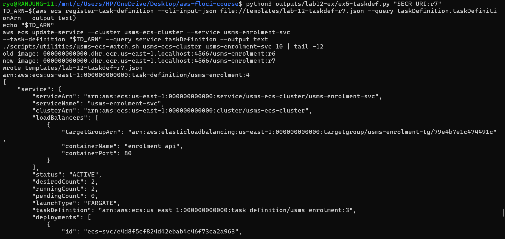

**The evidence chain** is in `outputs/lab-12-release-evidence.md`. Every value there is the output of the command shown with it:

| # | Link | Value |
|---|---|---|
| 1 | Source archive S3 version | `dfac5d25-540f-4786-ba39-d0827801828e` (2026-11-15T08:23:23Z) |
| 2 | Pipeline execution | `47b6a0f2-1399-482f-a857-e96ceb578eb3`, status **Failed**, consumed source version `dfac5d25-…` |
| 3 | Build ID | `usms-enrolment-build:11`, **Failed** (Source stage Succeeded) |
| 4 | Image digest for `r7` | `sha256:ad5475ace14cb308010b36945184c6148bae28ae6eae9519f697d2f0dc2fc8d8`, pushed 2026-11-15T14:51:16+06:00 |
| 5 | Task definition that names r7 | `arn:aws:ecs:us-east-1:000000000000:task-definition/usms-enrolment:4` → `…/usms-enrolment:r7` |
| 6 | Service's current task definition | `…/usms-enrolment:4`, 2 running |

**Putting r7 on the service.** I then pointed the service at revision 4 **by hand** (`update-service --task-definition usms-enrolment:4`), which is the step the Deploy stage would have done. The service now runs `usms-enrolment:4`.

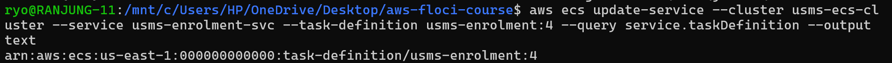

**Reading the chain honestly:**
- **Links 1 → 2 are proven by the platform.** The execution's `artifactRevisions` names the exact S3 version it consumed.
- **Link 2 → 3 is proven.** The execution's Build action is `usms-enrolment-build:11`. That build **faulted**, though, so the image in link 4 was **not** produced by it. I pushed it by hand in the preparation step, so the link from source to image rests on my own record (`outputs/lab-12-image-digest.txt` and the push output in `ex0.png`), not on CodeBuild.
- **Links 4 → 5 → 6 are proven.** At deployment time, `r7` resolved to `sha256:ad5475…`, revision 4 names `usms-enrolment:r7`, and the service runs revision 4.

**Breaking a link: retagging r7.** I recorded the current `r7` digest in `outputs/lab-12-image-digest.txt`, tagged the `r7-alt` image as `r7` and pushed it. Every layer already existed, so only the tag moved: `r7: digest: sha256:f944caaa…`. I recorded the new digest as a **second `r7` line** and did **not** deploy it:

```
r6 sha256:ae55d902baf2…1bde4  2026-11-15T07:52:24Z
r7 sha256:ad5475ace14c…c8d8   2026-11-15T14:22:58Z   <- what revision 4 was deployed with
r7 sha256:f944caaa5621…b0cd   2026-11-15T14:27:08Z   <- what r7 means now (the r7-alt image)
```

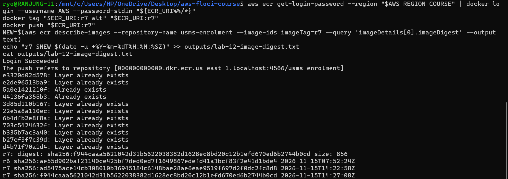

**The chain after the retag.** `describe-images` now shows `r7` and `r7-alt` with the **same** digest, `sha256:f944caaa…`. The original `sha256:ad5475…` no longer appears under any tag. Revision 4 still names just `…/usms-enrolment:r7`, and the service is still on revision 4.

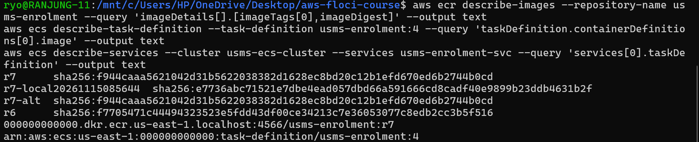

**What the document can and cannot still prove** (also written as section 8 of the evidence file):
- **Still proven:** the source version (`dfac5d25-…`), the execution that consumed it (`47b6a0f2-…`), its build (`usms-enrolment-build:11`, FAULT), and that the service runs revision 4, which names `usms-enrolment:r7`.
- **No longer proven: which bytes run.** Revision 4 names a **tag**. The task definition and the service look exactly the same before and after the retag, so neither can tell `ad5475…` and `f944caaa…` apart. Any task started from now on (a scale-out or a replaced task) would pull the **r7-alt** image under the **same** revision, so two different images could run as "release r7".
- **The only thing that still holds the truth** is a record outside the chain: the two `r7` lines in `outputs/lab-12-image-digest.txt`.
- **The fix:** deploy by **digest** (`…/usms-enrolment@sha256:ad5475…`) or use **immutable** tags. Exercise 2 showed that the registry would then have refused this exact retag.

---

## Summary

These exercises went past "it deploys" to the questions an operator and an auditor would ask. Exercise 1 showed that the base image is almost the whole image. Our own layer is 41 kB, and a moving base tag (`stable-alpine`) made the image 24% bigger without any change in our code. Exercise 2 proved that ECR rejects an overwrite of an immutable tag. I made the buildspec produce a unique tag per build (`<release>-<build number>`, with a defined local fallback) so the pipeline keeps working on an immutable repository, then set the repository back to MUTABLE for Exercise 5. Exercise 3 built the real blue/green scaffolding: a green target group with Lab 05's exact settings, a test listener on 8080, and a deployment group document with real ARNs and no placeholders. The service's deployment controller was left alone.

Exercise 4 showed the limit of IAM. `simulate-principal-policy` confirmed that `RegisterTaskDefinition` is allowed on `*`, so a stolen pipeline role could run any code as `usms-ecs-task-role` and reach student records. PassRole decides *which* role is passed but not *what it does*, so the real controls are least privilege on the task role, deploying by digest, and alerting on unexpected task definition changes. Exercise 5 traced r7 from its S3 version through the execution, build and digest to revision 4 running on the service, and recorded honestly that the build faulted on Floci, so I pushed the image and switched the service by hand. Retagging r7 to the r7-alt image then broke exactly one link: the task definition and the service looked identical before and after, but `r7` now meant `f944caaa…` instead of `ad5475…`, so the chain could no longer prove which bytes were running. The key lesson across all five is that **a tag is a promise and a digest is proof**: only immutable tags or digest-pinned task definitions let you say exactly which bytes are running.
