# Lab 13 Practical Report: Centralized Logging and Monitoring with CloudWatch and X-Ray

## 1. Aim / Objective

The aim of this lab is to give the USMS platform **telemetry**: logs that are kept for a known time and can be searched, metrics that can be counted and alarmed on, and traces that follow one request through the transcript pipeline. I built the three layers (logs, metrics, traces) around the transcript notifier from Lab 10, and combined them into alarms and a dashboard. Everything was done with the AWS CLI on the local emulator Floci.

The specific objectives were to:

- Probe what Floci supports, and inventory the log groups, alarms, namespaces and dashboards that earlier labs left behind.
- Create the central log group **`/usms/central/application`** and put a **retention policy** on every USMS log group, so nothing is kept forever.
- Write **structured log events**, design and test filter patterns, and deploy two **metric filters** (`usms-notify-count`, `usms-central-errors`).
- Publish **custom metrics with dimensions** (`TranscriptsProcessed`, `TranscriptLagSeconds`) in the namespace **`USMS/Application`**.
- Create the policy **`USMSObservabilityWrite`** and attach it to the Lambda and EC2 roles.
- **Instrument** `usms-transcript-notifier` (metrics, a trace id on every log line, a duration measurement), turn on **active tracing**, and move the `live` alias to it.
- Build **X-Ray segment documents** by hand, read traces back, search by annotation, and write a **sampling rule**.
- Create a threshold alarm, an **absence** alarm and a **composite** alarm, prove an alarm fires, and build the **`usms-overview`** dashboard.
- Restart Floci and prove the configuration survives, save **`configs/lab-13.env`**, verify with `verify-lab-13.sh`, and prepare the commit.

## 2. Introduction

Up to Lab 12 the platform could run, scale and deploy, but nobody could answer simple questions such as *"did that transcript go out?"*, *"how slow is the notifier?"* or *"is anything failing right now?"*. This lab adds the AWS services that answer them:

| Service | Its job in this lab |
|---|---|
| **CloudWatch Logs** | Stores log events in log groups and streams, deletes them after the retention period, and turns matching lines into numbers with **metric filters** |
| **CloudWatch Metrics** | Stores numbers over time (`NotifyCount`, `TranscriptsProcessed`, `TranscriptLagSeconds`) with **dimensions** such as `Faculty` and `Stage` |
| **CloudWatch Alarms** | Watch a metric and change state (`OK`, `ALARM`, `INSUFFICIENT_DATA`); a **composite alarm** combines child alarms into one incident |
| **CloudWatch Dashboards** | One page of widgets (text, metrics, alarms) on a 24-column grid |
| **AWS X-Ray** | Records **segments** and **subsegments** of a request under one **trace id**, so one request can be followed across services |

The main ideas of this lab:

| Concept | Simple meaning |
|---|---|
| **Retention** | A log group with no retention keeps logs forever and costs money forever. Every USMS group now has 30 days (application) or 14 days (functions). |
| **Structured log line** | A fixed prefix (`USMS_EVENT`, `USMS_NOTIFY`) followed by JSON, so a line can be both searched and parsed. |
| **Metric filter** | A pattern on a log group. Each matching line adds `metricValue` to a metric; `defaultValue` writes 0 when lines arrive but none match. |
| **Dimension** | A name/value pair on a metric (`Faculty=science`). Each different set of dimensions is a separate metric, so a total needs its own no-dimension datapoint. |
| **Missing data** | An alarm must be told what "no data" means. For a latency alarm, no data is fine (`notBreaching`). For a "the pipeline has gone silent" alarm, no data **is** the problem (`breaching`). |
| **Trace id** | `1-<8 hex time>-<24 hex random>`. Writing it into every log line lets a log and a trace be joined. |
| **Annotation vs metadata** | Annotations are indexed and searchable (`annotation.faculty = "science"`); metadata is just stored. |
| **Sampling** | Not every request needs a trace. A rule keeps a fixed number per second (the reservoir) and then a percentage of the rest. |

**The most important limitation:** my Step 4 probe showed that this Floci build supports log groups, metric data, alarms and dashboards, but **not** metric filters, Logs Insights or **any** X-Ray API. Every `put-metric-filter`, `test-metric-filter`, `start-query` and `xray ...` call failed with `UnsupportedOperation` or `UnknownOperationException`. In each case I used the closest supported replacement (`filter-log-events`, manual `put-metric-data`, local validation of the X-Ray documents) and I say clearly which result came from which.

## 3. Use Case

**USMS use case:** students upload transcripts, and the notifier (Lab 10) reacts to each upload. When a student says *"my transcript never arrived"*, the support team has no evidence either way. The university asked for:

- **Logs that are kept, but not forever.** One central application log group, 30 days for application logs and 14 days for function logs, and **no** USMS group left on never-expire.
- **Numbers, not just text.** A count of notifications sent, a count of errors, transcripts processed per faculty, and how long each notification took.
- **Least-privilege telemetry.** The application roles may write logs only to USMS groups, publish metrics only in `USMS/Application`, and send traces.
- **Follow one request.** A trace id on every notifier log line, active tracing on the function, and a sampling rule so tracing does not get expensive.
- **Be told, not just able to look.** An alarm when notifications get slow, an alarm when notifications **stop**, and one combined alarm that pages a person.
- **One screen.** A dashboard with the key numbers and alarm states.

## 4. System Architecture / Design

**How it works in simple words:**

1. **Upload:** a transcript lands in `usms-student-data` and S3 invokes `usms-transcript-notifier` through its alias **`live`**.
2. **Logs:** the instrumented notifier writes `USMS_NOTIFY {...}` and `USMS_SUMMARY {...}` lines, each with `trace_id`, to `/aws/lambda/usms-transcript-notifier` (14 days). Application events go to **`/usms/central/application`** (30 days).
3. **Metrics:** the notifier publishes `TranscriptsProcessed` (with `Faculty` and `Stage`, plus a no-dimension total) and `TranscriptLagSeconds` in **`USMS/Application`**. On real AWS the two metric filters would add `NotifyCount` and `CentralErrorCount` from the logs. On Floci I published those two with `put-metric-data`.
4. **Traces:** with active tracing the Lambda runtime starts a segment; the notifier's subsegments (S3 read, metric publish, notify) and the S3 downstream segment share one trace id. On Floci the documents were built and validated but could not be sent.
5. **Alarms:** `usms-transcript-lag-high` and `usms-notify-silence` feed the composite **`usms-transcript-pipeline-down`** (OR rule).
6. **Dashboard:** `usms-overview` shows a header, two metric graphs and the alarm states.

| Resource | Name | Key settings |
|---|---|---|
| Central log group | `/usms/central/application` | retention **30** days |
| Other log groups | `/usms/ecs/enrolment` (30), notifier and both edge functions (14) | no USMS group on never-expire |
| Metric filters (designed) | `usms-notify-count`, `usms-central-errors` | patterns `USMS_NOTIFY` and `ERROR`, namespace `USMS/Application`, `defaultValue=0`. **Not deployable on Floci** |
| Custom metrics | `TranscriptsProcessed`, `TranscriptLagSeconds`, `NotifyCount`, `CentralErrorCount` | namespace `USMS/Application` |
| IAM policy | `USMSObservabilityWrite` | logs on `/usms/*:*` and `/aws/lambda/usms-*:*`; `PutMetricData` only where `cloudwatch:namespace = USMS/Application`; X-Ray put |
| Function | `usms-transcript-notifier` | alias `live` → **version 4** (instrumented, tracing **Active**) |
| Sampling rule (document) | `usms-transcripts-sampling` | priority 1000, reservoir 2, fixed rate 0.10 |
| Alarms | `usms-transcript-lag-high`, `usms-notify-silence`, `usms-transcript-pipeline-down` | Maximum > 2 s (2 of 3); Sum < 1 for 3 × 5 min; OR composite |
| Dashboard | `usms-overview` | 5 widgets, 24-column grid, no overlaps |

## 5. Implementation Procedure

### Step 1: Start the environment and prove persistence

I started Floci with `floci-up.sh` and ran `floci-storage-check.sh`. The container was running (created by Compose project `floci-course`), storage mode was **`hybrid` (durable)**, `/app/data` was a bind mount to `/home/ryo/floci-data`, and the host state directory existed (57 MB). This matters for Step 24, where the configuration has to survive a restart.

Floci started in hybrid storage mode, and the storage check confirms the bind mount to `/home/ryo/floci-data`:


### Step 2: Source env files and confirm identity

I sourced `course.env` and the env files for Labs 01–12. All twelve were **sourced**, none absent. `whoami.sh` showed profile `floci`, endpoint `http://localhost:4566`, region `us-east-1` and account **`000000000000`** (*"this is Floci, not real AWS"*). The values this lab depends on were set:

| Value | Result |
|---|---|
| bucket | `usms-student-data` |
| notifier | `usms-transcript-notifier` |
| notifier log | `/aws/lambda/usms-transcript-notifier` |
| lambda role | `arn:aws:iam::000000000000:role/usms-lambda-exec-role` (an **ARN**, which matters in Step 12) |

All twelve earlier env files were sourced, and `whoami.sh` confirms account `000000000000` on Floci:


The values this lab depends on (bucket, notifier, log group, Lambda role, account id) are all set:


### Step 3: Create this lab's directories

I created `labs/lab-13-cloudwatch-xray/transcript-notifier-v2` and `project/checkpoint-01`, and confirmed *"source tree ready"*.

The lab directories `transcript-notifier-v2` and `project/checkpoint-01` were created:


The source tree check printed *"source tree ready"*:


### Step 4: Find out what Floci supports

I wrote a small `probe()` function that runs one read-only call per feature and prints SUPPORTED or UNSUPPORTED, and saved the result in `outputs/lab-13-support-probe.txt`:

| Service | Supported | Unsupported |
|---|---|---|
| CloudWatch Logs | `describe-log-groups` | `put-metric-filter` API, Insights `start-query` |
| CloudWatch | `list-metrics`, `describe-alarms`, `list-dashboards` | |
| X-Ray | | `get-sampling-rules`, `get-service-graph` |
| Lambda | `get-function-config` | |

This probe predicted every failure I met later, so I used it to decide in advance where I would need a workaround.

The support probe shows which logs, CloudWatch, X-Ray and Lambda calls this Floci build supports:


### Step 5: Inventory existing monitoring

`outputs/lab-13-telemetry-inventory.txt` recorded the starting point:

- **Log groups:** seven, and only `/usms/ecs/enrolment` (7 days) had retention. All the others were on **never-expire**.
- **Alarms:** `usms-enrolment-queue-high` (OK) from Lab 06, and four ECS target-tracking alarms in `INSUFFICIENT_DATA`.
- **Namespaces:** `USMS/Enrolment` and `USMS/Probe`.
- **Dashboards:** none.

The inventory of existing log groups, alarms, namespaces and dashboards before this lab:

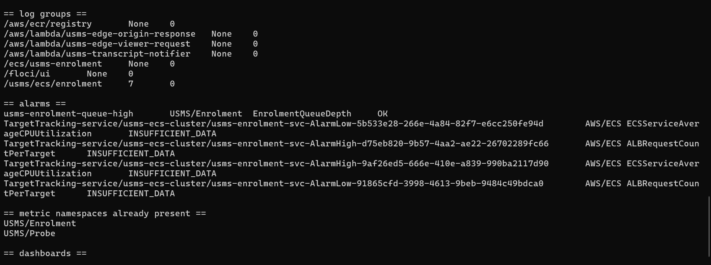

### Step 6: Central log group and retention

I created `/usms/central/application` (only if it did not exist) and set retention with a `set_retention` function that skips groups that are absent:

| Log group | Retention |
|---|---|
| `/usms/central/application` | 30 days |
| `/usms/ecs/enrolment` | 30 days (was 7) |
| `/aws/lambda/usms-transcript-notifier` | 14 days |
| `/aws/lambda/usms-edge-viewer-request` | 14 days |
| `/aws/lambda/usms-edge-origin-response` | 14 days |

`describe-log-groups` confirmed the values. The three groups still on `None` (`/aws/ecr/registry`, `/ecs/usms-enrolment`, `/floci/ui`) are not USMS application groups.

Creating the central log group `/usms/central/application` with 30-day retention:


Setting retention on every USMS log group with the `set_retention` function:

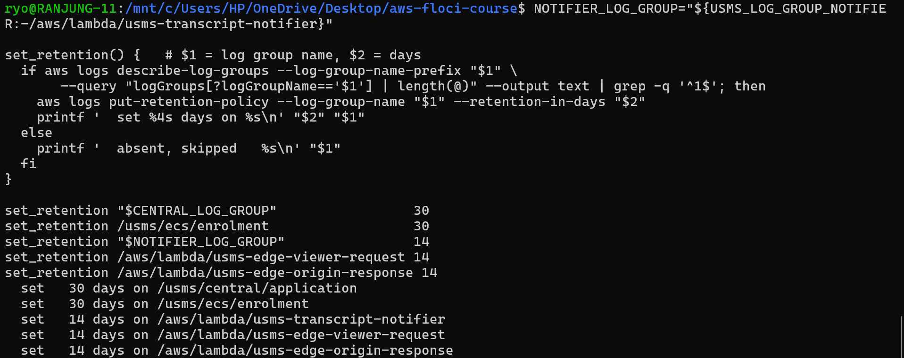

`describe-log-groups` confirms the retention value of every log group:

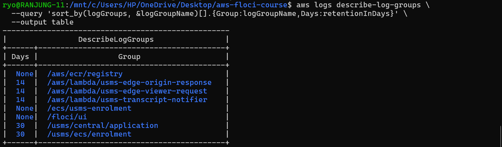

### Step 7: Write log events

I created the stream `lab-13-YYYYMMDD` and wrote four events with millisecond timestamps: three `USMS_EVENT` lines (one `transcript.requested`, two `transcript.processed`) and one `ERROR USMS_EVENT` line (`transcript.failed`, reason `render timeout`).

**Problem I hit:** the lab's shorthand form `timestamp=...,message='USMS_EVENT {"event":...}'` failed with *"Error parsing parameter '--log-events': Expected: ',', received: '"'"*. The CLI's shorthand syntax treats commas and braces as separators, so it cannot carry JSON. I wrote the events to `/tmp/usms-events.json` with a heredoc (unquoted `EOF`, so `$((NOW_MS-4000))` expands while `\"` stays escaped) and passed `--log-events file:///tmp/usms-events.json`. `rejectedLogEventsInfo` was **`null`**, and `get-log-events` and `filter-log-events` returned all four lines in order (`1794753711175` … `1794753715175`).

The four events written from a JSON file (`rejectedLogEventsInfo` is `null`) and read back with `get-log-events`:

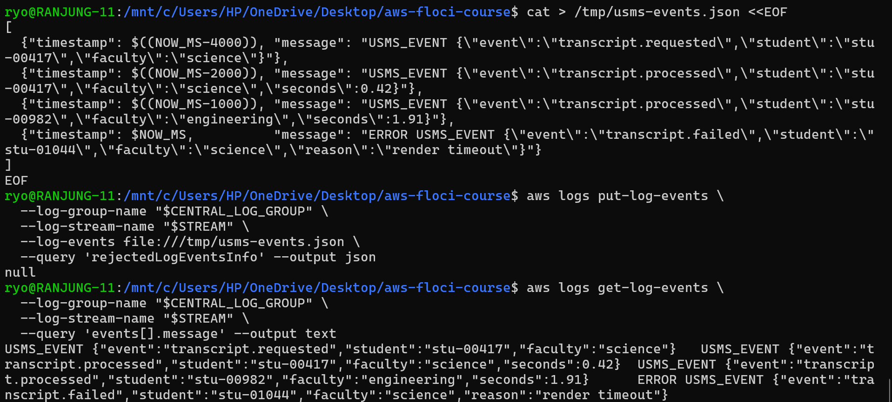

`filter-log-events` returns the four events in timestamp order:


#### Your turn: a fifth event that no filter should match

I wrote a plain health-check line one second after the last event:

```bash
aws logs put-log-events --log-group-name "$CENTRAL_LOG_GROUP" --log-stream-name "$STREAM" \
  --log-events timestamp=$((NOW_MS+1000)),message='health-check ok status=200 path=/healthz' \
  --query 'rejectedLogEventsInfo' --output json
```

The message has no JSON and no commas, so shorthand works here. The result was **`null`**, and `filter-log-events` on the stream now returns **5** rows, the last one `health-check ok status=200 path=/healthz`. It contains neither `USMS_EVENT` nor `ERROR`, so it is the negative case for Step 9: a correct filter must not count it.

The fifth event (a health-check line) is accepted; `rejectedLogEventsInfo` is `null`:

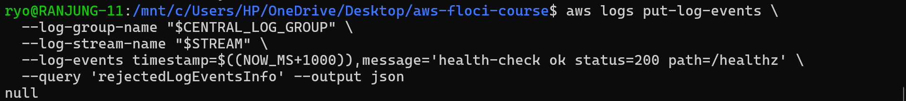

The stream now returns 5 events:


The fifth message is `health-check ok status=200 path=/healthz`:


### Step 8: Test a filter pattern

`aws logs test-metric-filter` failed with **`UnsupportedOperation`**, as Step 4 predicted. To test the `USMS_NOTIFY` pattern anyway, I wrote the four sample messages to a scratch stream and ran the same pattern with `filter-log-events`, which uses the same pattern syntax. Exactly **one** row came back, the `USMS_NOTIFY {"bucket": "usms-student-data", ...}` line. The `usms-transcript-notifier: 1 record(s)` line, the `REPORT RequestId` line and the `skipping non-transcript object` line were not matched. The evidence is in `outputs/lab-13-filter-test.json`.

The `USMS_NOTIFY` pattern, run with `filter-log-events` on a scratch stream, matches exactly one of the four sample messages:

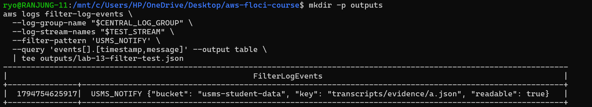

#### Your turn: design the error pattern

Again without `test-metric-filter`, I put the four Step 7 lines in a scratch stream (`err-design-step7-…`) and the false-positive line `USMS_EVENT {"event":"transcript.processed","reason":"no ERROR here"}` in a second one (`err-design-fp-…`), then ran each candidate pattern against both (`outputs/lab-13-error-pattern-design.txt`):

| Pattern | Step 7 lines (want 1) | False-positive line |
|---|---|---|
| `ERROR` | **1** | 0 |
| `"ERROR USMS_EVENT"` | **0** | 0 |
| `"transcript.failed"` | **1** | 0 |

My chosen pattern is **`"transcript.failed"`**: one match out of four, on the event name rather than a word that can appear anywhere. The full note on the false positive, and why the Floci result is not trustworthy for it, is in `exercises.md`.

Creating the two scratch streams and writing the Step 7 lines:

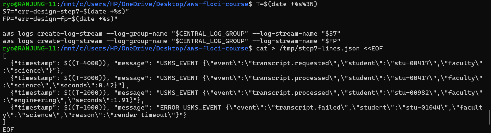

The match counts for the three candidate patterns:

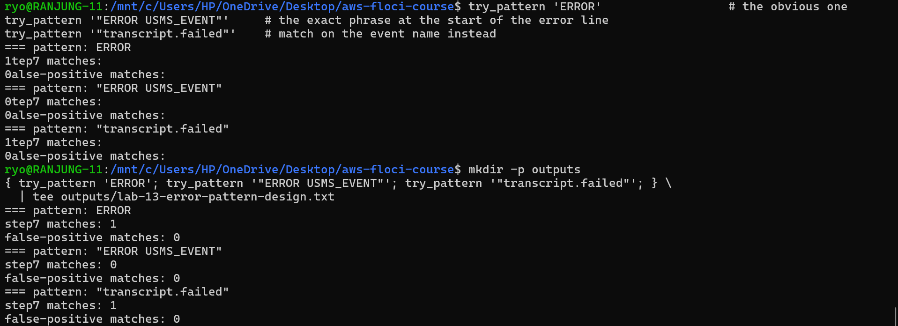

### Step 9: Deploy two metric filters

Both `put-metric-filter` calls (`usms-notify-count` on the notifier group with pattern `USMS_NOTIFY`, and `usms-central-errors` on the central group with pattern `ERROR`, both `metricValue=1, defaultValue=0` in `USMS/Application`) failed with **`UnsupportedOperation`**. `describe-metric-filters` failed the same way, so no filter exists on this build.

A metric filter does two things: count matching lines, and publish the count as a metric. I did both by hand with a `publish_filter_count` function: `filter-log-events` with the same pattern, then `put-metric-data` with the count. `list-metrics` then showed **`NotifyCount`** and **`CentralErrorCount`** in `USMS/Application`, and `CentralErrorCount` read back **Sum 2.0** for the 21:00 hour. The value is 2, not 1, because the bare `ERROR` pattern counted the error line in the Step 7 stream **and** its copy in my scratch stream: a small example of why scratch data does not belong in a production log group.

After publishing the counts by hand, `NotifyCount` and `CentralErrorCount` exist, and `CentralErrorCount` reads Sum 2.0:


`list-metrics` shows both metrics in the `USMS/Application` namespace:


### Step 10: Prove the filter end to end

I uploaded a probe object to `usms-student-data` (`transcripts/evidence/lab-13-probe-object.json`, ETag `d47fd7bd…`) and invoked the notifier through the alias `live` with the Lab 10 S3 event. `FunctionError` was **`None`** and the payload was `{"processed": 1, "keys": ["transcripts/evidence/synthetic-probe.json"]}` (still the Lab 10 code). Reading `NotifyCount` back over the last 15 minutes with a 60-second period gave **Sum 4.0, SampleCount 1.0** at 21:03 (`outputs/lab-13-metric-readback.json`). That datapoint came from my manual publish in Step 9, not from a filter.

The probe object was uploaded and the notifier invoked through `live` with no `FunctionError`:


Reading `NotifyCount` back over the last 15 minutes gives Sum 4.0, SampleCount 1.0:


#### Your turn: show that defaultValue is doing something

I asked for `NotifyCount` with a period of 300 over two 15-minute windows (`outputs/lab-13-defaultvalue-windows.txt`):

| Window | Result |
|---|---|
| A: ending 24 hours ago, before any upload today | `"Datapoints": []` |
| B: the last 15 minutes, including the upload | Sum **4.0** at 21:00, Sum **6.0** at 21:05 |

The answers differ, but on this build the difference is **not** caused by `defaultValue`. Because no metric filter exists, `defaultValue=0` was never in effect, and my build produced the **empty list**. The one-sentence note is in `exercises.md`.

Window A (before the upload) returns an empty list; window B (with the upload) returns Sum 4.0 and 6.0:

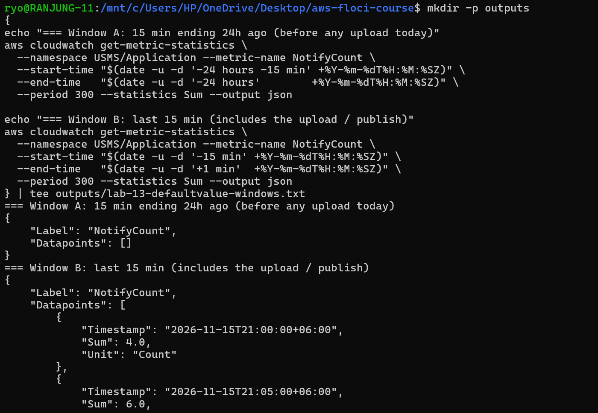

### Step 11: Publish custom metrics

I published `TranscriptsProcessed` twice: once **with** `Faculty=science, Stage=notify`, and once with **no dimensions** (the total). I then wrote `templates/lab-13-metric-data.json` (valid JSON) with three more datapoints: `TranscriptsProcessed` = 3 for `Faculty=engineering, Stage=notify`, and two `TranscriptLagSeconds` values (0.42 s and 1.91 s) for `Stage=notify`, and sent it with `--metric-data file://`.

`list-metrics` shows each dimension set as a separate metric:

| Metric | Dimensions |
|---|---|
| `TranscriptsProcessed` | `Faculty,Stage` (twice: science and engineering) |
| `TranscriptsProcessed` | **(none)**, the total |
| `TranscriptLagSeconds` | `Stage` |
| `NotifyCount`, `CentralErrorCount` | (none) |
| `EdgeDenyCount` | `Stage` |

The statistics query with `Datapoints[0]` returned `null` because the `$START`/`$END` window from Step 10 had already passed. The metrics themselves are listed above.

`TranscriptsProcessed` published with the `Faculty` and `Stage` dimensions, and again with no dimensions (the total):

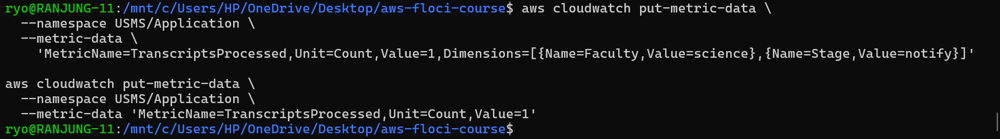

The metric data template `templates/lab-13-metric-data.json` passes the JSON check:


`list-metrics` lists each dimension set as a separate metric, including the `(none)` total:


### Step 12: Give roles telemetry permission

I wrote `policies/usms-observability-write-policy.json` (valid JSON) with three statements:

| Sid | What it allows |
|---|---|
| `WriteApplicationLogs` | `CreateLogStream`, `PutLogEvents`, `DescribeLogStreams` on `log-group:/usms/*:*` and `log-group:/aws/lambda/usms-*:*` only |
| `PublishCustomMetricsInOurNamespaceOnly` | `cloudwatch:PutMetricData` on `*`, **only when** `cloudwatch:namespace` equals `USMS/Application` |
| `SendTraces` | X-Ray `PutTraceSegments` / `PutTelemetryRecords` |

`create-policy` returned `arn:aws:iam::000000000000:policy/USMSObservabilityWrite`.

**Problem I hit:** both `attach-role-policy` calls failed with *"The role with name arn:aws:iam::000000000000:role/usms-lambda-exec-role cannot be found"*. This is the same mistake as Lab 10 Part 1: `USMS_ROLE_LAMBDA` and `USMS_ROLE_EC2` from `configs/lab-01.env` hold **ARNs**, but `--role-name` needs the plain name. I stripped the prefix with `role_name="${role##*/}"` and both attaches succeeded. `list-attached-role-policies` now shows `USMSLambdaBasic` + `USMSObservabilityWrite` on the Lambda role and `USMSStudentDataReadWrite` + `USMSObservabilityWrite` on the EC2 role. The lab's own read-back command (12.2) still passed the ARN and failed again; the policy version read back correctly with all three statements `Allow`.

The observability policy document with its three statements is valid JSON:


After stripping the ARN to the role name, the policy is attached to both roles:

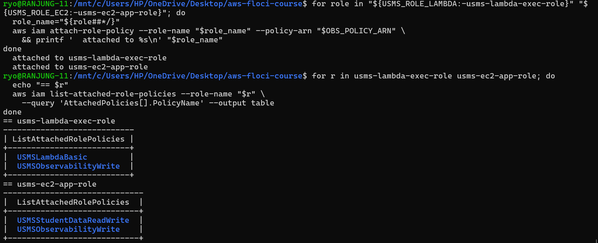

The lab's read-back command fails again on the ARN, but the policy version shows all three statements as `Allow`:


### Step 13: Instrument the notifier

I wrote `transcript-notifier-v2/notifier.py` (*"syntax OK (python3)"*). It keeps everything the Lab 10 handler did and adds a `TranscriptsProcessed` metric per transcript, a **trace id on every log line** (from `_X_AMZN_TRACE_ID`, falling back to the request id), a duration published as `TranscriptLagSeconds`, and a closing `USMS_SUMMARY` line. It stays inside `USMSLambdaBasic` + `USMSObservabilityWrite`.

**Problem I hit:** the first run of the deploy block wrote the zip to the wrong place. `configs/course.env` sets `COURSE_ROOT="$HOME/aws-floci-course"`, but my repository is under `/mnt/c/Users/HP/OneDrive/Desktop/aws-floci-course`. `update-function-code` failed with *"No such file or directory"*, **but the rest of the block still ran**: the environment variables were updated, **version 2 was published with the old code**, and `live` moved to it. Published versions cannot be changed, so I could not repair version 2. I set `COURSE_ROOT="$PWD"`, rebuilt the zip (`notifier.py`, 4,750 bytes), uploaded it (CodeSize **2130**), published **version 3** and moved `live` to it. `list-versions-by-function` proves the difference by hash:

| Version | CodeSize | CodeSha256 | Meaning |
|---|---|---|---|
| `$LATEST` | 2130 | `LBCHyEzo…` | instrumented code |
| 1 | 1345 | `rJDICjln…` | Lab 10 initial release |
| 2 | 1345 | `rJDICjln…` | **old code** under a Lab 13 description |
| 3 | 2130 | `LBCHyEzo…` | instrumented code |

Invoking through `live` (version **3**, handler `notifier.handler`, runtime `python3.12`) returned `{"processed": 1, ..., "trace_id": "961c6a2c-…", "seconds": 0.3514}`. The trace id is a request-id UUID, not an X-Ray id, because Floci does not set `_X_AMZN_TRACE_ID`, so the fallback was used.

The instrumented `notifier.py` passes the Python syntax check:

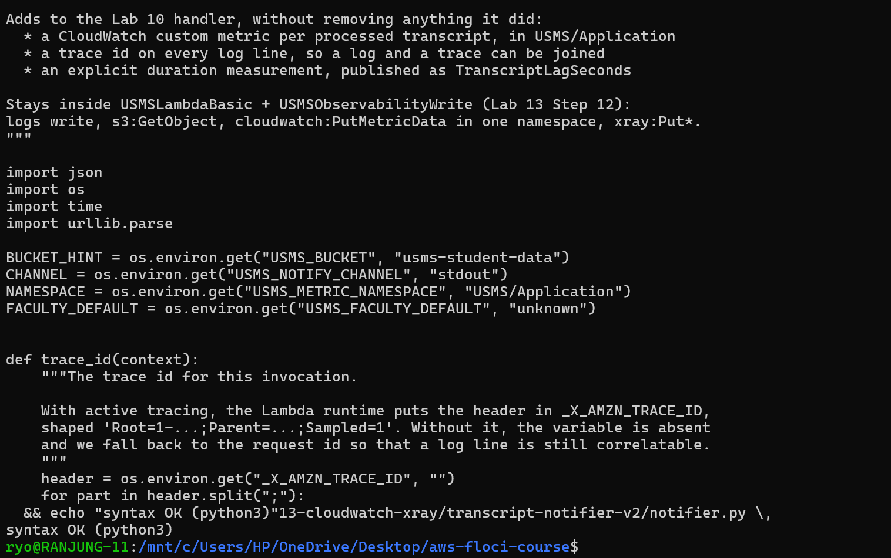

With `COURSE_ROOT` fixed, the zip contains `notifier.py` and the code upload returns CodeSize 2130:

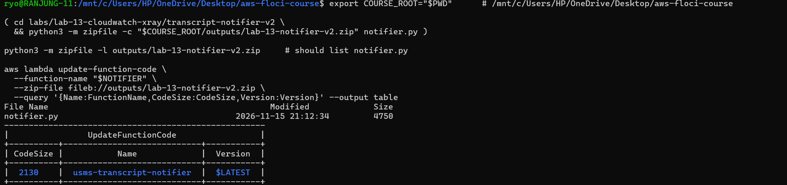

Version 3 is published and `live` points to it; the version table shows by `CodeSha256` that version 2 has the old code:


Invoking through `live` runs version 3 and returns a payload with `trace_id` and `seconds`:


#### Your turn: roll back, confirm, roll forward again

Using the **same alias ARN** for both invocations:

| Alias points at | `ExecutedVersion` | Payload |
|---|---|---|
| version **1** | 1 | `{"processed": 1, "keys": [...]}`: **no `trace_id`** |
| version **3** | 3 | `{"processed": 1, "keys": [...], "trace_id": "386ae747-…", "seconds": 0.3134}` |

Two invocations of one ARN returned two differently shaped payloads, and nothing was redeployed. I rolled forward to **3**, not 2, because version 2 holds the old code (see above). `list-versions-by-function` showed `$LATEST 2 3 1` before and after: **no version was deleted**. The rollback-time comparison with Lab 10 is in `exercises.md`.

Rolling `live` back to version 1: the payload has no `trace_id`:

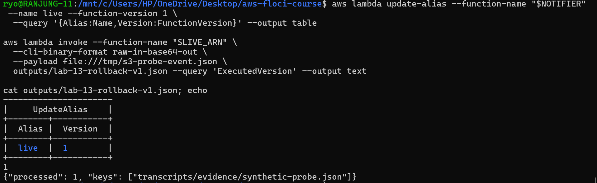

Rolling `live` forward to version 3: the payload has `trace_id` and `seconds`:

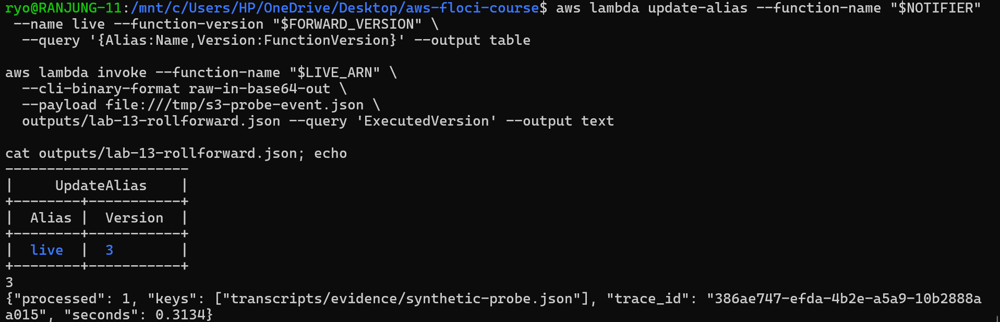

The version list still shows `$LATEST 2 3 1`; nothing was deleted:


### Step 14: Turn on active tracing

`update-function-configuration --tracing-config Mode=Active` returned **Tracing Active**. I published a new version, which became **version 4** (*"Lab 13 - instrumented + active tracing"*), and moved `live` to it. `get-function-configuration --qualifier live` confirmed **Version 4, Tracing Active**. Floci stores the setting, but because it has no X-Ray backend, the runtime still does not inject a trace header.

Tracing mode set to `Active`, published as version 4, with `live` moved to it:


`live` now reads Version 4, Tracing Active:


### Step 15: The X-Ray data model, and your first segment

I generated a parent segment for `usms-transcript-notifier` with Python: trace id **`1-6af9cd87-5be76c478778836d16d057d1`**, segment id **`6feaa7396d9c75a8`**, a 120 ms window, origin `AWS::Lambda::Function`, annotations `faculty=science`, `stage=notify`, `transcript_bytes=2184`, `readable=true`, and metadata (`key`, `bucket`, `alias`, `handler`). The file `templates/lab-13-segment-parent.json` is valid JSON and the ids went into `outputs/lab-13-trace-ids.txt`.

`put-trace-segments` failed with **`UnknownOperationException ... POST /TraceSegments`**: Floci has no X-Ray endpoint. A local check (`outputs/lab-13-xray-segment-check.txt`) passed every rule the API would apply: id is 16 hex characters, trace id matches `1-8hex-24hex`, `end_time > start_time`, annotations are scalar, duration **120.0 ms**.

The parent segment document is valid JSON, and its trace id and segment id are recorded:


### Step 16: Subsegments, a downstream service, and reading a trace back

I wrote `templates/lab-13-segment-subsegments.json` (the parent again, now with three subsegments) and `templates/lab-13-segment-downstream.json` (a separate segment for `usms-student-data`, origin `AWS::S3::Bucket`, `parent_id` = the notifier segment, a `HEAD` request with **status 200, content_length 2184**). Both are valid JSON. Sending them failed with `UnknownOperationException`, and `get-trace-summaries` and `batch-get-traces` failed the same way.

So I used the lab's **structural validation** fallback (`outputs/lab-13-trace-summaries.json`): all ten checks were **ok** (one trace id across the three documents, 16-hex ids, parent and subsegment documents share one segment id, downstream names the parent, every end after its start, three subsegments, every subsegment inside its parent's window, scalar annotations, downstream has an HTTP status), with `"errors": []`.

As a log-based substitute for `batch-get-traces`, I searched the notifier log group for the roll-forward trace id `386ae747-…` and found both lines of that one request (`outputs/lab-13-trace-from-logs.txt`): the `USMS_NOTIFY` line and the `USMS_SUMMARY` line (`processed 1, seconds 0.3134`). The `USMS_NOTIFY` line also shows `"faculty": "evidence"`, `"readable": false`, `"read_error": "ClientError"`: the synthetic probe key does not exist in the bucket, which the log now tells us directly.

The subsegments document shares the parent's trace id and segment id:


The downstream S3 segment is valid JSON, but `put-trace-segments` fails with `UnknownOperationException`:


Searching the notifier logs for the trace id returns the `USMS_NOTIFY` and `USMS_SUMMARY` lines of one request:

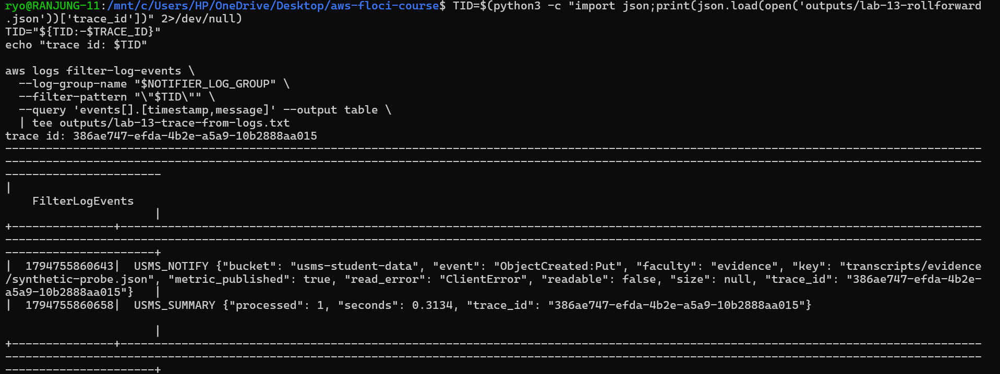

The structural validation fallback passes all ten checks with no errors:

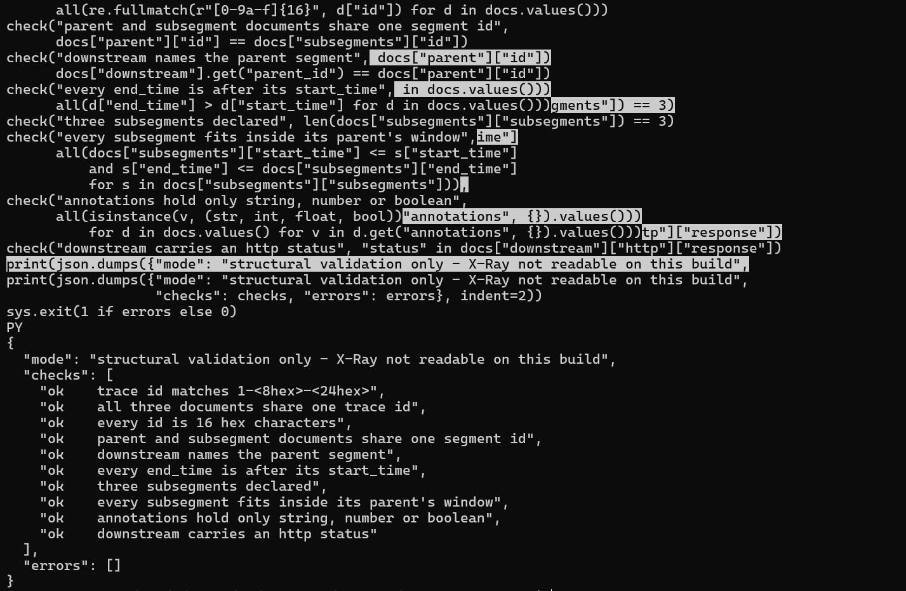

### Step 17: Search by annotation, read the service graph, and write the emitter

Both filter expressions (`annotation.faculty = "science"` and `"engineering"`) failed with `UnknownOperationException`, and the lab's fallback printed *"filter expressions unsupported on this build"* (`outputs/lab-13-trace-filter.txt`). `get-service-graph` failed the same way, so `outputs/lab-13-service-graph.json` is empty.

I wrote `scripts/utilities/usms-emit-telemetry.sh`, which writes one log line, one metric and one trace per run, and ran it three times (science 0.51 s, engineering 2.40 s, engineering 3.10 s). For each run:

| Part | Result |
|---|---|
| **log** | **failed**: the same shorthand JSON error as Step 7 (*"Expected: ',', received: '"'"*) |
| **metric** | ok, but published in **`USMS/Enrolment`**, not `USMS/Application`, most likely because an earlier lab's env file set the namespace variable |
| **trace** | SKIPPED (X-Ray unavailable), trace id still generated and recorded |

The three trace ids (`1-6af9ced4-…`, `1-6af9ced7-…`, `1-6af9ceda-…`) were added to `outputs/lab-13-trace-ids.txt`, which now has **4** lines. `filter-log-events` for `USMS_EVENT` returned **8**. None of the 8 came from the emitter, since its log writes failed: they are the 4 Step 7 lines plus the 4 copies in my error-pattern scratch stream.

Both annotation filter expressions fail, and the fallback message is printed:


`get-service-graph` fails with `UnknownOperationException`:

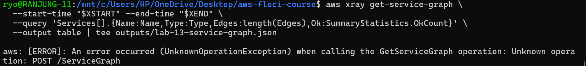

The emitter's log writes fail on shorthand JSON, its metric publishes, and its trace is skipped:

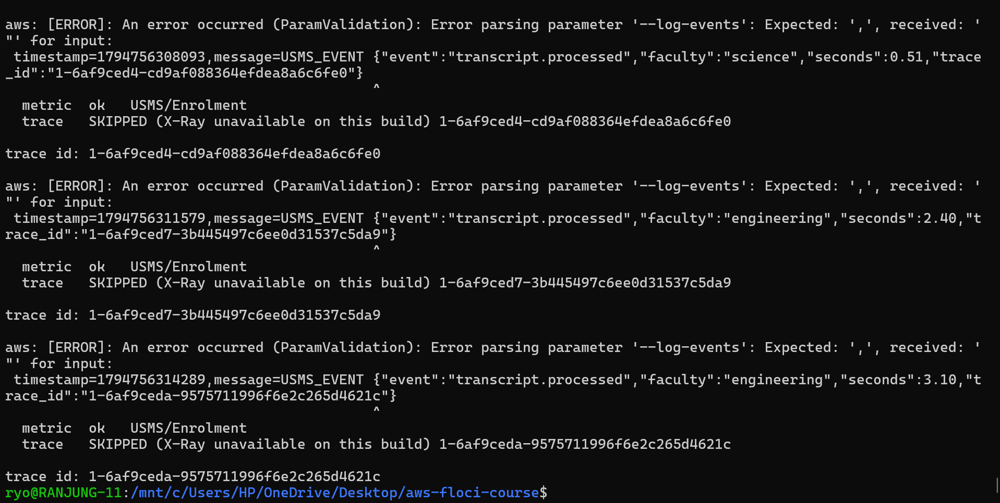

The trace id file has 4 lines, and `USMS_EVENT` matches 8 log lines:


### Step 18: Decide what gets traced at all

I wrote `templates/lab-13-sampling-rule.json` (valid JSON): **`usms-transcripts-sampling`**, priority **1000**, fixed rate **0.10**, reservoir **2**, service `usms-transcript-notifier`, everything else `*`, version 1. On real AWS this traces the first 2 requests every second and then 10% of the rest, and priority 1000 is evaluated before the built-in `Default` rule (10000). `get-sampling-rules` and `create-sampling-rule` both failed with `UnknownOperationException`, so as the lab says, *"the document above is the deliverable"*.

The sampling rule document is valid JSON, but both X-Ray sampling calls fail, so the document is the deliverable:


### Step 19: Create two alarms, one of which watches for an absence

| Alarm | Metric | Rule | Missing data |
|---|---|---|---|
| `usms-transcript-lag-high` | `TranscriptLagSeconds`, `Stage=notify` | **Maximum** > 2 s, period 60, **2 of 3** | `notBreaching` |
| `usms-notify-silence` | `NotifyCount` | Sum < 1, period 300, **3 of 3** (15 minutes) | `breaching` |

Both used `Project=USMS` tags. Maximum, not Average, is used for latency because one slow transcript is exactly what we want to see, and an average hides it. The silence alarm treats missing data as **breaching** because it watches for an absence: if nothing arrives, that is the incident.

`describe-alarms` listed both (lag-high **OK**, notify-silence **INSUFFICIENT_DATA**), but the **Missing** column read **`None`** for both, even though I passed `--treat-missing-data`. Floci accepts the flag but does not store it. This explains two of the verification failures in Section 6.

Creating `usms-transcript-lag-high` and `usms-notify-silence` with their missing-data settings:


`describe-alarms` lists both alarms, but the Missing column reads `None`:

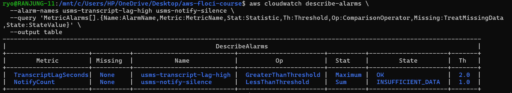

### Step 20: Prove the alarms, by making one fire

`set-alarm-state --state-value ALARM` on `usms-transcript-lag-high` (with reason data `{"step":20,"synthetic":true}`) changed it to **ALARM** at `2026-11-15T21:28:05+06:00`, with the reason *"Lab 13 Step 20: forced transition to prove the alarm is wired and records history"*. I then set it back to **OK** and read back `OK`. `outputs/lab-13-alarm-history.json` is empty: on this build the history query returned nothing to save.

The forced transition puts `usms-transcript-lag-high` in `ALARM` with the Step 20 reason:


The alarm is restored to `OK`:

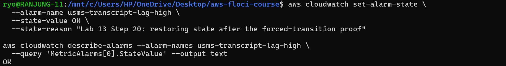

### Step 21: Combine them into one incident

The composite alarm **`usms-transcript-pipeline-down`** uses the rule `ALARM("usms-transcript-lag-high") OR ALARM("usms-notify-silence")`. Either child firing means the pipeline is down, so a person is paged once instead of twice.

`describe-alarms --alarm-types CompositeAlarm` returned **`null`**, both before and after I drove `usms-notify-silence` to ALARM. Floci did not keep the composite alarm, so I could not observe the parent following its child. I restored `usms-notify-silence` to OK.

The composite alarm query returns `null`, before and after driving a child alarm to `ALARM`:


### Step 22: Build the dashboard

`templates/lab-13-dashboard.json` defines five widgets on the 24-column grid: a full-width text header (*"USMS - transcript delivery … Alarms page the composite alarm only"*), *"Transcripts processed, by faculty"* (science and engineering, Sum, 300 s), *"Notification latency - max and average"*, and the alarm widgets. The file is valid JSON and `put-dashboard` returned an **empty** `DashboardValidationMessages` list. Reading it back: **`usms-overview`**, size 2317 bytes, **5 widgets**, types `alarm, metric, text`, grid width **24**, overlapping **False**.

The dashboard template is valid JSON and `put-dashboard` returns no validation messages:


Reading the dashboard back: 5 widgets, grid width 24, no overlaps:

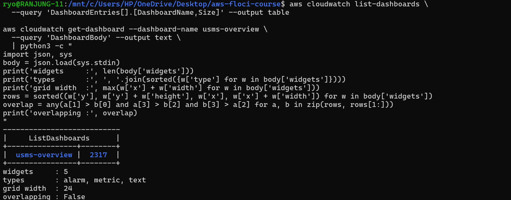

### Step 23: Query the logs properly

**Path A (Logs Insights)** started query `2d29805b-…`, but its status was **Failed** on all six polls, as Step 4 predicted.

**Path B (client-side aggregation):** I fetched every `USMS_EVENT` line with `filter-log-events`, parsed the JSON after the prefix in Python, and counted by `faculty`:

| Faculty | Events |
|---|---|
| science | **6** |
| engineering | **2** |

The lab's example shows science 3, engineering 2. Mine is exactly **double the Step 7 stream** (3 science + 1 engineering), because the error-pattern scratch stream holds a copy of those four lines, and the emitter's three lines never arrived (Step 17). The central group read back as 30-day retention, `storedBytes` 0 (Floci does not compute stored bytes).

The Logs Insights query reports `Failed` on every poll:

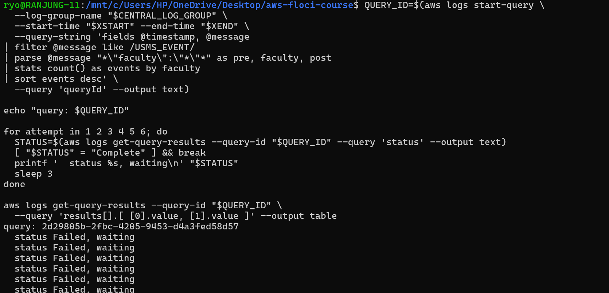

Counting `USMS_EVENT` lines by faculty in Python gives science 6, engineering 2:


The central log group reads back with 30-day retention:


### Step 24: Restart Floci and read everything back

I recorded an inventory, ran `floci-down.sh` (*"State preserved in /home/ryo/floci-data"*), `floci-up.sh` (storage mode **hybrid**) and `whoami.sh`, then recorded the inventory again (`outputs/lab-13-pre-restart.txt` and `outputs/lab-13-post-restart.txt`). The comparison printed **"CONFIGURATION IDENTICAL - every Lab 13 object survived the restart"**:

| Item | Before and after |
|---|---|
| Log groups and retention | 8 groups; central 30, ECS 30, three functions 14 |
| Metrics | `CentralErrorCount`, `EdgeDenyCount`, `NotifyCount`, `TranscriptLagSeconds`, `TranscriptsProcessed` |
| Alarms | `usms-transcript-lag-high` OK, `usms-notify-silence` OK, `usms-enrolment-queue-high` OK |
| Dashboards | `usms-overview` |
| Notifier | `live` → **4**, tracing **Active** |
| Metric filters | none (unsupported) |

The metric data line read **before=0, after=0**. That count is not meaningful: the query that counts datapoints failed with *"In function sort_by(), invalid type for value: None"*, so it counted nothing either time.

The inventory before the restart:

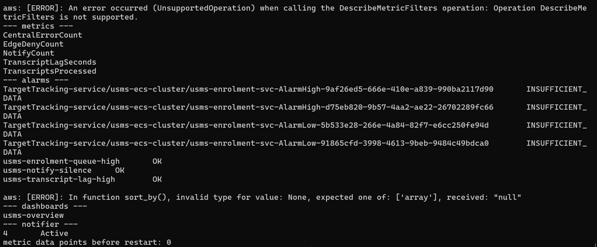

Floci stopped, started again in hybrid mode, and the identity check passes:


The inventory after the restart prints *"CONFIGURATION IDENTICAL"*:

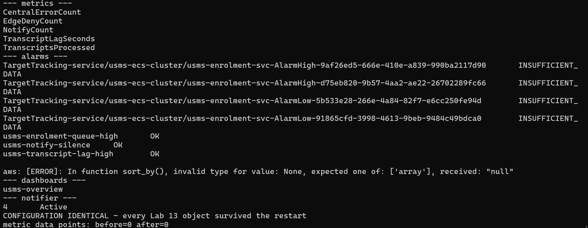

### Step 25: Write `configs/lab-13.env`

I generated `configs/lab-13.env` from live lookups: **28** exports, *"all values populated"*, *"sources cleanly"*. It records the log, metric, IAM, notifier, alarm, dashboard and X-Ray names, plus the capability flags `USMS_XRAY_SUPPORTED=no` and `USMS_INSIGHTS_SUPPORTED=no`.

Two values are worth correcting by hand, because the generator picked them up automatically:

- `USMS_NOTIFIER_VERSION_INSTRUMENTED=2`: version 2 has the **old** code (Step 13); the instrumented version is **3**. The traced version (`4`) and alias version (`4`) are right.
- `USMS_LOG_STREAM_CENTRAL=err-design-step7-1794754780`: this is my scratch stream from the error-pattern exercise, not the Step 7 stream.

`configs/lab-13.env` has 28 exports, all values populated, and sources cleanly:


### Step 26: Check what Git sees, and commit

`git status --short` showed the new Lab 13 files as untracked: `configs/lab-13.env`, `labs/lab-13-cloudwatch-xray/`, `policies/usms-observability-write-policy.json`, `scripts/utilities/usms-emit-telemetry.sh` and the six `templates/lab-13-*.json` files. `outputs/` does not appear, so it is ignored, and no zip is tracked. It also listed seven modified files from earlier labs, which do not belong in a Lab 13 commit, so the commit must add Lab 13 files **by explicit path**. At the time of writing `HEAD` is still `bfd25d6` (*"chore: lab 12 exercise"*): the Lab 13 commit has not been made yet.

`git status --short` shows the new Lab 13 files as untracked:

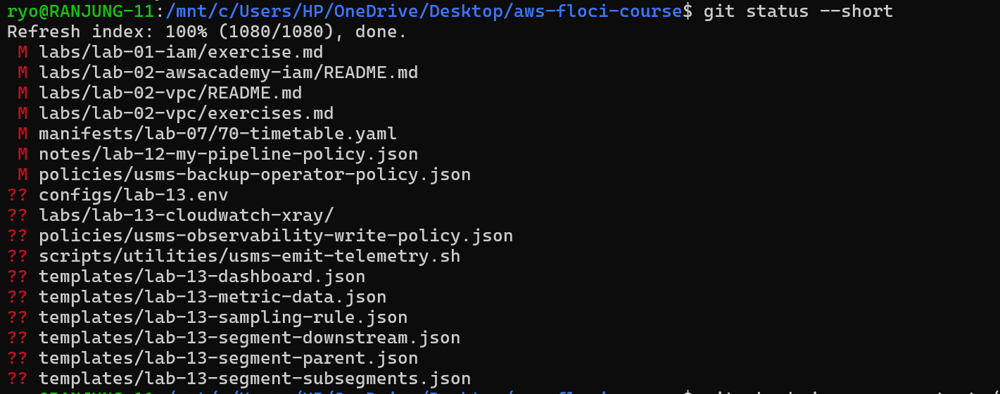

The full `git status` with modified files from older labs and the untracked Lab 13 files:

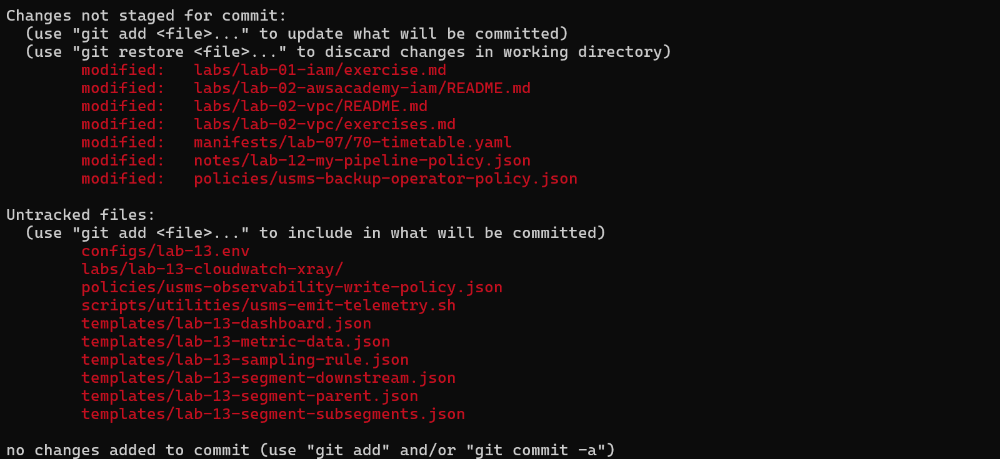

`HEAD` is still the Lab 12 commit `bfd25d6`:


## 6. Verification

`scripts/utilities/verify-lab-13.sh` checks the environment, the log layer, metric filters, metrics, IAM, the instrumented notifier, alarms, the dashboard, the X-Ray documents and Git hygiene.

The result was **PASS=38 FAIL=11** (`outputs/lab-13-verify.txt`).

| Block | Result |
|---|---|
| Environment | Floci running, storage not in memory mode, CLI reaches Floci |
| Log layer | central group exists with 30 days; notifier and ECS groups have retention; **no USMS group on never-expire**; central group has a stream |
| Metric filters | **3 FAIL** |
| Metrics | namespace has metrics, `TranscriptsProcessed` has dimensions, `TranscriptLagSeconds` exists; **1 FAIL** (the total) |
| IAM | policy exists, `PutMetricData` scoped by `cloudwatch:namespace`, log ARNs end in `:*`; **2 FAIL** (attached) |
| Notifier | function exists, `live` on a numbered version, moved past version 1, tracing Active, source emits `USMS_SUMMARY` |
| Alarms | both alarms exist, lag-high uses Maximum; **5 FAIL** |
| Dashboard | exists, valid JSON, 5 widgets, no overlaps |
| X-Ray documents | sampling rule valid and complete; segment documents share one trace id and are well formed |
| Files and hygiene | `lab-13.env` with 28 exports and no empty values, emitter executable, policy valid, dashboard template committed, no secret and no deployment archive tracked |

**What the 11 failures mean:**

| Failures | Cause | Mine to fix? |
|---|---|---|
| 3 × metric filters | Floci does not implement `PutMetricFilter` / `DescribeMetricFilters` (Steps 8–9) | No: Floci gap |
| 2 × "attached to" | The script passes `$USMS_ROLE_LAMBDA` / `$USMS_ROLE_EC2`, which hold **ARNs**, to `--role-name`. Step 12 (12.1) shows the policy **is** attached to both roles | No: same ARN/name bug, in the script |
| 1 × `TranscriptsProcessed` total | The no-dimension datapoint **does** exist (the `(none)` row in 11.2). The script's query `Metrics[].join(...) \|\| 'NONE'` applies `\|\|` to the whole list, so an empty dimension list never becomes `NONE` | No: query quirk in the script |
| 2 × treat-missing-data | Floci accepted `--treat-missing-data` but stores `None` (Step 19) | No: Floci gap |
| 2 × composite alarm | Floci returned `null` for `CompositeAlarm` (Step 21) | No: Floci gap |
| 1 × "stuck in ALARM" | Both alarms read **OK** in the Step 24 inventory, before and after the restart. I could not confirm why this check failed | Not confirmed |

So, as far as I can tell, every failure comes from the emulator or the check script rather than from a missing step, and I have pointed to the evidence for each one. I have not changed the course's verify script.

The end of the `verify-lab-13.sh` output, with PASS=38 FAIL=11:

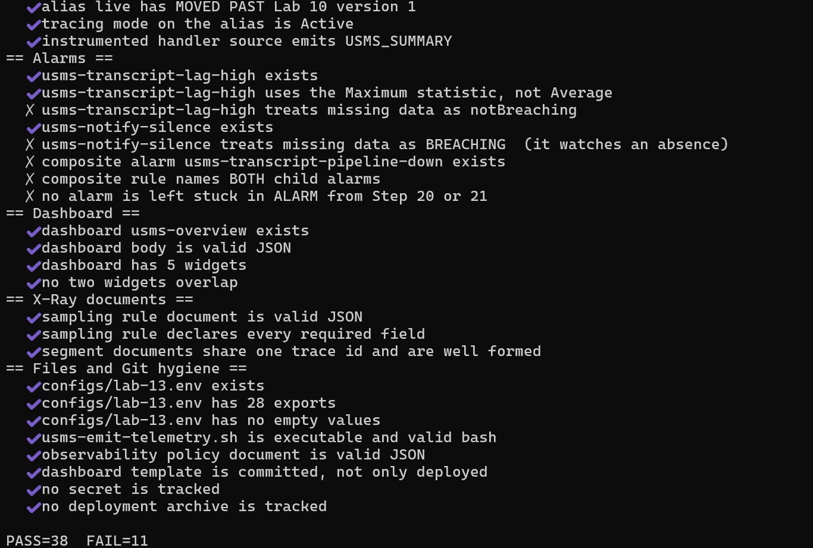

## 7. Analysis and Discussion

### 7.1 What was achieved

I turned the transcript pipeline from "something that runs" into "something that reports on itself". Every USMS log group now has a retention period, and the central application log group exists with 30 days. I wrote structured `USMS_EVENT` lines and designed filter patterns that count only what they should. I published custom metrics with dimensions and a total, gave the application roles a least-privilege telemetry policy, instrumented the notifier with metrics, a trace id on every log line and a duration, and moved `live` through versions 3 and 4 to the instrumented, actively traced build. I wrote valid X-Ray segment, subsegment, downstream and sampling documents, created a threshold alarm and an absence alarm, proved an alarm can fire and be restored, and built a five-widget dashboard. The configuration survived a full restart, `configs/lab-13.env` holds 28 values, and verification gave **PASS=38 FAIL=11**, with every failure traced to Floci or to the check script.

### 7.2 Observed, recorded and not available

| Type | Items |
|---|---|
| **Observed / working** | Log groups and retention; `put-log-events` and `filter-log-events`; `put-metric-data` with and without dimensions; `list-metrics` and `get-metric-statistics`; IAM policy create and attach; Lambda code update, versions 3 and 4, alias moves, invoke through the alias; tracing mode Active stored; alarm create, `set-alarm-state` ALARM → OK; dashboard put and get; restart with identical configuration |
| **Recorded only** (Floci stores, but does not act) | `TreatMissingData` passed but stored as `None`; tracing Active, but no trace header injected (the trace id falls back to the request id); alarm history empty |
| **Not available on this build** | Metric filters (put, describe, test); Logs Insights (`Failed`); every X-Ray API (put segments, trace summaries, batch-get, service graph, filter expressions, sampling rules); composite alarms (stored as `null`) |
| **Substitutes I used** | `filter-log-events` + `put-metric-data` for metric filters; scratch streams for pattern tests; local validation for X-Ray documents; log search by trace id for `batch-get-traces`; Python aggregation for Insights |
| **My own mistakes** | Shorthand JSON in `--log-events` (Step 7, and again inside the emitter in Step 17); ARN passed as a role name (Step 12); `COURSE_ROOT` pointing at the wrong directory, which published version 2 with old code (Step 13); scratch streams left in the central log group, which doubled later counts (Steps 9, 17, 23) |

### 7.3 Observations

- **Retention is the cheapest control in the lab.** Six of seven log groups started on never-expire. One `put-retention-policy` per group fixes a cost that would otherwise grow forever, and the verify script now guards it.
- **A pattern that matches a word will match that word anywhere.** A bare `ERROR` counts user text such as `"reason":"no ERROR here"`. Matching the event name (`"transcript.failed"`) is safer, and fully structured JSON logs would let a filter match a field instead of text.
- **"No data" is a decision, not a default.** The lag alarm must ignore silence; the silence alarm must treat it as the incident. The same missing datapoint means opposite things, which is why `treat-missing-data` is set per alarm. An empty `Datapoints` list and a list of zeroes are different statements.
- **Each dimension set is its own metric.** `TranscriptsProcessed` appears three times in `list-metrics`. If the total is not published separately, there is no way to graph "all faculties" without listing every faculty.
- **Scratch data pollutes production counts.** My test streams doubled `CentralErrorCount` (2 instead of 1) and the faculty totals (6/2 instead of 3/1). Test data belongs in its own log group.
- **A trace id in the logs is useful even without X-Ray.** With no tracing backend, searching for `386ae747-…` still returned the complete story of one request, including an S3 read error that no metric showed.
- **A failed step in a pasted block does not stop the next one.** Step 13 published a version whose code never uploaded. Chaining deploy commands with `&&`, or `set -e`, would have stopped at the failure, and the version table with `CodeSha256` was the only reliable way to see what had really happened.
- **Rollback is a pointer move.** Moving `live` between versions 1 and 3 changed the payload shape in seconds, without deploying anything, because every version is kept.

## 8. Reflection

### What I learned about observability

Before this lab I thought monitoring meant "look at the logs when something breaks". Now I see three different tools for three different questions. **Logs** say *what happened* to one request. **Metrics** say *how much* and *how fast*, and they are what alarms watch. **Traces** say *where the time went* across services. The trace id is what joins them: one id in the log line, the metric's context and the trace lets me move from "the lag alarm fired" to "this request" to "this S3 call".

The emulator made the lesson sharper. Because so much of CloudWatch Logs and all of X-Ray were missing, I had to understand what each feature actually *does* in order to rebuild it from smaller parts: a metric filter is "count matching lines, publish the count"; `batch-get-traces` is "find everything with this id". I also learned to keep three things apart in the report: what I **observed** working, what Floci only **recorded**, and what was **not available**, so the result is honest.

My most expensive mistakes were again about the shell, not AWS: JSON in shorthand syntax, an ARN where a name was needed, and a wrong `COURSE_ROOT`. The `COURSE_ROOT` one taught me that an immutable version is permanent evidence of a mistake, and that an alias is what makes it harmless.

## 9. Conclusion

In this lab I built the telemetry layer for the USMS transcript pipeline on Floci. I created the central log group **`/usms/central/application`** (30 days) and put retention on every USMS log group, wrote structured `USMS_EVENT` lines including a negative test case, and designed an error pattern (`"transcript.failed"`) that matches one of four lines. I published `TranscriptsProcessed` (by faculty and stage, plus a total) and `TranscriptLagSeconds` in **`USMS/Application`**, and attached **`USMSObservabilityWrite`** (namespace-scoped metrics, USMS-only logs, X-Ray) to the Lambda and EC2 roles.

I instrumented **`usms-transcript-notifier`**, recovered from a version published with old code by publishing **version 3**, proved a rollback to version 1 and a roll-forward through the same alias, and moved `live` to **version 4** with active tracing. I wrote and validated the X-Ray parent, subsegment, downstream and sampling-rule documents, created the alarms **`usms-transcript-lag-high`** and **`usms-notify-silence`**, proved an alarm transition, and built the five-widget dashboard **`usms-overview`**. Metric filters, Logs Insights, composite alarms and all of X-Ray are not available on this Floci build, and I replaced each one with the closest supported method and recorded which is which. The configuration survived a restart unchanged, `configs/lab-13.env` holds 28 values, and verification gave **PASS=38 FAIL=11**, with all eleven failures explained by the emulator or the check script.
