# Lab 13 Practical Report: Centralized Logging and Monitoring with CloudWatch and X-Ray

## 1. Aim / Objective

The aim of this lab is to give the USMS platform **observability**: logs that are kept for a known time and can be searched, metrics that can be counted and alarmed on, and traces that follow one request through the system. I built these three layers around the transcript notifier from Lab 10, and combined them into alarms and a dashboard. Everything was done with the AWS CLI on Floci.

The specific objectives were to:

- Understand the three parts of observability: **logs, metrics and traces**.
- Create a central log group and put a **retention policy** on every USMS log group.
- Write **structured log events**, design **filter patterns** and turn matching lines into metrics.
- Publish **custom metrics with dimensions** in the namespace `USMS/Application`.
- Create a least-privilege **telemetry policy** for the application roles.
- **Instrument** the notifier with metrics and a trace ID, and turn on **X-Ray active tracing**.
- Write X-Ray segment documents and a **sampling rule**.
- Create **alarms** (including one that watches for silence), a **composite alarm** and a **dashboard**.
- Prove the setup survives a restart, save values to `configs/lab-13.env`, and check the lab with a verification script.

## 2. Introduction

Up to Lab 12, USMS could run, scale and deploy, but nobody could answer simple questions like *"did that transcript go out?"*, *"how slow is the notifier?"* or *"is anything failing right now?"*. **Observability** means the system tells you what it is doing. It has three parts:

| Part | Question it answers | AWS service |
|---|---|---|
| **Logs** | *What happened* to this request? | CloudWatch Logs |
| **Metrics** | *How many* and *how fast*? | CloudWatch Metrics |
| **Traces** | *Where did the time go* across services? | AWS X-Ray |

On top of these, **CloudWatch Alarms** watch a metric and change state (`OK`, `ALARM`, `INSUFFICIENT_DATA`), and **CloudWatch Dashboards** show everything on one page.

Key ideas:

| Concept | Simple meaning |
|---|---|
| **Retention** | How long logs are kept. Without it, logs are kept (and paid for) forever. |
| **Structured log line** | A fixed word (`USMS_EVENT`) followed by JSON, so a line can be searched and parsed. |
| **Metric filter** | A pattern on a log group. Each matching line adds 1 to a metric. |
| **Dimension** | A label on a metric, like `Faculty=science`. Each different label set is a separate metric. |
| **Missing data** | What an alarm does when no data arrives. For a "silence" alarm, no data **is** the problem. |
| **Trace ID** | One ID shared by every part of a request, so logs and traces can be joined. |
| **Annotation** | A searchable label on a trace (for example `faculty = "science"`). |
| **Sampling** | Not every request needs a trace. A rule keeps a few per second plus a percentage. |

**Limitation:** this Floci build supports log groups, metric data, alarms and dashboards, but **not** metric filters, Logs Insights, composite alarms or **any** X-Ray API. For each one I used the closest replacement (for example `filter-log-events` + `put-metric-data`, or checking the X-Ray documents locally), and I say clearly which result came from which.

## 3. Use Case

**USMS use case:** when a student says *"my transcript never arrived"*, the support team has no evidence either way. The university wanted:

- **Logs that are kept, but not forever:** 30 days for application logs, 14 days for function logs.
- **Numbers, not just text:** notifications sent, errors, transcripts processed per faculty, and how long each notification took.
- **Least-privilege telemetry:** roles can only write USMS logs and `USMS/Application` metrics.
- **Follow one request:** a trace ID on every notifier log line and active tracing.
- **Be told, not just able to look:** an alarm when notifications get slow, an alarm when they **stop**, and one combined alarm.
- **One screen:** a dashboard with the key numbers and alarm states.

**Other real-world uses:**

- Online services alerting engineers at night when error rates rise.
- Finding which microservice makes a page slow using traces.
- Keeping logs for a fixed time to meet legal or audit rules.

## 4. System Architecture / Design

**How it works in simple words:**

1. **Upload:** a transcript arrives in `usms-student-data`, and S3 calls `usms-transcript-notifier` through its `live` alias.
2. **Logs:** the notifier writes `USMS_NOTIFY` and `USMS_SUMMARY` lines with a `trace_id` to its log group (14 days). Application events go to **`/usms/central/application`** (30 days).
3. **Metrics:** the notifier publishes `TranscriptsProcessed` (per faculty, plus a total) and `TranscriptLagSeconds` in **`USMS/Application`**.
4. **Traces:** with active tracing, the notifier's work (S3 read, metric publish, notify) is recorded under one trace ID. On Floci the documents were only checked locally.
5. **Alarms:** `usms-transcript-lag-high` and `usms-notify-silence` feed the composite alarm **`usms-transcript-pipeline-down`**.
6. **Dashboard:** `usms-overview` shows a header, two graphs and the alarm states.

| Resource | Name | Key settings |
|---|---|---|
| Central log group | `/usms/central/application` | 30 days |
| Function log groups | notifier and both edge functions | 14 days |
| Metrics | `TranscriptsProcessed`, `TranscriptLagSeconds`, `NotifyCount`, `CentralErrorCount` | `USMS/Application` |
| IAM policy | `USMSObservabilityWrite` | USMS logs only, metrics only in `USMS/Application`, X-Ray |
| Function | `usms-transcript-notifier` | `live` → version 4, tracing Active |
| Alarms | lag-high, notify-silence, pipeline-down | Max > 2 s; Sum < 1 for 15 min; OR |
| Dashboard | `usms-overview` | 5 widgets |

## 5. Implementation Procedure

### Step 1: Start the environment

I started Floci in **hybrid** storage mode, so data survives a restart.

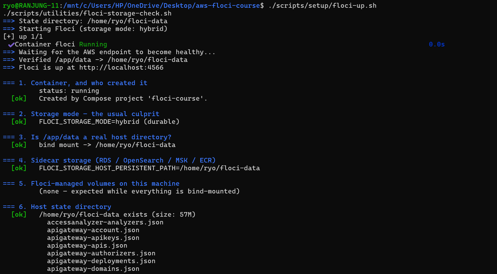

### Step 2: Load env files and confirm identity

All twelve earlier env files loaded, and the account is **000000000000**.

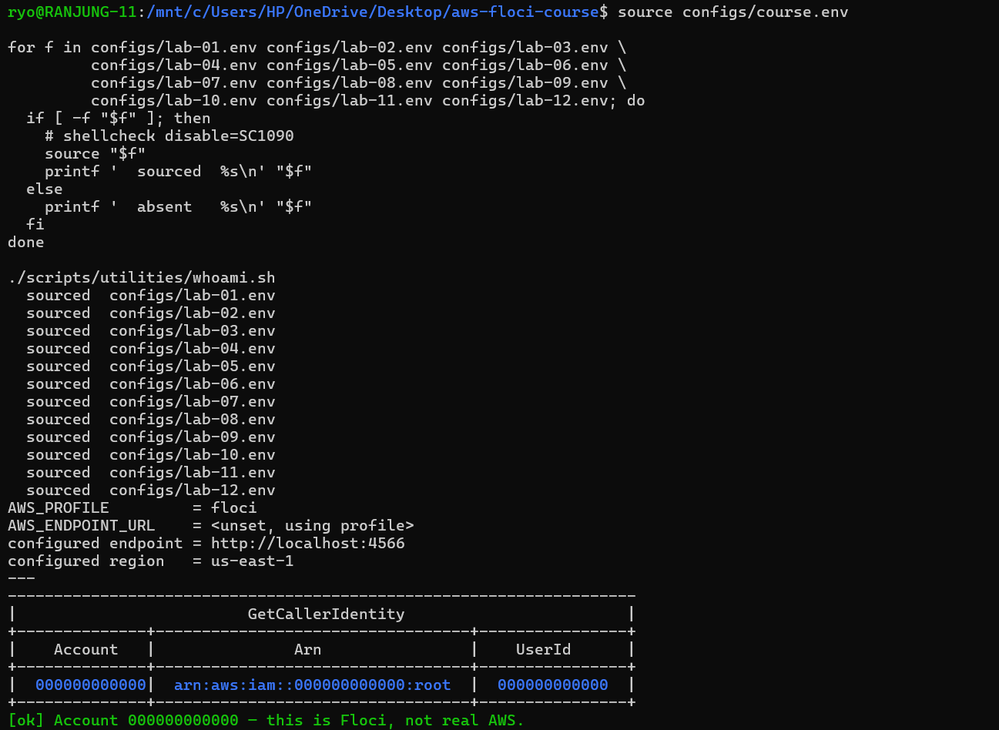

The bucket, notifier, log group and Lambda role were all set.

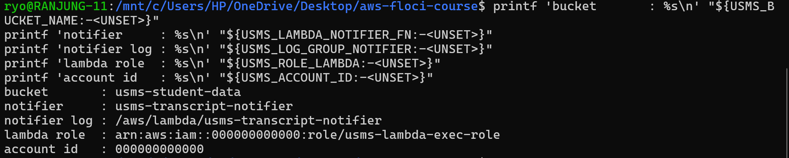

### Step 3: Create the lab folders

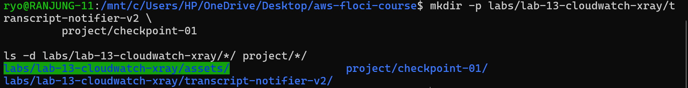

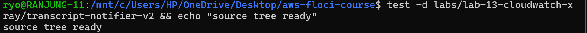

### Step 4: Find out what Floci supports

| Service | Supported | Not supported |
|---|---|---|
| CloudWatch Logs | log groups | metric filters, Logs Insights |
| CloudWatch | metrics, alarms, dashboards | |
| X-Ray | | everything |
| Lambda | function config | |

This probe predicted every problem I met later.

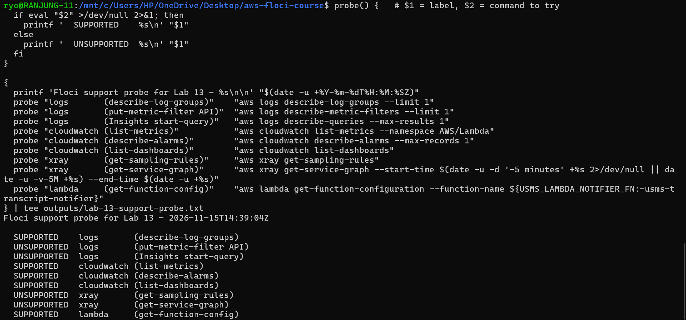

### Step 5: Inventory existing monitoring

There were seven log groups, and only one had retention; all others kept logs **forever**. There were some alarms from Lab 06 and no dashboards.

### Step 6: Central log group and retention

I created `/usms/central/application` and set retention on every USMS group:

| Log group | Retention |
|---|---|
| `/usms/central/application` | 30 days |
| `/usms/ecs/enrolment` | 30 days (was 7) |
| Notifier and both edge functions | 14 days |

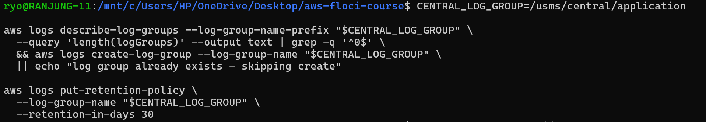

### Step 7: Write log events

I wrote four events: three `USMS_EVENT` lines and one `ERROR USMS_EVENT` line (`transcript.failed`). The short CLI syntax cannot carry JSON, so I wrote the events to a JSON file and passed it with `file://`. No events were rejected.

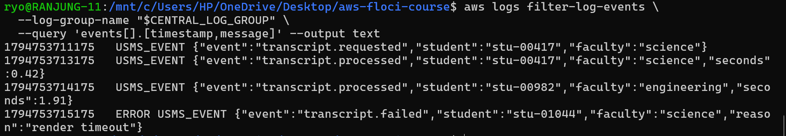

#### Your turn: a fifth event that no filter should match

I added `health-check ok status=200 path=/healthz`. It contains neither `USMS_EVENT` nor `ERROR`, so it is the negative test: a correct filter must not count it.

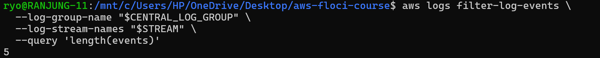

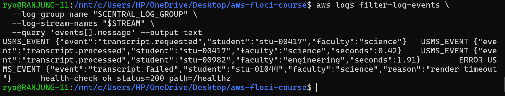

### Step 8: Test a filter pattern

`test-metric-filter` is not supported, so I tested the `USMS_NOTIFY` pattern with `filter-log-events`, which uses the same syntax. It matched **exactly one** of four sample lines.

#### Your turn: design the error pattern

| Pattern | Matches on Step 7 lines (want 1) |
|---|---|
| `ERROR` | 1 |
| `"ERROR USMS_EVENT"` | 0 |
| `"transcript.failed"` | **1** |

I chose **`"transcript.failed"`**, because it matches the event name, while a bare `ERROR` could match that word anywhere, even in normal text.

### Step 9: Deploy two metric filters

Both `put-metric-filter` calls failed with **`UnsupportedOperation`**. A metric filter does two things: count matching lines and publish the count. So I did both by hand with `filter-log-events` and `put-metric-data`. `NotifyCount` and `CentralErrorCount` now exist. `CentralErrorCount` was 2 instead of 1, because my test stream had a copy of the error line.

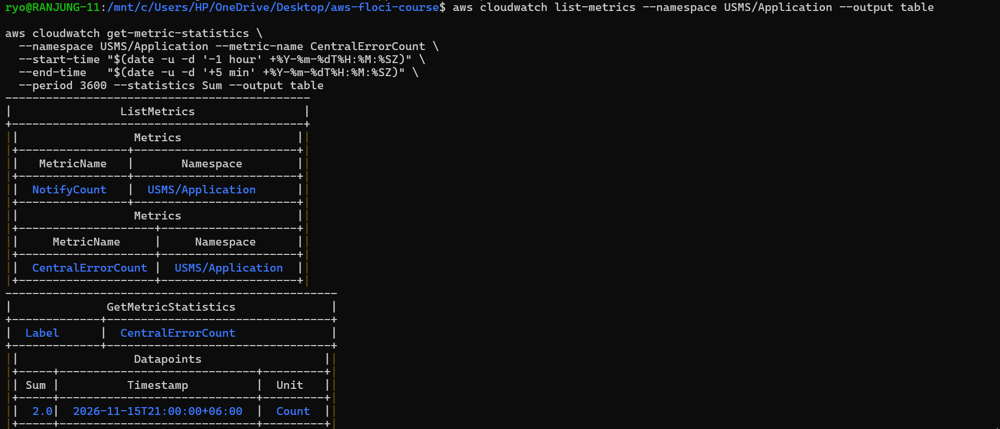

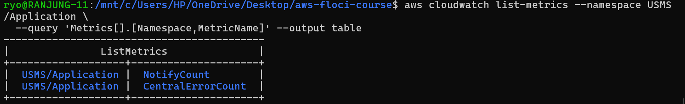

### Step 10: Prove the metric end to end

I uploaded a probe object and invoked the notifier through `live` with no errors.

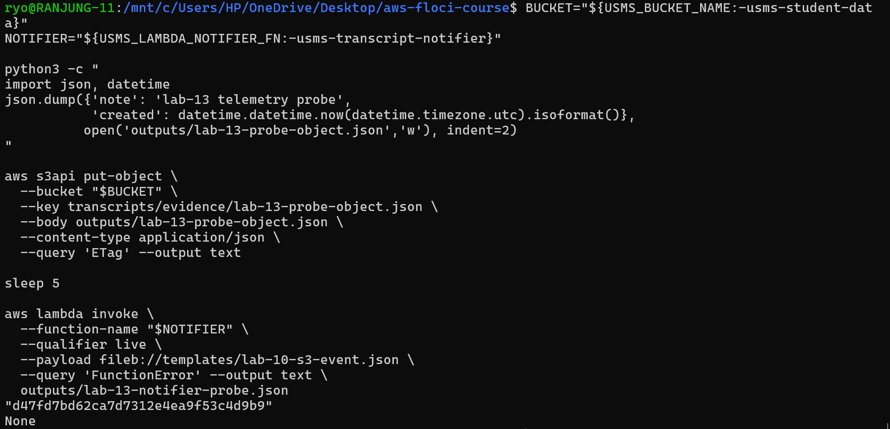

Reading `NotifyCount` back gave **Sum 4.0** (from my manual publish).

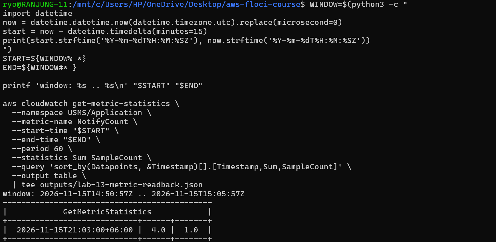

#### Your turn: show that defaultValue is doing something

The window from yesterday returned an **empty list**, and the last 15 minutes returned data. On real AWS, `defaultValue=0` would give zeros instead of an empty list, but no filter exists on Floci, so it never took effect.

### Step 11: Publish custom metrics

I published `TranscriptsProcessed` with `Faculty` and `Stage` dimensions, and again with **no dimensions** as the total. I also sent `TranscriptLagSeconds` values (0.42 s and 1.91 s) from a JSON file.

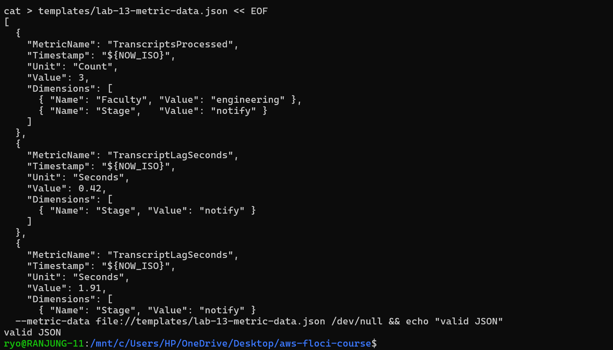

`list-metrics` shows each dimension set as a **separate metric**, including the `(none)` total.

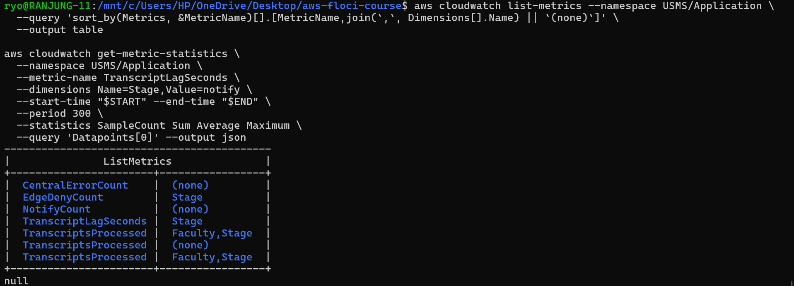

### Step 12: Give roles telemetry permission

I created **`USMSObservabilityWrite`** with three statements:

| Statement | Allows |
|---|---|
| Write logs | Only to `/usms/*` and `/aws/lambda/usms-*` log groups |
| Publish metrics | Only when the namespace is `USMS/Application` |
| Send traces | X-Ray put calls |

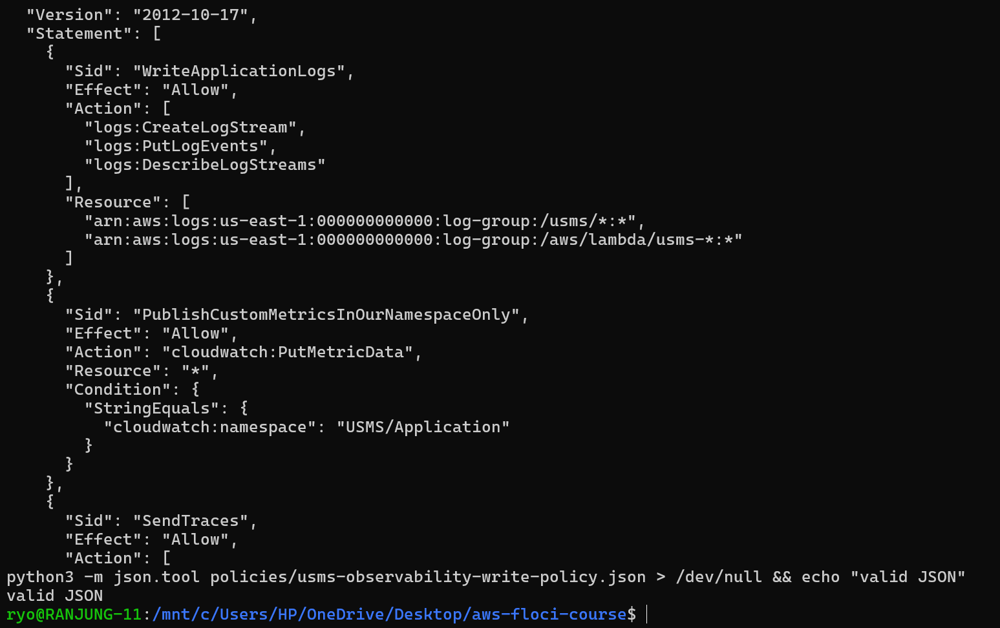

Attaching failed at first because my variables held **ARNs** instead of role names (the same mistake as Lab 10). I stripped the prefix and both attaches worked.

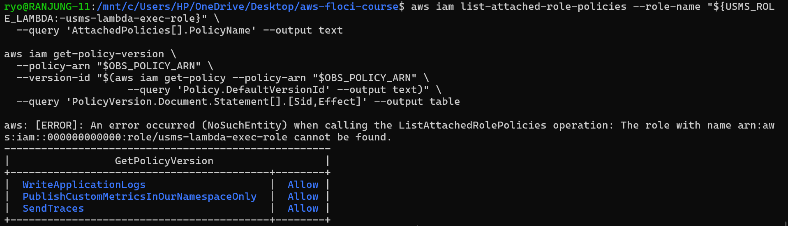

### Step 13: Instrument the notifier

The new `notifier.py` adds a `TranscriptsProcessed` metric, a **trace ID on every log line**, a duration metric and a `USMS_SUMMARY` line.

My first deploy used the wrong `COURSE_ROOT`, so the code upload failed but the next commands still ran and **published version 2 with the old code**. Published versions cannot be changed, so I fixed the path, uploaded the code and published **version 3**.

The version table proves by code hash that version 2 has the old code and version 3 the new code.

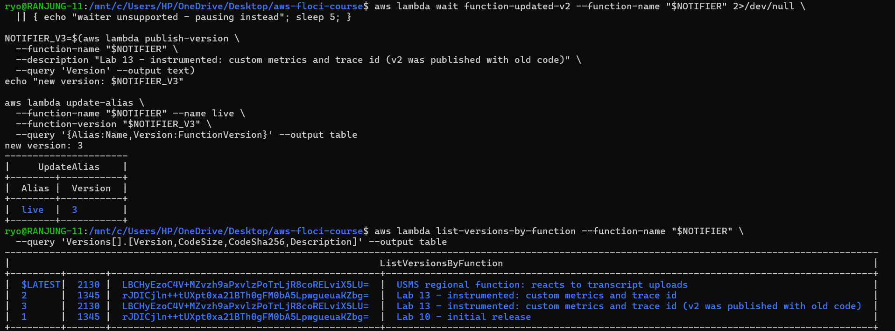

Invoking `live` (version 3) returned a payload with `trace_id` and `seconds`.

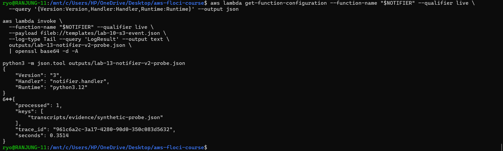

#### Your turn: roll back and roll forward

With `live` on **version 1**, the payload had **no trace_id**. With `live` on **version 3**, it had `trace_id` and `seconds`. Nothing was redeployed and no version was deleted: rollback is just moving the alias.

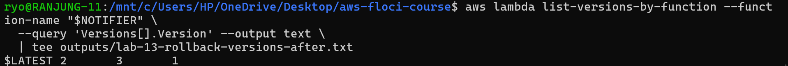

### Step 14: Turn on active tracing

I set tracing to **Active**, published **version 4** and moved `live` to it.

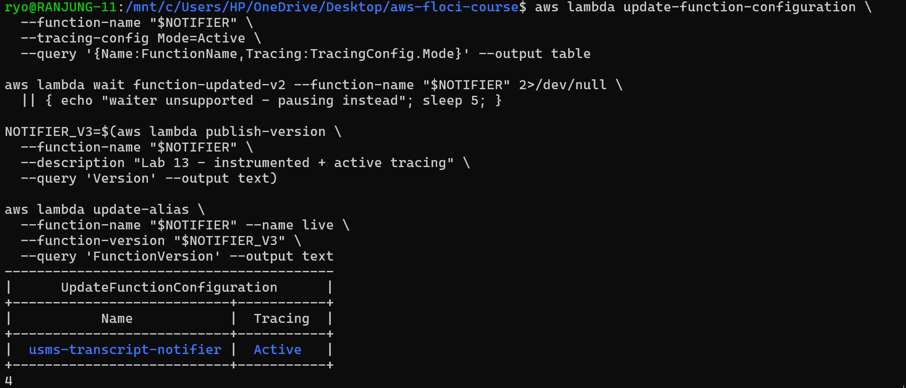

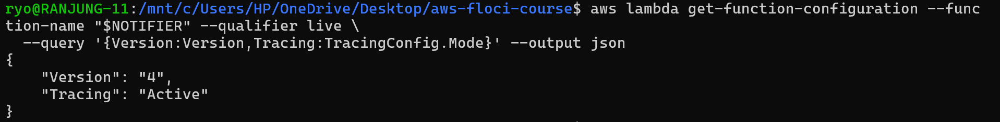

### Step 15: The first X-Ray segment

A **segment** is the record of one service handling one request. I built one for the notifier with a trace ID, a 120 ms time window, annotations (`faculty=science`) and metadata. Sending it failed (no X-Ray on Floci), but a local check passed every rule.

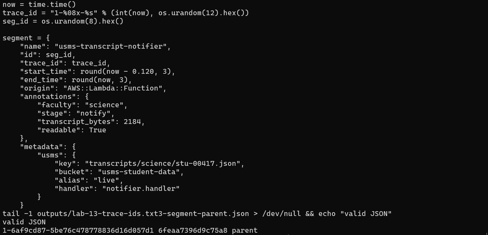

### Step 16: Subsegments and a downstream service

I added three **subsegments** (S3 read, metric publish, notify) and a downstream S3 segment.

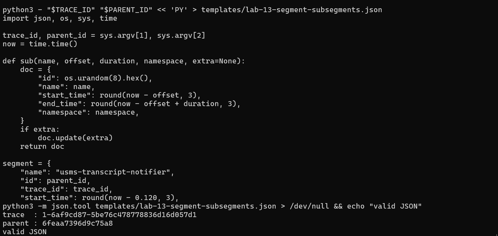

Sending them failed with `UnknownOperationException`.

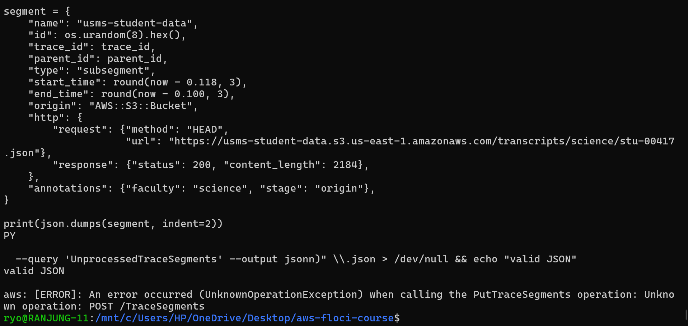

Instead, I searched the notifier logs for one trace ID and found **both lines of that one request**. The log even showed an S3 read error that no metric showed.

A structural check passed all **10** rules with no errors.

### Step 17: Search by annotation and the emitter script

Annotation searches and the service graph are not supported on Floci.

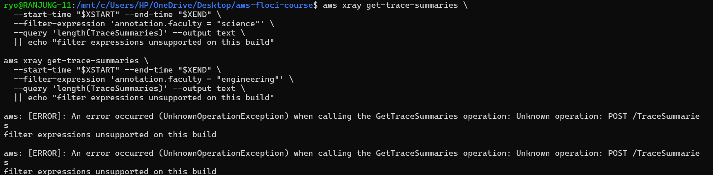

I wrote `usms-emit-telemetry.sh`, which writes one log line, one metric and one trace per run. The metric worked, the trace was skipped, and the log write failed because of the same JSON shorthand problem as Step 7.

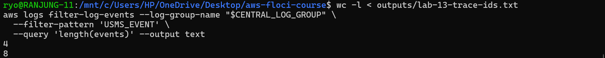

### Step 18: Sampling rule

I wrote `usms-transcripts-sampling`: trace the first **2 requests per second**, then **10%** of the rest. X-Ray is not supported, so the document is the deliverable.

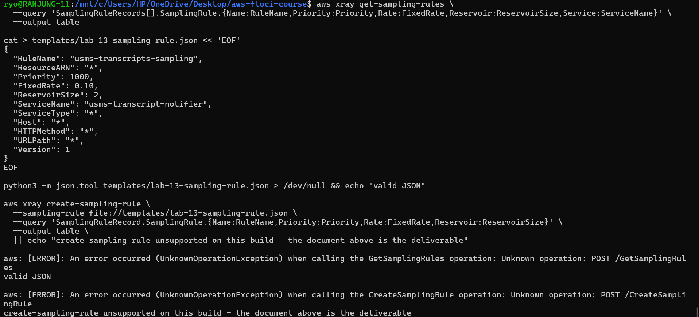

### Step 19: Create two alarms

| Alarm | Rule | Missing data |
|---|---|---|
| `usms-transcript-lag-high` | **Maximum** lag > 2 s in 2 of 3 minutes | `notBreaching` |
| `usms-notify-silence` | Notifications < 1 for 15 minutes | `breaching` |

I used **Maximum** because one slow transcript is what we want to see, and an average hides it. The silence alarm treats no data as **breaching**, because silence is the problem.

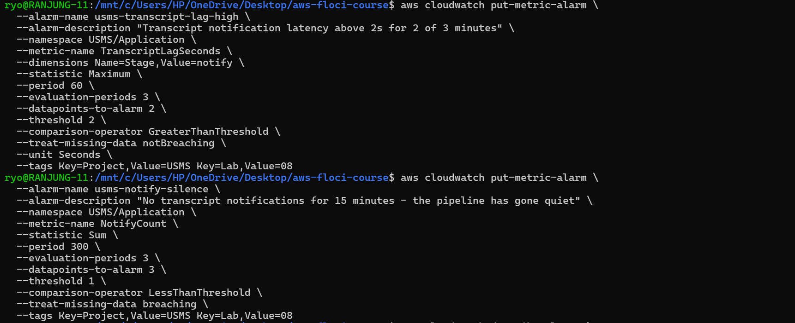

Both alarms exist, but Floci stored the missing-data setting as `None`.

### Step 20: Make an alarm fire

I forced `usms-transcript-lag-high` into **ALARM** with `set-alarm-state`.

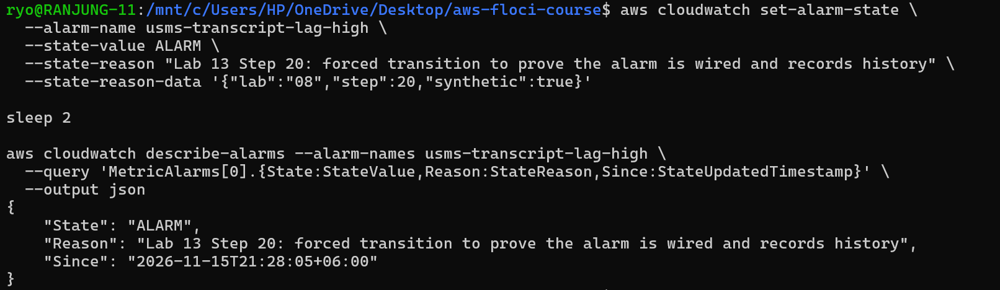

Then I set it back to **OK**.

### Step 21: Composite alarm

The composite alarm `usms-transcript-pipeline-down` fires if **either** child fires, so a person is paged once instead of twice. Floci returned `null` for it, so it is not stored.

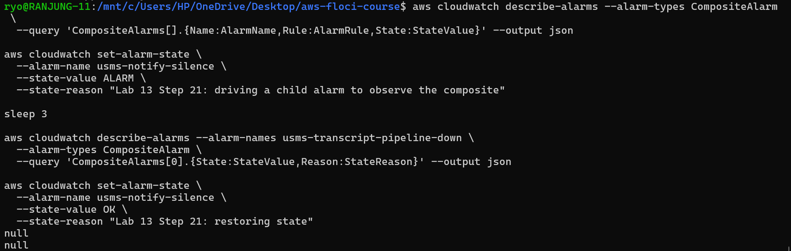

### Step 22: Build the dashboard

`usms-overview` has **5 widgets**: a header, transcripts by faculty, notification latency and alarm states. It was accepted with no validation messages.

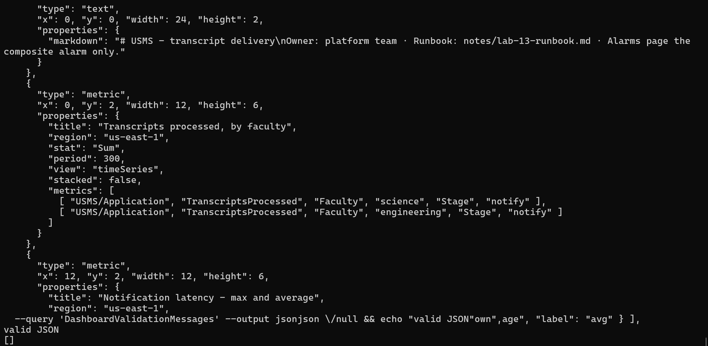

Read back: 5 widgets, grid width 24, no overlaps.

### Step 23: Query the logs

Logs Insights **Failed** on Floci.

Instead, I fetched the `USMS_EVENT` lines and counted them by faculty in Python: **science 6, engineering 2** (double the real numbers, because of my test stream).

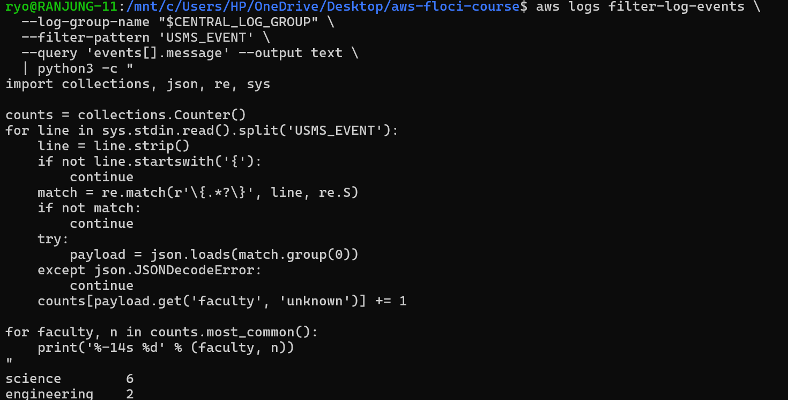

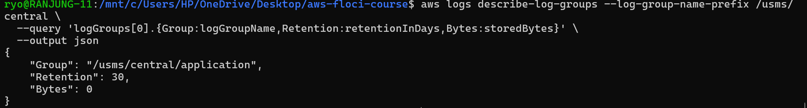

### Step 24: Restart test

I recorded the log groups, metrics, alarms, dashboard and notifier settings.

I restarted Floci.

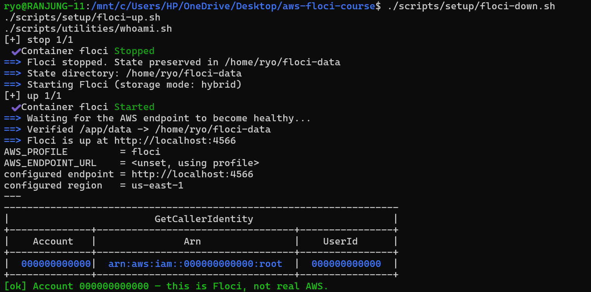

The result: **CONFIGURATION IDENTICAL — every Lab 13 object survived the restart**.

### Step 25: Write configs/lab-13.env

`configs/lab-13.env` has **28 exports**, all populated. Two values should be corrected by hand: the instrumented version is **3**, not 2, and the central stream name is my test stream.

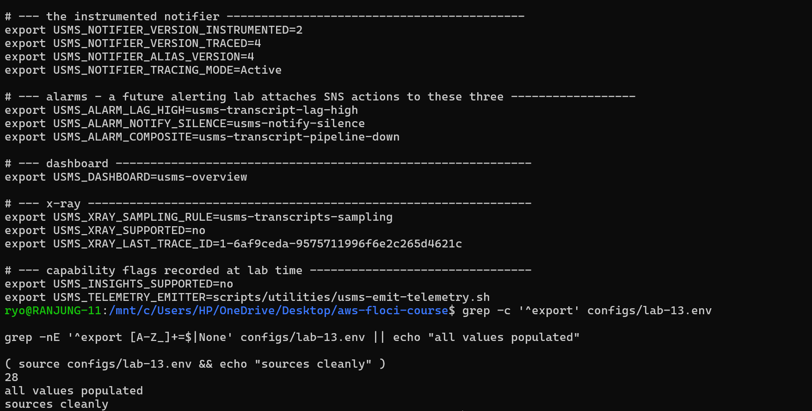

### Step 26: Commit

`git status` showed the new Lab 13 files, and `outputs/` is ignored. Older labs also had modified files, so the Lab 13 commit must add files by name.

At the time of the screenshot, the last commit was still Lab 12.

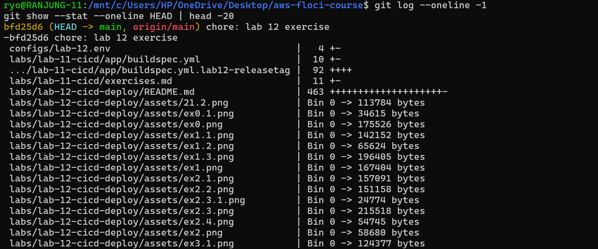

## 6. Verification

I ran `scripts/utilities/verify-lab-13.sh`, which checks logs, metric filters, metrics, IAM, the notifier, alarms, the dashboard, the X-Ray documents and Git hygiene. The result was **PASS=38, FAIL=11**.

The **passes** include: retention on every USMS group, metrics with dimensions, the scoped policy, the notifier on version 4 with tracing Active, both alarms, the dashboard, valid X-Ray documents and no secrets in Git.

The **failures** come from:

- **Floci limits (7):** metric filters (3), missing-data setting (2) and composite alarm (2).
- **The check script (3):** it passes role ARNs as names (2), and its query misses the no-dimension total that does exist (1).
- **Not confirmed (1):** an "alarm stuck in ALARM" check, although both alarms were OK.

## 7. Analysis and Discussion

### 7.1 What was achieved

- Every USMS log group now has a **retention** period, and the central log group exists.
- Structured log events and a safe error pattern (`"transcript.failed"`) were designed.
- Custom metrics with **dimensions** and a total were published in `USMS/Application`.
- A least-privilege **telemetry policy** was attached to the Lambda and EC2 roles.
- The notifier was **instrumented** and moved to version 4 with **active tracing**.
- X-Ray segment and sampling documents were written and validated.
- Two alarms and a five-widget **dashboard** were created, and an alarm was made to fire.
- Everything survived a restart, and the verification passed **38 of 49** checks.

### 7.2 Observations

- **Retention is the cheapest fix.** Six of seven groups were keeping logs forever.
- **A word matches anywhere.** Matching the event name is safer than matching `ERROR`.
- **"No data" is a decision.** The same missing data means "fine" for one alarm and "problem" for another.
- **Each dimension set is its own metric**, so the total must be published separately.
- **Test data pollutes real counts.** My test streams doubled some numbers.
- **A trace ID in logs is useful even without X-Ray.** One search showed the full story of one request.
- **Rollback is a pointer move.** Moving the alias changed the running code in seconds.
- **Floci limits.** No metric filters, Logs Insights, composite alarms or X-Ray.

## 8. Reflection

### What I learned about observability

Before this lab I thought monitoring meant "look at the logs when something breaks". Now I see three tools for three questions: **logs** say what happened, **metrics** say how much and how fast (and alarms watch them), and **traces** say where the time went. The trace ID joins them together. Because so much was missing on Floci, I had to understand what each feature really does to rebuild it from smaller parts: a metric filter is just "count matching lines and publish the count".

### Challenges I faced

My most expensive mistakes were about the shell, not AWS: JSON in the CLI short syntax, an ARN where a name was needed, and a wrong `COURSE_ROOT` that published a version with old code. That last one taught me that a published version is permanent, and that the alias is what makes a mistake harmless, because I could just point `live` at the right version. I also learned to keep test data out of real log groups.

## 9. Conclusion

In this lab I built the observability layer for the USMS transcript pipeline. All objectives were achieved where Floci allowed: I set retention on every log group, wrote structured logs and designed filter patterns, published custom metrics, created a scoped telemetry policy, instrumented the notifier with active tracing, wrote X-Ray documents, created alarms and built a dashboard. Where Floci had no support (metric filters, Logs Insights, composite alarms and X-Ray), I used the closest replacement and said so clearly. Everything survived a restart, and the verification passed **38 of 49** checks, with every failure explained.

The key concepts I learned are logs, metrics and traces, retention, metric filters, dimensions, missing-data handling, trace IDs and sampling. Observability is important because it lets the team find and fix problems before students notice them, and answer "did my transcript go out?" with evidence.
