# Lab 13 Exercises

This file has two parts:

- **Part A:** the four "Your turn" tasks from inside the lab steps.
- **Part B:** the five Independent Lab Exercises from Section 12.

All tasks were done with the AWS CLI on Floci, from `/mnt/c/Users/HP/OneDrive/Desktop/aws-floci-course` in WSL. This Floci build does not support `test-metric-filter`, `put-metric-filter`, composite alarms or any X-Ray API (see `outputs/lab-13-support-probe.txt`). Wherever a task asked for one of those, I used the closest supported call and say so.

# Part A: "Your turn" tasks

| Task | Step | Result |
|---|---|---|
| 1. A fifth event no filter should match | 7 | `health-check ok status=200 path=/healthz` written; `rejectedLogEventsInfo` **null**; stream returns **5** rows |
| 2. Design the error pattern | 8 | `"transcript.failed"` matches **1 of 4**; bare `ERROR` rejected for production |
| 3. Show that `defaultValue` matters | 10 | Window before upload: **empty** `Datapoints`; window with upload: Sum 4.0 and 6.0 |
| 4. Roll back, confirm, roll forward | 13 | Same alias ARN: v1 has **no** `trace_id`, v3 has one; no version deleted |

---

## 1. Step 7: a fifth event that no filter should match

I wrote one more event to the Step 7 stream, one second after the last one, with neither `USMS_EVENT` nor `ERROR` in it:

```bash
aws logs put-log-events --log-group-name "$CENTRAL_LOG_GROUP" --log-stream-name "$STREAM" \
  --log-events timestamp=$((NOW_MS+1000)),message='health-check ok status=200 path=/healthz' \
  --query 'rejectedLogEventsInfo' --output json
```

- `rejectedLogEventsInfo` was **`null`**: nothing was too old, too new or out of order.
- `filter-log-events --log-stream-names "$STREAM" --query 'length(events)'` returned **5**.
- The fifth message is `health-check ok status=200 path=/healthz`.

This line is the negative case for Step 9. A correct `USMS_NOTIFY` or error filter must count it as nothing. If a filter ever counts it, the pattern is too broad.

The fifth event (a health-check line) is accepted; `rejectedLogEventsInfo` is `null`:

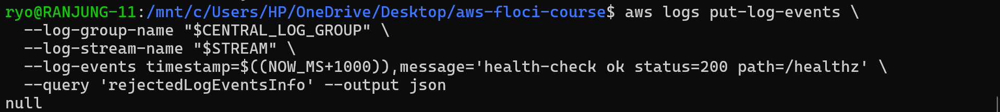

The stream now returns 5 events:

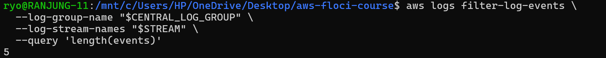

The fifth message is `health-check ok status=200 path=/healthz`:

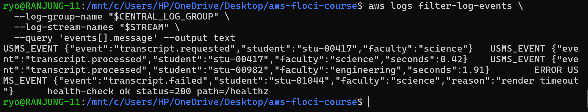

---

## 2. Step 8: design the error pattern, and the false positive

**Method.** `test-metric-filter` returns `UnsupportedOperation` on this build, so I tested each pattern with `filter-log-events`, which uses the same pattern syntax. I put the four Step 7 lines in stream `err-design-step7-…` and the false-positive line `USMS_EVENT {"event":"transcript.processed","reason":"no ERROR here"}` in stream `err-design-fp-…`.

**Results** (`outputs/lab-13-error-pattern-design.txt`):

| Pattern | Step 7 lines (want exactly 1) | False-positive line |
|---|---|---|
| `ERROR` | 1 | 0 |
| `"ERROR USMS_EVENT"` | **0** | 0 |
| `"transcript.failed"` | **1** | 0 |

Creating the two scratch streams and writing the Step 7 lines:

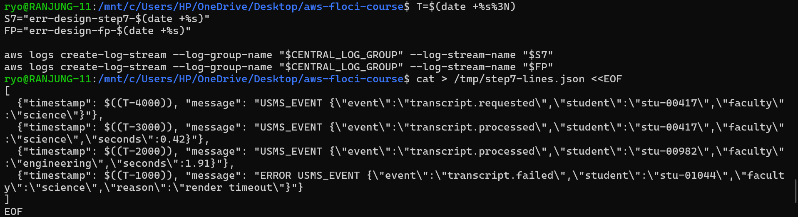

The match counts for the three candidate patterns:

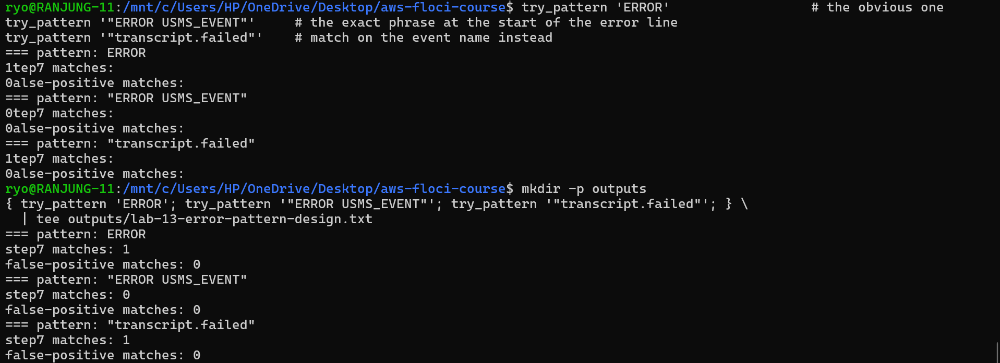

**My pattern: `"transcript.failed"`.** It matches exactly one of the four Step 7 lines (the `ERROR USMS_EVENT {"event":"transcript.failed",...}` line) and none of the three successful ones.

**What the false-positive line did: an honest note.** On this build, the false-positive stream returned **0 for every pattern, including bare `ERROR`**. Taken at face value that says bare `ERROR` is safe, but I do not trust it:

- In real CloudWatch Logs, a bare term matches the term **anywhere in the message**, case-sensitively. `"reason":"no ERROR here"` contains `ERROR`, so bare `ERROR` **would count this line as an error**. That is the false positive the task is warning about.
- The same line also did not appear in my Step 23 faculty count of all `USMS_EVENT` lines, although it starts with `USMS_EVENT`. So either Floci's matching differs from AWS here, or the event was never written to the stream. I could not tell which from my output.
- Floci's phrase matching also differs from AWS: `"ERROR USMS_EVENT"` matched **0** lines, although the real error line starts with exactly that phrase.

**Would I accept it in production?**

- **Bare `ERROR`: no.** It counts any line where a user-supplied field (a reason, a file name, a student comment) happens to contain the word, so the error count, and any alarm on it, would be wrong without anyone noticing. The lab's Step 9 filter `usms-central-errors` uses exactly this pattern, which I would change.
- **`"transcript.failed"`: yes, with one condition.** It matches what *happened* instead of a word that can appear in data. Its weakness is that a free-text field containing `transcript.failed` would still match, and renaming the event would silently break the count. The better long-term fix is to log **pure JSON** (no text prefix), so the filter can match a field, `{ $.event = "transcript.failed" }`, instead of searching text.

---

## 3. Step 10: show that `defaultValue` is doing something

I asked for `NotifyCount` with a period of 300 over two 15-minute windows (`outputs/lab-13-defaultvalue-windows.txt`):

| Window | Result |
|---|---|
| A: 15 minutes ending 24 hours ago (before any upload today) | `"Datapoints": []` |
| B: the last 15 minutes (includes the upload) | Sum **4.0** at 21:00, Sum **6.0** at 21:05 |

Window A (before the upload) returns an empty list; window B (with the upload) returns Sum 4.0 and 6.0:

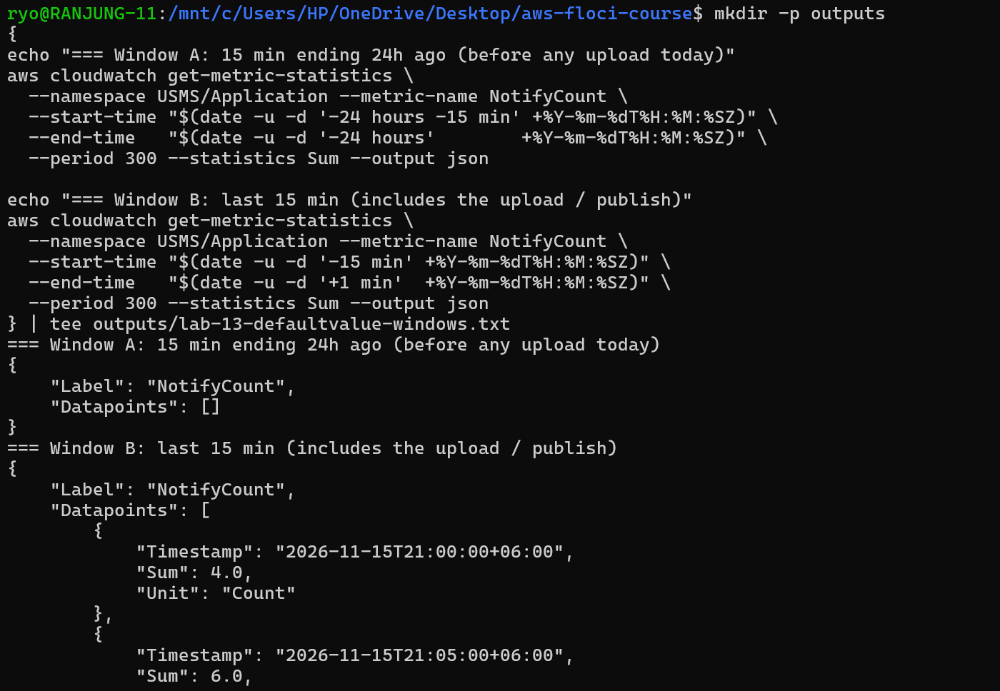

**Note:** an **empty `Datapoints` list** means CloudWatch holds no data at all for that window, while a **list of zeroes** means a metric filter with `defaultValue=0` saw log events arrive and none of them matched. My build produced the **empty list**, because `PutMetricFilter` is unsupported on Floci, so `defaultValue=0` was never in effect, and the only `NotifyCount` datapoints are the ones I published by hand with `put-metric-data`.

Even on real AWS, `defaultValue` only writes zeroes for periods in which *some* log event was ingested, so a window with no log activity at all would still come back empty. For the `usms-notify-silence` alarm this difference matters: an empty list is "missing data", which is why that alarm needs `treat-missing-data breaching`.

---

## 4. Step 13: roll back, confirm, roll forward again

**Why my numbers differ from the task.** The task expects the instrumented code in version 2. In my build, the first deploy block failed to upload the zip (`COURSE_ROOT` pointed to `$HOME/aws-floci-course`) but still published, so **version 2 holds the old Lab 10 code** and the instrumented code is in **version 3**. The `CodeSha256` values prove it: versions 1 and 2 are both `rJDICjln…`, and version 3 and `$LATEST` are both `LBCHyEzo…`. So I rolled forward to **3**.

**Two invocations of the same alias ARN** (`LIVE_ARN`, from `get-alias --name live`), with the same S3 test event:

| `live` points at | `ExecutedVersion` | Returned payload |
|---|---|---|
| version **1** | 1 | `{"processed": 1, "keys": ["transcripts/evidence/synthetic-probe.json"]}`: **no `trace_id`** |
| version **3** | 3 | `{"processed": 1, "keys": [...], "trace_id": "386ae747-efda-4b2e-a5a9-10b2888aa015", "seconds": 0.3134}` |

The ARN did not change, but the shape of the payload did, because the alias is just a pointer to a version.

**No version was deleted.** `list-versions-by-function` returned `$LATEST 2 3 1` before the rollback (`outputs/lab-13-rollback-versions-before.txt`) and after the roll-forward (`outputs/lab-13-rollback-versions-after.txt`). The task's expected list is `$LATEST, 1, 2`; mine also has 3 for the reason above.

Rolling `live` back to version 1: the payload has no `trace_id`:

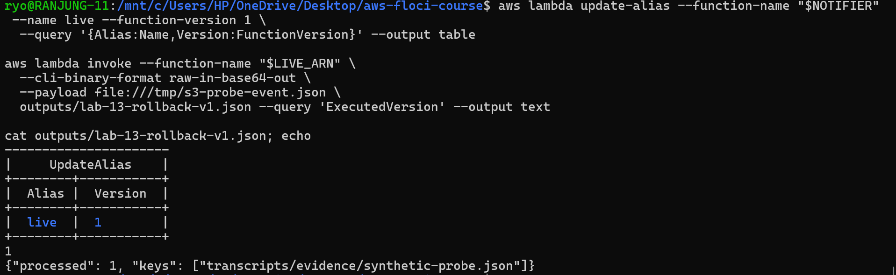

Rolling `live` forward to version 3: the payload has `trace_id` and `seconds`:

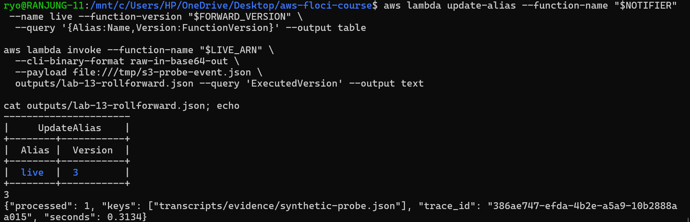

The version list still shows `$LATEST 2 3 1`; nothing was deleted:

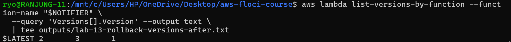

**Rollback time compared with Lab 10.** A real rollback of this deployment is one `update-alias` call that takes effect for the next invocation within seconds, with nothing rebuilt or redeployed, whereas the Lambda@Edge rollback described in Lab 10 Step 11 means changing the CloudFront distribution to an older function version ARN and waiting for that change to propagate to every edge location, which takes minutes rather than seconds.

---

## Summary

The four tasks each tested one idea from the lab. The health-check line gave the filters a negative case. The error-pattern task showed that matching a **word** is not the same as matching an **event**: I chose `"transcript.failed"`, rejected bare `ERROR` for production, and recorded that Floci's matching results for the false-positive line cannot be trusted. The `defaultValue` task showed the difference between "no data" (my build) and "zero" (a real metric filter), which is exactly what an absence alarm depends on. The rollback task showed that an alias makes rollback a pointer move of a few seconds, and that published versions are permanent, including the version 2 I published with the wrong code by mistake.

---

# Part B: Independent Lab Exercises

To avoid the copy-paste problems I had during the lab (shorthand JSON, broken heredocs), I put each exercise into its own script under `scripts/utilities/` and ran it with one command. Every result below comes from those scripts' output files in `outputs/`.

| Exercise | Script / file | Result in one line |
|---|---|---|
| 1. Extract a value instead of counting | `lab-13-ex1-seconds-filter.sh` | Filter designed with `metricValue=$seconds`; Floci rejected it, so I extracted the values myself: **4 sent, 4 read back** (0.37 to 2.75 s) |
| 2. Portable dashboard + sixth widget | `usms-build-dashboard.sh` | Dashboard generated from config: **6 widgets, no overlaps, no validation messages**, no typed account id |
| 3. Are these thresholds defensible? | `usms-threshold-report.sh` | Valid JSON for 3 alarms; **2 of 3 thresholds were never breached** |
| 4. Observability plan | `notes/lab-13-observability-plan.md` | Written: layers, log groups, SLIs, alarms, cost, what not to build |
| 5. Alarms ready for the alerting lab | `lab-13-ex5-alerting.sh` | Draft written and **not applied**; validation found **1 mismatch**; max latency **2.75 s** |

---

## Exercise 1 (Basic): extract a value instead of counting events

**The goal.** My Step 9 filters only *count* lines (`metricValue=1`). This exercise asks for a filter that reads a **number out of the log line** and publishes that number. The new filter is `usms-transcript-seconds` on `/usms/central/application`, publishing `TranscriptSecondsFromLogs` in `USMS/Application`.

**The problem with my log format.** My lines look like `USMS_EVENT {"event":...,"seconds":0.51}`. Because of the `USMS_EVENT` text in front, the line is not pure JSON, so CloudWatch's JSON filter style (`{ $.seconds = ... }`) cannot be used. I had two choices: use the **space-delimited** filter style, or change the log format. I did both:

- I changed `usms-emit-telemetry.sh` so each line ends with the seconds as a separate word:
  `USMS_EVENT {"event":"transcript.processed","faculty":"science","seconds":0.37,...} 0.37`
- The JSON is written without spaces, so the line has exactly **three words**. The pattern `[tag="USMS_EVENT", payload, seconds]` names them, and the filter publishes `metricValue=$seconds`.
- While editing the emitter, I also fixed its Step 17 bug: it now sends the log event from a JSON file instead of CLI shorthand, so `log ok` finally prints.

**What it cost.** The seconds value now appears twice in every line (inside the JSON and at the end). The pattern also depends on word **position**: if someone adds a space inside the JSON, or a fourth word, the filter silently stops matching. Older lines with only two words are not counted at all.

**What happened.** As required, I ran `test-metric-filter` first, but Floci answered `UnsupportedOperation`. `put-metric-filter` was rejected in the same way, so **no filter was created**. The script then did the filter's job itself:

1. It ran the emitter 4 times with known values: science 0.37, engineering 1.20, science 2.75, engineering 0.88. All four printed `log ok` and `metric ok`.
2. It read the new log lines and applied the same 3-word rule: **4 values extracted** (0.37, 1.20, 2.75, 0.88).
3. It published them as `TranscriptSecondsFromLogs` with each line's own timestamp.

Reading the metric back gave exactly what I sent:

| SampleCount | Sum | Minimum | Maximum |
|---|---|---|---|
| 4 | 5.2 | 0.37 | 2.75 |

I did not change `usms-central-errors` or `CentralErrorCount`; `CentralErrorCount` still exists (count `1`). The full output is in `outputs/lab-13-ex1-seconds-filter.txt`.

The whole Exercise 1 run: the two Floci errors, the four emitter runs, the four extracted values and the read-back:

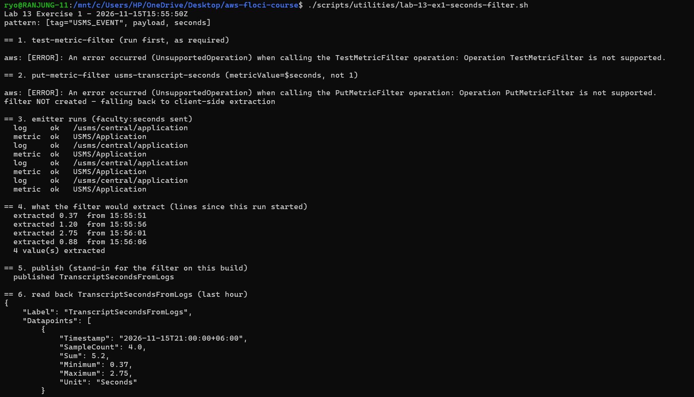

**Comparison with `TranscriptLagSeconds` (Step 11).** Both metrics measure the same thing, but in different ways:

| | `TranscriptLagSeconds` | `TranscriptSecondsFromLogs` |
|---|---|---|
| Who creates it | the code calls `put-metric-data` | CloudWatch, from the log line |
| Needs IAM permission in the app | yes (`PutMetricData`) | no |
| Breaks if... | the code forgets to publish | the log format changes |
| Has dimensions (`Stage`) | yes | no |

**Which I would keep: `TranscriptLagSeconds`.** It is published on purpose, has the `Stage` dimension the lag alarm needs, and does not depend on the position of words in a log line. The log-based metric is useful when you **cannot change the code**, for example a third-party service that only writes logs.

---

## Exercise 2 (Intermediate): make the dashboard portable and add a widget

**The goal.** My Step 22 dashboard had the account id `000000000000` and the region `us-east-1` typed directly into it. That only works in one account. The exercise asks for a generator that fills these in from the config files, plus a sixth widget for `CentralErrorCount`.

**What I did:**

- `scripts/utilities/usms-build-dashboard.sh` reads `USMS_ACCOUNT_ID` from `configs/lab-01.env` and `AWS_REGION_COURSE` from `configs/course.env`, then writes `templates/lab-13-dashboard.json` with an unquoted heredoc (the same method as Step 25). It can be re-run at any time.
- **Sixth widget:** "Central errors - last 3 hours", full width at `y=12` (below the existing widgets, which end at `y=12`), showing `CentralErrorCount` with `"start": "-PT3H"`. There is no error alarm yet, so the horizontal line is labelled **"proposed error alarm threshold (no alarm yet)"** at value 1.
- After `put-dashboard`, the script checks that the validation list is empty, there are 6 widgets, and **no two widgets overlap**. It compares every pair of widgets, not only neighbours.
- I changed the check in `verify-lab-13.sh` from "dashboard has 5 widgets" to **6**.

**Result.** I ran `./scripts/utilities/usms-build-dashboard.sh` and every check passed:

| Check | Result |
|---|---|
| Generated file is valid JSON | **valid JSON** |
| Variables left unfilled (`$` signs) | **0** |
| Account id typed into the generator | **none** (*"no literal account id in the generator"*) |
| `put-dashboard` validation messages | **`[]`** (empty) |
| Widgets read back | **6** |
| Grid width | **24** |
| Any two widgets overlapping | **False** |
| Widget 6 | **Central errors - last 3 hours** |

The generated `templates/lab-13-dashboard.json` still shows `us-east-1` and `000000000000`, but now those values come from the config files when the script runs. To move the dashboard to another account or region, I only change `configs/lab-01.env` or `configs/course.env` and run the script again.

The generator run: valid JSON, no unfilled variables, no typed account id, empty validation list, then the read-back with 6 widgets and no overlaps:

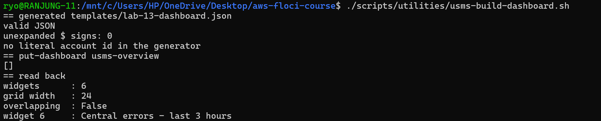

**Why a hard-coded widget count is useful and annoying.** It is **useful** because it catches a widget that was deleted by accident or a dashboard that was never updated. It is **annoying** because every planned change (like this exercise) breaks the check until someone also edits the verify script. The number is a copy of a design decision kept in a second place.

---

## Exercise 3 (Problem solving): are these thresholds defensible?

**The goal.** Write `scripts/utilities/usms-threshold-report.sh`, which looks at every alarm whose name starts with `usms-` and compares the alarm's threshold with what the metric **actually did** in the last 24 hours.

**How the script works:**

- One `describe-alarms` call gets every `usms-` alarm. Nothing is hard-coded: no alarm names and no metric names.
- For each alarm, it asks `get-metric-statistics` for **the alarm's exact metric and dimensions** over 24 hours.
- The JSON is built in `python3`, not by joining strings in bash. Only JSON goes to stdout; messages go to stderr.
- It is safe with `set -u` when an alarm has no dimensions or no data, and it works from any directory (`${BASH_SOURCE[0]}`).
- A composite alarm gets a row with `null` in the metric fields.

**Result** (`outputs/lab-13-threshold-report.json`, valid JSON, **3** alarms):

| Alarm | Rule | Observed in 24 h | Ever breached? |
|---|---|---|---|
| `usms-transcript-lag-high` | Maximum > 2 s | min 0.31, avg 1.02, **max 2.75**, 8 samples | **true** |
| `usms-notify-silence` | Sum < 1 | min 4, max 6, 2 samples | **false** |
| `usms-enrolment-queue-high` (Lab 06) | Average ≥ 100 | **no data at all** | **false** |

The script's messages on stderr (*"usms-enrolment-queue-high: no datapoints in the last 24 h"*, *"3 alarm(s) reported"*) and the start of the JSON report:

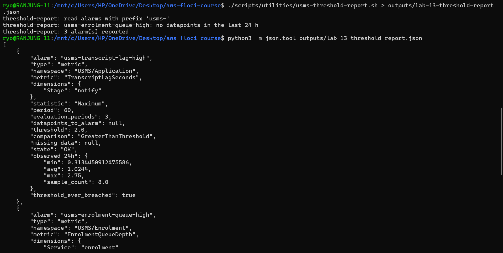

**What this tells me:**

- **`usms-enrolment-queue-high` has never been close.** Its metric has **no data at all**, so the threshold of 100 has never been tested against anything real. Nobody can say whether 100 is the right number. This is the finding the exercise expected.
- **`usms-transcript-lag-high` did cross 2 s**, but only because of my own synthetic test value (2.75 s from the emitter). With only 8 samples, all made by me, this proves the alarm *can* fire, not that 2 s is the right threshold for real traffic.
- **`usms-notify-silence` was never breached by a value.** It can only fire on *missing* data, which is exactly its design.
- **Floci details:** there is no composite alarm row, because Floci did not keep `usms-transcript-pipeline-down`. `missing_data` and `datapoints_to_alarm` came back `null`, because Floci did not store them (the same problem as in Step 19 of the main lab).

---

## Exercise 4 (Challenge): design the USMS observability plan

The plan is written in **`notes/lab-13-observability-plan.md`**. It contains no commands. Its main points in short:

1. **Right layer for each complaint:**
   - outage noticed too late → **metrics** with an absence alarm
   - could not find the failing layer → **traces**
   - March audit question → **logs**, in an audit log group
   - cost → metric **cardinality** and log **retention**
2. **Log groups:**
   - The longest retention is a new audit group `/usms/audit/transcript-access` (**400 days**, readable only by the registrar and auditors).
   - The shortest is a new `/usms/test/*` group (**1 day**), because my scratch streams in the central group doubled the counts in this lab.
   - The 400 days is my assumption and must be checked with the registrar.
3. **Three SLIs:**
   - delivery freshness → **alarm**
   - notification latency → **alarm**
   - success ratio → **graph only**, because one failure in a quiet hour would swing a ratio and page someone for nothing.
4. **Alarms:** `usms-notify-silence` is the one that would have caught the six-hour outage. During an outage **no numbers are published at all**, so a value threshold has nothing to compare. Only "missing data = breaching" turns silence into an alarm.
5. **Cost:** tens of dollars a month at USMS volume. The two biggest levers are retention and dimension cardinality (`Faculty` ~6 values, `Stage` 2 values, and `StudentId` **never** used as a dimension). The prices still have to be checked on the AWS pricing page.
6. **Not built yet:** per-student metrics. I would change my mind only if the registrar repeatedly needs answers faster than a log query can give them.

---

## Exercise 5 (Integration): leave alarms the next alerting lab can attach to

**The goal.** Prepare everything the next lab (alerting with SNS) will need, **without** changing any alarm yet.

**1. The draft** (`outputs/lab-13-alarm-actions-draft.json`) lists each alarm with its meaning, its urgency and a placeholder SNS topic:

| Alarm | Meaning | Urgency | Placeholder topic |
|---|---|---|---|
| `usms-transcript-pipeline-down` | pipeline lagging OR silent | **page** | `usms-oncall-page` |
| `usms-transcript-lag-high` | a notification took > 2 s | ticket | `usms-platform-tickets` |
| `usms-notify-silence` | no notifications for 15 min | ticket | `usms-platform-tickets` |

The ARNs look like `arn:aws:sns:us-east-1:000000000000:usms-oncall-page`, but the script builds the account id from `configs/lab-01.env`. It is not typed anywhere.

**2. Validation: `FAIL - 1 mismatch(es): alarm does not exist: usms-transcript-pipeline-down`.** Every ARN is well formed (six colon-separated parts, 12-digit account). The one mismatch is real: Floci never kept the composite alarm (see Step 21 of the main lab). As the exercise says, I **report** this and do not fix it silently.

**3. Not applied.** `AlarmActions` is **0** on both `usms-transcript-lag-high` and `usms-notify-silence`. That matters because `put-metric-alarm --alarm-actions` would replace the whole alarm definition.

**4. Latency baseline.** The emitter ran **6 more times** with mixed faculties and latencies (0.44, 1.35, 0.92, 2.60, 1.71, 0.58 s), all with `log ok` and `metric ok`. `outputs/lab-13-latency-baseline.json` holds the real observations for `TranscriptLagSeconds` (Stage=notify) over the last hour: **14 samples, minimum 0.31 s, average 1.13 s, maximum 2.75 s**.

**5. Readiness report.** `outputs/lab-13-alerting-readiness.txt` is generated by the script, never typed:

| Item | Value |
|---|---|
| Alarms and missing-data policy | `usms-transcript-lag-high` None, OK; `usms-notify-silence` None, **ALARM** |
| Composite rule | None (not kept by Floci) |
| Namespace | `USMS/Application` |
| Metrics | `CentralErrorCount`, `EdgeDenyCount`, `NotifyCount`, `TranscriptLagSeconds`, `TranscriptSecondsFromLogs`, `TranscriptsProcessed` |
| Notifier | `live` → version **4**, tracing **Active** |
| X-Ray / Insights on this build | no / no |
| Draft validation | FAIL - 1 mismatch (composite missing) |
| Observed maximum latency | **2.75 s** |

The readiness file is **git-ignored**: `git check-ignore -v` answers `.gitignore:35:outputs/*`, so it stays out of the repository.

The Exercise 5 run: draft written, validation result, empty alarm actions, six emitter runs and the start of the readiness report:

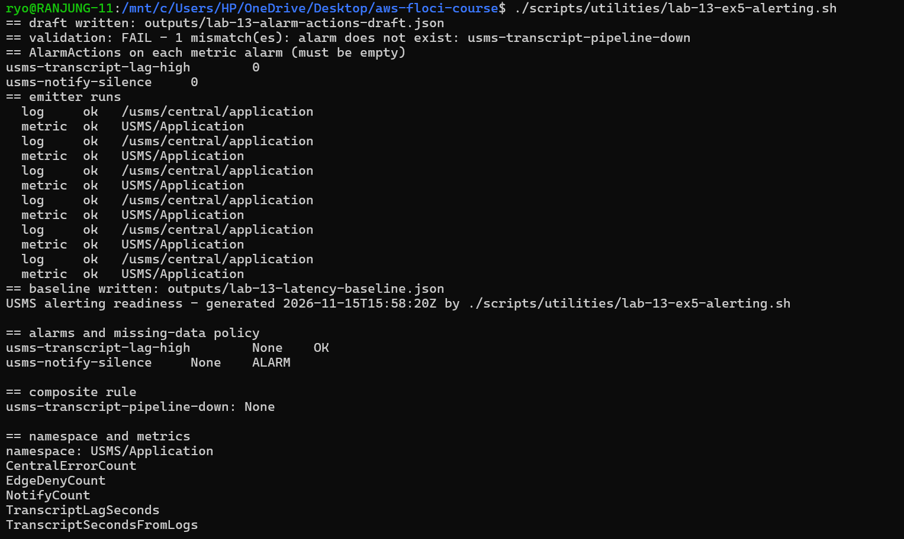

**Notes:**

- `usms-notify-silence` is now in **ALARM**. That is the alarm doing its job: when notifications stop arriving, missing data counts as breaching. Before the next lab, I should set it back to OK, or send a notification, so the verify check "no alarm left stuck in ALARM" can pass.
- The verify script will still not reach `PASS=49 FAIL=0` on Floci. The metric-filter, missing-data and composite-alarm checks cannot pass on this build, as explained in Section 6 of the README.

---

## Summary of Part B

- **Exercise 1:** a metric can be **extracted from a log line**, not only counted. It worked end to end (4 values in, the same 4 values out), but only because I did the filter's job myself, and it depends on the log format staying exactly the same.
- **Exercise 2:** the dashboard is now **generated** from the config files instead of typed by hand. It has six widgets, no overlaps and no validation messages, so it can be rebuilt in any account by running one script.
- **Exercise 3:** the most useful result. One alarm (`usms-enrolment-queue-high`) has **no data at all**, so its threshold has never been tested, and the only breach of the lag alarm came from my own test value.
- **Exercise 4:** the bigger lesson. Each complaint belongs to one layer (metrics, traces or logs), and the outage would only have been caught by an alarm that treats **silence** as a failure.
- **Exercise 5:** left the next lab a validated, **unapplied** draft, a real latency baseline (max 2.75 s), and an honest record that the composite alarm does not exist on this build.
